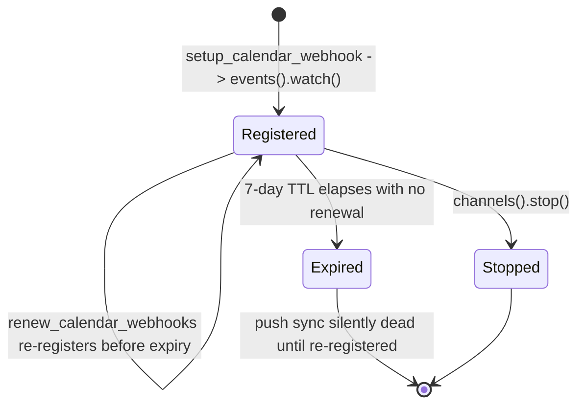

# Integration Architecture - Personal Management System

This document defines the architecture for external service integrations including Google Contacts, Immich, Strava, Firefly III, and communication platforms.


## Overview

The integration architecture uses an **Isolated Worker Architecture** pattern that provides dependency isolation while maintaining operational simplicity for self-hosted deployment.

### Core Principles

- **Dependency Isolation**: Each integration has isolated dependencies to prevent conflicts
- **Process Isolation**: Background workers can crash/restart independently
- **Domain Separation**: Integrations are cleanly separated from core business logic
- **Operational Simplicity**: Minimal additional infrastructure (just Redis)
- **AI-Friendly**: Each integration is self-contained and focused

## Architecture Pattern

### Integration Domain Structure

```
app/core/integrations/
├── shared/
│   ├── __init__.py
│   ├── base_models.py      # Common sync patterns (SyncMetadata — canonical link store)
│   ├── base_service.py     # Common integration logic
│   ├── task_queue.py       # ARQ setup and configuration
│   └── exceptions.py       # Integration-specific exceptions
├── google/
│   ├── __init__.py
│   ├── models.py           # Google-specific sync metadata
│   ├── service.py          # Business logic for Google Contacts sync
│   ├── api_client.py       # Google API wrapper
│   ├── tasks.py            # ARQ task definitions
│   └── README.md           # Integration-specific documentation
├── immich/
│   ├── __init__.py
│   ├── models.py           # Immich-specific models
│   ├── service.py          # Photo and album sync logic
│   ├── api_client.py       # Immich API wrapper
│   ├── tasks.py            # Background sync tasks
│   └── README.md
├── strava/
│   ├── __init__.py
│   ├── models.py           # Activity sync metadata
│   ├── service.py          # Activity to journal entry logic
│   ├── api_client.py       # Strava API wrapper
│   ├── tasks.py            # Activity sync tasks
│   └── README.md
└── firefly_iii/
    ├── __init__.py
    ├── models.py           # Transaction sync metadata
    ├── service.py          # Transaction linking logic
    ├── api_client.py       # Firefly III API wrapper
    ├── tasks.py            # Transaction sync tasks
    └── README.md
```

### Worker Process Structure

```
integration_workers/
├── google/
│   ├── requirements.txt    # Google-specific dependencies
│   ├── worker.py          # ARQ worker process
│   └── Dockerfile         # Optional: for container isolation
├── immich/
│   ├── requirements.txt   # Immich-specific dependencies
│   └── worker.py
├── strava/
│   ├── requirements.txt            # Strava-specific dependencies
│   ├── worker.py                   # ARQ worker process (webhook event + stream consumer)
│   ├── stream_consumer_tasks.py    # Redis Streams consumer (strava-worker group)
│   ├── strava_auth_service.py      # Token encryption/refresh for Strava OAuth
│   ├── strava_settings.py          # Worker-specific Pydantic settings
│   └── Dockerfile                  # Container isolation
└── firefly_iii/
    ├── requirements.txt   # Firefly III-specific dependencies
    └── worker.py
```

## Shared Code Strategy

### Core Shared Package

**Critical Implementation Detail**: All workers and the main application share code through a dedicated `core_shared` Python package.

#### Package Structure
```
core_shared/
├── pyproject.toml          # Minimal dependencies (SQLAlchemy, Pydantic)
├── core_shared/
│   ├── __init__.py
│   ├── models/             # SQLAlchemy models
│   │   ├── __init__.py
│   │   ├── contact.py      # Contact, ContactMethod, etc.
│   │   ├── sync_metadata.py # SyncMetadata (canonical integration link store)
│   │   └── base.py         # Base model classes
│   ├── database/           # Database session management
│   │   ├── __init__.py
│   │   ├── engine.py       # Engine and session factory
│   │   └── connection.py   # Connection pooling patterns
│   └── exceptions/         # Shared exception classes
│       ├── __init__.py
│       └── integration.py  # Integration-specific exceptions
```

#### Installation Pattern
- **Main App**: `pip install -e ../core_shared` in `pyproject.toml`
- **Workers**: `pip install -e ../core_shared` in `requirements.txt`
- **Docker**: Copy and install shared package in all containers

#### Benefits
- **Explicit Boundaries**: Only intentionally shared code is accessible
- **Dependency Safety**: Shared package declares its own minimal dependencies
- **Version Control**: Changes to shared models are explicit and testable
- **Import Safety**: Prevents accidental imports of core services

### Database Connection Management

#### Session-Per-Task Pattern
**Critical for Worker Efficiency**: Each worker uses connection pooling with session-per-task.

```python
# In core_shared/database/engine.py
from sqlalchemy import create_engine
from sqlalchemy.orm import sessionmaker

def create_session_factory(database_url: str):
    engine = create_engine(database_url, pool_size=5, max_overflow=10)
    return sessionmaker(bind=engine)

# In worker.py
from core_shared.database import create_session_factory

session_factory = create_session_factory(DATABASE_URL)

async def sync_task(external_id: str):
    with session_factory() as session:
        # All database operations use this session
        # Session automatically returned to pool on exit
        pass
```

## Core Components

### 1. Shared Models (core_shared package)

The `core_shared` package contains SQLAlchemy models and utilities used across the main application and integration workers.

#### SyncMetadata
Tracks synchronization state between external systems and internal entities:

```python
from core_shared import SyncMetadata, SyncStatus

class SyncMetadata(Base):
    internal_id: Optional[int]     # FK to internal entity (int); null when UUID-keyed
    internal_uuid: Optional[str]   # FK to internal entity (UUID, e.g. Snipe-IT)
    integration_source: str        # 'google', 'immich', etc.
    external_id: str              # External system's ID
    last_synced_at: datetime
    version_hash: str             # SHA-256 hash for change detection
    sync_status: str              # SUCCESS, FAILED, IN_PROGRESS, PENDING
    error_message: Optional[str]  # Last error if failed
    retry_count: int              # Number of retry attempts
    reference_data: Optional[str]      # Link metadata as JSON (e.g. album fields)
    internal_entity_type: Optional[str]  # 'contact', 'journal', 'gear_item'
    external_entity_type: Optional[str]  # 'person', 'album', 'activity'
```

#### Link Storage Consolidation (canonical link store)

Integration entity links were historically tracked in **two overlapping tables** —
`external_references` (read by the backend contact dedup/idempotency paths) and
`sync_metadata` (maintained by every integration worker for change detection,
concurrency and status). Because no writer kept both consistent, Immich-origin
(email-less) contacts could be duplicated when re-imported by Google sync.

`sync_metadata` is now the **single canonical store for all integration entity
links**, absorbing the fields `external_references` uniquely provided
(`reference_data`, and explicit `internal_entity_type` / `external_entity_type`).
**`external_references` has been dropped (Phase 5 complete); `sync_metadata` is the
sole link store.** See
[Iteration 15: Integration Link Consolidation](../tasks/iteration-15-integration-link-consolidation.md)
for the migration history (schema → dual-write + backfill → move reads → stop writing
`external_references` → drop + dedupe).

**Earlier transition state (dual-write).** During Phases 2–3 the consolidation
dual-wrote: every path that wrote `external_references` also wrote the paired
`sync_metadata` link in the same unit of work, so the canonical store stayed complete
and current while reads moved over.

A one-off, idempotent migration
(`0091_backfill_sync_metadata_from_external_references`) backfills rows that predate
dual-write: it upserts the matching `sync_metadata` link for every
`external_references` row (copying `reference_data` and entity types), preserving the
existing `internal_id` / `version_hash` and giving backfilled-only rows
`version_hash = ''` so the next sync re-validates. Where `external_references` holds
duplicate `(external_system, external_entity_id)` rows (which `sync_metadata`'s unique
key disallows), a deterministic winner is chosen and the losers are logged to the
temporary `link_backfill_quarantine` audit table for later reconciliation — nothing is
silently dropped.

**Reads now key on `sync_metadata` (Phase 3 complete).** With dual-write + backfill
guaranteeing the canonical store is complete and current, every integration-link
*reader* resolves links from `sync_metadata` via the shared
`IntegrationLinkRepository` (`find_link_by_external` / `find_internal_by_external` /
`find_external_by_internal`, plus the Immich `get_immich_person_id` /
`get_contact_ids_by_immich_person_ids` helpers):

- The inbound consumer's idempotency (`contact.created`) and contact lookup
  (`contact.updated`) read `sync_metadata`, so a Google re-import of an email-less
  Immich contact resolves the existing link and **updates rather than duplicates** it —
  this is the fix for the duplication loop.
- The contacts external-links API/MCP, the Immich worker's create-vs-update decision and
  outbound link lookup, the album display reads (`reference_data` from `sync_metadata`),
  and the contact-merge collision detection all read `sync_metadata`.

**Writes consolidated onto `sync_metadata` (Phase 4 complete).** The old half of the
dual-write has been removed: every writer now persists the canonical link (plus
`reference_data` and entity types) to `sync_metadata` **only** — nothing writes
`external_references` anymore:

- The inbound contact create/update paths write the link and its `reference_data`
  (`resource_name`/`etag`/`synced_tags`) onto `sync_metadata` (the `synced_tags`/`etag`
  read/write moved here too, via `SyncMetadataRepository.update_reference_data`).
- `SyncMetadataRepository.upsert_contact_link` (manual Immich linking) and
  `repoint_contact_links` (contact merge) operate on `sync_metadata` only.
- `SyncMetadataRepository.repoint_journal_links` does the same for journal merge.
  The table has no `ON DELETE CASCADE`, so a merge must move or remove the
  deleted source's rows rather than leave orphans that still look resolvable.
  Links for a service the target lacks always carry over; on a same-service
  collision the mode decides. An **additive fitness merge** re-points the
  source's row too, so one journal ends up linked to **several** Strava
  activities — the unique key is `(integration_source, external_id)`, not
  `internal_id`, so many rows may share one journal. Any other merge keeps the
  target's link and deletes the source's, as contact merge does. This is why
  the Strava worker resolves journals through `sync_metadata` rather than
  `journal_fitness_data.strava_activity_id`, which holds only one id: see
  [Strava Integration → Fitness merge modes](../journal-system-specification.md#strava-integration).
- The Immich worker's name-match auto-link and merge-cleanup unlink write/delete only
  `sync_metadata`.
- `AlbumSyncReadRepository.upsert_link` is the single writer of the album
  `sync_metadata` row (carrying `version_hash` + `reference_data` + the
  merge-protection anchor on `updated_at`); `find_link` and `delete` key on
  `sync_metadata`. Owning `updated_at` in `upsert_link` (rather than via a separate
  generic upsert that would unconditionally bump it) keeps the anchor meaningful on the
  consolidated store.

**`external_references` dropped (Phase 5 complete).** The table, its indexes, and the
temporary `link_backfill_quarantine` audit table were dropped
(`0093_drop_external_references`) after a data migration
(`0092_dedupe_bug_created_contacts`) merged the bug-created duplicate contacts and
reconciled orphaned links. The `ExternalReference` model, `ExternalReferenceService`
and `ExternalReferenceRepository` are deleted; their live link operations were
relocated to `SyncMetadataRepository` (`upsert_contact_link`, `repoint_contact_links`,
returning `IntegrationLinkCollision`), `IntegrationLinkRepository`
(`find_contact_with_birthday`) and `SqlContactRepository` (`contact_exists`).

### 2. Task Queue System

**Technology**: ARQ (asyncio-based, Redis-backed)
**Infrastructure**: Single Redis container

#### Task Types
- **Sync Tasks**: Periodic synchronization with external services
- **Webhook Tasks**: Process incoming webhooks from external services
- **Cleanup Tasks**: Maintenance and cleanup operations

#### Task Scheduling

Integration workers support three types of task scheduling:

##### 1. Periodic Scheduling (Automated Syncs)
Uses ARQ's `cron_jobs` feature for automatic, scheduled synchronization:

```python
from arq.cron import cron

class GoogleWorkerSettings:
    functions = [sync_google_contacts, push_local_contacts_to_google]

    # Periodic sync configuration
    cron_jobs = [
        # Sync every 6 hours at :00 minutes
        cron(sync_google_contacts, hour={0, 6, 12, 18}, minute=0),

        # Alternative: Daily sync at 2 AM
        # cron(sync_google_contacts, hour=2, minute=0),

        # Alternative: Hourly sync
        # cron(sync_google_contacts, minute=0),
    ]

    # ... other settings ...
```

**Configuration Options:**
- `minute`: 0-59 or set of minutes (e.g., `{0, 15, 30, 45}`)
- `hour`: 0-23 or set of hours (e.g., `{0, 6, 12, 18}`)
- `day`: 1-31 or set of days
- `month`: 1-12 or set of months
- `weekday`: 0-6 (Monday=0) or set of weekdays

**Environment-Based Configuration:**
```python
# In worker settings
import os

class WorkerSettings(BaseSettings):
    sync_interval_hours: int = Field(
        default=6,
        description="Hours between automatic syncs"
    )

class GoogleWorkerSettings:
    # Generate cron schedule from environment variable
    cron_jobs = [
        cron(
            sync_google_contacts,
            hour=set(range(0, 24, settings.sync_interval_hours)),
            minute=0
        )
    ] if os.getenv('ENABLE_PERIODIC_SYNC', 'false').lower() == 'true' else []
```

##### 2. Event-Driven Scheduling
Triggered by domain events from the main application:

```python
# In main application - triggered by user actions
async def on_contact_updated(contact_id: UUID):
    """Push local contact changes to Google."""
    await task_queue.enqueue_job(
        'push_local_contacts_to_google',
        contact_id=contact_id
    )
```

##### 3. Manual Scheduling
User-initiated sync operations via API endpoints:

```python
# In API controller
@router.post("/integrations/google/contacts/sync")
async def trigger_sync(
    user: SessionUser,
    task_queue_service: TaskQueueService
):
    """Manually trigger Google Contacts sync."""
    job_id = await task_queue_service.enqueue_google_sync(
        google_account_email=user.email,
        user_id=user.id,
        sync_type="smart"
    )
    # JSON:API response (camelCase attributes)
    return {
        "data": {
            "id": job_id,
            "type": "sync-job",
            "attributes": {"status": "queued", "syncType": "smart"},
        }
    }
```

#### Non-Blocking Fan-Outs and Reconciliation

Orchestrator (fan-out) jobs split a large sync into many child batch jobs. Rather than
**blocking** on `asyncio.gather(*[job.result()])` — which holds an ARQ worker slot for the whole
fan-out and relies on a brittle hard-coded timeout — orchestrators dispatch their children and
return immediately. Parent completion is decided out-of-band by a shared reconciliation job.

**Data model** (`core_shared/models/sync_job.py`):

- `SyncJobStatus.IN_PROGRESS` — a parent that has dispatched its children and is awaiting them
  (distinct from `RUNNING`, which means a job is actively executing on a worker).
- `sync_jobs.parent_job_id` — self-referencing link from a child to its orchestrator (`NULL` for
  top-level jobs).
- `expected_children`, `completed_children`, `failed_children` — child counters on the parent.

**Non-blocking lifecycle:**

1. The orchestrator enqueues the child jobs, persists each as a `sync_jobs` row linked via
   `parent_job_id`, calls `set_expected_children(...)`, marks itself `IN_PROGRESS`, and returns.
2. Each child, on completion, updates its own row and atomically increments the parent's
   `completed_children` / `failed_children` counter.
3. A periodic **reconciliation job** finalises the parent.

**Reconciliation job** (`core_shared/sync_reconciliation.py`):

`reconcile_in_progress_parents(ctx)` scans every `IN_PROGRESS` parent
(`SyncJobRepository.list_in_progress_parents()`) and transitions each based on the **actual child
rows** (`aggregate_children` is authoritative; the parent's counters are only a fast path, so a
missed increment cannot strand a parent):

- All expected children present and completed → `COMPLETED`.
- Any child failed or was cancelled (fail-if-any policy; a cancelled child is
  terminal-but-unsuccessful) → `FAILED`, with a failure summary on the parent.
- Children that have not progressed within `reconciliation_stale_after_seconds`
  (a `BaseWorkerSettings` field, default 30 min) → `FAILED` (stuck/timeout), rather than left
  `IN_PROGRESS` forever. Staleness is measured from the parent's `updated_at`, which bumps on each
  child counter increment.

The pure decision rules live in `decide_parent_outcome(...)` for unit testing; `reconcile_parents`
drives the repository loop; `reconcile_in_progress_parents` is the ARQ entry point (opens a session,
reconciles, commits). It is a safe no-op when no `IN_PROGRESS` parents exist.

**Scheduling.** Any worker that uses fan-outs registers the reconciler on a frequent cron via the
shared helper, far more often than the hourly periodic-sync cadence:

```python
from core_shared import generate_reconciliation_cron, reconcile_in_progress_parents

class WorkerSettings(SharedARQWorkerSettings, WorkerSettingsBase):
    functions = [reconcile_in_progress_parents, ...]
    # Reconcile in-progress fan-out parents every 5 minutes.
    cron_jobs = generate_reconciliation_cron(reconcile_in_progress_parents)
```

### 3. Integration Services

Each integration implements a common interface:

```python
class BaseIntegrationService(Protocol):
    async def authenticate(self) -> bool
    async def sync_data(self, user_id: UUID) -> SyncResult
    async def handle_webhook(self, payload: dict) -> None
    async def get_sync_status(self, user_id: UUID) -> SyncStatus
```

## Worker Design Patterns

### Mandatory Idempotency

**Critical Requirement**: Every worker task MUST be idempotent to handle retries safely.

#### Idempotency Pattern
```python
async def sync_external_entity(external_id: str, integration_source: str):
    with session_factory() as session:
        # 1. Check if work is already done
        existing = session.query(SyncMetadata).filter_by(
            integration_source=integration_source,
            external_id=external_id
        ).first()

        # 2. Calculate current version hash
        current_hash = calculate_version_hash(external_data)

        # 3. Skip if already synced with same version
        if existing and existing.version_hash == current_hash:
            logger.info(f"Skipping {external_id}, already synced")
            return

        # 4. Perform sync work
        # ... sync logic here ...

        # 5. Update sync metadata
        if existing:
            existing.version_hash = current_hash
            existing.last_synced_at = datetime.utcnow()
        else:
            session.add(SyncMetadata(...))
        session.commit()
```

### Dead Letter Queue (DLQ) Strategy

**Critical for Operational Safety**: Handle persistent task failures without blocking the queue.

#### ARQ Configuration
```python
# In worker.py
from arq import create_pool
from arq.connections import RedisSettings

async def startup(ctx):
    ctx['redis'] = await create_pool(RedisSettings())

async def shutdown(ctx):
    await ctx['redis'].close()

class WorkerSettings:
    functions = [sync_task]
    on_startup = startup
    on_shutdown = shutdown

    # DLQ Configuration
    max_tries = 5                    # Retry failed tasks 5 times
    retry_delay = 60                 # Wait 60 seconds between retries
    keep_result = 3600               # Keep results for 1 hour

    # Failed tasks go to DLQ after max_tries
    job_timeout = 300                # 5 minute timeout per task
```

#### DLQ Monitoring
- Failed tasks after max_tries are moved to `arq:dlq` queue
- Monitor DLQ depth for operational alerts
- Manual inspection and reprocessing of poison pill tasks
- Prevents single bad task from blocking entire integration

## Integration Patterns

### 1. Two-Way Sync (Google Contacts)

**Challenge**: Conflict resolution and data consistency
**Solution**: Last-write-wins with version hashing

**Process**:
1. Fetch all contacts from Google
2. Compare version hashes with stored metadata
3. Determine which side has newer data
4. Update the stale side and record new hash
5. Handle conflicts with user-defined rules

### 2. External Data References (Immich)

**Challenge**: Large binary data should stay external
**Solution**: Store references, not copies

**Process**:
1. Poll Immich for new photos/albums
2. Create Photo entities with external references
3. Link faces to contacts via person matching
4. Store thumbnails and metadata locally

### 3. One-Way Import (Strava, Firefly III)

**Challenge**: Transform external data to internal entities
**Solution**: ETL pattern with deduplication

**Process**:
1. Fetch new data from external service
2. Transform to internal domain entities
3. Check for duplicates using external references
4. Create/update internal entities
5. Record sync metadata

**Journal Integration Example**: Strava activities are imported as journal entries with FITNESS + OUTDOOR_ACTIVITY types. See [Journal System Specification](../journal-system-specification.md) for merge behavior and conflict resolution patterns.

#### Strava Webhook Push Subscription

Strava uses a push subscription model for real-time event delivery. The system implements the full webhook lifecycle:

1. **Subscription Creation**: When a user connects Strava via OAuth, a push subscription is created automatically. A random `verify_token` is generated and stored alongside the subscription ID in `user_strava_auth`.
2. **Validation Handshake**: Strava sends a GET request to `GET /api/integrations/strava/webhook` with `hub.mode`, `hub.challenge`, and `hub.verify_token`. The endpoint validates the token against the stored value and echoes the challenge.
3. **Event Delivery**: Strava sends POST requests to `POST /api/integrations/strava/webhook` for activity create/update/delete events. The endpoint responds 200 immediately (within 2 seconds) and enqueues an ARQ task on the `strava` queue for async processing.
4. **Worker Processing**: The Strava ARQ worker (`integration_workers/strava/worker.py`) picks up enqueued tasks and dispatches them based on `aspect_type` (create/update/delete).
5. **Stream Consumer**: The `StravaWorkerStreamConsumer` registers as the `strava-worker` consumer group on the `pms:domain-events` Redis Stream for future domain event fan-out.
6. **Subscription Lifecycle**: Subscriptions are deleted on OAuth disconnect. A `verify_subscription()` method checks if the subscription is still active, and `force_resubscribe()` deletes and recreates if needed.

#### Snipe-IT Webhook Authentication

Snipe-IT's General webhook has no signing secret or verification handshake, so the secret lives in the URL:

1. **Token**: Saving Snipe-IT settings for the first time generates a random `webhook_token` (`secrets.token_urlsafe(32)`) in `snipeit_settings`; later saves keep it. `GET /api/integrations/snipeit/webhook-url` returns `<webhook_base_url>/api/integrations/snipeit/webhook/<token>` for the user to paste into Snipe-IT.
2. **Event Delivery**: `POST /api/integrations/snipeit/webhook/{token}` looks up the token's owner before reading the body. An unknown token raises Starlette's own 404, identical to a path that does not exist. Each linked asset is published to `pms:domain-events` as `snipeit.webhook_received` with the owner's `user_id`.
3. **Stream Consumer**: `SnipeItWorkerStreamConsumer` syncs the asset for that `user_id` only. Events without one are skipped, never fanned out to every configured user.
4. **Keeping the token out of telemetry**: `app/infrastructure/secret_paths.py` replaces the token with `{webhook_token}` in every structlog event (a processor in `setup_logging`) and in the URL attributes of OpenTelemetry request spans (the `server_request_hook` passed to `setup_telemetry`). Span names already use the route template.
5. **Rotation**: `POST /api/integrations/snipeit/webhook-url/rotate` replaces the token (`SnipeItSettingsService.rotate_webhook_token`) and returns the new URL; the old URL 404s from then on.

### 4. Bi-Directional Sync (Google Calendar)

**Challenge**: Keep two systems in sync with conflict resolution
**Solution**: Last-write-wins with change tracking

**Process**:
1. Poll external service for changes
2. Compare with local change tracking
3. Determine which side has newer data
4. Update stale side
5. Record sync metadata

**Journal Integration Example**: Calendar events sync bi-directionally with journal EVENT type entries. See [Journal System Specification](../journal-system-specification.md) for sync behavior and attendee handling.

#### Google Calendar Push Channels

Polling is the floor, not the ceiling: inbound calendar changes also arrive as
Google Calendar push notifications, which depend on a per-calendar *watch
channel*. Channels carry a 7-day TTL, after which Google discards the channel
and silently stops delivering — so the lifecycle has three stages, not two.



1. **Register** — `setup_calendar_webhook` (google-worker) calls
   `events().watch()` and stores `channel_id`, `channel_resource_id` and
   `channel_expiration` in `calendar_sync_tokens`. Users can force this for
   every synced calendar via `POST /api/integrations/google/webhooks/reregister`.
2. **Notify** — Google POSTs to `/api/integrations/google/calendar/webhook`.
   The endpoint is unauthenticated (Google sends no token), so it validates the
   `X-Goog-Channel-ID` / `X-Goog-Resource-ID` header pair against
   `calendar_sync_tokens` before enqueueing a smart calendar sync.
3. **Renew** — `renew_calendar_webhooks` runs on a cron every 6 hours and
   re-registers any synced calendar whose channel expires within
   `WEBHOOK_RENEWAL_THRESHOLD_HOURS` (48 by default), was never registered, or
   has no recorded expiry.

Two design notes:

- Renewal is **not** gated on `ENABLE_PERIODIC_SYNC`. Push notifications are
  what keeps calendars fresh when periodic sync is off, so that is precisely
  when a lapsed channel does the most damage.
- Stopping a channel is **idempotent**: 404 and 410 from `channels().stop()`
  mean the channel is already gone, which is the state the call exists to
  produce, so they are not treated as failures.
- Setup is **serialised per calendar** by a transaction-scoped advisory lock
  (`CalendarWatchRepository.lock_calendar`), keyed by (user, calendar) and
  deliberately not by account — renewal and manual re-registration can resolve
  different accounts for the same calendar, and keying on it would hand them
  separate locks. Renewal jobs also carry a job id keyed to the calendar. Two
  overlapping setups would otherwise each register a replacement channel,
  leaving one live at Google but unrecorded — and so delivering notifications
  the webhook endpoint rejects until it expires.

The whole mechanism no-ops when `WEBHOOK_BASE_URL` is unset, leaving periodic
sync as the only inbound path.

#### Outbound Push and Calendar Access Roles

A connected Google calendar is not necessarily one the account may **write**
to. A work calendar shared with a personal account, or one shared as "see all
event details", lists its events happily and refuses every write with `403`.
The sync is therefore asymmetric by design: **inbound for any calendar,
outbound only where Google grants write access.**

`calendars.access_role` holds Google's own answer (`owner`, `writer`,
`reader`, `freeBusyReader`, or `none`), and every write to Google — the push,
journal deletion and orphan pruning — asks `is_read_only_calendar` before
calling the API at all. A role that is missing or unrecognised counts as
writable, so a calendar we have never asked about does not silently stop
syncing.

The role is **refreshed from `calendarList` on every calendar sync**
(`_refresh_calendar_access_roles`), not captured once when the calendar is
connected. Google can change it at any time and nothing announces it — a
snapshot taken at connection time goes stale silently, and the guard is only
as good as the value behind it. The refresh never fails its caller: a
calendar list that cannot be fetched leaves the stored roles as they were.

Revoking a share does not come back as a lesser role: Google drops the
calendar from `calendarList` altogether. Calendars the list no longer
mentions are therefore recorded as `none`, Google's own ACL value for no
access, which the guard treats like any other non-writable role. That
inference only holds while the user has **one** connected Google account —
`calendars` records no account of its own, so one account's list cannot
speak for another's calendars — and the sweep stands down when there is more
than one.

#### Transient vs Permanent Google Errors

Google answers `403` to two unrelated situations, and they need opposite
handling. `google_client.py` classifies them, alongside the `400` it uses for
event-type restrictions:

| Status and reason | Meaning | Handling |
|---|---|---|
| `403` `rateLimitExceeded`, `userRateLimitExceeded`, `quotaExceeded` | Going too fast | **Transient** — raise, retry with backoff |
| `403` `forbidden`, `forbiddenForNonOrganizer`, `requiredAccessLevel`, `insufficientPermissions` | Not allowed | **Permanent** — stop, do not retry |
| `403` with an unreadable body | unknown | Treated as permanent: an unreadable `403` is far more likely a refusal, and mis-classifying a quota `403` costs one skipped request rather than an endless retry |
| `400` `eventTypeRestriction` | Google derives this event (a birthday, a Gmail event) and accepts almost no change | **Permanent** — stop, do not retry |

On either permanent rejection the push marks the link `errored` and returns
without raising; a refusal also refreshes the stored access role, since a
stale role is why the push was attempted at all. See
<https://developers.google.com/workspace/calendar/api/guides/errors>.

#### Handler Convention: Returning vs Raising

Stream-consumed handlers signal retryability by **whether they raise**, not by
their return value, which the consumer discards:

- **Return** `{"status": "ignored", "reason": "..."}` — the work cannot succeed
  and retrying will not change that. The message is acknowledged.
- **Raise** — the failure may be transient. The message stays pending, is
  retried up to `max_delivery_count`, and is then dead-lettered.

Anything a retry cannot fix (a read-only calendar, a refused write, a journal
that no longer exists) must return rather than raise, or it burns the full
retry budget on every occurrence before dead-lettering.

## Deployment Architecture

### Development Environment
- **Mandatory**: Docker Compose with full worker isolation
- **Rationale**: Maintains dependency isolation and dev/prod parity
- **Components**: FastAPI web server, Redis, PostgreSQL, worker containers
- **Shared Code**: `core_shared` package mounted in all containers

### Production (Self-Hosted)
- FastAPI web server (core app only)
- Separate worker processes per integration
- Redis for task queue
- PostgreSQL for data storage
- Docker Compose orchestration

### Canonical Worker Dockerfile

Every integration worker builds from the **same canonical Dockerfile template** so a new
worker copies a known-good pattern rather than an arbitrary existing one. All four workers
(`google`, `immich`, `strava`, `snipeit`) conform to it:

```dockerfile
# <Worker> Integration Worker
# Extends the shared python-base image which provides:
#   - Python 3.14, system deps, uv, core_shared, and the appuser account

FROM pms-python-base

# Copy worker pyproject.toml for dependency caching
COPY ./integration_workers/<worker>/pyproject.toml .

# Copy worker source code before install so the package is complete
COPY ./integration_workers/<worker>/ .
RUN uv pip install --system --no-cache-dir --no-sources .

# Health check — Python reads REDIS_URL from the environment at runtime
HEALTHCHECK --interval=30s --timeout=10s --start-period=5s --retries=3 \
    CMD python -c "import redis, os; r=redis.Redis.from_url(os.environ['REDIS_URL']); r.ping()" || exit 1

# Switch to non-root user
USER appuser

# Run the ARQ worker
CMD ["python", "worker.py"]
```

Key invariants (enforced by
`core_shared/tests/unit/test_worker_tooling_standardisation.py`):

- **`FROM pms-python-base`** — the shared base image supplies Python 3.14, system deps, `uv`,
  the `core_shared` package, and the non-root `appuser` account.
- **Copy `pyproject.toml`, then the source, then `uv pip install … --no-sources .`** — the
  source must be present before install so the worker package is actually installed (rather
  than an empty wheel).
- **Redis-ping `HEALTHCHECK`** via `os.environ['REDIS_URL']` (not a bare `${REDIS_URL}`).
- **`USER appuser`** — run as non-root.
- **`CMD ["python", "worker.py"]`** — start the ARQ consumer.

The tooling configuration these images build against
(`ruff.toml`/`mypy.ini`/`pytest.ini`) is shared at the repo root — see
[Code Quality Standards → Shared Worker Tooling Configuration](../code-quality-standards.md#shared-worker-tooling-configuration).

### Docker Compose Structure

```yaml
version: '3.8'
services:
  app:
    build: .
    ports: ["8000:8000"]
    environment:
      - DATABASE_URL=postgresql://postgres:postgres@db:5432/personal_management
      - REDIS_URL=redis://redis:6379
    volumes:
      - ./core_shared:/app/core_shared:ro
    depends_on: [db, redis]

  google-worker:
    build: ./integration_workers/google
    env_file: ./integration_workers/google/.env
    environment:
      - DATABASE_URL=postgresql://postgres:postgres@db:5432/personal_management
      - REDIS_URL=redis://redis:6379
    volumes:
      - ./core_shared:/app/core_shared:ro
    depends_on: [db, redis]
    restart: unless-stopped

  immich-worker:
    build: ./integration_workers/immich
    env_file: ./integration_workers/immich/.env
    environment:
      - DATABASE_URL=postgresql://postgres:postgres@db:5432/personal_management
      - REDIS_URL=redis://redis:6379
    volumes:
      - ./core_shared:/app/core_shared:ro
    depends_on: [db, redis]
    restart: unless-stopped

  strava-worker:
    build: ./integration_workers/strava
    env_file: ./integration_workers/strava/.env
    environment:
      - DATABASE_URL=postgresql://postgres:postgres@db:5432/personal_management
      - REDIS_URL=redis://redis:6379
    volumes:
      - ./core_shared:/app/core_shared:ro
    depends_on: [db, redis]
    restart: unless-stopped

  redis:
    image: redis:7-alpine
    command: redis-server --appendonly yes
    volumes:
      - redis_data:/data

  db:
    image: postgres:18-alpine
    environment:
      - POSTGRES_DB=personal_management
      - POSTGRES_USER=postgres
      - POSTGRES_PASSWORD=postgres
    volumes:
      - postgres_data:/var/lib/postgresql/data

volumes:
  redis_data:
  postgres_data:
```

## Configuration and Secrets Management

### Worker Configuration Pattern

**Critical for Security**: Each worker has isolated configuration and secrets.

#### Docker Compose Configuration
```yaml
version: '3.8'
services:
  app:
    build: .
    environment:
      - DATABASE_URL=postgresql://...
      - REDIS_URL=redis://redis:6379
    depends_on: [db, redis]

  google-worker:
    build: ./integration_workers/google
    env_file: ./integration_workers/google/.env
    environment:
      - DATABASE_URL=postgresql://...
      - REDIS_URL=redis://redis:6379
    depends_on: [db, redis]

  immich-worker:
    build: ./integration_workers/immich
    env_file: ./integration_workers/immich/.env
    environment:
      - DATABASE_URL=postgresql://...
      - REDIS_URL=redis://redis:6379
    depends_on: [db, redis]
```

#### Worker-Specific Environment Files
```bash
# integration_workers/google/.env
GOOGLE_CLIENT_ID=your-google-client-id
GOOGLE_CLIENT_SECRET=your-google-client-secret
GOOGLE_REDIRECT_URI=http://localhost:8000/auth/google/callback

# integration_workers/immich/.env
IMMICH_BASE_URL=http://your-immich-instance
IMMICH_API_KEY=your-immich-api-key

# integration_workers/strava/.env
STRAVA_CLIENT_ID=your-strava-client-id
STRAVA_CLIENT_SECRET=your-strava-client-secret
```

#### Worker Configuration Loading (legacy pattern)
```python
# Legacy per-worker pattern — superseded by core_shared.BaseWorkerSettings below.
import os
from pydantic import BaseSettings

class GoogleWorkerSettings(BaseSettings):
    google_client_id: str
    google_client_secret: str
    google_redirect_uri: str
    database_url: str
    redis_url: str

    class Config:
        env_file = ".env"

settings = GoogleWorkerSettings()
```

#### Shared Base Settings (`core_shared.BaseWorkerSettings`)

`core_shared` provides `BaseWorkerSettings` as the **canonical worker settings base**.
Every worker subclasses it and declares only its integration-specific fields, so the
common surface is defined once. It is a Pydantic v2 `BaseSettings` model loaded from the
process environment or a `.env` file, with
`model_config = SettingsConfigDict(env_file=".env", env_file_encoding="utf-8", case_sensitive=False, extra="ignore")`.

Standard field set and documented defaults:

| Field | Type | Default | Notes |
|---|---|---|---|
| `database_url` | `SecretStr` | *(required)* | Always a `SecretStr` — keeps the DSN out of logs/tracebacks. Read via `.get_secret_value()`. |
| `redis_url` | `str` | `redis://redis:6379` | Backs both the ARQ queue and the event stream. |
| `stream_name` | `str` | `pms:domain-events` | Shared domain-events Redis stream the worker consumes. |
| `worker_id` | `str` | `worker` | Per-worker identifier (override, e.g. `immich-worker`). |
| `queue_name` | `str` | `arq:queue` | Matches arq's own default queue; override per worker (e.g. `arq:immich`). |
| `log_level` | `str` | `INFO` | |
| `enable_periodic_sync` | `bool` | `False` | |
| `sync_interval_hours` | `int` | `6` | |
| `enable_telemetry` | `bool` | `False` | OpenTelemetry block. |
| `otel_exporter_otlp_endpoint` | `str` | `""` | |
| `otel_service_name` | `str` | `worker` | Override per worker. |
| `otel_resource_attributes` | `str` | `""` | |

All secret-bearing settings (e.g. `database_url`, `encryption_key`, API client secrets)
must use `SecretStr`.

A companion helper, `redis_settings_from_url(redis_url) -> arq.connections.RedisSettings`,
derives ARQ `RedisSettings` from a `redis://` URL (wrapping `RedisSettings.from_dsn`,
handling host/port/database/password forms). It is the single shared replacement for the
duplicated `_parse_redis_url` helpers in the immich/snipeit workers.

```python
# In a worker's settings module
from pydantic import SecretStr
from core_shared import BaseWorkerSettings, redis_settings_from_url


class ImmichWorkerSettings(BaseWorkerSettings):
    """Adds only integration-specific fields; common fields come from the base."""

    worker_id: str = "immich-worker"
    queue_name: str = "arq:immich"
    otel_service_name: str = "immich-worker"
    encryption_key: SecretStr = SecretStr("")


settings = ImmichWorkerSettings()
redis_settings = redis_settings_from_url(settings.redis_url)
```

> **Rollout (iteration 14, ITER14-001).** This base is **additive** in Phase 1 — it lands
> in `core_shared` behind no runtime path. Phase 2 migrates `google`/`strava` onto it and
> Phase 3 migrates `immich`/`snipeit` (converting their bare-`str` secrets to `SecretStr`),
> deleting the duplicated `_parse_redis_url` copies in the same phase.

#### Shared ARQ Toolkit (`core_shared.worker_arq`)

`core_shared` provides the **standard ARQ worker bootstrap** so operational defaults, cron
generation, and the `on_startup`/`on_shutdown` lifecycle are defined once instead of
hand-written (and drifting) per worker. A worker's ARQ `WorkerSettings` then reduces to its
`functions` list, its consumer registration, and any documented override.

**Operational defaults.** `SharedARQWorkerSettings` carries the canonical ARQ settings as
class attributes; a worker subclasses it and **overrides a default only by redeclaring that
attribute, with a documented reason**. The shared backoff `default_retry_delay(retry_count)`
(exponential with ±20% jitter, capped at 900s) is the default `retry_delay`.

| Attribute | Default constant | Value | Notes |
|---|---|---|---|
| `job_timeout` | `DEFAULT_JOB_TIMEOUT` | `300` | Hard cap on a single job's runtime (seconds). |
| `keep_result` | `DEFAULT_KEEP_RESULT` | `3600` | How long job results are retained. |
| `max_tries` | `DEFAULT_MAX_TRIES` | `5` | Attempts before a job is dead-lettered. |
| `health_check_interval` | `DEFAULT_HEALTH_CHECK_INTERVAL` | `30` | Seconds between ARQ health-check writes. |
| `retry_delay` | `default_retry_delay` | — | Exponential backoff with jitter, capped at 900s. |

**Cron generation.** `generate_cron_jobs(func, *, enable_periodic_sync, sync_interval_hours, minute=0, unique=True)`
returns the ARQ cron list (empty when disabled), scheduling `func` at the top of every
`sync_interval_hours`-th hour (e.g. `6` → hours `{0, 6, 12, 18}`; `0` is floored to `1`). It
replaces `immich._generate_cron_jobs` and the inline google/strava cron blocks.

**Lifecycle factory.** `build_worker_lifecycle(*, settings, consumer_factory, close_session_factory=False, log_consumer_errors=False)`
returns the `(on_startup, on_shutdown)` pair. `on_startup` creates the DB session factory from
`settings.database_url`, stores it and `settings` in the ARQ `ctx`, and launches
`consumer_factory(session_factory, settings)` as the stream-consumer task. `on_shutdown`
cancels and reaps that task (handling `CancelledError`, and surfacing a crash even for an
already-completed task) and, when `close_session_factory` is set, disposes the session
factory's bound engine (releasing the connection pool — an `async_sessionmaker` has no `close`
of its own). The per-worker variants are folded in as options: `log_consumer_errors` attaches a
done-callback that logs unhandled consumer exceptions in real time (strava).

```python
# In a worker's ARQ worker module
from typing import cast

from arq.typing import StartupShutdown, WorkerSettingsBase
from core_shared import (
    SharedARQWorkerSettings,
    build_worker_lifecycle,
    generate_cron_jobs,
    redis_settings_from_url,
)
from .immich_settings import ImmichWorkerSettings
from .stream_consumer_tasks import run_immich_stream_consumer

settings = ImmichWorkerSettings()


async def _consumer(session_factory, settings):
    await run_immich_stream_consumer(
        session_factory=session_factory,
        redis_url=settings.redis_url,
        stream_name=settings.stream_name,
    )


_on_startup, _on_shutdown = build_worker_lifecycle(
    settings=settings, consumer_factory=_consumer
)


class WorkerSettings(SharedARQWorkerSettings, WorkerSettingsBase):
    functions = [sync_immich_people, sync_immich_albums]  # tasks only
    redis_settings = redis_settings_from_url(settings.redis_url)
    # cast to arq's StartupShutdown Protocol — the shared LifecycleHook alias is a
    # positional Callable, which the Protocol's named-`ctx` form rejects.
    on_startup: StartupShutdown = cast("StartupShutdown", _on_startup)
    on_shutdown: StartupShutdown = cast("StartupShutdown", _on_shutdown)
    cron_jobs = generate_cron_jobs(
        periodic_sync_all_immich_accounts,
        enable_periodic_sync=settings.enable_periodic_sync,
        sync_interval_hours=settings.sync_interval_hours,
    )
```

The leaf also inherits `arq.typing.WorkerSettingsBase` so `run_worker` accepts it nominally.
As with `redis_settings_from_url`, `arq` is imported lazily (only `generate_cron_jobs` needs
it), so `import core_shared` works without `arq` installed.

> **Subtlety — defaults must coincide with arq's, or be redeclared on the leaf.** arq builds the
> worker via `get_kwargs`, which reads only the **leaf** `WorkerSettings.__dict__` (inherited
> `SharedARQWorkerSettings` attributes are invisible to it) and falls back to arq's own `Worker`
> defaults for anything absent. The shared defaults for `job_timeout` (300), `keep_result` (3600)
> and `max_tries` (5) equal arq's, so inheritance is behaviourally transparent. `health_check_interval`
> is the exception (shared 30 vs arq 3600): a worker that wants 30 must **redeclare it on the leaf**
> (e.g. snipeit). google/strava never set it and stay on arq's 3600. Any genuine override
> (`google` `job_timeout=600`, `strava` `max_tries=20`/`max_jobs=5`, `google` `max_jobs`) is
> declared on the leaf with a comment.

> **Rollout (iteration 14, ITER14-002).** The toolkit is **additive** in Phase 1 — it lands
> in `core_shared` behind no runtime path, fully unit-tested. Phase 2 migrates `google`/`strava`
> onto it and Phase 3 migrates `immich`/`snipeit`, deleting each worker's hand-written
> startup/shutdown, inline cron, and `_parse_redis_url` in the same phase.

## Security Considerations

### Credential Management
- OAuth tokens stored encrypted in database
- API keys in environment variables per worker
- Automatic token refresh handling
- Credential isolation per integration
- No shared secrets between integrations

### Data Privacy
- External data references only (no copies of sensitive data)
- User consent required for each integration
- Granular permission controls
- Audit logging for all external API calls

## Production Resilience Patterns

### Mandatory Idempotency Implementation

**Critical Requirement**: Every worker operation MUST be idempotent to handle message redelivery safely.

#### Idempotency Strategy
```python
async def sync_external_entity(external_id: str, integration_source: str):
    """
    Idempotent sync operation using SyncMetadata for state tracking.
    Safe to retry - will not create duplicates or corrupt data.
    """
    with session_factory() as session:
        # 1. Begin transaction for atomic operation
        with session.begin():
            # 2. Check existing sync state
            sync_metadata = session.query(SyncMetadata).filter_by(
                integration_source=integration_source,
                external_id=external_id
            ).with_for_update().first()  # Lock for concurrent safety

            # 3. Fetch current external data
            external_data = await fetch_external_data(external_id)
            current_hash = calculate_version_hash(external_data)

            # 4. Skip if already processed with same version
            if sync_metadata and sync_metadata.version_hash == current_hash:
                logger.info(f"Skipping {external_id}, already synced",
                           extra={"external_id": external_id, "version_hash": current_hash})
                return SyncResult.ALREADY_SYNCED

            # 5. Perform sync work (create/update internal entities)
            try:
                internal_entity = await sync_to_internal_model(external_data)

                # 6. Update sync metadata atomically
                if sync_metadata:
                    sync_metadata.version_hash = current_hash
                    sync_metadata.last_synced_at = datetime.utcnow()
                    sync_metadata.sync_status = SyncStatus.SUCCESS
                    sync_metadata.error_message = None
                else:
                    session.add(SyncMetadata(
                        integration_source=integration_source,
                        external_id=external_id,
                        internal_id=internal_entity.id,
                        version_hash=current_hash,
                        last_synced_at=datetime.utcnow(),
                        sync_status=SyncStatus.SUCCESS
                    ))

                return SyncResult.SUCCESS

            except Exception as e:
                # 7. Record failure in sync metadata
                if sync_metadata:
                    sync_metadata.sync_status = SyncStatus.FAILED
                    sync_metadata.error_message = str(e)
                else:
                    session.add(SyncMetadata(
                        integration_source=integration_source,
                        external_id=external_id,
                        sync_status=SyncStatus.FAILED,
                        error_message=str(e),
                        last_synced_at=datetime.utcnow()
                    ))
                raise  # Re-raise for ARQ retry handling
```

### Retry and Dead Letter Queue Strategy

#### ARQ Retry Configuration
```python
# In worker.py
from arq import create_pool
from arq.connections import RedisSettings
import asyncio

class WorkerSettings:
    functions = [sync_google_contacts, sync_contact_batch]

    # Retry Strategy
    max_tries = 5                    # Total attempts (1 initial + 4 retries)
    retry_delay = 60                 # Base delay between retries (seconds)

    # Exponential backoff with jitter
    def retry_delay_func(retry_count: int) -> float:
        """
        Exponential backoff: 60s, 120s, 240s, 480s
        With jitter to prevent thundering herd
        """
        import random
        base_delay = 60 * (2 ** retry_count)
        jitter = random.uniform(0.8, 1.2)  # ±20% jitter
        return min(base_delay * jitter, 900)  # Cap at 15 minutes

    # Job lifecycle
    job_timeout = 600                # 10 minute timeout per job
    keep_result = 3600               # Keep results for 1 hour

    # Health check
    health_check_interval = 30       # Health check every 30 seconds
```

#### Dead Letter Queue Monitoring
```python
# In monitoring/dlq_monitor.py
async def monitor_dlq():
    """
    Monitor dead letter queue and alert on poison pill messages.
    Run as separate monitoring process.
    """
    redis = await create_pool(RedisSettings())

    while True:
        # Check DLQ depth
        dlq_length = await redis.llen('arq:dlq')

        if dlq_length > 10:  # Alert threshold
            await send_alert(f"DLQ has {dlq_length} failed jobs")

            # Log failed job details for analysis
            failed_jobs = await redis.lrange('arq:dlq', 0, 5)
            for job in failed_jobs:
                logger.error("DLQ job analysis needed",
                           extra={"job_data": job, "dlq_length": dlq_length})

        await asyncio.sleep(300)  # Check every 5 minutes
```

### Transactional Outbox Pattern

**Critical for Data Consistency**: Ensures atomic database updates and event publishing.

#### Implementation Pattern
```python
# In core_shared/models/outbox.py
class OutboxEvent(BaseModel):
    id: UUID = Field(default_factory=uuid4)
    event_type: str                  # 'contact.created', 'sync.completed'
    aggregate_id: UUID               # ID of the entity that changed
    event_data: dict                 # JSON payload
    created_at: datetime = Field(default_factory=datetime.utcnow)
    relayed_at: Optional[datetime] = None  # Set when published to Redis Stream
    retry_count: int = 0

# In integration service
async def sync_contact_with_outbox(contact_data: dict):
    """
    Sync contact and publish event atomically using outbox pattern.
    """
    with session_factory() as session:
        with session.begin():
            # 1. Update contact in database
            contact = await update_contact(session, contact_data)

            # 2. Add event to outbox in SAME transaction
            outbox_event = OutboxEvent(
                event_type='contact.synced',
                aggregate_id=contact.id,
                event_data={
                    'contact_id': str(contact.id),
                    'integration_source': 'google',
                    'sync_timestamp': datetime.utcnow().isoformat()
                }
            )
            session.add(outbox_event)

            # 3. Both operations commit together or fail together
            # No risk of database update without event or vice versa
```

#### Outbox Relay
```python
# In app/infrastructure/events/outbox_relay.py
async def run_outbox_relay_loop():
    """
    Reliable event relay that publishes outbox events to a Redis Stream.
    Runs as a FastAPI lifespan background task.
    """
    while True:
        async with engine.begin() as conn:
            # Get unrelayed events
            events = await repository.get_unrelayed_events()

            for event in events:
                try:
                    # Publish to Redis Stream (pms:domain-events)
                    await stream_client.publish(event)

                    # Mark as relayed
                    await repository.mark_as_relayed(event.event_id)

                except Exception as e:
                    logger.error("Failed to relay event",
                               event_id=event.event_id, error=str(e))

        await asyncio.sleep(10)  # Poll every 10 seconds
```

### Redis Stream Consumer Architecture

The `OutboxRelay` publishes events to a Redis Stream (`pms:domain-events`) and independent
consumers handle all event processing. Each consumer group processes independently, providing
failure isolation. Events that exceed `max_delivery_count` are routed to a `dead_letter_events`
table via the `DeadLetterConsumerMixin`.

#### Consumer Architecture

```
┌────────────────────────────────────────────────────────────────────┐
│ OutboxRelay (FastAPI lifespan task)                                │
│   - Polls outbox_events WHERE relayed_at IS NULL                  │
│   - XADD to pms:domain-events stream                             │
│   - Marks rows as relayed                                         │
└──────────────────────────┬─────────────────────────────────────────┘
                           │ Redis Stream (pms:domain-events)
                           │
      ┌──────────┬─────────┼──────────┬────────────────────┐
      │          │         │          │                    │
      ▼          ▼         ▼          ▼                    ▼
┌──────────┐ ┌────────┐ ┌──────────┐ ┌──────────────┐ ┌──────────┐
│ search-  │ │summary-│ │ inbound- │ │ google-      │ │ (future) │
│ indexer  │ │generat-│ │ processor│ │ worker       │ │ Phase 4  │
│ consumer │ │or      │ │ consumer │ │ consumer     │ │ cleanup  │
│ group    │ │consumer│ │ group    │ │ group        │ │          │
│          │ │group   │ │          │ │              │ │          │
│ Handles: │ │Handles:│ │ Handles: │ │ Handles:     │ │          │
│ •Contact*│ │•Contact│ │•contact.*│ │•JournalC/U/D │ │          │
│ •Journal*│ │ Summary│ │•journal_ │ │•TagUpdated   │ │          │
│ •Tag*    │ │ Refresh│ │ event.*  │ │•TagDeleted   │ │          │
│ •Import- │ │ Request│ │•journal_ │ │              │ │          │
│  antDate*│ │        │ │ review.* │ │ → ARQ broad- │ │          │
│          │ │        │ │          │ │   cast to    │ │          │
│          │ │        │ │          │ │   Google     │ │          │
│          │ │        │ │          │ │   worker     │ │          │
└──────────┘ └────────┘ └──────────┘ └──────────────┘ └──────────┘
```

#### Key Components

| Component | Module | Consumer Group | Responsibility |
|-----------|--------|----------------|----------------|
| `SearchIndexerConsumer` | `app.infrastructure.events.search_indexer_consumer` | `search-indexer` | MeiliSearch indexing. Indexes contacts and journals only — **task events are permanently ignored**: no task type is in its pattern list and `SearchIndexer.process_event` has no branch for one, so a task event is skip-acknowledged rather than dead-lettered. That is the specification's *"tasks are not indexed and do not appear in global search"*, and it is pinned by tests at both levels rather than left to hold by construction |
| `HistoryProjectionConsumer` | `app.infrastructure.events.history_projection_consumer` | `history-projection` | Field-level activity history projection for contacts, journals and tasks (idempotent; see [Activity History Spec](../product-specifications/activity-history-product-specification.md) / [Iteration 12](../tasks/iteration-12-activity-history.md)). **Every** task event type is projected under `entity_type='task'` — `TaskCreated`, `TaskUpdated`, `TaskDueJournalRetargeted`, `TaskJournalLinked`, `TaskJournalUnlinked`, `TaskDeleted` (ITER18-003 Phases 6–7) and `TaskJournalLinksRepointed` (Phase 10, the re-point a **journal merge** performs on every task the absorbed journal held; it shares `TaskUpdated`'s handler because it carries `changed_fields` for that purpose) — so nothing a task write announces reaches the stream unread, including the one write no task write path performs. The subscription list and `HistoryService._HANDLERS` are asserted against each other in both directions, and against the event classes in `app.core.tasks.models.events`, so a new type fails the suite until it has both halves. **Widening a consumer group's patterns does not recover what it already acknowledged** — a group sees each message once, so the task events published between Phase 1 and the Phase 6/7 deploys were skip-acknowledged and will never be redelivered. `TaskHistoryBackfill` (`app.core.history.services.task_history_backfill`) repairs those at application start by re-projecting the retained `outbox_events` rows through the **same** `HistoryService`, and fills `field_history.user_id` on task rows written before that column existed. It is idempotent (`ON CONFLICT DO NOTHING`) and bounded by an anti-join, so it is safe to run beside this consumer and costs one indexed query once the repair is done |
| `SummaryConsumer` | `app.infrastructure.events.summary_consumer` | `summary-generator` | AI contact summary generation + post-generation index update |
| `SummaryInvalidationConsumer` | `app.infrastructure.events.summary_invalidation_consumer` | `summary-invalidation` | Daily summary freshness: marks stale the days a change affects, and **never generates one** — the next read does. Owns what used to run inside `SearchIndexerConsumer` for journal events; it could not stay there, because that consumer permanently ignores task events and a task change makes a summary stale (ITER18-005 Phase 7). Its group is created at the stream's **latest** id rather than `0`: the stream is untrimmed, so the default would replay every event ever published on the deploy that introduces it |
| `InboundEventConsumer` | `app.infrastructure.events.inbound_event_consumer` | `inbound-processor` | Contact sync (`contact.*`), journal sync (`journal_event.*`), Immich album import (`immich_album.*`), and match detection (`journal_review.*`) |
| `GoogleWorkerStreamConsumer` | `integration_workers/google` | `google-worker` | Journal/tag events for Google Calendar sync, and contact events for outbound Google Contacts sync (contact routes derived from `CONTACT_PUSH_EVENT_TYPES`) |
| `StreamConsumer` (base) | `core_shared.stream_consumer` | — | XREADGROUP loop, event filtering, XACK, retry; declarative route dispatch (see below) |
| `EventRoute` | `core_shared.stream_consumer` | — | Declarative `pattern → handler` route used by route-based consumers |
| `stream_event_to_outbox_event` | `app.infrastructure.events.stream_event_adapter` | — | Converts `StreamEvent` → `OutboxEvent` for reuse of existing processors |
| `DeadLetterConsumerMixin` | `app.infrastructure.events.dead_letter_consumer_mixin` | — | Persists permanently failed events to `dead_letter_events` table |

#### Stream-Consumer Route Registration

The standard way a worker declares which domain events it consumes is a **route table** — a
list of `EventRoute(pattern, handler)` entries passed to `StreamConsumer(..., routes=[...])`. The
shared `core_shared.stream_consumer` infrastructure runs the `XREADGROUP`/ack/retry loop and
dispatches each matched event to the **first** route whose pattern matches; events matching no
route pattern are acknowledged immediately. Pattern matching follows `event_type_matches`:

- **Prefix match** — a pattern ending in `.` (e.g. `"strava."`) matches any event type with that
  prefix.
- **Exact match** — a pattern without a trailing `.` (e.g. `"ContactCreated"`) matches exactly.

```python
from core_shared import EventRoute, StreamConsumer

consumer = StreamConsumer(
    stream_client=stream_client,
    stream_name="pms:domain-events",
    group_name="example-worker",
    consumer_name="example-worker-1",
    routes=[
        EventRoute("ContactCreated", handle_contact_event),
        EventRoute("strava.", handle_strava_event),  # prefix route
    ],
)
```

When `routes` are supplied and `event_type_patterns` is omitted, the consumed-event set is derived
from the route patterns, so **the route table is the single, reviewable source of truth** for what
a worker consumes. Failure isolation and at-least-once semantics are unchanged: a handler that
raises leaves its event unacknowledged for retry via the pending-entries path.

A handler is an `async def handler(event: StreamEvent) -> None`. For backward compatibility during
migration, the legacy path — subclassing `StreamConsumer` and overriding `_handle_event` with
`event_type_patterns` — remains fully supported; route-based and override-based consumers coexist.

The `google` and `immich` workers have been migrated to declarative route tables (see their
`stream_consumer_tasks.py` and the "Stream Consumer" section in each worker `README.md`); `strava`
and `snipeit` follow in a later phase.

### Inbound Sync Flow (Pulling Data from External Systems)

**Critical Architecture Pattern**: The outbox pattern is used for BOTH outbound events (local → external) AND inbound sync processing (external → local).

#### Two-Way Sync Architecture

The system supports bidirectional synchronization:

1. **Outbound Sync** (Local Changes → External Systems)
   - User updates contact in local database
   - Domain event triggers worker task
   - Worker pushes changes to external API (e.g., Google Contacts)

2. **Inbound Sync** (External Systems → Local Database)
   - Worker pulls data from external API (periodic, manual, or webhook-triggered)
   - Worker creates OutboxEvent records for each external entity
   - OutboxRelay publishes events to the Redis Stream
   - InboundEventConsumer processes events via its consumer group
   - Domain services create/update local entities

#### The two halves meet: echoes and permanent rejections

The two directions share one event stream, so **an inbound sync's own writes come
back round to the outbound push**. Applying an external entity locally publishes
an ordinary domain event, and the worker that consumes those events is the same
worker that just fetched the entity. A worker must therefore not push back what
it applied itself: it reads the event's provenance (`event_data["source"]`, or
`changed_by` where a worker has no `Provenance` of its own) and skips its own.
The Google calendar push skips `google_calendar`; the Snipe-IT worker skips
`snipeit_maintenance`. The guard is on the *event's* provenance rather than the
entity's origin, so a user's later edit to an imported entity still syncs.

The other half is knowing when a provider's refusal is **final**. Raising leaves
the stream message unacknowledged, so the consumer redelivers it until it
dead-letters — right for a timeout or a 500, wrong for a rejection that no retry
can change. A permanently rejected push is acknowledged instead: the failure is
recorded on the link (`sync_status = 'errored'`) so the divergence is visible,
and the handler returns rather than raises. Google Calendar's
`eventTypeRestriction` is this case — birthday and from-Gmail events are derived
by Google and accept almost no change.

#### Inbound Sync Flow Diagram

```
┌─────────────────────────────────────────────────────────────────────┐
│ Integration Worker (Isolated Process)                              │
│                                                                     │
│  1. Periodic/Manual Trigger                                        │
│     ↓                                                               │
│  2. sync_google_contacts(ctx, email, sync_type)                   │
│     ↓                                                               │
│  3. Fetch contacts from Google API                                 │
│     ↓                                                               │
│  4. For each contact:                                              │
│     - Create OutboxEvent with event_type='contact.created'         │
│     - Store Google Person data in event_data                       │
│     - Commit to database                                           │
│                                                                     │
│  ⚠️  Worker does NOT directly create/update Contact entities       │
└─────────────────────────────────────────────────────────────────────┘
                              ↓
                    OutboxEvent Table
                              ↓
┌─────────────────────────────────────────────────────────────────────┐
│ Main Application (FastAPI Process)                                 │
│                                                                     │
│  5. OutboxRelay publishes events to Redis Stream                    │
│     ↓                                                               │
│  6. InboundEventConsumer picks up contact.* events                  │
│     ↓                                                               │
│  7. JournalOutboxEventProcessor.process_event(event)                │
│     ↓                                                               │
│  8. Transform Google Person → Contact entity                        │
│     (using GoogleContactTransformer)                               │
│     ↓                                                               │
│  9. Create/Update Contact via ContactService                        │
│     ↓                                                               │
│ 10. ACK the stream message                                          │
└─────────────────────────────────────────────────────────────────────┘
```

#### Implementation: Worker Side (Inbound Sync)

```python
# In integration_workers/google/worker.py

async def sync_google_contacts(
    ctx: dict[str, Any],
    google_account_email: str,
    sync_type: str = "smart"
) -> dict[str, Any]:
    """
    Pull contacts from Google and create OutboxEvents for processing.

    This task:
    1. Fetches contacts from Google API
    2. Creates OutboxEvent records (NOT Contact entities directly)
    3. Returns sync metrics

    The actual Contact creation happens in the main app via InboundEventConsumer.
    """
    logger.info("Starting Google Contacts sync", email=google_account_email)

    # Get database session from worker context
    session = ctx['session']

    # Fetch contacts from Google API
    google_client = await get_google_client(session, google_account_email)
    contacts = await google_client.fetch_contacts()

    # Create OutboxEvent for each contact
    for person in contacts:
        outbox_event = OutboxEvent(
            event_type='contact.created',  # or 'contact.updated'
            aggregate_id=None,  # Will be set when Contact is created
            event_data={
                'google_account_email': google_account_email,
                'person_data': person.to_dict(),  # Full Google Person object
                'integration_source': 'google',
                'external_id': person.resource_name
            },
            retry_count=0,
            max_retries=3
        )
        session.add(outbox_event)

    session.commit()

    logger.info(
        "Created outbox events for Google contacts",
        count=len(contacts),
        email=google_account_email
    )

    return {
        'status': 'success',
        'contacts_fetched': len(contacts),
        'events_created': len(contacts)
    }
```

#### Implementation: Main App Side (Event Processing)

```python
# In backend/app/infrastructure/events/outbox_processor.py

class OutboxProcessor:
    """Processes outbox events in the main application."""

    async def process_events(self) -> None:
        """Process unprocessed events from outbox table."""
        async with engine.begin() as conn:
            repository = OutboxRepository(conn)
            events = await repository.get_unprocessed_events(limit=50)

            for event in events:
                try:
                    # Route contact.* events to OutboxEventProcessor
                    if event.event_type.startswith("contact."):
                        await self._process_contact_event(event, conn)
                    else:
                        # Other events (search indexing, etc.)
                        await search_indexer.process_event(event)

                    # Mark as processed
                    await repository.mark_as_processed(event.event_id)

                except Exception as e:
                    logger.error("Failed to process event", event_id=event.event_id)
                    await repository.increment_retry_count(event.event_id)

# In backend/app/core/integrations/outbox_event_processor.py

class OutboxEventProcessor:
    """Processes contact sync events from integration workers."""

    def __init__(
        self,
        contact_service: ContactService,
        transformer: GoogleContactTransformer,
        db_connection: AsyncConnection
    ):
        self.contact_service = contact_service
        self.transformer = transformer
        self.db_connection = db_connection

    async def process_event(self, event: OutboxEvent) -> dict[str, Any]:
        """Process a single outbox event."""
        if event.event_type == "contact.created":
            return await self._process_contact_created(event)
        elif event.event_type == "contact.updated":
            return await self._process_contact_updated(event)
        else:
            raise OutboxEventProcessingError(f"Unknown event type: {event.event_type}")

    async def _process_contact_created(self, event: OutboxEvent) -> dict[str, Any]:
        """Transform Google Person data and create local Contact."""
        # Extract Google Person data from event
        person_data = event.event_data['person_data']
        google_account_email = event.event_data['google_account_email']
        external_id = event.event_data['external_id']

        # Transform Google Person to Contact entity
        contact_data = self.transformer.transform_person(person_data)

        # Create Contact via domain service
        contact = await self.contact_service.create_contact(
            user_id=user_id,
            contact_data=contact_data,
            db_connection=self.db_connection
        )

        # Create sync metadata
        await self._create_sync_metadata(
            contact_id=contact.id,
            external_id=external_id,
            integration_source='google',
            version_hash=calculate_hash(person_data)
        )

        logger.info(
            "Created contact from Google sync",
            contact_id=contact.id,
            external_id=external_id
        )

        return {'contact_id': str(contact.id), 'status': 'created'}
```

#### Why This Architecture?

**Contract Enforcement with Pydantic:**
- Both the integration worker (producer) and backend `OutboxEventProcessor` (consumer) MUST enforce strict contract boundaries using Pydantic models.
- When extracting nested event data (like `fitness_data` or `gpx_xml`), use Pydantic `BaseModel.model_validate()` to catch malformed payloads early, skipping or failing gracefully if constraints (like string length or required fields) are violated.

**Separation of Concerns:**
- Worker handles API communication, pagination, and transformation.
- Core handles domain logic, validation, and database persistence.
- Redis streams handle reliable delivery and retry logic.

**Reliability:**
- OutboxEvent provides transactional guarantee
- If worker crashes after creating events, they're still processed
- If main app crashes, events remain in outbox for retry

**Dependency Isolation:**
- Workers don't need domain service dependencies
- Main app doesn't need external API client dependencies
- Each can be deployed/scaled independently

**Testability:**
- Worker tests focus on API integration
- Domain tests focus on business logic
- Event processing can be tested independently

## Observability and Monitoring

### Structured Logging with Context Propagation

**Critical for Debugging**: All services must use structured logging with correlation IDs.

#### Logging Configuration
```python
# In core_shared/logging/config.py
import structlog
import uuid
from contextvars import ContextVar

# Context variables for request tracing
trace_id_var: ContextVar[str] = ContextVar('trace_id', default='')
job_id_var: ContextVar[str] = ContextVar('job_id', default='')
worker_id_var: ContextVar[str] = ContextVar('worker_id', default='')

def configure_logging():
    """
    Configure structured logging for all services.
    """
    structlog.configure(
        processors=[
            structlog.contextvars.merge_contextvars,
            structlog.processors.add_log_level,
            structlog.processors.TimeStamper(fmt="iso"),
            add_trace_context,
            structlog.processors.JSONRenderer()
        ],
        wrapper_class=structlog.make_filtering_bound_logger(20),  # INFO level
        logger_factory=structlog.PrintLoggerFactory(),
        cache_logger_on_first_use=True,
    )

def add_trace_context(logger, method_name, event_dict):
    """Add tracing context to every log entry."""
    event_dict['trace_id'] = trace_id_var.get()
    event_dict['job_id'] = job_id_var.get()
    event_dict['worker_id'] = worker_id_var.get()
    return event_dict

# Usage in worker
async def sync_task(external_id: str):
    job_id = str(uuid.uuid4())
    job_id_var.set(job_id)
    worker_id_var.set('google-worker')

    logger = structlog.get_logger()
    logger.info("Starting sync task", external_id=external_id)
    # All subsequent logs will include job_id and worker_id
```

### Key Metrics (Golden Signals)

#### Metrics Collection
```python
# In core_shared/metrics/collector.py
from prometheus_client import Counter, Histogram, Gauge

# Job processing metrics
job_duration = Histogram(
    'worker_job_duration_seconds',
    'Time spent processing jobs',
    ['worker_type', 'job_type', 'status']
)

job_total = Counter(
    'worker_jobs_total',
    'Total number of jobs processed',
    ['worker_type', 'job_type', 'status']
)

queue_depth = Gauge(
    'worker_queue_depth',
    'Number of jobs waiting in queue',
    ['worker_type']
)

# Usage in worker
@job_duration.labels(worker_type='google', job_type='sync', status='success').time()
async def sync_contact(contact_id: str):
    try:
        # ... sync logic ...
        job_total.labels(worker_type='google', job_type='sync', status='success').inc()
    except Exception:
        job_total.labels(worker_type='google', job_type='sync', status='error').inc()
        raise
```

## Operational Readiness

### Graceful Shutdown Pattern

**Critical for Data Integrity**: Workers must complete in-flight jobs before termination.

#### Implementation
```python
# In worker.py
import signal
import asyncio
from typing import Optional

class GracefulWorker:
    def __init__(self):
        self.shutdown_event = asyncio.Event()
        self.current_job: Optional[str] = None

    async def setup_signal_handlers(self):
        """Setup graceful shutdown on SIGTERM/SIGINT."""
        loop = asyncio.get_event_loop()

        for sig in (signal.SIGTERM, signal.SIGINT):
            loop.add_signal_handler(
                sig,
                lambda: asyncio.create_task(self.shutdown())
            )

    async def shutdown(self):
        """Graceful shutdown - finish current job, reject new ones."""
        logger.info("Shutdown signal received, finishing current job")
        self.shutdown_event.set()

        # Wait for current job to complete (max 5 minutes)
        if self.current_job:
            logger.info(f"Waiting for job {self.current_job} to complete")
            await asyncio.sleep(0.1)  # Allow job to finish naturally

        logger.info("Worker shutdown complete")

    async def process_job(self, job_data):
        """Process job with shutdown awareness."""
        if self.shutdown_event.is_set():
            logger.info("Rejecting new job due to shutdown")
            raise Exception("Worker shutting down")

        self.current_job = job_data.get('job_id')
        try:
            # ... actual job processing ...
            pass
        finally:
            self.current_job = None

# Docker configuration for graceful shutdown
# In Dockerfile:
# STOPSIGNAL SIGTERM
#
# In docker-compose.yml:
# stop_grace_period: 300s  # 5 minutes for jobs to complete
```

### Configuration and Secrets Management

#### Secure Configuration Pattern
```python
# In worker configuration
from pydantic import BaseSettings, SecretStr
import boto3

class WorkerSettings(BaseSettings):
    # Database connection
    database_url: SecretStr
    redis_url: str

    # Integration-specific secrets
    google_client_id: str
    google_client_secret: SecretStr

    # Operational settings
    worker_id: str = "google-worker"
    log_level: str = "INFO"
    max_concurrent_jobs: int = 5

    class Config:
        env_file = ".env"

    @classmethod
    def from_secrets_manager(cls, secret_name: str):
        """Load configuration from AWS Secrets Manager."""
        client = boto3.client('secretsmanager')
        response = client.get_secret_value(SecretId=secret_name)
        secrets = json.loads(response['SecretValue'])
        return cls(**secrets)

# Usage
settings = WorkerSettings.from_secrets_manager("prod/google-worker")
```

#### Docker Secrets Integration
```yaml
# docker-compose.prod.yml
version: '3.8'
services:
  google-worker:
    image: personal-mgmt/google-worker:latest
    secrets:
      - google_client_secret
      - database_password
    environment:
      - GOOGLE_CLIENT_ID=your-client-id
      - GOOGLE_CLIENT_SECRET_FILE=/run/secrets/google_client_secret
      - DATABASE_PASSWORD_FILE=/run/secrets/database_password
    deploy:
      restart_policy:
        condition: on-failure
        delay: 30s
        max_attempts: 3

secrets:
  google_client_secret:
    external: true
  database_password:
    external: true
```

### Long-Running Job Management

#### Progress Tracking Pattern
```python
# In core_shared/models/job_progress.py
class JobProgress(BaseModel):
    job_id: UUID
    worker_type: str
    status: JobStatus  # PENDING, RUNNING, COMPLETED, FAILED, CANCELLED
    progress_percent: int = 0
    current_step: str = ""
    total_items: Optional[int] = None
    processed_items: int = 0
    started_at: Optional[datetime] = None
    completed_at: Optional[datetime] = None
    error_message: Optional[str] = None

# In worker implementation
async def sync_all_contacts(job_id: UUID):
    """Long-running sync with progress tracking."""
    progress = JobProgress(
        job_id=job_id,
        worker_type='google',
        status=JobStatus.RUNNING,
        current_step='Fetching contact list'
    )
    await update_job_progress(progress)

    try:
        # Get total count
        total_contacts = await get_total_contact_count()
        progress.total_items = total_contacts
        progress.current_step = 'Syncing contacts'
        await update_job_progress(progress)

        # Process in batches with progress updates
        for i, contact_batch in enumerate(get_contact_batches()):
            if await is_job_cancelled(job_id):
                progress.status = JobStatus.CANCELLED
                await update_job_progress(progress)
                return

            await sync_contact_batch(contact_batch)

            # Update progress every batch
            progress.processed_items = (i + 1) * BATCH_SIZE
            progress.progress_percent = min(
                int((progress.processed_items / total_contacts) * 100),
                100
            )
            await update_job_progress(progress)

        progress.status = JobStatus.COMPLETED
        progress.completed_at = datetime.utcnow()
        await update_job_progress(progress)

    except Exception as e:
        progress.status = JobStatus.FAILED
        progress.error_message = str(e)
        progress.completed_at = datetime.utcnow()
        await update_job_progress(progress)
        raise
```

#### Job Cancellation Support
```python
# API endpoint for job cancellation
@router.post("/jobs/{job_id}/cancel")
async def cancel_job(job_id: UUID):
    """Cancel a running integration job."""
    await mark_job_cancelled(job_id)
    return {"message": "Job cancellation requested"}

# Worker checks for cancellation
async def sync_contact_batch(contacts):
    for contact in contacts:
        # Check for cancellation before each contact
        if await is_job_cancelled(current_job_id):
            logger.info("Job cancelled, stopping sync")
            return

        await sync_single_contact(contact)
```

## Pluggable Integration Registry

### Overview

The **Integration Registry** provides a unified API for listing all registered integrations and their current status. Instead of individual status endpoints per integration (e.g. `/api/integrations/google/contacts/status`), the registry aggregates information from all providers into a single response.

### Architecture

```
┌─────────────────────────────┐
│  GET /api/integrations      │
│  (IntegrationsController)   │
└───────┬─────────────────────┘
        │
        ▼
┌─────────────────────────────┐
│ IntegrationRegistryService  │  ← Aggregates results from all providers
│                             │     Error-isolating: one provider failure
│                             │     does not affect others
└───────┬─────────────────────┘
        │  list[IntegrationProvider]
        ├────────────────────────┐
        ▼                        ▼
┌──────────────────┐   ┌──────────────────┐
│ GoogleIntegration │   │ StravaIntegration │  (future)
│    Provider       │   │    Provider       │
└──────────────────┘   └──────────────────┘
```

### Provider Protocol

Every integration must implement the `IntegrationProvider` protocol:

```python
class IntegrationProvider(Protocol):
    async def get_integration_info(
        self, user_id: str, connection: AsyncConnection
    ) -> IntegrationInfo:
        ...
```

`IntegrationInfo` is a frozen dataclass containing:

| Field | Type | Description |
|-------|------|-------------|
| `id` | `str` | Unique integration identifier (e.g. `"google"`) |
| `name` | `str` | Human-readable name |
| `status` | `IntegrationStatus` | `connected`, `disconnected`, `error`, `token_expired` |
| `capabilities` | `list[IntegrationCapability]` | `contacts_sync`, `calendar_sync`, `activity_import` |
| `sync_summary` | `SyncSummary` | `last_sync_time`, `sync_count`, `error_count` |
| `needs_reauth` | `bool` | Token expired or revoked |
| `needs_reconsent` | `bool` | Missing required OAuth scopes |

### DI Registration

Providers are registered as a `list[IntegrationProvider]` via Dishka. The registry service receives this list at construction time:

```python
# In app/infrastructure/di/integrations.py
@provide(scope=Scope.APP)
def provide_integration_registry_service(
    google_provider: GoogleIntegrationProvider,
) -> IntegrationRegistryService:
    return IntegrationRegistryService(providers=[google_provider])
```

### Error Isolation

If a provider raises an exception, the registry returns an error entry for that integration and continues querying remaining providers:

```python
IntegrationInfo(
    id=integration_id,
    name=integration_id.title(),
    status=IntegrationStatus.ERROR,
)
```

### REST API: `GET /api/integrations`

Returns a JSON API response listing all registered integrations:

```json
{
  "data": [
    {
      "id": "google",
      "type": "integration",
      "attributes": {
        "status": "connected",
        "capabilities": ["contacts_sync", "calendar_sync"],
        "sync_summary": {
          "last_sync_time": "2024-01-15T10:30:00",
          "sync_count": 42,
          "error_count": 0
        },
        "needs_reauth": false,
        "needs_reconsent": false
      }
    }
  ]
}
```

### MCP Tool: `list_integrations`

The same data is exposed via the MCP `list_integrations` tool in `app/mcp/domains/integrations/tools.py`. It returns both structured JSON data and an AI-friendly `summary` field (e.g. `"1/1 integrations connected"`).

### Adding a New Integration Provider

1. Create a class implementing `IntegrationProvider` (e.g. `StravaIntegrationProvider`, `SnipeItIntegrationProvider`)
2. Register it in the Dishka DI container (`app/infrastructure/di/integrations.py`)
3. Add it to the `providers` list in `provide_integration_registry_service`
4. The REST and MCP endpoints automatically include the new integration

Currently registered providers: `GoogleIntegrationProvider`, `StravaIntegrationProvider`, `SnipeItIntegrationProvider`.

### Adding a New Integration Worker

The steps above register a provider on the backend (REST/MCP surface). To scaffold the
**worker process** itself — its uv project, settings, ARQ lifecycle, stream consumer, tests,
Dockerfile, and CI/release entries on the standardised `core_shared` platform — follow the
[`creating-a-new-worker`](../../.claude/skills/creating-a-new-worker/SKILL.md) skill. It is the
canonical, end-to-end path for adding a worker and keeps a new worker consistent with the shared
surfaces introduced in iteration 14 (`BaseWorkerSettings`, the shared ARQ factory/lifecycle,
stream-consumer registration, `core_shared/testing/` fixtures, the shared tooling config, and the
canonical Dockerfile). `integration_workers/snipeit/` is the reference worker.

## Future Considerations

### Advanced Scalability Patterns
- **Queue-Based Autoscaling**: Scale workers based on queue depth using KEDA
- **Resource Isolation**: Dedicated worker pools for different job types (fast vs. slow)
- **Intelligent Load Balancing**: Route jobs based on worker capacity and job characteristics
- **Horizontal Sharding**: Partition large datasets across multiple worker instances
- **Caching Layers**: Redis-based caching for frequently accessed external data

### Advanced Operational Safety
- **API-Level Rate Limiting**: Protect system from runaway clients and DoS attacks
- **Poison Pill Handling**: Check-in/check-out mechanism to prevent crash loops
- **Canary Deployments**: Gradual rollout of worker updates with automatic rollback
- **Circuit Breaker Pattern**: Fail fast when external services are unavailable
- **Bulkhead Isolation**: Isolate failures to prevent cascade effects

### Additional Integrations
- Communication platforms (Signal, WhatsApp)
- Email providers (Zoho Mail, Gmail)
- Calendar systems (CalDAV)
- Financial services beyond Firefly III
- Social media platforms (Twitter, LinkedIn)
- Productivity tools (Notion, Obsidian)

### Advanced Features
- Real-time sync via webhooks and Server-Sent Events
- Conflict resolution UI with merge strategies
- Integration health dashboard with predictive analytics
- Data export/import tools with format conversion
- Multi-tenant support for shared hosting
- AI-powered data enrichment and deduplication
- Cross-integration data correlation and insights
