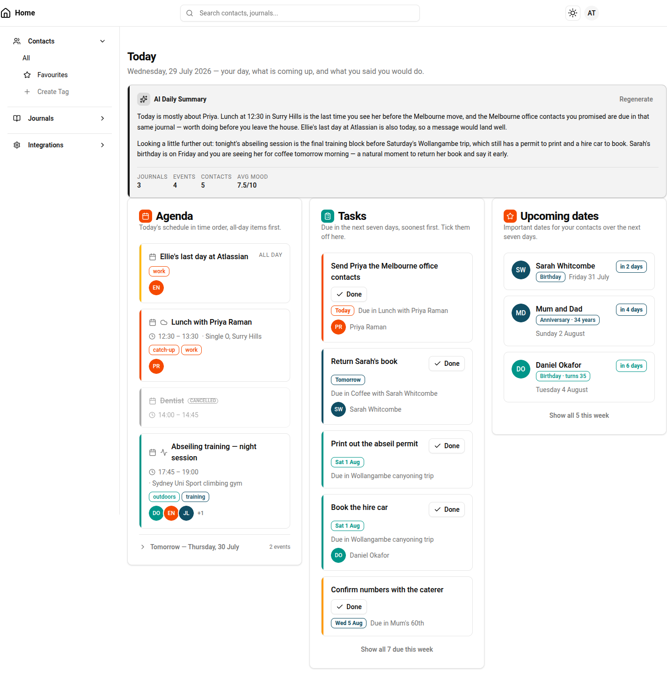

# Home Dashboard Wireframe

**Source of truth:** [Home Dashboard — Claude Design](https://claude.ai/design/p/488fbcbb-4dea-4005-ad0c-56b290e3055e?file=Home+Dashboard.dc.html)
(project `488fbcbb-4dea-4005-ad0c-56b290e3055e`, file `Home Dashboard.dc.html`)
**Specification:** [Home Dashboard & Tasks Product Specification](../product-specifications/home-dashboard-and-tasks-product-specification.md)
**Consumed by:** [Iteration 18: Home Dashboard and Tasks](../tasks/iteration-18-home-dashboard-and-tasks.md)

The wireframe is built against the **real** PMS design system — it imports the synced
`_ds_bundle` (`PMS.Header`, `PMS.DesktopSidebar`, `PMS.Card`, `PMS.Badge`, `PMS.Avatar`,
`PMS.Button`), so what it shows is buildable from `frontend/src/components/ui` and the shared app
chrome as they exist today. See [`frontend/.design-sync/`](../../frontend/.design-sync/NOTES.md) for how
that bundle is published.

> Rendered at 1440 px wide (three-column breakpoint). The screenshot is a convenience copy — the
> Claude Design link above is authoritative, including the interactive states listed under W33.

## How to use this document

Iteration 18 acceptance criteria cite the numbered elements below (**W1**–**W33**) so that "matches the
wireframe" is reviewable without opening a design tool. Every **dashboard** UI-bearing acceptance criterion
references at least one `W` number, and every `W` number is claimed by at least one acceptance criterion.
UI outside the dashboard — the journal task surface, the delete-failure dialog, the history feed — has no
wireframe and is marked "not wireframe-bearing" in the iteration document.

`W` numbers describe **structure, ordering, states and affordances** — not pixel values. Where the
wireframe and the specification disagree, the specification wins and the divergence is recorded under
*Known gaps and divergences* at the end of this document.

## Page frame

| Id | Element | Detail |
|---|---|---|
| **W1** | App chrome | Existing sticky `Header` and fixed `DesktopSidebar`, page content in `main.md:pl-64 > .container.mx-auto.px-4.py-6`. The dashboard adds no new chrome. |
| **W2** | Page header | `h1` **"Today"** plus a muted subtitle carrying the full localised date and a one-line framing sentence — *"Wednesday, 29 July 2026 — your day, what is coming up, and what you said you would do."* Date is the user's local today; the page takes no date parameter. |
| **W3** | Section grid | The three evidence sections sit in one `grid-cols-1 lg:grid-cols-3 items-start gap-4` row beneath the summary. `items-start` means columns size independently — a short Upcoming-dates card does not stretch to match Agenda. Below `lg` the three stack in the order Agenda → Tasks → Upcoming dates. |
| **W4** | Section semantics | Each of the three is a `<section aria-labelledby>` whose `h2` is visually hidden (`sr-only`), with the visible title provided by the card header; each list is a `<ul>` with an `aria-label`. |

## AI daily summary (headline)

| Id | Element | Detail |
|---|---|---|
| **W5** | Summary card | Full-width, visually distinguished from the evidence cards: `bg-primary/5 border-primary/20` with a 1-unit primary accent bar down the left edge. Sits directly under W2, above W3. |
| **W6** | Summary card header | Sparkle icon in a rounded primary-tinted chip, label **"AI Daily Summary"**, and a right-aligned ghost **"Regenerate"** button (`size="sm"`, muted until hover). |
| **W7** | Generated state | The summary text in full, as one or more prose paragraphs (`text-sm leading-relaxed`), not truncated and not clamped. Read-only — no edit affordance anywhere on the card. |
| **W8** | Generating state | A `secondary` **"Generating..."** badge beside the header label, and the body replaced by a single muted line *"Summary is being generated..."*. |
| **W9** | Unavailable state | A single muted line that says so plainly and reassures that the rest of the page still works — *"No summary today — AI summaries are not configured. Everything below still works."* No error styling and no retry banner, though the **Regenerate** control of W6 sits outside all three state branches and therefore persists here. W3 renders normally. |
| **W10** | Key stats footer | In the generated state only: a top-bordered row of four label/value pairs — **Journals**, **Events**, **Contacts**, **Avg Mood** — with uppercase tracked muted labels above the values, and mood shown out of ten (`7.5/10`). Absent in the generating and unavailable states. |

## Agenda

| Id | Element | Detail |
|---|---|---|
| **W11** | Card header | Calendar icon in a filled `bg-chart-1` chip, title **"Agenda"**, description *"Today's schedule in time order, all-day items first."* |
| **W12** | All-day entries | Pinned above all timed entries, with an uppercase muted **"ALL DAY"** marker on the title row in place of a time. |
| **W13** | Timed entries | Below the all-day block, ascending by start time. Time rendered with a clock icon and `tabular-nums` as `HH:MM – HH:MM`, followed by `· <location>` on the same wrapping line when a location is present. |
| **W14** | Entry title | The journal title is a link to the journal detail view, preceded by a calendar glyph and, where the journal has one, a second glyph for the journal's type or calendar. (The sample rows use lucide `cloud` and `activity`; the glyph mapping itself is not specified by the wireframe.) |
| **W15** | Entry tags | Colour-coded `outline` badges in a wrapping row, one per journal tag, using the tag's own colour for border and text. |
| **W16** | Participants | An overlapping avatar stack (`-space-x-2`, ringed in the background colour) of participant initials, with a muted `+N` counter when the stack overflows. Absent when the journal has no participants. |
| **W17** | Type accent | Each entry is a bordered rounded row with a 1-unit coloured accent bar down its left edge, keyed to the journal's type/calendar colour, plus a hover shadow. |
| **W18** | Cancelled entry | Shown, not hidden: whole row at reduced opacity, muted accent bar, title struck through, and a small bold uppercase **CANCELLED** outline badge next to the title. Never presented as if still happening. |
| **W19** | Tomorrow disclosure | A top-bordered full-width toggle row beneath today's list: chevron (right when collapsed, down when expanded), label **"Tomorrow — <weekday>, <d Month>"**, and a right-aligned muted count *"2 events"*. Collapsed by default. |
| **W20** | Tomorrow content | Expands **in place** (no navigation) into a list of entries in exactly the same form as W12–W18. |

## Tasks

| Id | Element | Detail |
|---|---|---|
| **W21** | Card header | Clipboard icon in a filled `bg-chart-2` chip, title **"Tasks"**, description *"Due in the next seven days, soonest first. Tick them off here."* |
| **W22** | Task rows | At most five rows, ordered by due-journal date soonest first, each a bordered rounded row with a left accent bar and hover shadow (same row idiom as W17). |
| **W23** | Task text | The task text as a prominent non-link line (`font-medium`). The task itself has no detail route — see the specification's *Where tasks appear*. |
| **W24** | Inline done action | An `outline` `size="sm"` **"Done"** button with a check icon on every row, top-right of the text row, wrapping under the text when the column is narrow. Acting on it must not navigate away. |
| **W25** | Due chip | A bordered colour-coded chip carrying a **relative** due label — `Today`, `Tomorrow`, then an absolute short form (`Sat 1 Aug`, `Wed 5 Aug`). The chip colour tracks the row's left accent bar (W22), i.e. the due journal — **not** a proximity scale: in the sample, `Tomorrow` and `Wed 5 Aug` share a colour while the nearer `Sat 1 Aug` differs. Row 5's chip diverges even from its own accent bar, which is sample noise rather than a rule. |
| **W26** | Due-journal link | Muted text *"Due in "* followed by the due journal's title as an underline-on-hover link to that journal. |
| **W27** | Linked contacts | For each linked contact, an avatar plus the contact's full name in muted text. Zero contacts renders nothing (rows 3 and 5 in the wireframe). |
| **W28** | Show more | A centred muted `link`-variant button naming the full count of the window — *"Show all 7 due this week"* — revealing the remainder of the seven-day window in place. |
| **W29** | Empty state | Centred in the card body: a check icon and one muted line *"Nothing due in the next seven days."* Reads as a good outcome, not an error. |

## Upcoming dates

| Id | Element | Detail |
|---|---|---|
| **W30** | Card header | Star icon in a filled `bg-chart-1` chip, title **"Upcoming dates"**, description *"Important dates for your contacts over the next seven days."* |
| **W31** | Date rows | A bordered row per occurrence, ordered by date ascending: a 10-unit ringed avatar, then the contact name as a link, then a colour-coded `outline` type badge and the full occurrence date (*"Friday 31 July"*), and a right-aligned bordered **"in N days"** chip in `tabular-nums`. The type badge carries the derived extra where the underlying date's precision allows it — `Birthday · turns 35`, `Anniversary · 34 years` — and degrades to the bare type (`Birthday`) when it does not. |
| **W32** | Show more | A centred muted `link`-variant button naming the full count — *"Show all 5 this week"*. |

## Declared interactive states

| Id | Element | Detail |
|---|---|---|
| **W33** | Wireframe state props | The wireframe declares three switchable states, and each is a state the implementation must handle: `summaryState` (`generated` \| `generating` \| `unavailable` → W7/W8/W9), `tomorrowExpanded` (→ W19/W20), and `tasksEmpty` (→ W22 vs W29). |

## Known gaps and divergences

Recorded so implementation does not have to guess. Each is resolved in the iteration document.

1. **Agenda empty state is not depicted.** The specification requires a single line when nothing is
   scheduled. Build it in the idiom of W29.
2. **Upcoming-dates empty state is not depicted.** Same treatment — one line, in the idiom of W29.
3. **Upcoming dates depicts a cap of three** — three rows plus a show-more reading *"Show all 5 this
   week"*, i.e. two occurrences hidden. The specification requires a cap and a show-more but fixes no
   number, so the choice is between three (what the wireframe draws) and five (symmetry with the tasks
   section). Recorded as an open decision in ITER18-004; the wireframe is evidence for three, not five.
4. **No sidebar entry for the dashboard.** The wireframe's sidebar shows Contacts / Journals /
   Integrations only; "Home" is reachable solely from the header logo link (W1), which is today's
   behaviour. The specification asks for the home page to be reachable from the primary navigation as
   the post-sign-in default, so ITER18-004 adds it — a deliberate addition to the wireframe.
5. **No lapsed tasks anywhere on the page.** Deliberate and correct: lapsed tasks leave the dashboard
   silently. The lapsed presentation lives on journal detail views (ITER18-001), not here.
6. **The key-stats footer (W10) is not called out in the specification's dashboard section.** The four
   values it shows are the existing `journal_daily_summaries` counters, so this is additive surfacing
   of data the summary entity already carries, not a new computation.
7. **Sample content is fictional.** Names, journals and dates in the screenshot are illustrative; they
   are not fixtures and must not be copied into tests.
8. **W24 draws only the done action, because the dashboard only ever needs one.** Everything on the
   dashboard is not-done, so completion is the only status move a row there can make. A journal shows
   all three statuses side by side, so ITER18-001 Phase 17 extends the same idiom on the *journal* row
   with a return-to-not-done, an ordinary cancel, and a secondary confirmed delete — an addition to the
   wireframe rather than a divergence from it, since W24's own rules (`outline`, `size="sm"`, icon,
   top-right of the text row, wrapping under it when narrow, never navigating away) are what the whole
   group follows. Two journal-only rules go with it, neither of which the wireframe could have shown:
   a **cancelled** row offers no status action at all, because the service lets a cancelled task out
   only by retargeting; and **delete is never offered on the dashboard**, only where a task is worked
   with in full. The dashboard's own row stays exactly as W24 draws it.
9. **No per-section loading or unavailable states are depicted.** Only the summary declares an unavailable
   variant (W9); the agenda, tasks and upcoming-dates cards are drawn in their populated state (and tasks
   additionally in its empty state, W29). The specification requires independence in both directions — a
   summary failure must not blank the other sections, *and vice versa* — so each section needs a loading
   skeleton and an unavailable state that the wireframe does not show. Build them in the idiom of W9
   (one quiet line) and W29 (centred icon plus line). Likewise, no state prop demonstrates a show-more in
   its expanded form (W28, W32); "reveals the remainder in place" is the specification's requirement, not
   a depicted state. Resolved by ITER18-004 Phase 16.
10. **The retarget affordance is journal-only, like delete.** W24 draws one action because everything on
    the dashboard is not-done and future-dated, so the only move a row there can make is completion.
    ITER18-001 Phase 18 adds a fourth control to the *journal* row — a retarget that reads *Resurrect* on
    a lapsed or cancelled task, *Reschedule* on a live one and *Reopen* on a done one — sitting after the
    status actions and before the secondary delete, in the same `outline`/`size="sm"`/icon idiom W24
    establishes. It is journal-only for the same reason delete is (gap 8): the dashboard is where a
    commitment is *reminded of*, not where it is worked with, and a lapsed task — the one this control
    exists for — is deliberately absent from the dashboard altogether (gap 5). The dashboard's own row
    stays exactly as W24 draws it.
11. **Mention links are journal-only, and there is no wireframe surface for them at all.** ITER18-001
    Phase 19 adds two controls the wireframe could not have shown: an *Attach task* button in the journal
    detail view's `Tasks` card header, and a remove on rows in that card's *mentioned* group. Both are
    about a link between a task and **the journal being viewed**, which is a relationship the dashboard
    has no way to express — its rows are not shown in the context of any journal, so there is no "this
    journal" for a mention to attach to or be removed from. The dashboard's own row stays exactly as W24
    draws it, and gains nothing from this phase.
