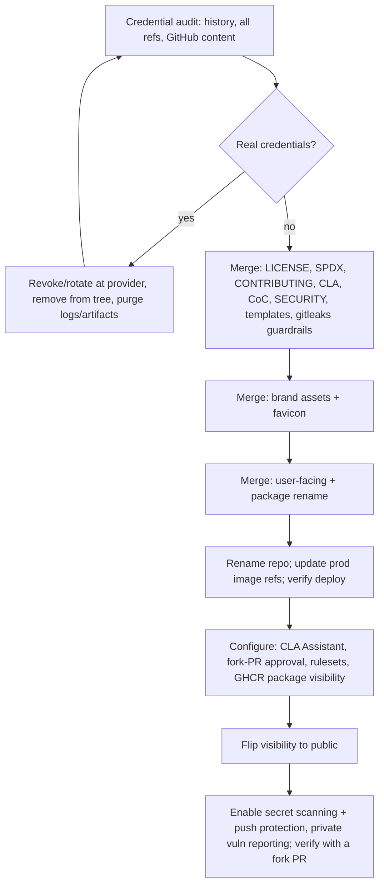

# Open-Source Release & Branding Product Specification

## Overview

The system has been developed privately by one developer since May 2025: about 4,500 commits and
747 remote branches. The aim is to make it public as an open-source, self-hostable project. That
requires four things, each specified as a Part below:

1. A clear, legally effective licence and a contribution model that keeps the owner's IP position.
2. A distinctive name, replacing "PMS", which has negative connotations.
3. A visual identity: an SVG mark for the favicon, the app and the README.
4. Confidence that no credentials are exposed when the repository becomes public.

This is a product specification, not a technical design. The iteration doc breaks it into phases
(one PR each, about 500 changed lines max).

## Reference and Alignment

- `README.md:271-273` already states "AGPL v3", and every `pyproject.toml` declares
  `license = {text = "AGPL-3.0"}`. However, **no `LICENSE` file exists**, so the licence has never
  been legally applied.
- `frontend/src/app/layout.tsx:12-17`: the title is "Personal Management System", and it references
  `/favicon.ico`, **which does not exist** (`frontend/public/` holds only `.gitkeep`).
- `backend/app/main.py:319`: the API title is "Personal CRM & Journal System".
- `backend/app/mcp/server.py:113`: the MCP server name is "Personal Management System".
- `.github/workflows/release.yml:16`: `IMAGE_NAME: ${{ github.repository }}`, so **GHCR image paths
  follow the repository name**.
- `.github/workflows/security.yml` runs pip-audit, Bandit and frontend audits weekly. There is **no
  secret scanning** there or in `.pre-commit-config.yaml`.
- `docs/ci-cd-setup.md#stacked-prs` and the CI stack gate are unchanged by this work.

## Product Goals

1. Anyone can legally use, study, modify and self-host the software. Anyone who runs a modified
   version as a network service must share their changes.
2. The owner keeps copyright and the practical ability to relicense or commercialise later.
3. The product has a unique, ownable name and a recognisable mark that works at 16px.
4. Nothing that grants access to any system (credentials, keys, tokens) is exposed by publication.
5. Contributions follow a predictable, reviewable path that suits a single-maintainer, AI-assisted
   project.

## Product Principles

1. **Rotate, don't just delete.** Any real credential found anywhere in history is treated as
   compromised and revoked. Removing it from history is secondary; GitHub keeps `refs/pull/*`
   references to old commits regardless.
2. **Name and code are licensed differently.** The code is AGPL. The *Lifecontour* name and logo are
   not licensed for use by forks, which is how the owner keeps the brand.
3. **Discuss before code.** Contributions start as an issue; small PRs follow.
4. **User-facing rename now, infrastructure rename later.** Renaming running infrastructure risks
   the production deployment for no user benefit.

## Scope

### In Scope

- LICENSE file, SPDX licence identifiers, copyright notices, dependency licence audit.
- CLA plus CLA Assistant, CONTRIBUTING, CODE_OF_CONDUCT, SECURITY, PR and issue templates.
- A credential audit of git history (all refs) and GitHub-side content, remediation, and ongoing
  secret-scanning guardrails.
- The rename of user-facing text, package
  names and the GitHub repository.
- Brand mark SVGs, favicon and app icons, a dark variant, and a short brand guide.
- The go-public runbook: repository settings and the visibility flip.

### Out of Scope

- **Infrastructure rename** (option c): DB names (`personal_management*`), Redis stream and consumer
  names, env vars, compose project names, local compose `pms-*` image and container names, log and
  OTel service names, and the Python import package `core_shared`. This may become a later
  optional iteration. (The published GHCR image paths are *not* deferred; they follow the
  repository rename.)
- **Non-credential information** that is visible once the repository is public, such as the
  production hostname in `mcp/server.py:173` and in integration tests, stays as is. The owner
  accepts this; only credentials are in scope.
- **Rewriting historical docs** (`docs/tasks/iteration-*.md`, older specs); they keep the old name.
- **Deleting branches or scrubbing PR discussion.** The owner accepts them being public; only
  credentials are in scope.
- **Adopting the brand palette as the app's UI theme.** The app keeps its current neutral shadcn
  theme; only the mark uses the palette.
- **Legal advice.** Where commercial use becomes real, the CLA and licence choices should be
  reviewed by a lawyer.

---

## Part 1: Licensing

### Problem Statement

The project intends to be AGPL, but it has never applied a licence. There is no `LICENSE` file;
`README.md` links to one that does not exist. The package metadata uses a non-SPDX `{text =
"AGPL-3.0"}`, and some vendored content lacks licence notices.

### Decision: AGPL-3.0-or-later

| Option | Effect | Fit |
|---|---|---|
| **AGPL-3.0-or-later** ✅ | Copyleft that also covers network use: hosting a modified version obliges sharing the source | Best fit for a self-hosted web app; blocks closed SaaS forks |
| GPL-3.0 | Hosting as a service is not "distribution" | Weak for a web app |
| MPL-2.0 | Copyleft applies per file only | Weak for an app |
| MIT / Apache-2.0 | Permissive; anyone can take it closed | Conflicts with retaining control |
| FSL / BSL / PolyForm | Source-available only | Not OSI open source |

"-or-later" lets the project adopt future AGPL versions.

### Target Behaviour

- A root `LICENSE` file holds the verbatim AGPL-3.0 text.
- Every package declares the SPDX identifier `AGPL-3.0-or-later`:
  - the backend, `core_shared` and all four worker `pyproject.toml` files (replacing
    `{text = "AGPL-3.0"}`);
  - `frontend/package.json` (a `license` field).
- A copyright line reads `Copyright (C) 2025–2026 Harry J E Day`. It goes in `README.md` and
  `CONTRIBUTING.md`. `LICENSE` stays byte-identical to the GNU text, with no preamble. Per-file
  headers are **not** required.
- **AGPL §13 source offer:** the app shows a "Source code" link, pointing to the public repository,
  on the public login page and in the user menu, so it can be reached signed in or out. This makes
  it easy for anyone running a modified copy to comply.
- **Dependency licence audit:** every runtime dependency (Python and npm) is checked for
  compatibility with AGPL-3.0, and the result is recorded. Any incompatible dependency blocks the
  release until it is replaced.
  - A preliminary review found nothing incompatible. The deps are permissive; psycopg2 and
    pycountry are LGPL; dompurify is MPL/Apache; the Inter font is OFL.
  - The OpenStreetMap attribution in PDF output (`osm_tile_source.py:40`) must be kept (ODbL).
- **Vendored content keeps its own licence notices:**
  - `.claude/skills/playwright-skill/LICENSE` (MIT) is already present.
  - `.claude/skills/shadcn/` has **no licence file**, because upstream ships none in the skill
    folder. Its upstream MIT notice goes in `.claude/skills/THIRD_PARTY_NOTICES.md`.
  - Installed skill folders are left exactly as the `skills` CLI wrote them, bundled logos
    included, so updates from `skills-lock.json` keep working.
- **Trademark notice:** a short `TRADEMARKS.md`, linked from the README, states that the Lifecontour
  name and logo are not granted by the AGPL. Forks must rebrand, though they may truthfully say
  "based on Lifecontour".

### Notes on IP

- The history shows no third-party human contributors. The authors are the owner under three name
  variants, dependabot, and AI agents (an Augment agent and Claude co-author trailers). So **no
  retroactive consent is needed**, and the owner can license the existing code.
- Copyright protection for purely AI-generated material is limited in Australia and the US. This
  does not block open-sourcing, but it means the owner's exclusive rights are strongest in the parts
  of the work they authored or directed. This is a known limitation, not something the release can
  fix.

### Outcome

The repository is under a legally applied AGPL-3.0-or-later licence, with consistent
machine-readable
identifiers and a visible source link.

---

## Part 2: Contribution Model

### Problem Statement

The project has only ever had one developer. Nothing tells an outside contributor how to propose a
change, how big it may be, how AI-assisted work is treated, or what rights they grant. Without a
CLA, the owner could not relicense code once others contribute.

### Decision: a CLA that grants a licence

| | CLA (chosen) | DCO |
|---|---|---|
| Mechanism | A one-time click-through via the CLA Assistant bot on a contributor's first PR | `Signed-off-by` on every commit |
| Owner rights | A broad, perpetual licence to each contribution, **including the right to relicense** | Contributions are AGPL only |
| Contributor keeps copyright | Yes (a licence grant, not an assignment) | Yes |

The CLA text is based on a recognised template: the Apache Individual CLA, adapted to allow
relicensing under any licence, or the equivalent Harmony option. It is stored in the repo as
`CLA.md` and enforced by CLA Assistant as a required PR status check.

### CONTRIBUTING.md: target behaviour

- **Discuss first:** open an issue describing the change. PRs without a linked, maintainer-acknowledged
  issue may be closed. Typo and docs fixes are exempt.
- **PR size:** at most **500 changed lines** (additions plus deletions, tests included), so each PR
  can be reviewed. Larger work is split into a stack of PRs. This matches the project's own standard.
- **AI-generated PRs:**
  - The submitter must **review the AI-generated changes personally before submitting** and take
    responsibility for every line.
  - They must **run automated code review** (for example an AI review tool) and the project's
    quality gates (pre-commit, lint, types, tests) before opening the PR.
  - They disclose AI assistance in the PR description.
  - Agents should follow the repo's existing `AGENTS.md`.
- **Workflow:**
  - Test-first development.
  - Rebase, never merge `main` into a PR.
  - Pre-commit hooks.
  - Quality commands, linked to `docs/code-quality-standards.md` and the testing strategy.
- **CLA:** signed on the first PR via the bot.
- **Supporting files:**
  - `CODE_OF_CONDUCT.md` (Contributor Covenant 2.1).
  - `SECURITY.md`: report vulnerabilities privately via GitHub private vulnerability reporting, and
    never in public issues.
  - The **existing** `.github/pull_request_template.md` is extended with a linked issue, diff
    size, an AI-assistance disclosure checklist, and tests run.
  - The **existing** `.github/ISSUE_TEMPLATE/` (`bug_report.md`, `feature_request.md`) is updated
    so the feature template acts as the "discuss first" proposal, and a `config.yml` is added that
    points security reports to `SECURITY.md`.
- **Agent guidance:** CONTRIBUTING links `AGENTS.md`. The dangling `docs/ai-guidelines.md`
  reference in `README.md` and `.github/copilot-instructions.md` is fixed to point at `AGENTS.md`.
- **Stacked fork PRs:** only the bottom layer of a stack runs CI. Upper layers are CI-dispatched by
  the maintainer (`gh workflow run ci.yml --ref <branch>`). CONTRIBUTING says so.

### Fork PRs and CI

- CI must run for PRs from forks **without access to repository secrets**.
  - This is verified today: `ci.yml` references no secrets and has no `pull_request_target`.
  - The only secret in any workflow is `GITHUB_TOKEN`, in `release.yml`, which runs on tags and
    not on PRs.
  - SonarCloud Automatic Analysis runs outside Actions.
- **Never use `pull_request_target` with a checkout of PR code.** This becomes a rule in
  `docs/ci-cd-setup.md`.
- Repository setting: require approval before workflows run for first-time contributors.
- The existing stacked-PR CI gate (`needs: changes`) is unchanged.
- Public repositories get free GitHub-hosted runner minutes. That eases the Actions budget but does
  **not** change the gate policy.

### Outcome

A contributor can find out how to propose, size, disclose and submit a change. The owner receives a
relicensable licence to every contribution.

---

## Part 3: Security Audit & Guardrails

### Problem Statement

The repository is being made public in place (option a): all history, branches, PRs and Actions
logs become visible. The owner's concern is **credentials**. A preliminary check (not a substitute
for the audit) found:

- The committed `.env.dev` and `.env.test` hold placeholders only (`dev-client-secret`, empty
  Google, GitHub and Immich secrets, `dev_master_key_change_in_production`).
- No private-key blocks or Google API-key patterns appear anywhere in history.

### Target Behaviour: pre-release audit

- **Git history, every ref:**
  - Refs covered: all branches and tags, plus the `refs/pull/*/head` refs fetched from GitHub.
  - Scanners: **gitleaks** (full history) and **TruffleHog**, with verification enabled to confirm
    live credentials.
- **Current tree:** every committed `.env*` file and config file (`docker-compose.yml`, workflows,
  test fixtures, e2e auth setup) is confirmed to hold only dev or test placeholders.
- **GitHub-side content** (not covered by git scanning):
  - PR and issue bodies and comments.
  - Retained Actions logs and artifacts (for example playwright reports, Bandit output).
  - Releases, and any wiki.
  - GHCR packages: their visibility is set separately from the repository, and they become public
    at release. Every published image layer is scanned for baked-in secrets before that happens.
- **Triage:**
  - Every finding is classified as real credential, dev/test placeholder, or false positive. The
    classification goes into an audit record with **no secret values**.
  - False positives and placeholders go into a committed `.gitleaks.toml` allowlist.
- **Remediation of real credentials:**
  - Revoke or rotate at the provider **first** (Google OAuth client, Strava, Immich, Snipe-IT,
    OIDC, etc.).
  - Then remove it from the current tree.
  - A history rewrite is **not** required once the credential is revoked.
  - Remove Actions logs or artifacts that contain secrets.
- **Repository hygiene:**
  - Remove the tracked stray file `.tmpxYhLD4` (a local MCP config with local paths and workspace
    IDs).
  - Remove the stray root `ITER2-004-Phase2-Production-Readiness.md`, or move it under `docs/`.
- **Release gate:** the flip happens only when the audit has zero unresolved real-credential
  findings.
- A preliminary pattern scan of the current tree during planning found no real tokens (GitHub,
  Google, AWS, OpenAI, JWT, private keys). There are no recorded HTTP cassettes or HAR files.

### Target Behaviour: ongoing guardrails

- A **gitleaks pre-commit hook** in `.pre-commit-config.yaml`.
- A **gitleaks CI job** in `ci.yml` behind `needs: changes`, which fails the PR on a new finding.
  Upper stack layers skip CI by design, so no layer merges without a passing scan on its head,
  either as the bottom layer or dispatched manually.
- After the flip:
  - **GitHub secret scanning and push protection** are enabled (free for public repositories).
  - **Private vulnerability reporting** and **Dependabot alerts** are enabled.
  - A **branch protection / ruleset** on `main` requires PRs, passing checks and a signed CLA.

### Outcome

The repository is published with no live credentials, and new ones are blocked at commit, in CI and
at push.

---

## Part 4: Name — Lifecontour

### Problem Statement

"PMS" has negative connotations. "Personal Management System" and "Personal CRM & Journal System"
are generic, inconsistent across surfaces, and cannot be owned. The product needs one distinctive
name, used everywhere it names itself.

### Decision

The product becomes **Lifecontour**. The idea is the shape and contours of a life over time: people,
journal and days, with a quiet echo of topographic contour lines from the outdoor logbook side.

- The display form is **Lifecontour**, with a single capital.
- Identifiers use **`lifecontour`**.
- The tagline is *"Your journal, people and adventures — self-hosted."*

Brainstorm record: about 130 names were checked over three rounds. Everyday journal, life-management
and personal-CRM words are all taken, so coined compounds were the viable space.

- **Runner-up:** Tarnbook.
- **Rejected because taken or crowded:** Cairn, Waymark, Kith, Headway, Keepsake, Dayline and
  others.
- **Rejected on cultural grounds:** Sherpa, Totem, and borrowed Aboriginal words.

### Name clearance

- **Trademarks:** the owner searched the IP Australia and USPTO registers on 2026-09-27 and found
  no conflicting mark. The rename is not gated.
- **Domain:** not wanted. The project lives at its GitHub repository.
- **Repository name:** the owner confirmed `hjed/lifecontour` is available (2026-09-27).

### Rename surfaces (option b)

| Surface | Change |
|---|---|
| Frontend metadata | Root `title` and `description` (`layout.tsx:12-13`), plus per-page titles in "… \| Lifecontour" form (`integrations/layout.tsx:4`, `journals/new/page.tsx:14`) |
| UI copy | Sign-in text (`lib/constants.ts:152`); settings copy (`settings/page.tsx:15`); "PMS" in Snipe-IT settings (`SnipeItSettings.tsx:146`); app-chrome name, if any |
| "Private application" wording | `constants.ts:157` says "private application for personal use only". It becomes "your self-hosted instance" wording. `robots: noindex` (`layout.tsx:14`) **stays**, because instances hold personal data |
| API | FastAPI `title` and `description` (`main.py:319-320`); "PMS" in OpenAPI field text (`snipeit_settings_schemas.py:20,33`) |
| MCP | Server `name` and `instructions` text (`mcp/server.py:113-115`). Existing client connections are unaffected; only the display name changes |
| Outbound identity | The OSM tile-server User-Agent `PersonalManagementSystem/1.0` (`config.py:177`) becomes `Lifecontour (+<project URL>; …)`, identifying the product and a contact URL as the OSM tile policy asks. The Strava GPX `creator` attribute (`gpx_generator.py:60`) becomes `Lifecontour` |
| Docs | `README.md` (title, tagline, licence, badges, logo); `AGENTS.md` project context; `docs/architecture.md` heading; `frontend/.design-sync/conventions.md`; release notes template (`release.yml:194`, `cd personal-management-system`) |
| Package metadata | `personal-management-backend` becomes `lifecontour-backend` and `personal-management-frontend` becomes `lifecontour-frontend`. Descriptions and the placeholder author (`dev@example.com`) are replaced with the real owner in all six `pyproject.toml` files and `frontend/package.json`. Worker package names and `core_shared` are unchanged |
| Design-sync | `frontend/.design-sync/config.json` `pkg` and `globalName` (`PMS`) and the preview imports follow the frontend package rename, followed by a re-sync |
| Example env | The `NEXT_PUBLIC_APP_NAME` value (`frontend/.env.example:6`). It is unused in `src`, so it is updated, or removed if dead |
| Dev OAuth UI | The product name in `docker/oauth-ui/views/index.ejs:66` (dev only) |
| GitHub repository | `hjed/personal-management-system` becomes `hjed/lifecontour` (GitHub redirects old URLs and git remotes) |
| **GHCR images** | `ghcr.io/hjed/personal-management-system-*` follow the repository name automatically (`release.yml:16`), so the **production deployment's image references must be updated in the same release**. See the decision below |
| SonarCloud | Analysis is SonarCloud Automatic Analysis, and `sonar-project.properties` is dead config. After the repository rename, the SonarCloud project binding and key are checked or re-bound in SonarCloud, and badge URLs are updated |

**Tests the rename updates:**

- The e2e assertions `toHaveTitle(/Personal Management System/)` appear about 25 times, in
  `contacts*.spec.ts`, `sidebar.spec.ts`, `auth/login.spec.ts` and `utils/test-helpers.ts`. These
  are centralised into one shared title constant or pattern while being changed.
- Unit tests: `LoginPage.test.tsx`, `jest.setup.ts:165`, `contacts/new/__tests__/page.test.tsx`.
- **Kept as is:** `home-dashboard.spec.ts:64` and `app/__tests__/page.test.tsx:397`, which assert
  the old placeholder text is *absent*.

**Deferred to the infrastructure rename:** local compose `pms-*` image and container names; log
and OTel service names (`personal-management-backend`); DB names; stream names; env vars.

### Decision: images follow the repository name

The repository rename changes image paths to `ghcr.io/hjed/lifecontour-*`. Two ways to handle this:

- **Let them follow** (chosen). The deploy config is updated as a runbook step, and the old images
  stay pullable for rollback.
- Pin `IMAGE_NAME` to the old name. This would leave the most public-facing identifier (the docker
  pull path) on the old name indefinitely.

### Outcome

A user or MCP client sees "Lifecontour" everywhere the product names itself. Internal
infrastructure keeps working unchanged.

---

## Part 5: Brand Identity

### Problem Statement

The product has no visual identity. The favicon it references (`/favicon.ico`) does not exist, so
browser tabs show a generic icon, and the README has no logo.

### Mark

The mark is **concept E (original)**: an open logbook in line art, with a person on the left page
(people) and a winding creek on the right page (outdoors and the flow of life).

- Runner-up concept: D (closed logbook with a lake on the cover).
- Concept drafts were reviewed in the planning session. The final SVGs are authored during the
  iteration.
- **Cultural review rule:** the mark must avoid motifs associated with Aboriginal and Torres Strait
  Islander art. In particular, **no concentric circles or rings** (the waterhole/campsite motif)
  and no dot-infill. The contour-ring variant E2 was rejected for this reason.

| Token | Hex | Use |
|---|---|---|
| Eucalypt | `#2F5D50` | Book outline (primary) |
| Creek | `#2B7A9E` | Creek line |
| Sandstone | `#D08A3C` | Person (accent) |

### Target Behaviour

- **Brand assets** are committed to `branding/`. They are part of the brand, not code:
  - `mark.svg`: the mark, colour, on light.
  - `mark-dark.svg`: light strokes for dark backgrounds. The eucalypt stroke has too little
    contrast on dark.
  - `mark-mono.svg`: single colour, `currentColor`.
  - `lockup.svg`: the mark plus the "Lifecontour" wordmark, for the README header.
  - `README.md`: a brand guide covering colours, minimum size (16px), clear space, do/don't, and
    the trademark pointer.
- The **SVGs are hand-tuned** for small sizes: a 64-unit grid, stroke widths of 3 or more, and
  shapes that stay recognisable at 16px.
- **App icons** follow the Next.js App Router file conventions:
  - `frontend/src/app/icon.svg`, which embeds a `prefers-color-scheme: dark` style so the tab icon
    switches variant;
  - `favicon.ico` (16 and 32px) and `apple-icon.png` (180px), generated from the SVG.
  - The dangling `icons: { icon: '/favicon.ico' }` metadata that points at a missing file is removed
    or corrected.
- The **README header** uses the lockup.

### Outcome

Browser tabs, bookmarks, home-screen installs and the README all show the Lifecontour mark, legibly
in light and dark.

---

## Part 6: Go-Public Runbook

- **GHCR packages** are made public, so self-hosters can `docker pull` the released images.
- After the flip, check that:
  - secret-scanning alerts are reviewed (GitHub scans the full history on enablement);
  - a test PR from a fork gets CLA Assistant, CI without secrets and templates;
  - the README renders with the licence badge and logo.

---

## Success Criteria

1. `LICENSE` exists, and every package declares `AGPL-3.0-or-later`. The dependency audit shows no
   incompatible licence.
2. CONTRIBUTING, CLA, CODE_OF_CONDUCT, SECURITY and the PR and issue templates exist. CLA Assistant
   blocks unsigned PRs.
3. The credential audit record shows every finding triaged, and zero live credentials at flip time.
   gitleaks runs in pre-commit and CI.
4. No user-facing surface in the Part 4 table says "Personal
   Management System", "Personal CRM" or "PMS". Excluded from this check: historical docs, the
   deferred infrastructure identifiers, and the two tests that assert the old placeholder is
   absent.
5. The favicon and app icon show the Lifecontour mark at 16px in light and dark browser themes.
6. The repository is public at `hjed/lifecontour`, production pulls the renamed images, and a fork
   PR runs CI successfully without secrets.

## Delivery Notes

- Delivered as **Iteration 19: Open-Source Release & Branding**, detailed in a separate iteration
  doc after this spec is approved. A likely breakdown:
  1. Credential audit and secret-scanning guardrails.
  2. Licensing and contribution docs.
  3. Brand assets and favicon.
  4. Rename (user-facing text and packages).
  5. Repository rename, deploy update and go-public runbook.
- The security audit runs **first**, and alone blocks the flip. The rename can proceed in parallel
  with the licensing docs.
- There are no domain-model or MCP tool changes, so the MCP-parity rule is limited to the server's
  name and instructions.
