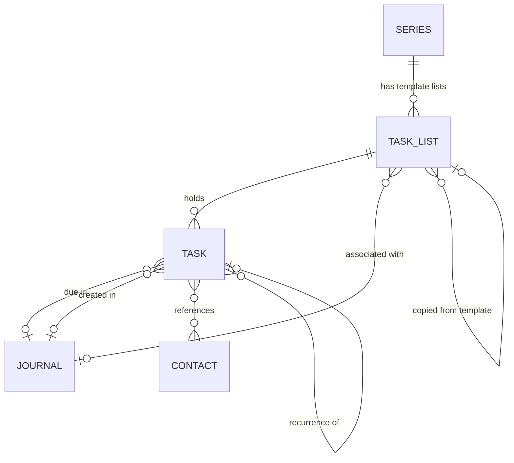
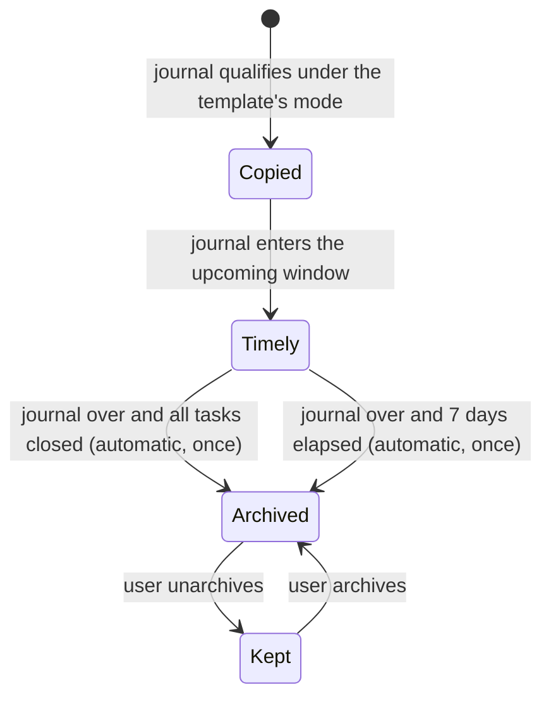

# Task Lists and Navigation Product Specification

## Overview

This document defines the target product behaviour for **Task Lists** — a second home for tasks alongside journals — and for the navigation changes that make them reachable: a new sidebar section, a global Create button, and a revamped mobile navigation.

It is a product specification rather than a technical design. It describes the intended experience across the web interface, the home dashboard, the AI daily summary, global search, and AI-facing workflows through MCP.

It **supersedes parts of** the Home Dashboard and Tasks specification. That specification made every task a commitment anchored to two journals and deliberately provided no place to list tasks. In use this has proved too limiting: much of what the user needs to track is not tied to a dated event — a packing list, things to buy, things to do "sometime", a routine that repeats. Journal-anchored tasks stay exactly as they are; this specification adds a second way to hold a task.

## Reference and Alignment

Builds on and refines:

- `docs/product-specifications/home-dashboard-and-tasks-product-specification.md` (partly superseded — see *Superseded behaviour*)
- `docs/product-specifications/journals-product-specification.md`
- `docs/product-specifications/contacts-product-specification.md`
- `docs/product-specifications/contact-merge-product-specification.md`
- `docs/product-specifications/activity-history-product-specification.md`
- `docs/architecture/frontend-design.md`
- `docs/architecture/domain-architecture.md`

### Superseded behaviour

| Earlier rule (Home Dashboard and Tasks spec) | Now |
|---|---|
| Principle 2 and invariants 1–3: every task is anchored to a creating and a due journal | A task has a list, a due journal, or both. The two-journal rule holds only for tasks with no list. |
| Invariant 5: the product must not offer a bare date picker for a task | List tasks may carry a plain due date. Journal-only tasks still may not. |
| *Creating a task*: always created from a journal | Also created on a list, or from the global Create button. |
| Principle 3 and *Lapsed tasks*: no overdue section, counter or badge | True for journal-only tasks. List tasks show an overdue marker, and lists show open-task counts. |
| Principle 4 and Success Criterion 5: no screen lists outstanding tasks together | Lists and `/tasks` are such screens, by design. The dashboard still shows only what is timely. |
| *Where tasks appear*: exactly two places | Also the list page, `/tasks`, the sidebar counts, and search. |
| *Journal Anchor Integrity → Deletion*: a creating or due journal cannot be deleted | Still blocked for journal-only tasks. Not blocked by tasks that are on a list (see *Journal changes*). |
| Out of scope: global tasks page, priorities, recurring tasks, tasks in search | Tasks section, a single flag, recurrence for list tasks, and open tasks and lists in search are in scope. Effort and scheduling remain out. |
| *Tasks over MCP*: an agent cannot create a task without both anchors; "no separate task list and no due date" | An agent may create a task on a list with neither anchor. Guidance rewritten. |
| Dashboard Tasks card: journal-due tasks only | Extended (see *Dashboard and Daily Summary*). |

Everything else in that specification — statuses, retargeting and its acknowledgement, lapse and resurrection for journal-only tasks, contacts on tasks, tasks as a read-only record on contact pages, contact merge, history, the dashboard's other cards — continues to apply unless stated here.

## Product Goals

Task Lists should help the user:

1. Keep tasks that have no natural date somewhere they will be found again.
2. Group related tasks (a trip, a project, a shop) and see the group at a glance.
3. Give a task a deadline without having to invent a journal for it.
4. Reuse a checklist every time a recurring event comes round.
5. Have repeating chores re-appear by themselves once done.

The navigation changes should help the user:

1. Move between Home, Journals, Tasks and Contacts on a phone in one tap.
2. Create a task, journal or contact from anywhere in one or two taps.

## Product Principles

1. **AI-first:** every capability here is available over MCP in the same phase as its UI.
2. **Two homes, one task:** list tasks and journal tasks are the same entity with the same statuses, contacts and history. There are not two kinds of task.
3. **Lists hold; the dashboard prompts:** a list is allowed to accumulate. The dashboard remains selective — an undated task never appears there by itself.
4. **Dates are optional:** a list task with no date is complete as it is, not missing something.
5. **Archive over delete:** a finished list is archived, consistent with *cancel over delete*.
6. **One tap between sections on mobile.**
7. **Built to admit notes:** nothing in the navigation, create menu or search model assumes tasks are the last standalone entity.

## Scope Priority

This specification describes the full target behaviour, even if delivery happens in phases.

Priority order:

1. Task model changes: list membership, optional due date, relaxed journal anchoring, flag and icon
2. Task Lists: model, list page, `/tasks` overview, sidebar section, archive
3. Global Create button and mobile navigation
4. Dashboard and daily summary rules for list tasks
5. List ↔ journal association
6. Recurring tasks
7. Series template lists
8. Tasks and lists in search

MCP parity ships with each item, not after.

## Current Product Context

- A task today requires a **creating journal** and a **due journal**. It has no due date of its own; its date is the due journal's date. Past that date it **lapses**.
- There is no tasks page, no task collection in the API, and no task in search.
- Tasks appear in two places: the journal detail page and the dashboard's Tasks card (not-done tasks due in the next seven days).
- Series group journals; instances are journals created by hand or synced from a recurring Google Calendar event. Nothing generates future journals, and series carry no tasks.
- Navigation is a desktop sidebar (Home, Contacts, Journals, Integrations) and, on mobile, the same sidebar inside a hamburger sheet. There is no bottom navigation. The top bar holds Home, search, theme toggle and the user menu — no create action; journals and contacts are created from buttons on their own pages.

## In Scope

- Task Lists: create, rename, icon, reorder, archive, unarchive, delete
- List tasks: optional due date, optional due journal, manual ordering, move between lists
- Flag and icon on all tasks, including journal-only ones
- List ↔ journal association
- Recurring list tasks
- Series template lists and per-instance copies
- Tasks sidebar section, list page, `/tasks` overview
- Top-bar Create button (task, journal, contact)
- Mobile navigation revamp
- Dashboard and daily-summary treatment of list tasks
- Open tasks and lists in global search
- Events, history and MCP parity for all of the above

## Out of Scope

- Standalone notes (not attached to a journal or contact) — future work; see *Designing for Notes*
- Sub-tasks, sections within a list, task dependencies
- Priority levels, effort estimates, time-of-day deadlines
- Calendar-rule recurrence ("every Monday", "1st of the month")
- Relative dates on template tasks ("three days before the event")
- Reminders, notifications, push
- Sharing lists or assigning tasks to other people
- A task on more than one list
- External task-system integrations
- Dashboard customisation

## Tasks

### Product model

A task is still a short piece of text with a status. What changes is where it lives.

A task has:

- **text** and **status** (not done, done, cancelled) — unchanged
- an optional **list** — at most one
- an optional **due journal** and **creating journal** — as today, but no longer mandatory when the task is on a list
- an optional **due date** — a calendar day in the user's timezone, no time of day; list tasks only
- an optional **flag** and an optional **icon**
- optional **recurrence** — list tasks only
- **contacts** and **intermediate journals** — unchanged

### Core invariants

1. A task has a list, a due journal, or both. It can never have neither.
2. A task with no list is a **journal-only task** and follows the existing specification in full: creating journal and due journal both required, due journal in the future when set, lapse when it passes.
3. A task is on at most one list.
4. A task has a due date **or** a due journal, never both. When it has a due journal, that journal's date is its date.
5. A due date may only be set on a task that is on a list.
6. Recurrence may only be set on a task that is on an ordinary list (not an instance or template list).
7. A task on a list never lapses.

### Dates, overdue and lapse

| Task | Date comes from | After the date passes |
|---|---|---|
| Journal-only | Due journal | **Lapses** (unchanged): goes quiet everywhere, revived by retargeting |
| On a list, with due date | Its own due date | **Overdue**: stays open on its list, marked overdue |
| On a list, with due journal | Due journal | **Overdue**, same as above |
| On a list, undated | — | Nothing; it simply lives on the list |

**Which day counts.** A journal's date, for every task purpose, remains the start of its event range in the user's timezone — when a task is due, when a journal enters the upcoming window, whether a due journal is "in the future", and when a journal-only task lapses are all unchanged. The new list behaviours that wait for a journal to be *over* — a list task becoming overdue, an instance list auto-archiving, series regeneration moving on — wait until the journal's **last** day has ended, so a multi-day trip's packing list is not overdue on day two.

An overdue task stays on the dashboard for **seven days** after its date. After that it leaves the dashboard but remains open and marked overdue on its list until it is done, cancelled or re-dated.

**Setting and changing a list task's date:**

- A due date, when set, must be today or later. A due journal, when set, must be dated in the future — the existing rule.
- Changing a date is a plain edit: no acknowledgement step, and it does not change status. A done or cancelled list task is reopened by changing its status, not its date.
- Whenever a due journal is replaced or cleared — by another journal, a due date, or nothing — the previous due journal becomes an intermediate journal, as with retargeting today.

### Status

Statuses are unchanged. For list tasks, reopening is direct: a done or cancelled list task can be set back to not done, without retargeting. Journal-only tasks keep the existing rules, including retarget-to-revive and the reopen acknowledgement.

### Flag and icon

- **Flag:** a single on/off marker meaning "this one matters". Flagged tasks are visually distinct wherever tasks are shown. The flag does not reorder a list. There are no priority levels.
- **Icon:** an optional icon chosen from a fixed set, shown beside the task text.
- Both apply to every task, including journal-only tasks, and are editable wherever a task can be edited.

### Moving tasks

- A list task can be moved to another list; it joins the bottom.
- A journal-only task can be added to a list. It keeps its journals and, from then on, follows list rules (it no longer lapses).
- A task can be removed from its list only if it has both a creating and a due journal. It becomes a journal-only task; if its due journal is already past it is immediately lapsed, and the user is told so before confirming. A task without both anchors cannot be removed — only moved, cancelled or deleted.
- Moving a recurring task onto an instance list, or removing it from its list, clears its recurrence; the user is told so before confirming.

### Journal changes

How journal operations affect tasks **that are on a list** (journal-only tasks keep the existing *Journal Anchor Integrity* rules unchanged):

| Journal operation | Effect on a list task |
|---|---|
| **Delete** | Not blocked. The task's link to that journal (due, creating or intermediate) is removed. If it was the due journal the task becomes undated. The confirmation states how many list tasks will lose their link. |
| **Cancel** | Links are kept. While the journal is cancelled the task is treated as undated (not overdue, not on the dashboard through that journal); un-cancelling restores the date. |
| **Merge** | Links re-point to the surviving journal, as today. |

### Contacts, events and history

Contact links, and their behaviour under contact merge, work as today. List tasks appear on a contact's page alongside journal tasks, labelled with their list, and — like journal tasks today — as a read-only record that links to where the task can be acted on. Every new mutation — list membership, due date, flag, icon, recurrence — emits a domain event and appears in task history; reordering does not. Lists have their own history (created, renamed, archived, unarchived, journal association changed).

## Task Lists

### Product model

A list has a **name**, an optional **icon**, an optional **associated journal**, an **archived** state, and a position among the user's lists. Lists belong to one user.

There are three kinds, distinguished by how they came to exist:

| Kind | Created by | Shown in sidebar | Tasks actionable |
|---|---|---|---|
| **Ordinary list** | The user | Yes, until archived | Yes |
| **Template list** | The user, on a series | No — managed from the series | No; a template is a pattern, not work |
| **Instance list** | The system, copying a template for one series journal | Only while timely (see *Series Template Lists*) | Yes |

### The list page

- Open tasks in the user's manual order. Drag to reorder, with a keyboard equivalent. New tasks are added at the bottom via an always-present inline "add task" row.
- Each row: checkbox, icon, text, flag, due chip (date, or due-journal link), overdue marker, contact chips, recurrence marker. Inline edit of text; a detail affordance for the rest.
- **Completed below the fold:** done and cancelled tasks sit in a collapsed "Completed" group under the open tasks, most recently closed first, loaded in pages. Cancelled tasks are marked as such.
- Header: name, icon, associated journal (linked), and actions — rename, associate with journal, archive, delete.
- An empty list says so and invites the first task.

### The Tasks overview (`/tasks`)

A page showing every open list as a card: name, icon, associated journal, count of open tasks, and a **preview of its first few open tasks** (completable in place). From here the user can create a list, reorder lists, and open an **Archived** area listing archived lists with an unarchive action. Template lists are not shown here; they are reached from their series.

### Sidebar

A **Tasks** section sits alongside Contacts and Journals:

- *All lists* → `/tasks`
- one entry per unarchived ordinary list, in the user's order, with its icon and open-task count
- instance lists that are currently timely
- *New list*

### Archiving and deleting

- Archiving hides a list from the sidebar and the overview, and hides it and its tasks from the dashboard, the daily summary and search. Task state is untouched. A list with open tasks can be archived.
- An archived list is read-only until unarchived. It remains openable from the Archived area and still appears, marked archived, on its associated journal's page. Its tasks still appear, marked archived, on their own due or creating journal's page (where they cannot be acted on) and in the record on linked contacts' pages.
- Unarchiving restores everything.
- Deleting a list is a confirmed, destructive action intended for mistakes. Tasks with both a creating and a due journal survive as journal-only tasks (lapsed if that journal has passed, and no longer recurring); all other tasks, open or completed, are deleted with it.

### Association with a journal

A list may be associated with **one** journal — a packing list for a trip, prep for a meeting.

- The list appears on that journal's page with its tasks completable in place, and the journal is linked from the list. A task shown there is not repeated in the journal's own Due/Created/Mentioned task groups.
- On a journal page, a list task past its date shows the **overdue** marker and direct actions, never the lapsed marker.
- A journal may have several lists associated with it.
- The association is what lets undated tasks reach the dashboard: while the journal is within the dashboard's upcoming window, the list's open undated tasks are surfaced there.
- Association can be changed or removed at any time. If the journal is deleted the list survives, unassociated. If the journal is cancelled the list stops surfacing on the dashboard until it is un-cancelled. If the journal is merged the association moves to the surviving journal.
- Association does not make the journal each task's due journal; tasks keep their own dates if they have them.

## Recurring Tasks

A task on an ordinary list can be set to recur. **Completion is the only trigger**: when a recurring task is marked done, a new copy is created in the same list, at the same position, not done. Cancelling a recurring task does not create a copy; it ends the recurrence.

The copy inherits text, flag, icon, contacts and the recurrence setting. It does not inherit the creating journal or intermediate journals, and it records which task it came from so history can show the chain.

The copy's date follows the task's recurrence mode:

| Mode | Copy's date |
|---|---|
| **No date** | Undated |
| **Interval after completion** | Completion day + interval (days, weeks, months or years). When recurrence is switched on for a task that already has a due date, the interval is pre-filled with the gap between the task's creation and its due date (created 1 Nov, due 15 Nov → "2 weeks"); each copy reuses the stored interval. |
| **Next journal in a series** | The next non-cancelled journal in a chosen series dated after today becomes the copy's due journal. Offered by default when the task's due journal belongs to a series. |

**No next journal, no copy.** In *next journal in a series* mode a copy is created only if a later journal already exists in the series at the moment the task is completed. If none exists, no copy is made and the chain stops there: the completed task is marked "did not recur — no next *series name* journal", and nothing is created later when a journal appears. The user restarts the routine by adding the task again. There is never an undated placeholder waiting for a journal.

If the series is merged, the task follows the surviving series; if the series is deleted, the mode falls back to *No date*.

**Undoing a completion.** If a recurring task is reopened while its copy is untouched — still not done, and not changed by the user or an agent — the copy is removed. This makes an accidental tick harmless. If the copy has been changed, both remain and the reopened original stops recurring, so there is never more than one live recurring task in a chain.

Editing recurrence affects the current task and future copies only.

## Series Template Lists

A series can hold one or more **template lists**: named checklists that are copied for the series' journals.

- A template is created on the series page, either empty or **from an existing list**. Using an existing list copies its open tasks' text, order, flag, icon and contacts into the template; statuses, dates and recurrence are dropped, and the original list is left as it was.
- Template tasks have no status, no dates and no recurrence.
- Each copy — an **instance list** — is associated with one series journal, named after the template, and starts with every task not done. Editing a template changes future copies only.
- An instance list is an ordinary working list in every other respect: it can be renamed, added to, re-associated, archived or deleted.
- A journal receives at most one copy of a given template. Journals dated in the past, and cancelled journals, never receive one.

Each template has a regeneration mode:

| Mode | When a copy is made |
|---|---|
| **For each journal, when it is created** | Immediately for every existing series journal dated today or later when the template is attached, then for each journal as it joins the series |
| **After the previous one has passed** | For the next upcoming series journal when the template is attached. Once that journal is over, for whichever series journal is then next — whether or not the previous copy's tasks were finished. If none exists at that moment, the copy is made when one appears. |

In the second mode, a journal later inserted ahead of the one already holding the copy is not back-filled, and changing a journal's date does not move or duplicate its copy.

**Visibility.** Instance lists always appear on their journal's page. They appear in the sidebar and on `/tasks` only while *timely* — from when their journal enters the dashboard's upcoming window until they are archived. This keeps a weekly series synced six months ahead from filling the sidebar with twenty-six lists.

**Auto-archive.** An instance list archives itself once its journal is over and either every task is done or cancelled, or seven days have gone by. This happens at most once per instance list: if the user unarchives it, it stays in the sidebar like an ordinary list until archived by hand. Ordinary lists never auto-archive.

**Series changes.**

| Change | Effect |
|---|---|
| Journal removed from the series | Its instance list stays, as an ordinary associated list |
| Template detached | Future copies stop; existing instance lists stay |
| Series deleted | Its templates are deleted; instance lists stay as ordinary associated lists |
| Series merged | Templates move to the surviving series; journals that already hold a copy of a template keep it and receive no second one |
| Two journals merged, each holding a copy of the same template | Both instance lists are kept on the surviving journal — the one explicit exception to "at most one copy" |

## Navigation

### Create button

The top bar gains a **Create** control, present on every authenticated page and at every viewport size, offering:

- **Task** — opens a compact dialog: text, then a required destination. There is no built-in inbox.
  - **A list** (existing, or a new one named inline): optional due date or due journal, flag, icon, contacts.
  - **A journal**: creates a journal-only task under the existing rules, so the dialog asks for the creating journal and the future due journal. No date field is offered.
  - The destination is pre-filled from context: the list being viewed, or the journal being viewed as creating journal. Otherwise the user must choose.
- **Journal** — the existing journal creation flow.
- **Contact** — the existing contact creation flow.

Existing page-level create buttons may remain. The menu is built so further entries (a note) can be added.

### Mobile navigation

The current mobile experience puts every destination behind a hamburger sheet containing the full desktop sidebar, tag trees included.

Requirements:

1. Home, Journals, Tasks and Contacts are each reachable in **one tap** from any page.
2. Create is reachable in **one tap** from any page.
3. Search remains reachable from any page.
4. Secondary destinations (tags, individual lists, favourites, outdoor logbook, integrations, settings) are reachable in at most two taps from their section.
5. Navigation never obscures the primary action of a page (the journal editor, an inline add-task row) and respects device safe areas and the on-screen keyboard.

**Recommended pattern:** a fixed bottom tab bar — Home, Journals, Tasks, Contacts, More — with Create as a prominent control. Whether the sheet survives as "More", and how section sub-navigation (tags, lists) is presented within each tab, is for design to decide against the requirements above. Desktop keeps the sidebar.

## Dashboard and Daily Summary

### Tasks card

The card keeps its current size and show-more behaviour. Its contents become:

| Shown | Rule |
|---|---|
| Journal-only tasks | Unchanged: due journal within the upcoming window, not lapsed |
| Dated list tasks | Due date or due journal within the upcoming window |
| Overdue list tasks | Up to seven days past their date, marked overdue |
| Undated list tasks | Only when their list is associated with a journal within the upcoming window |

**Order:** overdue tasks first (oldest first), then everything else soonest first.

**Undated tasks do not take a row each.** A list surfaced through its journal appears as a single row — list name, journal, "*n* open" — placed at its journal's date and expandable in place to tick tasks off. The row counts and expands only the list's **undated** open tasks; a dated or overdue task on the same list has its own row and is not repeated. A thirty-item packing list therefore costs one row.

Never shown: undated tasks on unassociated lists, tasks on archived lists, tasks whose surfacing journal is cancelled, template tasks, done or cancelled tasks.

Each list task links to its list. Completing from the dashboard works as today and triggers recurrence.

### Daily summary

- **Today's briefing** uses the same rules as the Tasks card, so it can mention a packing list for tomorrow's trip and an overdue chore, and stays silent about undated backlog.
- **Past-day summaries** include, in addition to tasks due in that day's journals, list tasks whose due date was that day, with their outcome.
- A summary is refreshed by the existing task triggers and additionally by: due-date changes, moving a task on or off a list, archiving or unarchiving a list, changing a list's journal association, a recurrence copy being created, and an instance list being created or auto-archived.

## Tasks and Search

Global search gains two result types alongside contacts and journals: **open tasks** and **lists**.

### Tasks

- Included: not-done tasks on unarchived lists (overdue ones included), and not-done, not-lapsed journal-only tasks.
- Excluded: done and cancelled tasks, lapsed tasks (they have gone quiet), tasks on archived lists, template tasks.
- A result shows the task text, its list or journal, and its date; it opens the list (scrolled to the task) or the journal.
- Matching is on task text, and on linked contact names.

### Lists

- Included: unarchived ordinary lists and unarchived instance lists, matched on name.
- Excluded: archived lists and template lists.
- A result shows the list's name, icon, open-task count and associated journal, and opens the list.

### Freshness

Search reflects, promptly, every change that affects whether something is found or what its result shows:

- on a task: create, text edit, status change, delete, due-date or due-journal change (including a retarget that revives a lapsed task), adding to, removing from or moving between lists, contact link changes;
- on a list: create, rename, archive (including auto-archive), unarchive, delete, journal association change;
- on a task's due journal: date change, cancel, un-cancel, delete, merge;
- on a linked contact: rename, merge.

A journal-only task that lapses purely through the passing of time drops out of search within a day.

## MCP and AI-Agent Parity

Agents can do everything the UI can:

- Lists: create, rename, set icon, reorder, archive, unarchive, delete, associate with a journal, list all (with archived filter), read one with its tasks.
- Tasks: create on a list (with or without date or due journal), set or clear due date, flag, icon, move between lists, add to or remove from a list, reorder, set recurrence. Existing task tools keep working for journal-only tasks.
- Series: create (empty or from a list), edit and detach template lists; set regeneration mode.
- Upcoming-task and dashboard tools return list tasks under the dashboard rules above as individual tasks — the one-row-per-list grouping is presentation only — each marked with its list, whether it is overdue, and the journal that surfaced it if it is undated.
- Global search accepts tasks and lists as entity types.
- The server's task guidance is rewritten: tasks may live on lists and may carry due dates.

## Designing for Notes

Standalone notes — notes attached to neither a journal nor a contact — are future work. This specification should not make them harder:

- The Create menu is a list of entity types, not three hard-coded buttons.
- The sidebar and the mobile tab bar can admit one more top-level section without redesign; "More" is the overflow.
- Search treats result types as an open set.
- A list's optional association with a journal is the pattern a note would reuse: standalone by default, attachable when relevant.
- A task has no body text, deliberately. Longer writing will belong to notes, and a task will be able to reference one.

## Success Criteria

1. A user can create a list, add undated tasks, tick them off, and find them below the fold.
2. A task with a due date appears on the dashboard in its week, shows overdue for seven days after, then leaves the dashboard but stays on its list.
3. A packing list associated with next weekend's trip shows on the dashboard this week with no dates set.
4. Completing a recurring task produces the next one, dated by its interval or by the next series journal; un-ticking it straight away leaves no stray copy.
5. A weekly series with a template list presents a fresh checklist for each occurrence, and old ones tidy themselves away.
6. On a phone, moving from a journal to Contacts is one tap; creating a task from anywhere is two.
7. Searching for a word in an open task finds it, and a list is found by its name; the same word in a task on an archived list does not match.
8. Every one of the above can be done by an AI agent over MCP.
9. Existing journal-only tasks behave exactly as before.

## Delivery Notes

- Existing tasks need no migration of meaning: they are journal-only tasks.
- The model change (relaxed anchoring, list membership, due date) comes first and is safe to ship alone; lists, recurrence and templates build on it.
- Navigation work touches design-system components (`Header`, `Sidebar`, `MobileSidebar`) and any new bottom bar must be added to the design sync.
- Each UI phase ships its own E2E coverage, on Firefox and Mobile Chrome; MCP ships with its matching API.
