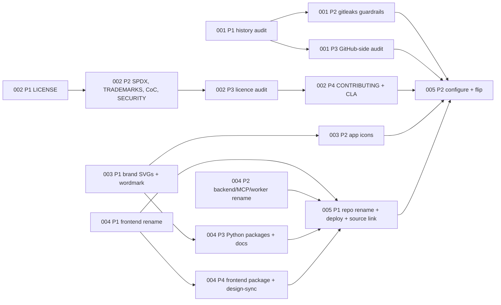

# Iteration 19: Open-Source Release & Branding

**Status:** 🟡 IN PROGRESS — 5 sub-iterations, 15 phases (one PR each). Each phase is marked ✅ DONE where it is described below; there is deliberately no running count, because parallel phase PRs would each bump it and git merges those edits silently into a wrong total.

**Dependencies:** None on product features. It operates on the repository, its metadata, the
app's user-facing naming, and the GitHub/GHCR/SonarCloud configuration.

**Goal:** Publish the repository as the open-source project **Lifecontour**. This needs:

- a legally applied **AGPL-3.0-or-later** licence and a **CLA**-backed contribution model;
- a credential-clean history with permanent secret-scanning guardrails;
- the new name everywhere the product names itself;
- a line-art brand mark used as the favicon and app icon.

## Overview

The system has been developed privately by one developer. This iteration makes it public without
exposing credentials, applies the licence the metadata has always claimed, gives outside
contributors a documented path, and replaces the "Personal Management System / PMS" naming with
**Lifecontour**.

This iteration realises the
[Open-Source Release & Branding Product Specification](../product-specifications/open-source-release-and-branding-product-specification.md).
It does **not** rename infrastructure identifiers (DB names, Redis streams, env vars, compose
`pms-*` names, log and OTel service names). It does not rewrite historical docs, and it does not
adopt the brand palette as the app's UI theme.

**Work split:**

- Five **sub-iterations**, each broken into **PR-sized phases** (≤500-line diffs, green and
  deployable `main` per phase), following the [Iteration 16](./iteration-16-outdoor-logbook-improvements.md)
  format.
- Unlike feature iterations, several phases are **operational**: scans, GitHub and GHCR
  settings, a production deploy update. Those phases still produce a PR: the audit record,
  config, and docs changes. Their out-of-repo steps are listed as checklist items that the PR
  description confirms.

## Reference Documents

- **[Open-Source Release & Branding Product Specification](../product-specifications/open-source-release-and-branding-product-specification.md)** — approved behaviour (the spec this document delivers)
- **[CI/CD Setup](../ci-cd-setup.md)** — the stacked-PR CI gate (`needs: changes`), release workflow, GHCR images
- **[Code Quality Standards](../code-quality-standards.md)** — pre-commit hooks, ruff/mypy, frontend `quality:check`
- **[Testing Strategy](../architecture/testing-strategy.md)** — RTL, Playwright e2e, backend unit tests
- **[Frontend Design](../architecture/frontend-design.md)** — Next.js metadata and app-chrome conventions
- **[MCP Setup](../mcp-setup.md)** — MCP server identity shown to clients

### External Documentation

- **GNU AGPL-3.0** — https://www.gnu.org/licenses/agpl-3.0.txt (the verbatim licence text; SPDX `AGPL-3.0-or-later`)
- **CLA Assistant** — https://github.com/cla-assistant/cla-assistant (CLA via a gist, enforced as a PR status)
- **Apache Individual CLA** — https://www.apache.org/licenses/icla.pdf (the template the CLA adapts)
- **Contributor Covenant 2.1** — https://www.contributor-covenant.org/version/2/1/code_of_conduct/
- **gitleaks** — https://github.com/gitleaks/gitleaks (pre-commit hook, CI, `.gitleaks.toml` allowlist)
- **TruffleHog** — https://github.com/trufflesecurity/trufflehog (verified-credential scan of git history and container images)
- **Next.js metadata files** — `app/icon.svg`, `app/favicon.ico`, `app/apple-icon.png` and `metadata.title.template` (context7 Next.js docs)
- **OSM tile usage policy** — https://operations.osmfoundation.org/policies/tiles/ (identifying User-Agent)
- **GitHub docs** — renaming a repository (redirects), secret scanning and push protection, private vulnerability reporting, rulesets, fork-PR workflow approval

## Delivery Rules

These apply to every sub-iteration and every phase:

1. **Tests first where there is behaviour.**
   - Rename and UI phases update or write the failing assertions first (new title, new MCP name,
     new User-Agent, source-code link), then change the code (red → green → refactor).
   - Documentation, licence and scan phases have no TDD component. Their verification step is
     listed per phase instead.
2. **Green main:** do not merge unless the relevant backend tests, `ruff`, `mypy`, and frontend
   `pnpm quality:check` pass. The pre-commit hooks run on every commit.
3. **PR size ≤ 500 lines.**
   - The one exception is the verbatim AGPL `LICENSE` (about 660 lines), which lands **alone** in
     its own PR (ITER19-002 Phase 1). It is verified by an exact diff against the GNU source,
     not read line by line.
   - Other verbatim texts (the Contributor Covenant) count against the budget normally.
4. **Credentials are rotated, not just deleted.** A real credential found anywhere is revoked at
   the provider **before** any cleanup commit. Secret values never appear in the audit record, PR
   descriptions, or commit messages.
5. **The CI gate is untouched.**
   - New CI jobs declare `needs: changes`, directly or transitively. A job with no path filter
     follows the `core-shared-lint` precedent.
   - Nothing loosens the stacked-PR gate.
   - Never use `pull_request_target` with a checkout of PR code.
6. **Name the product through one constant per stack.**
   - The frontend and backend each read the product name from a single constant, so a future
     rename is a one-line change.
   - Tests assert against the same constant or a shared pattern, not string literals scattered
     across specs.
7. **No infrastructure renames.** DB names, streams, env vars, compose `pms-*` names, and log/OTel
   service names are deferred (spec Out of Scope). Any such identifier a phase touches is left as
   is.
8. **The visibility flip is last.** It happens only after ITER19-001 has recorded zero unresolved
   real-credential findings and ITER19-002 to ITER19-004 have merged.

## Grounding Findings (shaped the sub-iteration boundaries)

Established by reviewing the current code during spec planning:

- **No `LICENSE` file exists**, though `README.md:271-273` links to one.
  - All six `pyproject.toml` files declare the non-SPDX `license = {text = "AGPL-3.0"}`.
  - `frontend/package.json` has no `license` field.
  - Every Python package builds with **hatchling** (`[build-system]`, e.g.
    `backend/pyproject.toml:84-86`). Hatchling ≥1.27 accepts the PEP 639 SPDX string form. No
    `License ::` classifiers are present.
  - Result: a small, mechanical licensing phase.
- **Repo contributors are the owner, dependabot, and AI agents only** (an Augment agent, Claude
  co-author trailers). No retroactive contributor consent is needed before licensing.
- **CI already uses no secrets on PRs.**
  - `ci.yml` has no `pull_request_target` and references no secrets.
  - The only secret in any workflow is `GITHUB_TOKEN`, in `release.yml`, which runs on tags.
  - SonarCloud runs as Automatic Analysis, outside Actions, and `sonar-project.properties` is dead
    config.
  - Fork PRs therefore need no workflow changes, only a repository setting.
- **No secret scanning exists anywhere.** `security.yml` runs pip-audit and Bandit weekly, and
  `.pre-commit-config.yaml` has no secret hook.
- **Preliminary scans found no real credentials:**
  - `.env.dev` and `.env.test` hold placeholders only;
  - no private-key or Google API-key patterns appear in history;
  - no real GitHub, AWS, OpenAI or JWT tokens are in the current tree;
  - there are no HTTP cassettes or HAR files.
  - A full audit is still required: 4,500+ commits, 747 remote branches, and `refs/pull/*`.
- **Stray tracked files:** `.tmpxYhLD4` (a local MCP config with local paths and workspace IDs)
  and the root `ITER2-004-Phase2-Production-Readiness.md`.
- **Vendored skills:**
  - `.claude/skills/playwright-skill/LICENSE` (MIT) is present.
  - `.claude/skills/shadcn/` has no licence file and ships shadcn logo PNGs under `assets/`,
    which `.claude/skills/shadcn/agents/openai.yml:4-5` references.
- **The contribution templates already exist.** `.github/pull_request_template.md` and
  `.github/ISSUE_TEMPLATE/{bug_report,feature_request}.md` are extended rather than created.
  `README.md` and `.github/copilot-instructions.md` link to a missing `docs/ai-guidelines.md`.
- **Frontend naming is scattered string literals:**
  - `layout.tsx:12-13` (title, description), `integrations/layout.tsx:4`,
    `journals/new/page.tsx:14`;
  - `lib/constants.ts:152` (sign-in) and `:157` ("private application");
  - `settings/page.tsx:15`, and "PMS" in `SnipeItSettings.tsx:146`.
  - About 25 e2e `toHaveTitle(/Personal Management System/)` assertions are spread across
    `contacts*.spec.ts`, `sidebar.spec.ts:195`, `auth/login.spec.ts` and `utils/test-helpers.ts`,
    plus the unit tests `LoginPage.test.tsx`, `jest.setup.ts:165` and
    `contacts/new/__tests__/page.test.tsx`.
  - Two tests (`home-dashboard.spec.ts:64`, `app/__tests__/page.test.tsx:397`) assert an old
    placeholder is **absent**; they stay unchanged.
  - Old-name assertions that are not titles: `auth/login.spec.ts:29`
    (`text=Sign in to your Personal Management System`) and `:502` (a body `toContain`), plus
    `LoginPage.test.tsx:164`.
  - Next.js 16's `metadata.title.template` removes the need for per-page suffix literals.
- **Design-sync is keyed to the frontend package name.** `frontend/.design-sync/config.json:3-4`
  has `"pkg": "personal-management-frontend"` and `"globalName": "PMS"`, and 47
  `previews/*.tsx` import from that package name. Renaming the package is therefore its own
  phase, including a `/design-sync` re-sync. Editing the previews clears their verification
  hashes (see `frontend/.design-sync/NOTES.md`).
- **Backend naming:**
  - `main.py:319-320` (FastAPI title and description, shown in OpenAPI) and the log messages at
    `main.py:69,280`;
  - `mcp/server.py:113-115` (MCP server name and instructions);
  - "PMS" in the OpenAPI field text at `snipeit_settings_schemas.py:20,33`;
  - the OSM User-Agent default at `infrastructure/config.py:177`. Note that
    `tests/unit/journal/test_osm_tile_source.py:34` passes its own `_USER_AGENT` to the
    constructor, so **nothing asserts the default today**;
  - module docstrings (`backend/app/__init__.py`, `main.py:2`), `backend/README.md`,
    `backend/INTEGRATION_TESTS.md`;
  - the `core_shared` module docstrings.
- **Worker outbound identity:** the Strava GPX `"creator": "PersonalManagementSystem"`
  (`integration_workers/strava/gpx_generator.py:60`) appears in files users download.
- **Package identity:**
  - `backend/pyproject.toml:2,4,6`: name `personal-management-backend`, the description
    "Personal CRM & Journal System", and a placeholder author (`dev@example.com`). The
    `core_shared` and four worker `pyproject.toml` files carry the same description and author
    placeholders;
  - `backend/uv.lock:1634` (the project name, regenerated with the rename);
  - `frontend/package.json:2,4`: the name and description. There is no author field.
  - Worker package names and `core_shared` are unchanged.
- **Docs naming:** `README.md` (including `:20` `cd personal-management-system` and `:277`),
  `frontend/README.md`, `AGENTS.md` (project context), `docs/tasks.md:1`,
  `docs/architecture.md`, `frontend/.design-sync/conventions.md`, the release-notes text
  (`release.yml:194`), `frontend/.env.example:6` (unused `NEXT_PUBLIC_APP_NAME`), and
  `docker/oauth-ui/views/index.ejs:66`.
  - The README has **no badges** today. The licence badge is new, and there is no SonarCloud badge
    to update.
- **GHCR image paths follow the repository name** (`release.yml:16`,
  `IMAGE_NAME: ${{ github.repository }}`). Renaming the repository moves future images to
  `ghcr.io/hjed/lifecontour-*`, so production's image references must change in the same step.
  Old packages stay pullable for rollback.
- **The favicon is broken.** `layout.tsx:15-16` references `/favicon.ico`, but `frontend/public/`
  holds only `.gitkeep`, so the app has no icon today.

## Dependency and Parallelisation Notes

- **ITER19-001 (Credential Audit)** starts first. Its Phase 1 result is the release gate; nothing
  else waits on it until the flip.
- **ITER19-002 (Licensing & Contributions)** is independent and can run in parallel from the
  start.
- **ITER19-003 (Brand Identity)** is independent. Phase 1's SVGs are needed by ITER19-004 Phase 3
  (the README lockup).
- **ITER19-004 (Rename)** can start immediately; the trademark searches are complete (see Resolved
  Decisions). Phase 3 needs ITER19-003 Phase 1, and Phase 4 follows Phase 1.
- **ITER19-005 (Repository Rename & Go Public)** comes last.
  - Phase 1 needs ITER19-004 merged.
  - Phase 2 (the flip) needs every other phase merged and ITER19-001's gate passed.

| Sub-iteration | Depends on | Can parallelise with |
|---|---|---|
| ITER19-001 Credential Audit & Guardrails | — | -002, -003, -004 |
| ITER19-002 Licensing & Contributions | — | -001, -003, -004 |
| ITER19-003 Brand Identity | — | -001, -002, -004 (Phases 1–2) |
| ITER19-004 Rename to Lifecontour | -003 P1 (for P3); P1 (for P4) | -001, -002 |
| ITER19-005 Repository Rename & Go Public | -004 (P1); all + -001 gate (P2) | — |

## Task Breakdown

Each sub-iteration defines:

- its objective;
- the specification section it realises;
- its dependencies;
- its deliverable;
- the outcomes its phases must collectively satisfy;
- a **phase breakdown**, where each phase carries a PR-size estimate, scope, and its tests or
  verification and documentation updates.

### ITER19-001: Credential Audit & Secret-Scanning Guardrails

**Objective:** Prove that no live credential is exposed anywhere the public flip reveals, and block
new ones permanently.

**Specification Reference:**
- [Part 3: Security Audit & Guardrails](../product-specifications/open-source-release-and-branding-product-specification.md#part-3-security-audit--guardrails)

**Dependencies:** None.

**Deliverable:**

- A committed audit record: every finding triaged, and no secret values.
- A tuned `.gitleaks.toml`.
- gitleaks enforced in pre-commit and CI.
- A GitHub-side audit (PR/issue text, Actions logs and artifacts, GHCR image layers).

**Outcomes the phases must satisfy:**
- Every git ref is scanned with gitleaks and TruffleHog (verification on): all branches, tags, and
  `refs/pull/*/head` fetched from GitHub.
- Every finding is classified as *real credential* / *dev-test placeholder* / *false positive*.
  Real credentials are revoked or rotated at the provider before anything else. The gate is
  zero unresolved real findings.
- Placeholders and false positives are allowlisted in `.gitleaks.toml`, so the guardrails start
  clean.
- The stray tracked files are removed.
- gitleaks blocks new secrets at commit (pre-commit) and in CI (behind `needs: changes`).

**Phase Breakdown:**

**Phase 1 — Git history audit, allowlist, hygiene.** PR ~200 lines. ✅ DONE — gitleaks v8.30.1 and TruffleHog 3.97.9 scanned all 603 branches, 114 tags and 1,503 `refs/pull/*/head` refs (4,742 commits). There were 29 gitleaks findings and 58 unknown TruffleHog results, all placeholders or false positives, and 0 real or verified credentials. The committed `.gitleaks.toml` brings the re-scan to 0. The record is in [docs/security/open-source-release-audit.md](../security/open-source-release-audit.md). The history gate is met: the owner confirmed production sets its own `ENCRYPTION_KEY` rather than using the compose default. Two findings for Phase 2: the config needs gitleaks **≥ 8.25**, not ≥8.19; and every allowlist entry must set `targetRules`, because a global allowlist's `paths` skip whole files despite `condition = "AND"`.

- **Scan history:** clone a mirror with `refs/pull/*` fetched and scan all refs:
  - `gitleaks git --log-opts="--all" <mirror>` (gitleaks git-mode syntax; `detect` is deprecated. The committed config needs gitleaks ≥ 8.25);
  - `trufflehog git file://<mirror> --results=verified,unknown`.
- **Scan the current tree:** check every committed `.env*` file, `docker-compose.yml`, the
  workflows, test fixtures, and the e2e auth setup, and confirm each holds only dev or test
  placeholders.
- **Triage:** record each finding in `docs/security/open-source-release-audit.md` with the
  scanner, rule, file, first commit, classification, and action taken. **Never record the secret
  value.**
- **Rotate:** revoke or rotate any real credential at its provider first (Google OAuth, Strava,
  Immich, Snipe-IT, OIDC, MeiliSearch…), then remove it from the tree.
- **Commit:**
  - `.gitleaks.toml`, extending the default ruleset and allowlisting the dev/test placeholders
    (`.env.dev`, `.env.test`, `*.env.example`, test fixtures) by path plus value regex, not by
    blanket path;
  - a `.gitleaksignore` holding the **fingerprints** of rotated real credentials. History is
    not rewritten, so a rotated secret is still in the history; its fingerprint documents that
    it was handled;
  - removal of `.tmpxYhLD4`, with `.tmp*` added to `.gitignore`;
  - `ITER2-004-Phase2-Production-Readiness.md` moved under `docs/tasks/`.
- **Verification:**
  - Re-running `gitleaks git` over the full mirror with the committed `.gitleaks.toml` and
    `.gitleaksignore` reports zero findings.
  - The TruffleHog verified-results count is zero.
  - Both commands and their summary counts are recorded in the audit doc.
- **Docs:** `docs/security/open-source-release-audit.md` (new).

**Phase 2 — Guardrails: gitleaks in pre-commit and CI.** PR ~120 lines.

- **Pre-commit:** add the `gitleaks` hook (pinned rev, ≥ v8.25 and the same as or newer than the audit's v8.30.1) to `.pre-commit-config.yaml`, using the
  committed config.
- **CI:** add a `secret-scan` job to `ci.yml` with `needs: changes`. It has **no path filter**
  (like `core-shared-lint`), so it runs on every in-gate event. It uses the pinned gitleaks CLI (≥ v8.25; every `.gitleaks.toml` allowlist entry sets `targetRules`)
  with `.gitleaks.toml` and `.gitleaksignore`, checks out with `fetch-depth: 0`, and scans:
  - **pull_request:** `base.sha..head.sha`;
  - **push:** `before..after`;
  - **tag** (via `release.yml:21`) and **workflow_dispatch** (upper stack layers): the full
    history of the ref. The allowlist and ignore file keep this clean.
- **Stacked PRs.** The job inherits the stack gate, so upper layers skip it. The gate stays as it
  is (AGENTS.md). The rule instead is that **no stack layer merges without a passing
  `secret-scan` run on its head**: either as the bottom layer, or via
  `gh workflow run ci.yml --ref <branch>`. Dispatching an upper layer scans its full history, so
  it covers every layer below it too.
  - `docs/ci-cd-setup.md` and CONTRIBUTING state this rule.
  - The maintainer confirms it in the PR checklist.
  - The pre-commit hook and, after the flip, GitHub push protection remain as backstops that do
    not depend on CI.
- **Fork PRs are never upper layers.** A PR's base must be a branch in the upstream repository,
  so an external contributor cannot build a stack upstream: every fork PR targets `main` and runs
  the full in-gate CI, `secret-scan` included, once its first-run workflow approval is given.
  Stacks are a maintainer workflow on upstream branches, where the dispatch above works.
  - CONTRIBUTING tells external contributors to submit dependent changes as **sequential** PRs
    against `main`, opening the next once the previous one merges, not as a stack.
  - If a fork contributor needs to stack anyway, the maintainer pushes the layers to upstream
    branches first; they are then scanned like any upstream stack.
- If the gitleaks GitHub Action is chosen over the CLI, it needs `GITHUB_TOKEN`. That works on
  fork PRs (read-only) and is recorded against the "no repository secrets on PRs" invariant. The
  CLI avoids the question.
- **Verification:**
  - Locally: a throwaway commit containing a fake AWS-style key is rejected by the hook, and
    `gitleaks git` flags it. Do not push it.
  - In CI: the job passes on the phase's own PR.
- **Docs:**
  - `docs/code-quality-standards.md`: the new hook, and how to allowlist a false positive.
  - `docs/ci-cd-setup.md`: the `secret-scan` job; the rule that every stack layer needs a passing
    scan on its head before it merges; and the rule "never use `pull_request_target` with a
    checkout of PR code".

**Phase 3 — GitHub-side content audit.** PR ~80 lines (audit record only).

- **PR and issue text:** scan all PR and issue bodies, comments, and review comments. Export them
  via `gh api` paginated, then run `gitleaks dir <export>` over the export.
- **Actions:**
  - Scan retained logs and artifacts.
  - Delete any Actions run log or artifact that holds a secret; `gh run delete` removes a run and
    its logs.
- **Releases and wiki:** check release notes and assets, and the wiki if one exists.
- **GHCR images:** the packages become public in ITER19-005, so every published image is
  scanned first.
  - Enumerate packages and tags with `gh api /users/hjed/packages?package_type=container` and
    `.../packages/container/<name>/versions`.
  - Run `trufflehog docker --image ghcr.io/hjed/<package>:<tag>` for each; the CLI does not
    accept wildcards.
- **Record and rotate:** triage each result into the audit doc, with the same rotation rules as
  Phase 1.
- **Verification:** the audit doc's GitHub-side section lists each surface scanned, its count, and
  zero unresolved real findings.

---

### ITER19-002: Licensing & Contribution Model

**Objective:** Legally apply AGPL-3.0-or-later with consistent identifiers, record licence
compatibility, protect the name and logo, and publish a CLA-backed contribution path.

**Specification Reference:**
- [Part 1: Licensing](../product-specifications/open-source-release-and-branding-product-specification.md#part-1-licensing)
- [Part 2: Contribution Model](../product-specifications/open-source-release-and-branding-product-specification.md#part-2-contribution-model)

**Dependencies:** None.

**Deliverable:**

- `LICENSE` and SPDX identifiers.
- The dependency licence audit.
- `TRADEMARKS.md`, `CODE_OF_CONDUCT.md`, `SECURITY.md`, `CONTRIBUTING.md` and `CLA.md`.
- Updated PR and issue templates.

**Outcomes the phases must satisfy:**
- A root `LICENSE` holds the verbatim AGPL-3.0 text with no preamble. Every package declares
  `AGPL-3.0-or-later`.
- The copyright line `Copyright (C) 2025–2026 Harry J E Day` appears in the `README.md` licence
  section and `CONTRIBUTING.md`. The README links `LICENSE` and `TRADEMARKS.md`.
- Vendored content carries its licence notices: the shadcn skill's MIT notice is recorded in
  `.claude/skills/THIRD_PARTY_NOTICES.md`, and the installed skill folders stay unmodified.
- Every runtime dependency's licence is recorded as AGPL-compatible. An incompatible one blocks
  release.
- CONTRIBUTING encodes the owner's rules: issue first, ≤500-line PRs, AI-generated PRs reviewed by
  the submitter plus automated review plus disclosure, rebase-only, and the stacked-PR CI note.
- The CLA is a **licence grant** (not assignment) that permits relicensing, and it is enforceable
  by CLA Assistant.

**Phase Breakdown:**

**Phase 1 — `LICENSE` alone.** PR ~660 lines, all verbatim. This is the single exception to the
≤500-line rule, accepted with this plan; see Delivery Rule 3. ✅ DONE — root `LICENSE` is
the verbatim GNU AGPL-3.0 text (661 lines, no preamble); `diff` against the GNU source is empty.
This status note is the only other change in the PR, in the same commit (owner decision).

- Add `LICENSE`: the verbatim `https://www.gnu.org/licenses/agpl-3.0.txt`, with **no preamble**.
  The copyright line lives in `README.md` and `CONTRIBUTING.md`, which keeps the file
  byte-identical to the GNU source.
- Nothing else goes in this PR, so review is the diff check alone.
- **Verification:** `diff <(curl -s https://www.gnu.org/licenses/agpl-3.0.txt) LICENSE` is empty.

**Phase 2 — SPDX identifiers, notices, trademarks, conduct, security policy.** PR ~300 lines.
✅ DONE:

- All six `pyproject.toml` files declare `license = "AGPL-3.0-or-later"` on `hatchling>=1.27`,
  and each wheel's `METADATA` carries `License-Expression: AGPL-3.0-or-later`.
- `frontend/package.json` and the two dev-only `docker/oauth-*` packages declare the same
  identifier.
- The README and worker READMEs have licence sections.
- `TRADEMARKS.md`, `CODE_OF_CONDUCT.md` and `SECURITY.md` are added. The Code of Conduct contact
  is GitHub private vulnerability reporting (owner decision); that channel is enabled at the
  ITER19-005 Phase 2 flip.
- The strava `uv.lock` had drifted from `core_shared` on `main`. It was refreshed so
  `uv lock --check` passes.

- **Python packages:** replace `license = {text = "AGPL-3.0"}` with the PEP 639 form
  `license = "AGPL-3.0-or-later"` in all six `pyproject.toml` files. Raise each
  `[build-system]` requirement to `hatchling>=1.27`, which accepts the SPDX string.
- **Frontend:** add `"license": "AGPL-3.0-or-later"` to `frontend/package.json`.
- **README licence section** (`README.md:271-273`): the SPDX identifier, the copyright line
  `Copyright (C) 2025–2026 Harry J E Day`, and links to `LICENSE` and `TRADEMARKS.md`. Also update
  the worker README licence lines (`integration_workers/*/README.md`).
- **Vendored shadcn skill:** add `.claude/skills/THIRD_PARTY_NOTICES.md`, which lists each
  vendored skill's source and licence and reproduces the upstream shadcn/ui MIT text.
  - The skill folders stay byte-identical to what the `skills` CLI installed, so
    `skills-lock.json` stays valid and `npx skills update` does not revert anything.
  - The upstream skill ships its own logo PNGs. They stay, as shadcn's own files that label
    shadcn's skill; the notice records that they are not this project's work.
  - This replaces an earlier plan to add a `LICENSE` inside the folder and delete the PNGs,
    which the owner rejected because the next update would revert it.
- **`TRADEMARKS.md`:** the Lifecontour name and logo are not licensed by the AGPL. Forks must
  rebrand, and may say "based on Lifecontour".
- **`CODE_OF_CONDUCT.md`:** the verbatim Contributor Covenant 2.1, with GitHub private reporting as
  the contact method.
- **`SECURITY.md`:**
  - report via GitHub private vulnerability reporting, never public issues;
  - the latest release is supported;
  - the expected response window.
- **Verification:**
  - Every Python project builds with `uv build`, which proves hatchling accepts the SPDX string.
    `uv lock --check` passes.
  - `rtk proxy git grep -n 'AGPL-3.0"'` finds no bare identifiers.
  - The `check-toml` hook passes.
  - A link check over the new files and the README passes.

**Phase 3 — Dependency licence audit.** PR ~200 lines.

- Generate the runtime licence lists:
  - `pip-licenses` in `--no-dev` synced environments for the backend, `core_shared` and each
    worker;
  - `pnpm licenses list --prod` for the frontend.
- **Record, don't dump:** `docs/licensing/third-party-licences.md` holds **per-ecosystem counts
  by licence family**, plus an **individual list of every non-permissive package** (copyleft,
  weak copyleft, unknown or custom) with a compatibility verdict. The regeneration commands are
  included so the audit can be repeated.
- **Known so far:** psycopg2 and pycountry are LGPL (compatible); dompurify is MPL-2.0 or
  Apache-2.0; the Inter font is OFL.
- Keep the OpenStreetMap ODbL attribution (`osm_tile_source.py:40`).
- Any incompatible or unknown licence is raised to the owner and blocks ITER19-005 Phase 2.
- **Verification:** the per-ecosystem totals equal the **resolved production dependency sets**,
  not the whole lockfiles, which also hold dev-only tools such as pytest, mypy and ruff:
  - `uv export --no-dev --frozen` for the backend, `core_shared` and each worker;
  - `pnpm list --prod --depth Infinity --json`, de-duplicated, for the frontend.
  - Record the commands and counts in the audit doc.

**Phase 4 — CONTRIBUTING, CLA, templates.** PR ~350 lines.

- **`CONTRIBUTING.md`:**
  - the copyright notice, and that contributions are licensed under AGPL-3.0-or-later plus the
    CLA;
  - discuss first on an issue, with typo and docs fixes exempt;
  - ≤500 changed lines per PR, split into a stack beyond that;
  - AI-generated PRs: the submitter reviews every line, runs automated code review and the quality
    gates, and discloses AI assistance; agents follow `AGENTS.md`;
  - test-first; rebase, never merge `main`; pre-commit;
  - quality commands, linking `docs/code-quality-standards.md` and the testing strategy;
  - the stacked-PR note: only the bottom layer runs CI, and the maintainer dispatches upper
    layers. No layer merges without a passing `secret-scan` on its head.
  - External contributors working from forks submit dependent changes as sequential PRs against
    `main` rather than as a stack; each such PR runs full CI.
- **`CLA.md`:** an individual CLA adapted from the Apache ICLA. The contributor grants the owner a
  perpetual, worldwide, royalty-free, irrevocable copyright and patent licence, including the
  right to sublicense and relicense under any terms, and keeps their own copyright. Include a
  short plain-English summary.
- **`.github/pull_request_template.md` (extend):** linked issue, diff size, tests run, an
  AI-assistance disclosure with "I reviewed every AI-generated line" and "automated review run",
  CLA acknowledgement, and a maintainer checkbox: "`secret-scan` passed on this head (bottom
  layer or dispatched)".
- **`.github/ISSUE_TEMPLATE/` (extend):** `feature_request.md` becomes the "discuss first"
  proposal. Add `config.yml` that disables blank issues and links security reports to
  `SECURITY.md`.
- Fix the dangling `docs/ai-guidelines.md` links in `README.md` and
  `.github/copilot-instructions.md` to point at `AGENTS.md`.
- **Verification:**
  - A GitHub preview of the templates shows the new fields.
  - A link check passes.
  - CLA Assistant itself is installed in ITER19-005 Phase 2.

---

### ITER19-003: Brand Identity

**Objective:** Ship the Lifecontour mark, concept E (an open logbook, a person, a creek), as
hand-tuned SVG brand assets and as the app's favicon and app icons, legible at 16px in light and
dark.

**Specification Reference:**
- [Part 5: Brand Identity](../product-specifications/open-source-release-and-branding-product-specification.md#part-5-brand-identity)

**Dependencies:** None.

**Deliverable:**

- `branding/` holding `mark.svg`, `mark-dark.svg`, `mark-mono.svg`, `lockup.svg` and a brand
  guide.
- Working `icon.svg`, `favicon.ico` and `apple-icon.png` in the app.

**Outcomes the phases must satisfy:**
- The mark is concept E, drawn on a 64-unit grid with strokes ≥3 units, using the palette
  Eucalypt `#2F5D50`, Creek `#2B7A9E`, Sandstone `#D08A3C`.
- The dark variant lightens the strokes for contrast on dark backgrounds. The mono variant uses
  `currentColor`.
- **Cultural review rule:** no concentric circles or rings and no dot-infill. The brand guide
  records this rule and the reason.
- The app serves a working icon. The dangling `/favicon.ico` metadata is gone. The tab icon
  follows `prefers-color-scheme`.

**Phase Breakdown:**

**Phase 1 — Brand assets and guide.** PR ~250 lines. ✅ DONE

- **Progress:** delivered `branding/mark.svg`, `mark-dark.svg`, `mark-mono.svg`, `lockup.svg`,
  `lockup-dark.svg` and `README.md`. `lockup-dark.svg` was added because GitHub shows an ``
  SVG in the OS colour scheme, not the GitHub theme, so the README needs `<picture>` (the snippet is
  in the guide). Colours live in `.book`/`.creek`/`.person`/`.wordmark` classes, so each light and
  dark file differ only in their `<style>` block, ready for Phase 2's media-query swap. The
  wordmark is Inter SemiBold (OFL), outlined with kerning. The 16/32/128px light and dark
  contact sheet is attached to the PR for owner sign-off.

- **SVGs in `branding/`:**
  - `mark.svg`, `mark-dark.svg`, `mark-mono.svg`;
  - `lockup.svg`: the mark plus a "Lifecontour" wordmark, with the text converted to paths so it
    renders without the font.
- **Brand guide (`branding/README.md`):** palette, minimum size, clear space, do/don't, the
  cultural review rule, and a pointer to `TRADEMARKS.md`.
- The SVGs are hand-authored and optimised (no editor metadata) and include `<title>` for
  accessibility.
- **Verification:**
  - Render each SVG at 16, 32 and 128px on light and dark backgrounds, with `inkscape` or
    `rsvg-convert` into a contact sheet.
  - Attach the sheet to the PR description. Do not commit it.
  - The owner confirms legibility and the cultural rule.
- **Docs:** `branding/README.md`.

**Phase 2 — App icons.** PR ~120 lines. ✅ DONE

- **Progress:** delivered `frontend/src/app/icon.svg` (the mark with a dark media-query swap),
  `favicon.ico` (16 + 32px, light mark) and `apple-icon.png` (180px, 30px clear space, white),
  generated with Inkscape and ImageMagick using the commands in `branding/README.md`. The `icons`
  metadata is gone from `layout.tsx`. The `sidebar.spec.ts` "App icon" e2e also checks that every
  `link[rel="icon"]` resolves, so a dangling icon link fails the test.

- **`frontend/src/app/icon.svg`:** the mark with an embedded
  `@media (prefers-color-scheme: dark)` style that swaps to the dark strokes.
- **`frontend/src/app/favicon.ico`** (16 and 32px) and **`frontend/src/app/apple-icon.png`**
  (180px, padded, on a light background): generated from the SVG with the command recorded in
  `branding/README.md`.
- Remove `icons: { icon: '/favicon.ico' }` from `layout.tsx`. The Next.js file conventions emit
  the `<link>` tags.
- **Tests:** a Playwright e2e in an existing app-shell spec (e.g. `sidebar.spec.ts`). It asserts
  that a `link[rel="icon"]` whose href points at the app's `icon.svg` is present, and that
  fetching that href returns 200 with an SVG content type. It runs on the `firefox` and
  `Mobile Chrome` projects.
- **Verification:** a manual check in light and dark browser themes that the tab icon switches
  variant.

---

### ITER19-004: Rename to Lifecontour

**Objective:** Everywhere the product names itself (UI, API, MCP, outbound requests, packages,
docs), it says **Lifecontour**, read from one constant per stack.

**Specification Reference:**
- [Part 4: Name — Lifecontour](../product-specifications/open-source-release-and-branding-product-specification.md#part-4-name--lifecontour)

**Dependencies:**

- Phase 3 needs ITER19-003 Phase 1 (the lockup for the README).
- Phase 4 follows Phase 1, so the frontend is stable before the design-sync re-grade.

**Deliverable:** A user, API consumer, or MCP client sees "Lifecontour", and the tagline is
*"Your journal, people and adventures — self-hosted."*

**Outcomes the phases must satisfy:**
- Every surface in the spec's rename table is renamed, plus the worker descriptions and the
  Strava GPX `creator`. The deferred infrastructure identifiers are untouched.
- The frontend titles use `metadata.title.template` (`'%s | Lifecontour'`), with the product name
  from one constant.
- The backend, MCP and workers read the product name from one `core_shared` constant.
- The e2e and unit title assertions use a single shared pattern.
- "Private application" wording becomes self-hosted-instance wording. `robots: noindex` stays.
- The OSM User-Agent identifies Lifecontour with a project URL.

**Phase Breakdown:**

**Phase 1 — Frontend user-facing rename.** PR ~320 lines. ✅ DONE

- **Progress:** `APP_NAME` and `APP_TAGLINE` live in `frontend/src/lib/constants.ts`, and the root
  metadata uses `title.template`. `UI_TEXT.PRIVATE_APP_NOTICE` was renamed to `SELF_HOSTED_NOTICE`
  ("This is a private, self-hosted Lifecontour instance."). The Jest `@/lib/constants` mocks read
  `APP_NAME`, `APP_TAGLINE` and `UI_TEXT` through `jest.requireActual` instead of copying the
  strings. `APP_TITLE_PATTERN` is derived from `APP_NAME`. The login spec asserts the exact root
  title and `integrations.spec.ts` the exact `Integrations | Lifecontour`, which together prove
  the default and the template.

- **Constants:** add `APP_NAME = 'Lifecontour'` and `APP_TAGLINE` to `frontend/src/lib/constants.ts`.
- **Metadata:**
  - `layout.tsx` metadata becomes `title: { default: APP_NAME, template: '%s | ' + APP_NAME }`,
    with the tagline as the description.
  - The per-page titles (`integrations/layout.tsx:4`, `journals/new/page.tsx:14`) become bare
    page names.
- **Copy:**
  - the sign-in text (`constants.ts:152`);
  - the "private application" text (`constants.ts:157`) becomes self-hosted-instance wording;
  - the settings copy (`settings/page.tsx:15`);
  - "PMS" in `SnipeItSettings.tsx:146`.
- **Tests (red first):**
  - Add `APP_TITLE_PATTERN` to `tests/e2e/utils/test-helpers.ts`, and change every
    `toHaveTitle(/Personal Management System/)` (about 22 sites) to use it.
  - Update the non-title e2e assertions at `auth/login.spec.ts:29` and `:502` to the new sign-in
    copy.
  - Update the unit assertions in `LoginPage.test.tsx` (including `:164`), `jest.setup.ts:165` and
    `contacts/new/__tests__/page.test.tsx`.
  - Leave `home-dashboard.spec.ts:64` and `app/__tests__/page.test.tsx:397` unchanged.
  - Add an RTL assertion that the Snipe-IT settings copy says "Lifecontour".
- **Verification:**
  - `pnpm quality:check` and the full Jest suite pass.
  - The changed e2e specs pass on `firefox` and `Mobile Chrome`.
  - `rtk proxy git grep -n -e "Personal Management System" -e "Personal CRM" -e "\bPMS\b" -- frontend/src frontend/tests`
    returns only the two absence tests.

**Phase 2 — Backend, MCP, worker and outbound identity.** PR ~300 lines.

- **Constants:**
  - Add `PRODUCT_NAME = "Lifecontour"`, `PRODUCT_TAGLINE` and
    `PRODUCT_URL = "https://github.com/hjed/lifecontour"` in `core_shared`, so the backend and the
    workers share them. The URL resolves once ITER19-005 renames the repository.
- **FastAPI and backend:**
  - the `title` and `description` (`main.py:319-320`);
  - the startup and shutdown log messages (`main.py:69,280`);
  - the docstrings at `main.py:2` and `backend/app/__init__.py`.
- **MCP:**
  - The server `name` and the `instructions` wording (`mcp/server.py:113-115`) use the constants.
  - Tool docstrings are unchanged unless they name the product.
- **OpenAPI:** the "PMS" field text in `snipeit_settings_schemas.py:20,33` becomes "Lifecontour".
- **OSM User-Agent:**
  - The default (`config.py:177`) becomes
    `f"{PRODUCT_NAME} (+{PRODUCT_URL}; outdoor-logbook-pdf)"`.
  - It has **no version component**. OSM's policy needs an identifying agent with contact
    information, and this avoids depending on package metadata that is renamed in Phase 3.
- **Strava GPX:** the `creator` attribute (`integration_workers/strava/gpx_generator.py:60`) uses
  `PRODUCT_NAME`.
- **Docs:** update the naming in `backend/README.md`, `backend/INTEGRATION_TESTS.md` and the
  `core_shared` module docstrings.
- **Tests (red first):**
  - backend unit: the OpenAPI schema `info.title` equals `PRODUCT_NAME`;
  - backend unit: the MCP server's `name` equals `PRODUCT_NAME`;
  - backend unit: **`Settings()` default** for the tile User-Agent contains `PRODUCT_NAME` and
    `PRODUCT_URL`. The existing `test_osm_tile_source.py` injects its own agent and does not
    cover this;
  - backend unit: the Snipe-IT schema descriptions do not contain "PMS";
  - Strava worker unit: the generated GPX root's `creator` equals `PRODUCT_NAME`.
- **Verification:**
  - The backend, `core_shared` and Strava unit tests, `ruff` and `mypy` pass.
  - `rtk proxy git grep` for the old names under `backend/app`, `core_shared/` and
    `integration_workers/` returns only the deferred infrastructure identifiers (log/OTel service
    names, DB and stream names).

**Phase 3 — Python package metadata and docs.** PR ~300 lines.

- **Packages:**
  - `backend/pyproject.toml`: name `lifecontour-backend`, and the description and author
    (`Harry J E Day`) in place of the placeholders.
  - The same description and author fixes in `core_shared` and the four worker `pyproject.toml`
    files. The package names are unchanged.
  - Regenerate `backend/uv.lock`, touching only the project name.
- **README** (with ITER19-003 Phase 1): the title, the tagline, the `branding/lockup.svg` header,
  a new licence badge, and "About" copy.
- **Docs:**
  - `frontend/README.md`;
  - `AGENTS.md` project context;
  - `docs/tasks.md:1` heading;
  - `docs/architecture.md` heading;
  - `frontend/.design-sync/conventions.md` (prose only);
  - `frontend/.env.example:6` (remove the unused `NEXT_PUBLIC_APP_NAME`);
  - `docker/oauth-ui/views/index.ejs:66`.
- **Left for ITER19-005 Phase 1:** repository-URL text (`cd personal-management-system` at
  `README.md:20` and `release.yml:194`, `docs/architecture/frontend-design.md:109`), because it is
  only correct once the repository is renamed.
- **Verification:**
  - The backend Docker image builds; Docker installs from `pyproject`.
  - `uv lock --check` passes for each project.
  - The README renders the lockup and badge on GitHub (branch preview).

**Phase 4 — Frontend package rename and design-sync.** PR ~150 lines.

- `frontend/package.json`: name `lifecontour-frontend`, and the description.
- `frontend/.design-sync/config.json:3-4`: set `"pkg": "lifecontour-frontend"` and
  `"globalName": "Lifecontour"`.
- Update the package import in the 47 `previews/*.tsx` files. It is a mechanical one-line change
  per file; `ds-entry.ts` is updated if it names the package.
- Run `node .design-sync/prepare.mjs`, format with Prettier, then run `/design-sync` to re-publish
  and re-grade the previews, following `frontend/.design-sync/NOTES.md`. The edits clear the
  previews' verification hashes, so the re-sync is part of this phase.
- **Verification:**
  - `pnpm install --frozen-lockfile` and `pnpm quality:check` pass.
  - The design-sync build succeeds, and the re-sync reports every preview verified.

---

### ITER19-005: Repository Rename & Go Public

**Objective:** Move the repository, images and deployment to the new name, configure the public
repository's protections, and flip visibility.

**Specification Reference:**
- [Part 6: Go-Public Runbook](../product-specifications/open-source-release-and-branding-product-specification.md#part-6-go-public-runbook)
- [Part 4 — images follow the repository name](../product-specifications/open-source-release-and-branding-product-specification.md#decision-images-follow-the-repository-name)
- [Part 1 — AGPL §13 source offer](../product-specifications/open-source-release-and-branding-product-specification.md#target-behaviour)

**Dependencies:**

- Phase 1 needs ITER19-004.
- Phase 2 needs every other phase merged and ITER19-001's gate passed.

**Deliverable:**

- The repository at `hjed/lifecontour`, with production pulling `ghcr.io/hjed/lifecontour-*`.
- A "Source code" link in the app.
- Public visibility, with secret scanning, push protection, a required CLA check, and fork-PR
  approval on.

**Outcomes the phases must satisfy:**
- The repository is renamed. Old URLs and remotes redirect. SonarCloud is re-bound, and the badge
  URLs are updated.
- A release produces `ghcr.io/hjed/lifecontour-*` images. Production is redeployed from them and
  verified. The old packages are kept for rollback.
- The app shows a "Source code" link to the public repository (AGPL §13) on the public login
  page and in the user menu, so it can be reached signed in or out.
- The GHCR packages are public, linked to the repository.
- After the flip: secret scanning and push protection, private vulnerability reporting, and
  Dependabot alerts are enabled. A ruleset on `main` requires PRs, passing checks, and the CLA
  check. First-time contributors' workflows need approval.
- A test PR from a fork gets the CLA bot, runs CI without secrets, and shows the templates.

**Phase Breakdown:**

**Phase 1 — Repository rename, images, deploy, source link.** PR ~150 lines.

- **Before merge (manual):**
  - Rename the repository to `hjed/lifecontour`.
  - `git remote set-url` in each local checkout and worktree.
  - Re-bind the SonarCloud project and update its key.
- **In the PR:**
  - `SOURCE_CODE_URL` in `frontend/src/lib/constants.ts`, and a "Source code" link on **both**
    surfaces a network user can reach:
    - the **login page**, which is public, so unauthenticated visitors can reach it;
    - `components/auth/UserMenu.tsx`, for signed-in users.
    Both are external links with `rel="noopener noreferrer"`.
  - Update the repository-URL text:
    - `docs/mcp-setup.md:155`;
    - `cd personal-management-system` at `README.md:20`, `release.yml:194` and
      `docs/troubleshooting/docker-development.md`;
    - `docs/architecture/frontend-design.md:109`.
  - `sonar-project.properties`: delete it, since it is dead config (Automatic Analysis reads
    `.sonarcloud.properties`), or update it.
- **Tests (red first):**
  - RTL, **new** `components/auth/__tests__/UserMenu.test.tsx` (none exists today): `UserMenu`
    renders a "Source code" link to `SOURCE_CODE_URL` that opens in a new tab.
  - RTL: `LoginPage.test.tsx` asserts that the login page renders the same link.
  - e2e, on `firefox` and `Mobile Chrome`:
    - in `auth/login.spec.ts`, **signed out**, the login page shows the link with the right href;
    - in an app-shell spec (new; no existing e2e opens the user menu), open the user menu and
      assert the link.
- **After merge (manual):**
  - Tag a release, and confirm `release.yml` publishes `ghcr.io/hjed/lifecontour-*`.
  - Update the production deployment's image references and redeploy.
  - Verify health, login, and an MCP call.
  - Keep the old packages.
- **Docs:** `docs/ci-cd-setup.md` gets the new image paths and a note that they follow
  `github.repository`.

**Phase 2 — Configure the public repository and flip.** PR ~100 lines (docs only).

- **Pre-flip:**
  - Install CLA Assistant, with `CLA.md` published as its gist. **Allowlist the bots**
    (`dependabot[bot]` and any other automation) so the required CLA check does not block them.
  - Require approval for first-time contributors' workflow runs.
  - Create a ruleset on `main`: PR required, the required status checks, the CLA check, and no
    force-push.
  - Make the GHCR packages public and link them to the repository.
- **Flip:** set the repository visibility to public.
- **Post-flip:**
  - Enable secret scanning plus push protection, private vulnerability reporting, and Dependabot
    alerts.
  - Triage any secret-scanning alerts from GitHub's full-history scan into the audit doc.
  - Open a test PR from a fork (a trivial docs change) and confirm the CLA bot, secret-free CI, and
    templates, then close it.
  - Confirm the public README renders the lockup, the licence badge, and the LICENSE and
    TRADEMARKS links.
- **Docs:** `docs/ci-cd-setup.md` gets a "Public repository settings" section covering each
  setting above and why, plus the fork-PR and CLA flow. Append the post-flip triage to
  `docs/security/open-source-release-audit.md`.
- **Verification:** walk through the spec's Success Criteria 1–6 and record each result in the PR
  description.

---

## Resolved Decisions

Confirmed with the product owner (2026-09-26, spec planning):

1. **Licence:** AGPL-3.0-**or-later**.
2. **Contribution agreement:** a **CLA** as a licence grant (not assignment). There are no
   commercial plans today, but the option stays open.
3. **Publish strategy:** flip the existing repository. Branches and PR history being public is
   acceptable; only credentials are in scope.
4. **Rename depth:** user-facing text, package names and the repository name. Infrastructure is
   deferred.
5. **Name:** **Lifecontour**, with the tagline *"Your journal, people and adventures —
   self-hosted."*
6. **Icon:** concept **E**, the original with the creek. The contour-ring variant was rejected
   because it echoes a First Nations art motif.
7. **Copyright holder:** Harry J E Day.
8. **GHCR packages:** made **public**, so self-hosters can `docker pull`.
9. **Trademark searches (2026-09-27):** the owner completed the IP Australia and USPTO searches
   for "Lifecontour" with no conflicts, and confirmed `hjed/lifecontour` is available. The
   name-adoption gate is removed, and **no domain is registered**.
10. **CONTRIBUTING rules:** issue first, ≤500-line PRs, AI-generated PRs reviewed by the submitter
   and run through automated review.

Planning decisions made in this document (not requiring product input, recorded for review):

11. **`LICENSE` is verbatim with no preamble**, and lands alone as the single exception to the
    ≤500-line rule. The copyright line lives in the README and CONTRIBUTING.
12. **The OSM User-Agent carries no version**; it identifies the product and URL, as OSM's policy
    requires.
13. **The frontend package rename is its own phase**, because design-sync keys on the package name
    and needs a re-sync.

### Remaining design choices (decide during implementation, no product input required)

- The exact CLA wording within the Apache-ICLA-derived licence grant, and whether CLA Assistant
  stores signatures in its default store or in a repository file.
- The gitleaks CI mechanism (the official action vs. the pinned CLI), provided it stays behind
  `needs: changes` and uses the committed config.
- The exact `core_shared` module for the product constants (e.g. `core_shared/product.py`).
- Where the user menu places the "Source code" link (item order and icon).

## Sub-Iteration Summary

| Sub-iteration | Deliverable | UI | MCP | Depends on |
|---|---|---|---|---|
| ITER19-001: Credential Audit & Guardrails | Audit record, `.gitleaks.toml`, gitleaks pre-commit + CI | — | — | — |
| ITER19-002: Licensing & Contributions | LICENSE/SPDX, licence audit, TRADEMARKS, CoC, SECURITY, CONTRIBUTING, CLA, templates | — | — | — |
| ITER19-003: Brand Identity | `branding/` assets + guide, app icons | ✅ | — | — |
| ITER19-004: Rename to Lifecontour | Name everywhere (UI, API, MCP, workers, packages, design-sync), from one constant per stack | ✅ | ✅ (server name) | -003 P1 |
| ITER19-005: Repository Rename & Go Public | Repo/images/deploy renamed, source link, public with protections | ✅ | — | All |

### Phase Summary

| Sub-iteration | Phases | Est. PRs |
|---|---|---|
| ITER19-001: Credential Audit & Guardrails | 3 | 3 |
| ITER19-002: Licensing & Contributions | 4 | 4 |
| ITER19-003: Brand Identity | 2 | 2 |
| ITER19-004: Rename to Lifecontour | 4 | 4 |
| ITER19-005: Repository Rename & Go Public | 2 | 2 |
| **Total** | **15** | **15** |

**Suggested delivery order:**

1. Start ITER19-001 Phase 1 immediately; the credential audit is the long-lead item.
2. Run ITER19-002 and ITER19-003 in parallel.
3. Then ITER19-004 Phases 1–4.
4. Then ITER19-005 Phase 1, with the deploy step.
5. ITER19-005 Phase 2 flips the repository last.
