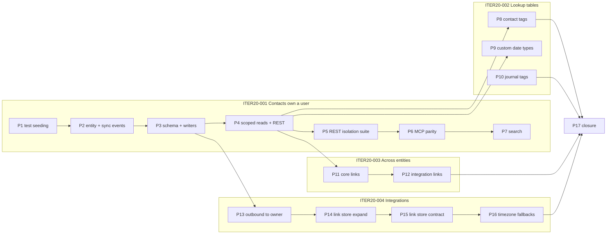

# Iteration 20: Entity Ownership (user_id)

**Status:** 🔴 PLANNED — 5 sub-iterations, 17 phases (one PR each). Each phase is marked ✅ DONE where it is described below; there is deliberately no running count, because parallel phase PRs would each bump it and git merges those edits silently into a wrong total.

**Dependencies:** Iteration 15 (`sync_metadata` is the sole integration link store), Iteration 18 (tasks' owner-scoped repository contract; the recorded contact-ownership divergence), Iteration 13 (contact merge; the same divergence), Iteration 12 (event-driven history), Iteration 14 (worker standardisation; `core_shared/testing` fixtures), migration `0106` (owner derivation).

**Goal:** Give every user-created or user-synced entity exactly one owner, enforced in SQL on every read and write, across REST, MCP, search, history, dashboards and all four integration workers — starting with **contacts** — and assign every existing row to the site's one real user.

## Overview

The system was built and deployed for one person. Journals, tasks, calendars, gear, templates,
series and every credential table carry `user_id`; **contacts do not**, nor do contact tags,
custom date types, journal tags, or the integration link store `sync_metadata`. Beyond the schema,
several code paths *assume* one user: the Google and Immich workers push each contact change to
every connected account, worker sync events carry no owner, the inbound consumer reconciles by
email and resolves tags across all users, contact search has no owner filter, and two background
consumers read "the" timezone through a single-user helper.

This iteration realises the
[Entity Ownership Product Specification](../product-specifications/entity-ownership-product-specification.md).
It resolves the divergences recorded in [iteration 13](./iteration-13-contact-merge.md) (contact
merge cannot check ownership) and [iteration 18](./iteration-18-home-dashboard-and-tasks.md)
(phase 4: task contacts check existence only; the dashboard's contact ports are unscoped).

**Work split:**

- Five **sub-iterations**, each broken into **PR-sized phases** (≤500-line diffs, green and
  deployable `main` per phase), following the [Iteration 19](./iteration-19-open-source-release-and-branding.md)
  format.
- Where a change spans `core_shared`, the workers and the backend, phases follow the
  **expand → migrate → contract** ordering of [Iteration 15](./iteration-15-integration-link-consolidation.md):
  the producers gain the field first (additive), the consumers start requiring it second, and the
  contract (NOT NULL, required type, unique-key swap) lands last.

## Reference Documents

- **[Entity Ownership Product Specification](../product-specifications/entity-ownership-product-specification.md)** — approved behaviour (the spec this document delivers)
- **[Database Design](../architecture/database-design.md)** — contacts, tags and `field_history` tables; transaction management (commit-as-you-go, `@transactional`, savepoints)
- **[Domain Architecture](../architecture/domain-architecture.md)** — the journals `find_by_id_for_user` pattern, the tasks "every method takes the acting user's id" contract, and the recorded "contacts have no owner" notes
- **[API Design](../architecture/api-design.md)** — 404 (never 403) for another user's entity; JSON:API resource shapes
- **[Integration Architecture](../architecture/integration-architecture.md)** — outbox → Redis Streams flow, the inbound consumer, the Snipe-IT "events without a `user_id` are skipped" rule
- **[Testing Strategy](../architecture/testing-strategy.md)** — conftest usage, `authenticated_client`, `authenticated_lifespan_client`, worker fixtures
- **[Creating Migrations skill](../../.claude/skills/creating-migrations/SKILL.md)** — sequential naming
- `backend/tests/integration/api/test_journal_ownership.py` — the cross-user isolation suite pattern (`CROSS_USER_REQUESTS`, `UNCHANGED_ROWS`, a foreign fixture seeded with `OTHER_USER_ID`)
- `backend/app/migrations/versions/0106_reassign_synthetic_owner_rows.py` and `backend/tests/integration/mcp/test_reassign_synthetic_owner_migration.py` — the owner-derivation precedent and its test harness

## Delivery Rules

These apply to every sub-iteration and every phase:

1. **Tests first.** Every phase writes the failing test before the change (red → green → refactor).
   Schema-only steps are covered by a migration test on an isolated database (the `run_alembic` /
   `throwaway_database` fixtures), not by "the column exists" assertions.
2. **Green main:** backend `pytest`, `ruff`, `mypy`, every touched worker's suite, and frontend
   `pnpm quality:check` pass before merge. Pre-commit runs on every commit.
3. **PR size ≤ 500 lines** including tests. Phases 1 and 3 are the ones most at risk; each says how
   it is split if the estimate is exceeded.
4. **Filter in SQL, at the aggregate.** A repository method that reads an aggregate takes `user_id`
   and puts it in the `WHERE` clause. Child-row methods keyed by the parent id stay unscoped; the
   service proves the parent belongs to the user first. Never fetch-then-compare.
5. **404, never 403.** A foreign id is `ContactNotFoundError` / `TagNotFoundError` / … exactly as a
   missing one is, and the error body carries nothing about the row.
6. **Events carry the owner.** A payload that identifies an owned aggregate carries `user_id`; a
   consumer that needs the owner and does not get one fails that event permanently
   (`PermanentOutboxEventProcessingError`), never guesses.
7. **Transactions:** writes commit in the service (`@transactional` / `unit_of_work`); controllers
   and MCP tools never open one. Migrations that reassign rows log every decision and refuse
   ambiguity (the `0106` shape).
8. **The wire contract does not change.** No JSON:API attribute, MCP result field or frontend type
   gains `user_id`.
9. **Deploy order.** A backend that requires `user_id` on worker events (Phase 3) must never run
   against a worker that does not send it (Phase 2). Deploy workers first or together.
10. **Record decisions and follow-ups here.** Divergences, deferrals and discoveries are appended to
    the phase that found them.

## Grounding Findings (shaped the phase boundaries)

Established by reviewing the current code during spec planning:

- **Owner columns are `VARCHAR(50)` strings with no FK**; there is no `users` table. Test identities:
  the `test_user` fixture hard-codes `id="test-user-123"` (`backend/tests/integration/conftest.py:695`)
  and there is **no shared constant for it** (only a private `_TEST_USER_ID` in
  `test_external_links_endpoints.py:10`); `OTHER_USER_ID = "other-user-456"` lives in
  `backend/tests/integration/tasks/task_seeding.py:54`. Phase 1 introduces `TEST_USER_ID` beside the
  seeding helper and points the fixture at it.
- **Head migration is `0120`**. Numbers below are indicative; take the next free number when the
  phase lands and update the notes here (iteration 15 precedent).
- **`contacts` construction sites** (non-test) number 18 across `backend/app` (REST converters,
  MCP tools, Immich auth controller, suggestion service, merge service, three repository row
  mappers, `upcoming_important_date_repository.py`), `core_shared` (`serialization.py`) and the
  Google transformer and Immich sync service. Making `Contact.user_id` required is what forces every
  one of them to name an owner.
- **54 test files run raw `INSERT INTO contacts`** (42 under `backend/tests`, 12 under the workers
  and `core_shared`). A NOT NULL column breaks them all at once, so seeding is consolidated first.
- **`ContactRepository`** (`backend/app/core/contacts/models/repositories.py`) has ~99 port
  methods. Only the aggregate-level ones need `user_id`: `find_by_id`, `contact_exists`,
  `find_names_by_ids`, `find_by_email`, `find_by_external_reference`, `search`, `get_all`,
  `get_count`, `delete`, `bulk_delete_all`, `get_contacts_by_tag`, `get_favourite_contacts`,
  `get_favourite_contacts_count`, `get_contacts_by_filters`. Sub-entity methods keyed by
  `contact_id` stay as they are.
- **Surfaces:** 28 routes in `api/contacts/controllers.py`, 5 in `relationship_controllers.py`, 3 in
  `custom_date_type_controllers.py`, 6 in `api/tags/controllers.py`; 19 MCP tools in
  `mcp/domains/contacts/tools.py`; 4 journal-tag MCP tools in `mcp/domains/journals/tools/tags.py`.
- **Worker sync events:** `ContactSyncEventData` (`core_shared/core_shared/models/outbox_events.py:20`)
  has no `user_id`; `OutboxEvent.create_contact_sync_event` (`core_shared/.../models/outbox.py:102`)
  takes none. The Google transformer (`integration_workers/google/transformer.py:86`) and the Immich
  sync service (`immich_sync_service.py:723`) build the `Contact` the payload serialises.
- **Outbound fan-out:** Google `process_contact_event` selects every `user_google_auth` row
  (`integration_workers/google/worker.py:3509`); `find_contacts_to_push` reads all contacts
  (`worker.py:142`). Immich `process_contact_event` prefers `event_data["user_id"]` and otherwise
  falls back to `get_all_user_ids` (`integration_workers/immich/worker.py:659`, comment "single-user
  by design"); `_fetch_user_contacts` reads all contacts (`immich_sync_service.py:848`).
  **`ContactMerged` never reaches that generic branch:** both workers dispatch it first to a
  dedicated `_process_contact_merged_event` (Google `worker.py:3476` → `:3338`; Immich
  `worker.py:633` → `:535`). The Google merge handler selects every `user_google_auth` row
  (`:3383`) and runs the remote delete of the source contact for each — a destructive cross-user
  request unless it, too, is scoped.
- **Inbound consumer** (`backend/app/core/integrations/outbox_event_processor.py:646`): idempotency by
  `sync_metadata.find_by_external_id(source, external_id)` (global), email reconciliation via
  `find_by_email` (global), `_get_or_create_tag` (global, `:443`).
- **`sync_metadata`** unique index `idx_sync_metadata_integration_external (integration_source, external_id)`
  (`0003_add_integration_tables.py:99`); no `user_id`. Snipe-IT asset ids are per-instance, so two
  users' instances collide today. **Seven writers name that key as their `ON CONFLICT` target:**
  backend `SyncMetadataRepository.upsert` (`sync_metadata_repository.py:199`) and
  `link_journal_if_unlinked` (`:634`, the additive journal-merge path, `DO NOTHING`), the album
  `upsert_link` (`album_sync_read_repository.py:120`), Google `_upsert_sync_metadata`
  (`google/worker.py:1369`), Immich `_upsert_sync_metadata` (`immich_sync_service.py:883`),
  Snipe-IT (`snipeit_sync_service.py:649`) and the Strava link write. Every one must move to the
  per-user key *before* the global index goes, or PostgreSQL rejects the write for naming a
  conflict target that no longer exists.
- **Outbound contact events are fourteen, not four:** `CONTACT_PUSH_EVENT_TYPES`
  (`core_shared/core_shared/models/contacts/event_types.py:27`) routes the four lifecycle events
  **and** `TagAssigned`, `TagRemoved`, `ContactMethodAdded/Deleted`, `ContactAddressAdded/Deleted`,
  `ContactNoteAdded`, `ImportantDateAdded/Updated/Deleted` to both workers' `process_contact_event`.
  Separately, Google `process_tag_event` (`google/worker.py:3071`) handles `TagUpdated` /
  `TagDeleted` with its own every-`user_google_auth` loop (`:3103`), renaming or deleting the
  matching contact group in each account.
- **Timezone helper** `get_default_timezone()` (`user_settings_repository.py:79`) reads the most
  recently updated `user_settings` row; callers: `inbound_event_consumer.py:255,386`,
  `summary_consumer.py:261`. `get_timezone(user_id)` (`:72`) already exists and stays. The owner is
  already available at both inbound call sites: journal sync events carry it in
  `journal_data["user_id"]` (`core_shared/.../models/outbox_events.py:64` / Google `worker.py:202`)
  and `journal_review.detect_matches` carries `payload.user_id` (`outbox_events.py:233`,
  `match_detection_event_processor.py:76`).
- **Search:** `CONTACTS_INDEX_SETTINGS.filterableAttributes` (`meilisearch_client.py:88`) has no
  `user_id`; journals verify `JOURNAL_REQUIRED_FILTERABLE_ATTRIBUTES = ("user_id", "id")` at startup
  (`:155`). `ReindexService.reindex_contacts` exists (`reindex_service.py:105`).
- **Contacts are hard-deleted** (`contact_service.py:1702`; merge deletes the source at
  `contact_merge_service.py:252`), so contact history authorises by loading the contact; a deleted
  contact's history is unreachable, as today.
- **Cross-entity checks are existence-only** and each names itself as the place the rule lands:
  `TaskService._resolve_contacts` (`task_service.py:1633`), `AthleteMappingService.create_mapping`
  (`athlete_mapping_service.py:66`), `JournalContactService.add_contact_to_journal`
  (`journal_contact_service.py:44`), `ContactMergeService.merge_contacts` (`:123`),
  `ContactRelationshipService.create_relationship` (`:43`).

## Dependency and Parallelisation Notes

- **ITER20-001 is strictly sequential** (P1 → P7): each phase depends on the previous one's contract.
- **ITER20-002** (tags, date types, journal tags) needs P4's scoped `ContactService` for tag
  assignment checks but its three phases are **independent of each other** and of ITER20-003/004.
- **ITER20-003** needs P4 (scoped `contact_exists`); P11 and P12 are sequential only because P12
  reuses P11's test seeding.
- **ITER20-004** needs P3 (events carry `user_id`) and is otherwise independent of 002/003.
  P14 → P15 is the expand → contract pair and must stay ordered.
- **ITER20-005** (closure) is last.

---

## Task Breakdown

### ITER20-001: Contacts own a user

**Objective:** `contacts.user_id NOT NULL`, every existing contact assigned to the site's one real
user, every creation path stamping the acting user, every read and write scoped in SQL, proven by
cross-user isolation suites on REST and MCP, and contact search filtered by owner.

**Specification Reference:** Parts 1, 2, 5; Part 6 "Sync events name the owner".

**Acceptance Criteria (task-level):**
- [x] `contacts.user_id` exists, is `NOT NULL`, indexed, and the migration assigns existing rows per the `0106` derivation (refusing ambiguity unless `-x contacts_owner=` is given).
- [x] `Contact.user_id: str` is required on the shared entity; no construction site in backend, `core_shared` or the workers omits it.
- [ ] Every aggregate-level `ContactRepository` method takes `user_id` and filters in SQL; every REST endpoint and MCP tool answers 404 for another user's contact and leaves it unchanged (`test_contact_ownership.py`, `test_mcp_contact_ownership.py`).
- [ ] Contact search, global search and search suggestions return only the acting user's contacts.
- [x] Worker-published contact sync events and backend contact events carry `user_id`.

---

#### Phase 1: Consolidate test seeding of contacts ✅ DONE

**PR Size:** ~350 lines across ~55 files (mechanical; test-only)

Before the schema changes, every raw `INSERT INTO contacts` in a test goes through one helper so
Phase 3 changes the owner in one place, and later phases seed a foreign contact the same way.

- [x] Add `backend/tests/integration/contact_seeding.py` defining `TEST_USER_ID = "test-user-123"`
  (the `test_user` fixture in `conftest.py:695` reads it, so the two cannot drift) and
  `seed_contact(conn, *, user_id: str = TEST_USER_ID, first_name="Sarah", last_name=None, ...) -> int`
  (generalising `task_seeding.create_contact`). `task_seeding.create_contact`,
  `contact_suggestion_seeding.create_contact`, `upcoming_date_seeding.seed_contact` and the two
  local `seed_contact` helpers (`test_home_dashboard_upcoming_dates.py:59`,
  `test_contact_tools_integration.py:1833`) delegate to it.
- [x] Add `seed_contact` to `core_shared/core_shared/testing/` for the 12 worker / `core_shared` test
  files (Google `test_tag_push_integration.py:22`, Immich reconciliation tests, …).
- [x] Replace every remaining raw insert (42 backend files) with the helper. Behaviour of every test
  is unchanged.
- [x] `tests/fixtures/contact_fixtures.py` factories and the `ContactFactory` fixture
  (`conftest.py:936`) are left as they are (they go through the API / entity, not SQL).

**Required Test Coverage:** none new — the whole existing suite is the coverage; it must pass
unchanged. Grep gate in the PR description: `INSERT INTO contacts` appears only in the two helpers.

**E2E:** not applicable.

**Required Documentation Updates:**
- [x] `docs/architecture/testing-strategy.md` — name the seeding helpers as the way to create a
  contact in an integration test.

**Status:** ✅ DONE — every test-side contact insert goes through `seed_contact` /
`seed_contacts`; the whole suite passes unchanged (backend unit 4936, backend integration 3408,
`core_shared` 651, Google 700, Immich 254).

**Decisions (recorded during implementation):**
- **One seeding module, not two helpers.** The SQL lives once, in `core_shared/core_shared/testing/seeding.py`:
  `seed_contact` and, for the one test that needs 33,000 rows in a single statement,
  `seed_contacts`. `backend/tests/integration/contact_seeding.py` defines `TEST_USER_ID` and
  re-exports both. The backend already depends on `core_shared`, so Phase 3 edits one module.
- **No `user_id` parameter yet.** The column does not exist until Phase 3, and an accepted but
  ignored owner would let a test believe it seeded a foreign contact. Phase 3 adds the parameter
  together with the column (backend default `TEST_USER_ID`; workers pass their own user).
- **Migration tests keep their raw inserts.** `test_backfill_sync_metadata_migration.py` (0091),
  `test_dedupe_bug_created_contacts_migration.py` (0092), `test_drop_external_references_migration.py`
  (0093) and `test_reassign_synthetic_owner_migration.py` (0106) seed a schema pinned at an old
  revision, which the helper will not match once it writes `user_id`.
- **The grep gate is a test.** `backend/tests/unit/test_contact_seeding_guard.py` fails on any
  `INSERT INTO contacts` under `backend/tests`, `core_shared` or `integration_workers/*/tests`
  outside the helper and the four migration tests, so later phases cannot reintroduce one.
- **PR size.** The mechanical diff is ~1,470 changed lines, well over the ~350 estimate, so the
  phase ships as a stack split on directory lines; the guard test lands in the top layer, once
  the last raw insert is gone.

**Follow-ups (found in Phase 1):**
- **Phase 3 — worker call sites.** Worker tests act as many different users (`lock-user`,
  `test-user-immich`, …), so when `seed_contact` gains `user_id`, either the `core_shared` helper
  takes a default test owner or the ~26 worker call sites (12 files) each name one. Budget it in
  Phase 3.
- **Guard coverage in CI.** The guard runs in the backend unit job, whose path filter does not
  include `integration_workers/**`; a worker-only PR that adds a raw insert passes and turns the
  next backend PR red. Left as is to avoid running the backend suite for worker-only PRs.

---

#### Phase 2: Owner on the shared entity and on worker sync events (expand) ✅ DONE

**PR Size:** ~250 lines (`core_shared` + Google + Immich workers)

Producers gain the field first. The backend keeps ignoring it until Phase 3.

- [x] `core_shared/core_shared/models/contacts/entities.py`: `Contact.user_id: str | None = None`
  — **transitional**; the docstring says it becomes required in Phase 3. `serialize_contact` /
  `deserialize_contact` round-trip it.
- [x] `ContactSyncEventData.user_id: str | None = None` (`outbox_events.py`) and
  `OutboxEvent.create_contact_sync_event(..., user_id=...)` (`outbox.py`).
- [x] Google worker: `GoogleContactTransformer` takes the sync job's `user_id` and stamps it on the
  `Contact` it builds (`transformer.py:86`); every `create_contact_sync_event` call in `worker.py`
  passes `user_id`.
- [x] Immich worker: `ImmichSyncService` (already constructed with `user_id`) stamps it on the
  person-derived `Contact` (`immich_sync_service.py:723`) and on the sync event.

**Required Test Coverage:**
- [x] **Unit (`core_shared`):** `serialize_contact` / `deserialize_contact` carry `user_id`; a
  payload without it deserialises to `None` (transitional).
- [x] **Unit (Google):** transformer output and the published outbox payload carry the job's
  `user_id` (`integration_workers/google/tests/unit/test_transformer.py`, `test_worker.py`).
- [x] **Unit (Immich):** `sync_people_batch` publishes events whose `contact_data.user_id` and
  `user_id` equal the service's user (`test_immich_sync_service.py`).
- [x] **Integration (worker):** one outbox row per worker asserted end-to-end to contain `user_id`.

**E2E:** not applicable.

**Required Documentation Updates:**
- [x] `docs/architecture/integration-architecture.md` — `contact.created` / `contact.updated`
  payload documents `user_id` (required from Phase 3).

**Status:** ✅ DONE — Google and Immich publish `contact.created` / `contact.updated` with the
syncing user in `event_data.user_id` and `contact_data.user_id`; the backend still ignores both.

**Decisions (recorded during implementation):**
- **`Contact.user_id` sits directly after `first_name`** (defaulted to `None`), where Phase 3
  puts the required field, so the contract step only drops the default. No construction site
  passes `Contact` fields positionally.
- **`GoogleContactTransformer` requires `user_id`** (keyword-only), although the shared entity
  is still transitional: the transformer is worker-local, so the worker cannot build an unowned
  contact even before Phase 3. `_create_transformer(client, user_id)` normalises the job's
  `str | int` id with `str()`, as the incremental sync's SQL already does.
- **The owner travels twice** — top-level `user_id` from the factory and `contact_data.user_id`
  from the entity. Phase 3's consumer may read either; Phase 3 makes the factory argument
  required with the entity.
- **Backend untouched.** `deserialize_contact` now fills `Contact.user_id`, but the repository
  writes named columns and `ContactService._calculate_changed_fields` compares named fields, so
  the extra attribute neither persists nor surfaces as a history change.

---

#### Phase 3: Owned contacts — schema and writers (migrate + contract on the entity)

**PR Size:** ~500 lines. **If over budget, split so that `NOT NULL` lands with the writers, never
before them:** 3a = migration adding the column **nullable**, the backfill, the index, the table /
repository mapping, the fixtures and the migration test; 3b = every creation site, the events, the
inbound consumer, the entity contract **and** a second migration that applies `SET NOT NULL`. 3a
alone is green and deployable because a REST/MCP contact created before 3b still inserts with
`user_id = NULL` (the transitional entity field) and is picked up by 3b's `SET NOT NULL` step only
after that migration re-runs the same owner assignment over rows still `NULL`. What is never allowed
is the reverse: a `NOT NULL` column in production while a construction site can still produce
`None`.

> **Migration number:** indicative `0121_add_user_id_to_contacts.py` (`down_revision = "0120"`).

- [x] Migration `0121`: add `user_id VARCHAR(50)` nullable → assign every row per the `0106`
  derivation, **widened to every owner-bearing table as evidence**: `0106`'s `REPAIRED_TABLES` plus
  the credential and settings tables it deliberately left out of *repair* (`user_google_auth`,
  `user_immich_auth`, `user_strava_auth`, `user_snipe_it_auth`, `user_settings`, `sync_jobs`,
  `calendar_sync_tokens`, `pending_entity_mappings`, `contact_suggestion_ignores`). Those are only
  ever written by the authenticated user, which is exactly what makes them evidence of who that user
  is, and they cover the installation `0106` could not: one that has only ever used contacts (through
  a Google sync, say) and holds no journal, task or calendar. Rules: a single distinct non-synthetic
  owner → assign; only a synthetic owner (dev, CI, e2e) → assign it; no contacts → no-op; contacts
  but **no owner evidence at all, or more than one real owner** → `RuntimeError` naming what was
  found, unless `-x contacts_owner=<id>` is passed → `ALTER COLUMN SET NOT NULL` →
  `idx_contacts_user_id`. Downgrade drops the index and column. Logs every decision through the
  `alembic.runtime.migration` logger. The derivation is written once as a helper module beside the
  migrations so `0122`–`0125` reuse it rather than re-deriving.
- [x] `contact_tables.py`: `user_id` column. `SqlContactRepository.save` writes it; the three row
  mappers (`contact_repository.py:78,1528,1665`) and `upcoming_important_date_repository.py:161`
  read it.
- [x] **Contract:** `Contact.user_id: str` (required, placed after `first_name`). mypy then names
  every construction site; each passes the owner:
  - REST: `ContactRequestConverter` (`api/contacts/converters.py:417,475`) receives the
    `SessionUser` id from the controller.
  - MCP: `mcp/domains/contacts/tools.py:596,792` use `get_current_user_id()`;
    `mcp/domains/integrations/tools.py:429` (athlete-mapping create) likewise.
  - `api/integrations/immich_auth_controller.py:361` (conflict "create") — session user.
  - `ContactSuggestionService._contact_holding` (`contact_suggestion_service.py:218`) — the
    `user_id` its accept path already receives.
  - `ContactMergeService` (`:324`) — the survivor's owner.
  - Inbound consumer (`outbox_event_processor.py:646, 883`): the owner is
    `payload.user_id` (or `contact_data.user_id`); missing →
    `PermanentOutboxEventProcessingError("contact sync event names no owner")`.
- [x] **Every event in `CONTACT_PUSH_EVENT_TYPES`** (`core/contacts/models/events.py` — the four
  lifecycle events plus `TagAssigned`, `TagRemoved`, `ContactMethodAdded/Deleted`,
  `ContactAddressAdded/Deleted`, `ContactNoteAdded`, `ImportantDateAdded/Updated/Deleted`) gains
  `user_id` in `event_data`, supplied by the publishing service from the aggregate it has already
  loaded. Phase 13 refuses to push an event with no owner, so a child mutation that emits only its
  own event would otherwise stop syncing. `ContactMerged` carries the survivor's owner. A unit test
  iterates `CONTACT_PUSH_EVENT_TYPES` and asserts each constructor's payload names `user_id`, so a
  new pushed type cannot land without one (the subscription-list-vs-handlers assertion pattern).
  Mechanical, ~2 lines per class; it is 3b work if the phase splits.
- [x] Test fixtures: `contact_fixtures.py` factories and `ContactFactory` default
  `user_id=TEST_USER_ID`; `seed_contact` (Phase 1) writes the column.

**Required Test Coverage:**
- [x] **Integration (migration):** `backend/tests/integration/contacts/test_add_user_id_to_contacts_migration.py`
  on the `test_reassign_synthetic_owner_migration.py` harness — rows assigned to the single real
  owner; owner found from a credential/settings table alone (contacts-only installation);
  dev-only database assigned to `dev-user`; contacts with no owner evidence refuse; ambiguous
  ownership refuses; `-x contacts_owner` overrides both refusals; empty database upgrades and
  downgrades; existing rows otherwise untouched.
- [x] **Integration (repository):** `save` persists and `find_by_id` returns `user_id`
  (`test_contact_repository_integration.py`).
- [x] **Unit:** converters and MCP tools stamp the acting user; processor stamps the payload's owner
  and rejects a payload without one; each of the four events carries `user_id`
  (`tests/unit/contacts/test_contact_service.py`, `tests/unit/api/test_contact_converters.py`,
  `tests/unit/core/integrations/test_outbox_event_processor.py`).

**E2E:** regression only — the contacts suites must stay green (the e2e user creates contacts through
the API, which now stamps it).

**Required Documentation Updates:**
- [x] `docs/architecture/database-design.md` — `contacts.user_id` in the Contacts Table section; the
  migration's owner derivation.
- [x] `docs/architecture/integration-architecture.md` — inbound consumer rejects contact events
  without an owner.

**Delivery:** a four-layer stack, each layer deployable on its own. The contract alone breaks 288
test construction sites (mypy, 40 backend files) on top of the hand-built sync-event payloads, so
that mechanical test change lands first, while the field is still optional:
- **3a ✅ DONE** — `0123` (nullable column, owner assignment, `idx_contacts_user_id`), the shared
  `app/migrations/owner_derivation.py`, `contacts_table` column and index, repository INSERT and
  row mappers, `seed_contact(user_id=…)` (required in `core_shared`; the backend wrapper defaults
  to `TEST_USER_ID`), `run_alembic(..., x_args=…)`.
- **3b-prep ✅ DONE** — test-only: every test `Contact(...)`, the contact factories (`user_id`
  defaulting to `TEST_USER_ID`) and the hand-built sync payloads name an owner. No production code.
- **3b ✅ DONE** — required `Contact.user_id`, `ContactSyncEventData.user_id` and
  `create_contact_sync_event(user_id=…)`; every writer stamps an owner (REST and MCP the acting
  user, Immich-conflict "create" on both surfaces, suggestion accept, the merge survivor); the
  inbound consumer's owner handling; `0124` (`SET NOT NULL`).
- **3c ✅ DONE** — `user_id` on every `CONTACT_PUSH_EVENT_TYPES` event (a required keyword on
  each constructor, so mypy names every publisher). **Must merge before Phase 13.**
  It changes one worker immediately: the Immich worker's per-contact push already prefers
  `event_data["user_id"]` (`immich/worker.py:659`) over every connected account, so from 3c it
  pushes a contact change to its owner's Immich account only — on a one-user site the same
  account as before, and an owner without Immich is skipped rather than written to someone
  else's. The Google worker ignores the key until Phase 13, as does Immich's separate
  `ContactMerged` handler (both scoped in Phase 13).

**Decisions (recorded during implementation):**
- **Migration numbers:** `0123` (column) and `0124` (`NOT NULL`) — `main` took `0121` and `0122`
  (journal-series recurrence aliases, split-series consolidation) — so the indicative numbers of
  later phases shift by three.
- **One derivation helper, literal evidence per revision.** `derive_owner` reads the operator
  override first, then the evidence each migration passes as its own literal tuple (revision
  files cannot import each other, and literals keep a revision's meaning fixed). `0123`'s evidence
  is `0106`'s `REPAIRED_TABLES` plus `user_google_auth`, `user_google_integration`,
  `user_immich_auth`, `user_strava_auth`, `user_snipe_it_auth`, `snipeit_settings`,
  `user_settings`, `sync_jobs`, `calendar_sync_tokens`, `pending_entity_mappings`,
  `contact_suggestion_ignores`, and the records that can outlive the rows above:
  `journal_daily_summaries`, `field_history` (task history) and
  `journal_series_recurrence_aliases`. The migration test asserts the list *equals* the set of
  tables holding a `user_id` at the base revision, so a table cannot be left out (augment review
  on #1668 found three missing).
- **Both synthetic owners, no real one → `dev-user`.** The spec covers one synthetic owner;
  `debug-client` can no longer be produced, so a database holding both is a legacy local one
  whose developer is the `DISABLE_AUTH` user. Refusing would make every such developer pass `-x`.
- **The owner is written on INSERT only.** `save` never updates `user_id`, so neither an update
  converter nor a sync event can re-own a contact. `ContactService.update_contact` also adopts the
  stored owner onto the incoming contact, so the aggregate it saves, returns and publishes always
  agrees with the row, whatever owner a caller sent (augment review on #1676).
- **The inbound consumer: the top-level `user_id` is authoritative, a stored contact keeps its
  owner.** A payload failing validation (an owner-less one included) is now a
  `PermanentOutboxEventProcessingError`, logged as an invalid payload; before, pydantic's
  `ValidationError` was wrapped as a transient `OutboxEventProcessingError`. Either way the stream
  layer retries it up to `max_delivery_count` and then dead-letters it (see follow-ups). A new contact takes the event's top-level owner, whatever
  `contact_data` says (`contact_data` is not rewritten, so version hashes are unchanged). An update
  through the link store, or a create reconciled by email, keeps the **stored** owner and logs a
  mismatch rather than refusing: refusing cross-owner links is Phases 14–15's per-user link store.
- **Child-row events take the owner from the contact the service already loads.**
  `ContactValidationService.validate_contact_exists` now returns the contact it loads; field
  updates use `current_contact`, bulk saves the aggregate being saved (on update, the *stored*
  contact), and the private `_save_contact_*` / important-date helpers take a keyword `user_id`.
  No extra query.
- **`ContactMergeService._merge_scalars` names the survivor's owner explicitly.** It builds the
  merged contact with `Contact(id=…, **resolved)`; mypy cannot see a missing required argument
  through `**dict`, so this one site would have raised `TypeError` on every merge with no type
  error to warn of it.
- **`mcp/domains/integrations/tools.py:429` is the Immich conflict "create"**, not the athlete
  mapping (which creates no contact) — the construction-site list above names it wrongly.

**Follow-ups (found in Phase 3):**
- **Permanent inbound failures are still retried.** `InboundEventConsumer` lets
  `PermanentOutboxEventProcessingError` propagate, and `StreamConsumer` (core_shared) treats every
  exception alike: the message stays pending, is redelivered, and is dead-lettered only after
  `max_delivery_count` (5). An owner-less sync event therefore costs four pointless retries before
  it reaches the dead-letter table. Pre-existing for every permanent payload error; dead-lettering
  it on first delivery is a `StreamConsumer` change for all consumers (augment review on #1674).
- `daily_summary_invalidation_service.py` (the `ImportantDate*` / `ContactUpdated` invalidation)
  still documents "contacts carries no owner column" and fans out to every user with a summary.
  The events now carry `user_id`; scoping that fan-out belongs with the dashboard reads in Phase 4. **Resolved in Phase 4c.**
- `backend/tests/unit/contacts/test_summary_prompt_builder.py::test_prompt_current_time_uses_user_timezone`
  asserts Sydney renders as `AEST` / `+10:00`, which is false during daylight saving (from
  2026-10-04 it is `AEDT` / `+11:00`). It fails on `main`, independent of this phase; fix the test
  to pin "now" or to accept the zone's current abbreviation.
- Worker integration suites run `upgrade head` without resetting the schema, so a stale *local*
  test database holding contacts and no owner evidence makes `0123` refuse; recreate the
  container or pass `-x contacts_owner`. CI starts from fresh containers.

---

#### Phase 4: Owned contacts — scoped reads and writes (repository, service, REST) ✅ DONE

**PR Size:** ~450 lines

- [x] `ContactRepository` port and `SqlContactRepository`: the 14 aggregate-level methods listed in
  *Grounding Findings* take `user_id: str` and filter `WHERE … AND c.user_id = :user_id`. `lock`,
  `touch`, `lock_and_get_updated_at` and every sub-entity method stay keyed by `contact_id`.
- [x] The two dashboard contact ports take `user_id` and filter in SQL, as every other dashboard
  port does: `UpcomingImportantDateRepository` (`upcoming_important_date_repository.py`, read by the
  home dashboard's upcoming-dates section and the `list_upcoming_important_dates` MCP tool) and
  `ContactImportanceRepository` (`contact_importance_repository.py`, the importance ranking behind
  it). This resolves the "Not scoped by user" note in `domain-architecture.md`.
  `ContactSummaryRepository` reads go through the aggregate check.
- [x] `ContactService`: every public method takes `user_id`; each by-id operation first resolves the
  aggregate with the scoped `find_by_id` and raises `ContactNotFoundError` otherwise, then continues
  on child rows. `bulk_delete_all(user_id)` for the test-only cleanup endpoint.
- [x] `api/contacts/controllers.py`, `relationship_controllers.py`: pass `user.id` from the injected
  `SessionUser` (already required on every route) — including avatar, history (already passes
  `reader_user_id`), summary and `test/cleanup`.

**Required Test Coverage:**
- [x] **Integration (repository, written first):** for each scoped method, a contact seeded with
  `OTHER_USER_ID` is invisible: by-id returns `None`, lists exclude it, counts ignore it,
  `bulk_delete_all` leaves it (`test_contact_repository_ownership.py`, a file of its own).
- [x] **Unit:** `ContactService` raises `ContactNotFoundError` for a foreign id and performs no
  child write (`test_contact_service_ownership.py`, parametrised over every by-id operation);
  existing unit tests updated for the signatures.
- [x] The REST cross-user suite is Phase 5 (kept separate for size); Phase 4's controllers are
  exercised by the existing API integration tests.

**E2E:** regression only.

**Required Documentation Updates:**
- [x] `docs/architecture/domain-architecture.md` — Contacts domain: the repository contract
  ("every aggregate-level method takes the acting user's id"), replacing the "Contacts have no owner
  in this system" note and the dashboard ports' "Not scoped by user" note.

---

**Delivery:** a five-layer stack. The phase came to about three times its estimate: about 330
existing test call sites name the acting user, and mypy rejects the tree between a signature and
its callers. Every layer is deployable on its own.
- **4a-i ✅ DONE** — `ContactService` takes a keyword-only `user_id` on every by-id, list and read
  method. Every caller passes it: REST `user.id`, MCP `get_current_user_id`, the inbound consumer
  `payload.user_id`, suggestion accept the accepting user. No behaviour change.
- **4a-ii ✅ DONE** — `ContactRelationshipService` and `ContactMergeService.merge_contacts` take the
  acting user the same way.
- **4b-i ✅ DONE** — the repository is scoped in SQL (red first: `test_contact_repository_ownership.py`),
  plus `ContactValidationService` and every repository caller.
- **4b-ii ✅ DONE** — by-id operations that read only child rows prove the parent first (red first:
  `test_contact_service_ownership.py`, relationships by id). The inbound consumer's
  `_keep_stored_owner` is removed.
- **4c ✅ DONE** — the dashboard ports, the contact-summary check, and daily-summary invalidation
  targeted at the event's owner.

**Decisions (recorded during implementation):**
- **Every caller passes the owner it already holds (user decision).** The alternative was
  transitional `*_unscoped` reads for the callers Phases 11/12 list. Instead, Phase 4 scopes those
  callers' reads too:
  - `TaskService._resolve_contacts` (create and link) and the task read model use the task's owner.
  - Relationships check both ends; `merge_contacts(…, user_id)` checks both sides.
  - Journal enrichment names and the MCP journal-contact tool use the reader.
  - The Strava athlete search and `create_mapping` use the event's or the acting user.
  - Immich conflict resolution uses the session or MCP user.
  - Contact history is checked through `ContactService.get_contact_history`.

  Phases 11/12 keep their integration proofs and the paths that do not go through
  `ContactRepository` (see the notes added to each).
- **`create_contact` takes no `user_id`.** The new contact carries its owner, stamped by every
  converter and tool since Phase 3. `update_contact` does take one: a load-then-update caller would
  otherwise "authorise" with the stored owner.
- **`find_owner_id(contact_id)`** is the one read with no acting user, for the summary consumer. It
  resolves the owner, then reads the contact as that owner. Phase 16 can reuse it for the owner's
  timezone in `summary_consumer.py`.
- **The inbound consumer acts as the event's owner.** Its reference lookup, email reconciliation and
  stored-contact re-read are scoped to `payload.user_id`. A link that resolves to another user's
  contact is invisible: `contact.updated` falls through to the create path, whose global
  link-store idempotency check skips it, so nothing is written to either user and the link is not
  re-pointed. This replaces Phase 3's "keep the stored owner and log the mismatch", which could no
  longer happen, so `_keep_stored_owner` is gone.
- **A missing or foreign contact is `ContactNotFoundError` on every by-id path.** Field updates
  (`_get_existing_contact`) and the favourite toggle used to raise `ContactValidationError`.
  Relationship-not-found stays a `ContactValidationError`, as it was. A relationship belongs to the
  user when its from-contact does.
- **Daily-summary invalidation skips an owner-less contact event and logs a warning**, the same as
  its journal and task handlers, rather than raising `PermanentOutboxEventProcessingError`. The
  consumer never fails an event, and a stale-summary hint is not worth a dead letter.
  `user_ids_with_summaries` lost its only caller and is removed.
- **Dead methods were deleted, not threaded:**
  - `ContactService.search_contacts`, `get_contacts_by_tag` and `get_favourite_contacts`.
  - `ContactRepository.get_contacts_by_tag`, `get_favourite_contacts` and
    `get_favourite_contacts_count`.
  - `ContactRelationshipService.get_relationships_from_contact` / `_to_contact`,
    `delete_all_relationships_for_contact` and `validate_partner_relationship_compatibility`.

  `get_contacts_count_by_filters` was missing from the Grounding Findings list and is scoped too.
- `ContactSummaryService` proves the contact itself, so the refresh route no longer reads the
  contact first.

**Follow-ups (found in Phase 4):**
- **Email uniqueness is system-wide.** `ix_contact_methods_email_unique` (migration `0027`) is on
  `contact_methods`, which carries no owner, so a second user cannot store an address another
  user's contact holds. The service pre-check is now per owner, and the database's
  `DuplicateEmailError(…, 0)` names no foreign contact, but a 409 still reveals that the address
  exists somewhere. Per-owner uniqueness needs the owner in the index (a denormalised
  `contact_methods.user_id`, or a trigger). It is not covered by any phase yet.
- `TaskService` `add_contacts` replacement path (`task_service.py:~1496`) still relies on the foreign
  key and checks names only after an `IntegrityError`, so it does not refuse a foreign contact that
  exists. It belongs with Phase 11's task-contact bullet.
- `ContactResolver.resolve_by_email` (`journal_outbox_event_processor.py`, inbound calendar
  attendees → journal participants) is raw SQL over every user's contacts. It does not go through
  `ContactRepository`, so Phase 4 does not reach it. It must resolve within the journal's owner
  (`journal_data["user_id"]`) and belongs with Phase 11's participant writes.
- `ContactRepository.lock(contact_id)` runs before the ownership check on child-row writes (the
  lock-ordering rule), so a foreign id briefly takes another user's row lock and then answers 404.
  Nothing is written.

#### Phase 5: REST cross-user isolation suite for contacts

**PR Size:** ~350 lines (test-heavy)

- [ ] `backend/tests/integration/api/test_contact_ownership.py` modelled on
  `test_journal_ownership.py`: a `foreign_contact` fixture seeded with `OTHER_USER_ID` (with a
  method, address, note, important date, tag and relationship so `UNCHANGED_ROWS` covers every child
  table); a `CROSS_USER_REQUESTS` table over **every** by-id route in `controllers.py` and
  `relationship_controllers.py` (GET, PATCH, DELETE, favourites, avatar, history, summary, methods,
  addresses, notes, important dates, tags, relationships, merge); each answers 404 with a body that
  echoes neither name; every child row is byte-identical afterwards.
- [ ] List, filter, favourites, by-tag and count endpoints exclude the foreign contact.
- [ ] `DELETE /api/contacts/test/cleanup` leaves the foreign contact.
- [ ] Any red found is fixed in this PR and recorded under this phase.

**Required Test Coverage:** the suite itself (integration, `authenticated_client`).

**E2E:** not applicable — a single OAuth user; isolation is proven here, as journals did.

**Required Documentation Updates:**
- [ ] `docs/architecture/api-design.md` — contacts join the "404, never 403" rule with the suite
  named as its proof.

---

#### Phase 6: MCP parity for contacts

**PR Size:** ~400 lines

> **Already done in Phase 4:** every contact tool that calls a by-id, list or read service
> method, plus the Immich conflict tool and the journal-contact tool, resolves the current user and
> passes it to the scoped services; mypy required it, since the signatures changed. What remains is the isolation suite below,
> plus any tool its reds turn up.

- [ ] All 19 tools in `mcp/domains/contacts/tools.py` and the contact-touching integration tools
  (`get_contact_by_external_id`, athlete-mapping create/link, Immich conflict resolve, suggestion
  accept/ignore) resolve `user_id = await get_current_user_id()` and pass it to the scoped service.
  Tools stay controller-equivalent: no transactions opened.
- [ ] Not-found payloads for a foreign id are identical to a missing id.

**Required Test Coverage:**
- [ ] **Integration (MCP, written first):** `backend/tests/integration/mcp/test_mcp_contact_ownership.py`
  modelled on `test_mcp_journal_owner_identity.py` — for every by-id tool, a foreign contact yields
  the not-found payload and its rows are unchanged; `list_contacts` / `search_contacts` /
  `list_upcoming_important_dates` exclude it. Uses `authenticated_lifespan_client`.
- [ ] **Unit:** tool argument plumbing where the tool has unit tests today.

**E2E:** not applicable.

**Required Documentation Updates:** none — MCP tool docs live in the docstrings/schemas
(`docs/mcp-setup.md` is not per-tool).

---

#### Phase 7: Owner-filtered contact search

**PR Size:** ~350 lines

- [ ] Documents carry `user_id`: `SearchIndexer._fetch_complete_contact_data`
  (`search_indexer.py:193`) and `ReindexService._fetch_contact_document` (`:279`).
- [ ] `CONTACTS_INDEX_SETTINGS.filterableAttributes += "user_id"` and
  `CONTACTS_REQUIRED_FILTERABLE_ATTRIBUTES = ("user_id", …)` verified at startup like the journals
  constant (`meilisearch_client.py:149-155`).
- [ ] `SearchService.search_contacts`, `global_search` and `get_search_suggestions` take `user_id`
  and prepend the `user_id = …` filter; `api/search/controllers.py` (`search_contacts`,
  `global_search`, `get_search_suggestions`) and the MCP `search_contacts` / `global_search` tools
  pass it.
- [ ] Deployment note (PR description and `docs/architecture/deployment-guide.md`): call
  `POST /api/search/reindex` after this deploys; until then owner-filtered contact search returns
  nothing (the safe direction).

**Required Test Coverage:**
- [ ] **Unit:** filter composition puts `user_id` first and cannot be overridden by client filters.
- [ ] **Integration (real MeiliSearch, the `index_journal`-style fixture):** a contact of
  `OTHER_USER_ID` is indexed but not returned to `TEST_USER_ID` by contact search, global search or
  suggestions.

**E2E:** regression — the contacts search e2e spec stays green (the e2e stack indexes from events, so
documents already carry the owner).

**Required Documentation Updates:**
- [ ] `docs/architecture/deployment-guide.md` — reindex step.

---

### ITER20-002: Lookup tables own a user

**Objective:** Contact tags, custom date types and journal tags are per-user, with per-user name
uniqueness and owner-scoped management operations across REST, MCP and the inbound sync.

**Specification Reference:** Part 3.

**Acceptance Criteria (task-level):**
- [ ] `tags`, `custom_date_types`, `journal_tags` carry `user_id NOT NULL` and `UNIQUE(user_id, name)`; existing rows assigned per the `0106` derivation.
- [ ] Two users can each own a tag / date type of the same name; a foreign tag answers 404 everywhere; assignment requires the tag and the entity to share an owner.
- [ ] Inbound Google group→tag sync matches and creates tags only within the owner's tags.

---

#### Phase 8: Contact tags

**PR Size:** ~450 lines

> **Migration number:** indicative `0122_add_user_id_to_tags.py`.

- [ ] Migration `0122`: `tags.user_id` (same derivation as `0121`, `-x tags_owner`), `NOT NULL`,
  drop `UNIQUE(name)`, add `uq_tags_user_id_name (user_id, name)`, index on `user_id`. Downgrade
  reverses (refusing if two users now hold the same name).
- [ ] `tags_table`; `Tag` entity `user_id: str`; `TagRepository` port and `SqlTagRepository`:
  `find_by_id`, `find_by_name`, `find_by_names`, `get_all`, `get_children`,
  `get_descendants_for_tags`, `get_root_tags`, `search`, `save`, `delete` take `user_id`; a
  `parent_id` must reference a tag of the same owner (checked in `TagService`).
- [ ] `TagService`, `TagHierarchyService`; `api/tags/controllers.py` (6 routes) and the tag
  operations inside `ContactService.update_contact` / MCP `update_contact`, `list_contact_tags`,
  `update_contact_tag`, `delete_contact_tag`, `merge_contact_tags` pass the acting user.
- [ ] Inbound `_get_or_create_tag` and `_resolve_contact_tags` (`outbox_event_processor.py:443, 525`)
  resolve within the event's owner.
- [ ] `TagUpdated` and `TagDeleted` (`core/contacts/models/events.py`) carry the tag's `user_id`, and
  Google `process_tag_event` (`google/worker.py:3071`) is scoped **in this phase, not Phase 13**:
  it renames or deletes the contact group only in `user_google_auth WHERE user_id = :user_id`, and
  skips with a warning when the event names no owner. From this phase two users can hold a tag of
  the same name, so the every-account loop would start renaming or deleting another user's group
  the moment the migration lands; the fix cannot trail the schema change.
- [ ] Search indexer tag-change handling unchanged (it re-fetches the contact, which now carries the
  owner).

**Required Test Coverage:**
- [ ] **Integration (migration):** rows assigned; per-user uniqueness (two users, same name, both
  saved); downgrade with a collision refuses.
- [ ] **Integration (repository, first):** foreign tag invisible to every scoped method; hierarchy
  cannot cross owners.
- [ ] **Integration (REST):** tag routes added to `test_contact_ownership.py`'s
  `CROSS_USER_REQUESTS`; assigning a foreign tag to an owned contact is 404.
- [ ] **Integration (MCP):** tag tools added to `test_mcp_contact_ownership.py`.
- [ ] **Unit:** processor creates the tag for the event's owner and never matches another user's
  tag of the same name; Google `process_tag_event` with two `user_google_auth` rows and a
  `TagUpdated` / `TagDeleted` owned by one → exactly one account touched; no owner → no API call.

**E2E:** regression — contact tag management specs stay green.

**Required Documentation Updates:**
- [ ] `docs/architecture/database-design.md` — Tags Table section.

---

#### Phase 9: Custom date types

**PR Size:** ~200 lines

> **Migration number:** indicative `0123_add_user_id_to_custom_date_types.py`.

- [ ] Migration `0123`: `custom_date_types.user_id`, derivation, `NOT NULL`,
  `UNIQUE(user_id, name)` replacing `UNIQUE(name)`.
- [ ] `CustomDateTypeRepository` (`create`, `get_by_id`, `get_by_name`, `list_all`) and
  `CustomDateTypeService` take `user_id`; the 3 routes pass it; creating or updating an important
  date with a `custom_type_id` requires the type to belong to the acting user.

**Required Test Coverage:**
- [ ] **Integration (migration + repository):** assignment; per-user uniqueness; foreign type
  invisible.
- [ ] **Integration (REST):** date-type routes and "important date with a foreign custom type →
  404" added to `test_contact_ownership.py`.

**E2E:** regression.

**Required Documentation Updates:**
- [ ] `docs/architecture/database-design.md` — custom date types.

---

#### Phase 10: Journal tags

**PR Size:** ~450 lines

> **Migration numbers:** `0127_add_user_id_to_journal_tags.py`, `0128_require_journal_tags_user_id.py`.

- [ ] Migration `0124`: `journal_tags.user_id`, derivation (`-x journal_tags_owner`), `NOT NULL`,
  `uq_journal_tags_user_id_name` replacing `uq_journal_tags_name`, index.
- [ ] `JournalTag` entity `user_id`; `JournalTagRepository` port and `SqlJournalTagRepository`:
  `find_by_id`, `find_by_name`, `save`, `delete`, `merge_into`, `get_all`,
  `get_descendants_for_tags`, `get_children`, `get_root_tags`, `assign_tag` take `user_id`;
  `assign_tag` requires the journal and the tag to share an owner. `agenda_repository.py` joins
  stay as they are (owner comes through the journal).
- [ ] `JournalTagService`; journal tag routes in `api/journals/controllers.py`; MCP
  `list_journal_tags`, `update_journal_tag`, `delete_journal_tag`, `merge_journal_tag` and the tag
  parameters of `create_journal_entry` / `update_journal_entry` / `search_journals`
  (`tag_ids` descendant expansion is per-user).

**Required Test Coverage:**
- [ ] **Integration (migration + repository, first):** as Phase 8.
- [ ] **Integration (REST):** journal tag routes added to `test_journal_ownership.py`'s
  `CROSS_USER_REQUESTS`; assigning a foreign tag → 404; `/journals?tag_ids=` with a foreign tag
  returns nothing.
- [ ] **Integration (MCP):** the four tag tools in `test_mcp_journal_owner_identity.py`.

**E2E:** regression — sidebar journal-tag tree and tag editor specs stay green.

**Required Documentation Updates:**
- [ ] `docs/architecture/database-design.md` — journal tags.

**Delivery:** a four-layer stack, each layer deployable on its own (the Phase 3 shape):
- **10a ✅ DONE** — `0127` (nullable `journal_tags.user_id`, per-tag owner assignment,
  `idx_journal_tags_user_id`); `JournalTag.user_id` (optional); the repository writes it on
  INSERT only and maps it; REST `POST /tags` stamps the session user and the find-or-create in
  `JournalWriteService._process_journal_tags` stamps the journal's owner. Reads still global.
- **10b** — test-only: every test `JournalTag(...)` and raw `INSERT INTO journal_tags` names an
  owner, through shared helpers.
- **10c** — `0128` (`NOT NULL`, per-user unique index), required `JournalTag.user_id`, the scoped
  repository and services, REST and MCP callers passing the acting user.
- **10d** — the REST and MCP cross-user isolation suites; documentation.

**Decisions (recorded during implementation):**
- **Migration numbers:** `0127` (column) and `0128` (contract). `main` had reached `0126`; if
  Phase 15 lands its contract revision first, these renumber.
- **Each tag takes its carriers' owner.** Tags are linked to owned journals through
  `journal_tag_assignments`, so `0127` gives a carried tag the owner of the journals carrying it;
  only an uncarried tag falls back to the site's one user (`derive_owner`, `-x
  journal_tags_owner`, evidence = every table holding `user_id` at `0126`, pinned by the test). A
  tag carried by journals of **more than one** owner refuses, naming it, and the override does
  not resolve that: either owner would leave the other's journal holding a foreign tag, which the
  journal-keyed reads (`get_tags_for_journal`, the agenda) would show them.
- **The live unique index is `uq_journal_tags_name_lower` on `LOWER(name)`** (migration `0048`),
  not `uq_journal_tags_name`; 10c replaces it with `(user_id, LOWER(name))`, keeping names
  case-insensitive. The global index stays until then, so the namespace is still global (and
  `find_by_name` correctly unscoped) while the column is nullable.
- **The owner is written on INSERT only**, so saving an existing tag never re-owns it.

---

### ITER20-003: Ownership across entities

**Objective:** Every link that involves a contact enforces the contact belongs to the acting user,
resolving the divergences recorded in iterations 13 and 18.

**Specification Reference:** Part 4.

**Acceptance Criteria (task-level):**
- [ ] Journal participants, task contacts, contact relationships, contact merge, athlete mappings, suggestion accept, Immich conflict resolution and contact history treat a foreign contact as not found and write nothing.
- [ ] The divergence notes in `task_service.py:1638`, iteration 13, iteration 18 phase 4 and `domain-architecture.md` are replaced by pointers to the enforced rule.

---

#### Phase 11: Core links — journals, tasks, relationships, merge

**PR Size:** ~400 lines

> **Already done in Phase 4 (the user chose to pass the owner through every caller):**
> - `TaskService._resolve_contacts` (create and link) is owner-scoped.
> - Relationships check both ends on create, and by-id reads, updates and deletes check the
>   from-contact.
> - `merge_contacts(…, user_id)` scopes both sides.
> - `ContactService.get_contact_history` proves the contact first.
>
> What remains:
> - the integration proofs below
> - `JournalContactService` / `JournalWriteService` participant writes, and inbound attendee
>   resolution (`ContactResolver.resolve_by_email`)
> - the task `add_contacts` replacement path (see the Phase 4 follow-ups)
> - `ContactHistoryService`'s own entry points (the REST history route already reads the contact
>   first)

- [ ] `JournalContactService.add_contact_to_journal` and the `JournalWriteService` paths that link
  contacts (create with contacts, participant updates, attendance) check
  `contact_exists(contact_id, user_id=journal.user_id)` before writing.
- [ ] `TaskService._resolve_contacts(contact_ids, user_id)` (the docstring's "single place the rule
  lands") uses the scoped existence check; `TaskContactRepository` unchanged (it stands in for a
  foreign key).
- [ ] `ContactRelationshipService.create_relationship` / `update_relationship`: both ends scoped to
  the acting user.
- [ ] `ContactMergeService.merge_contacts(survivor_id, source_id, user_id, …)`: both scoped;
  `ContactMerged` carries the owner (Phase 3).
- [ ] `ContactHistoryService.get_contact_history` / `_count`: load the contact for
  `reader_user_id` first; 404 otherwise.

**Required Test Coverage:**
- [ ] **Integration (first):** for each link, a contact seeded with `OTHER_USER_ID` → the
  domain's not-found error and no link row (`test_task_service_integration.py` — the iteration 18
  phase 4 test "a contact owned by another user (rejected)" becomes real; journal contact
  relationship, relationship, merge and history suites).
- [ ] **Unit:** services raise before any repository write.

**E2E:** not applicable.

**Required Documentation Updates:**
- [ ] `docs/architecture/domain-architecture.md` — Tasks Domain and journal-contact sections: the
  ownership rule replaces the "existence only" notes.
- [ ] `docs/tasks/iteration-13-contact-merge.md`, `iteration-18-home-dashboard-and-tasks.md` — a
  one-line resolution pointer under each recorded divergence.

---

#### Phase 12: Integration-adjacent links — athlete mappings, suggestions, Immich conflicts

**PR Size:** ~300 lines

> **Already done in Phase 4:**
> - `AthleteMappingService.create_mapping` and the Strava athlete name match are owner-scoped.
> - Suggestion accept with an `ExistingContactTarget` reads the contact through the scoped
>   `ContactService`.
> - Immich "link" checks the candidate with the scoped `contact_exists` on REST and MCP.
>
> What remains is the integration proofs below.

- [ ] `AthleteMappingService.create_mapping` resolves the contact with `(contact_id, user_id)`.
- [ ] `ContactSuggestionService` accept with an `ExistingContactTarget` resolves the contact for the
  acting user; the `NewContactTarget` path already stamps the owner (Phase 3).
- [ ] Immich person-conflict resolution ("link" action) in `immich_auth_controller.py` and
  `mcp/domains/integrations/tools.py`: the candidate contact must belong to the acting user;
  `pending_entity_mappings` is already per-user.
- [ ] Contact summary refresh (`ContactSummaryRefreshRequested` from journal links) unchanged — it
  carries `contact_id` and the summary consumer loads the owned contact.

**Required Test Coverage:**
- [ ] **Integration (first):** foreign contact in each path → not found, no mapping / method / link
  row (`tests/integration/integrations/`, `tests/integration/mcp/test_integration_tools_mcp.py`).

**E2E:** not applicable.

**Required Documentation Updates:**
- [ ] `docs/architecture/integration-architecture.md` — Strava participant mapping and Immich
  conflict resolution note the ownership check.

---

### ITER20-004: Integrations scoped to the owner

**Objective:** Every worker path that reads or pushes contacts, and every integration-link lookup,
is keyed by the owner; no runtime single-user fallback remains.

**Specification Reference:** Part 6.

**Acceptance Criteria (task-level):**
- [x] Google and Immich outbound pushes reach only the owner's connected account(s); an event without an owner is skipped and logged, never fanned out.
- [x] `sync_metadata.user_id NOT NULL` with `UNIQUE(user_id, integration_source, external_id)`; every lookup and upsert is keyed by owner.
- [ ] `get_default_timezone()` no longer exists; the per-user `get_timezone(user_id)` does.

---

#### Phase 13: Outbound pushes go to the owner only; per-user worker reads

**PR Size:** ~350 lines (Google + Immich workers)

- [x] Google `process_contact_event` (`worker.py:3440-3671`): `user_id = event_data["user_id"]`;
  select `user_google_auth WHERE user_id = :user_id` only; an event without `user_id` returns
  `{"status": "skipped", "reason": "no_owner"}` with a warning (the Snipe-IT rule).
- [x] Google `find_contacts_to_push(session, user_id, …)` (`worker.py:142`) filters
  `c.user_id = :user_id`; the periodic push job iterates `user_google_auth` users and calls it per
  user.
- [x] Immich `process_contact_event`: remove the `get_all_user_ids` fallback (`worker.py:659`) and
  the "single-user by design" comment; skip without an owner.
- [x] Immich `_fetch_user_contacts(user_id)` (`immich_sync_service.py:843`) filters by owner so the
  name-match auto-link (`:639`) only considers the owner's contacts; `ContactNameMatcher` unchanged.
- [x] **Merge events, in both workers.** `_process_contact_merged_event` (Google `worker.py:3338`,
  Immich `worker.py:535`) is dispatched ahead of the generic branch and has its own account loop, so
  it is scoped separately: it reads `event_data["user_id"]` (the survivor's owner, carried on
  `ContactMerged` since Phase 3), reconciles the source's remote record only in **that** user's
  account(s), and skips with a warning when the event names no owner. The remote delete of a
  merged-away contact is the one destructive outbound call in these workers, so it is the one that
  must never run against another user's account.

**Required Test Coverage:**
- [x] **Unit (Google, first):** two `user_google_auth` rows, an event owned by one → exactly one
  push; no owner → skipped, no API call (`test_worker.py`). The same two cases for a
  `ContactMerged` event: exactly one remote delete, against the owner's account only; no owner →
  no delete call.
- [x] **Unit (Immich):** same shape for both the generic branch and `_process_contact_merged_event`;
  auto-link candidates exclude another user's contact (`test_immich_sync_service.py`).
- [x] **Integration (workers):** `find_contacts_to_push` returns only the owner's contacts
  (`test_tag_push_integration.py` / the outbound push integration suite).

**E2E:** not applicable.

**Required Documentation Updates:**
- [x] `docs/architecture/integration-architecture.md` — Google/Immich outbound sections: per-owner
  push; "single-user" wording removed.

**Delivery:** a four-layer stack, each layer deployable on its own (the measured diff was
~1,200 lines against the ~350 estimate, mostly tests):
- **13a** — Google `process_contact_event` and `_process_contact_merged_event` scoped to the
  owner; no owner → skipped.
- **13b** — Google `find_contacts_to_push(session, user_id=…)`; the push before each account's
  pull passes that account's user; `push_local_contacts_to_google` loses its `user_id=1` default.
- **13c** — Immich `process_contact_event` scoped to the owner (fallback, `get_all_user_ids` and
  the "single-user by design" comment removed); `_fetch_user_contacts` filters by owner.
- **13d** — Immich `_process_contact_merged_event` scoped to the owner; documentation.

**Status:** ✅ DONE — Google and Immich push a contact change only to its owner's connected
account(s); an event that names no owner is skipped; the periodic Google push and the Immich
name-match read only the owner's contacts.

**Decisions (recorded during implementation):**
- **No owner → skip, never raise.** Both workers return
  `{"status": "skipped", "reason": "no_owner"}` and log a warning, after the Google inbound-echo
  guard and before any database work. Raising would only redeliver the event to the dead-letter
  table. The check sits once at the top of `process_contact_event`, so the `ContactMerged` branch
  is covered by the same line and the handler receives the owner as an argument.
- **`_event_owner` normalises with `str()`.** `user_id` columns are `VARCHAR`; a numeric owner
  would otherwise fail the bound comparison under asyncpg. The helper is duplicated in the two
  workers rather than shared: workers are isolated and it is five lines.
- **The Google periodic push needs no new loop.** `periodic_sync_all_accounts` already enqueues
  `sync_google_contacts` per `user_google_auth` row, and each run pushes before it pulls; the
  owner is passed explicitly down to `find_contacts_to_push` (`_push_before_pull` /
  `_push_pending_local_contacts` take `user_id`) rather than read off the client, which the
  tests mock.
- **The Immich merge unlink is keyed by the source contact.** It makes no remote call; it deletes
  the source's orphaned `sync_metadata` row, now `WHERE integration_source = 'immich' AND
  external_id = … AND internal_id = <source_contact_id>`, so a row for the same person id held by
  any other contact is never touched. That is contact-scoped, not yet owner-scoped:
  `ContactMergeService.merge_contacts` still loads both contacts unscoped, so the survivor and
  source can belong to different users until Phase 11 makes the merge require one owner (augment
  review on #1693). The same holds for the Google merge, whose delete in the survivor owner's
  account finds nothing for a foreign source and is answered with a 404. A first draft gated the unlink on the owner having an Immich
  account instead; review found that protected nothing under the global unique key and stopped an
  owner who had disconnected Immich from having the orphan cleaned. `get_all_user_ids` is deleted
  (no caller left).
- **An Immich owner without credentials is reported as a skipped result**, as before for one
  account in the loop; the old top-level `no_immich_integrations` skip no longer exists because
  there is no list of accounts to be empty.

- **Events published before Phase 3c are skipped.** A contact event still in the stream from a
  backend that did not stamp `user_id` is skipped as `no_owner` at deploy. A create or update is
  recovered by the next periodic Google push (`updated_at > last_synced_at`); a
  `ContactDeleted` / `ContactMerged` is not, so that remote contact stays. Accepted: Phase 3c was
  already deployed, so the window is the stream backlog at deploy time.
- **Test placement.** Most of the Google event tests live in
  `google/tests/unit/test_process_contact_event.py` (with the two-account integration cases in
  `test_contact_subentity_event_push_integration.py` and
  `test_process_contact_event_integration.py`), not `test_worker.py` as listed above;
  `find_contacts_to_push` has its own `test_find_contacts_to_push_integration.py`, and the Immich
  name-match test is `test_immich_name_match_owner_integration.py`.

**Follow-ups (found in Phase 13):**
- None. Google `process_tag_event` still loops over every `user_google_auth` row; that is Phase 8's
  by design (it must land with the per-user tag schema).

---

#### Phase 14: Per-user link store — expand and backfill

**PR Size:** ~400 lines estimated (`core_shared`, backend, all four workers' upserts); ~1,850
measured, shipped as one PR (see *Decisions*)

> **Migration number:** `0126_add_user_id_to_sync_metadata.py`.

- [x] Migration `0126`: `sync_metadata.user_id VARCHAR(50)` **nullable**; backfill from the owning
  entity by `internal_entity_type` (`contact` → `contacts.user_id`, `journal` → `journals.user_id`,
  `gear_item` → `gear_items.user_id` via `internal_uuid`; a NULL entity type is derived from
  `integration_source` with the `0089` mapping); rows still unresolved (orphans) take the
  single-owner derivation or `-x sync_metadata_owner`; every unresolved row is logged. Then create
  the **per-user unique index `uq_sync_metadata_user_source_external (user_id, integration_source,
  external_id)` now**, alongside the global one — valid while the column is nullable because
  PostgreSQL treats NULLs as distinct, and required now so that writers have a conflict target to
  move to before Phase 15 drops the global index.
- [x] `SyncMetadata` model column. **Every one of the seven writers** listed in *Grounding
  Findings* stamps `user_id` **and moves its `ON CONFLICT` target to
  `(user_id, integration_source, external_id)`** in this phase: backend `upsert`,
  `upsert_contact_link`, `repoint_contact_links` and `link_journal_if_unlinked` (the journal's
  owner, read from the survivor row — this path was missed in the first draft and would otherwise
  keep inserting owner-less rows after the backfill), the album `upsert_link`, and the Google,
  Immich, Snipe-IT and Strava upserts (the job's user). No writer may still name the global key
  when Phase 15 drops it.
- [x] **The still-present global index is the cross-owner guard.** With writers conflicting on the
  per-user key, a same-owner re-sync updates as before, and a write for the same
  `(integration_source, external_id)` by a *different* owner finds no per-user conflict, attempts
  the insert, and trips `idx_sync_metadata_integration_external` — an `IntegrityError` the backend
  surfaces as the existing `IntegrationLinkCollision` and the workers log as a failed item (the sync
  continues). Today's `DO UPDATE` silently re-points such a row to the later writer, so this is a
  strict improvement, and no `WHERE` clause on the update is needed.
- [x] Reads unchanged in this phase (still by `(source, external_id)`).

**Required Test Coverage:**
- [x] **Integration (migration, first):** each entity type backfills from its owner; orphan rows
  take the derived owner and are logged; re-run is idempotent; downgrade drops the column.
- [x] **Integration (backend repository) + unit (each worker):** every writer sets `user_id` and
  conflicts on the per-user key (a same-owner re-sync updates in place; `link_journal_if_unlinked`
  stamps the journal's owner); an upsert for the same `(source, external_id)` by a different owner
  raises / reports a collision and leaves the first owner's row intact. A grep gate in the PR:
  no `ON CONFLICT (integration_source, external_id)` remains outside `migrations/`.

**E2E:** not applicable.

**Required Documentation Updates:**
- [x] `docs/architecture/integration-architecture.md` — `sync_metadata` gains an owner (transition
  state: written, not yet read).

**Status:** ✅ DONE — every link carries its entity's owner, every writer stamps it and conflicts on
`(user_id, integration_source, external_id)`, and a write for an external id another user links is
refused instead of re-pointed. Lookups are unchanged until Phase 15.

**Decisions (recorded during implementation):**
- *Superseded by Phase 15:* the cross-owner refusal described below
  (`ExternalLinkOwnedByAnotherUserError`, the Immich 409) existed only while the global index did;
  Phase 15 removed both.
- **One PR, not a stack (user decision).** The measured diff is ~1,850 lines (about two thirds tests and docs). Once a writer
  conflicts on the per-user key, a row written owner-less by a writer not yet updated no longer
  matches it, and the next owner-aware upsert for that row trips the global index. Shipping every
  writer together means that state never exists after the backfill. Tests that seeded owner-less
  rows before running a writer now seed an owner.
- **The collision is a new error, not `IntegrationLinkCollision` (user decision).** That class is
  the dataclass the merge repoints *return*; it is never raised. The backend writers run their
  insert through `execute_link_write` (`sync_metadata_repository.py`), which wraps it in a
  savepoint and turns a violation of `idx_sync_metadata_integration_external` into
  `ExternalLinkOwnedByAnotherUserError(integration_source, external_id)` — never naming the other
  owner. It first reads who holds the key: only a *different, non-null* owner is another user's.
  A holder with no owner (written owner-less by a pre-release writer during a rolling deploy) or
  the same owner (two concurrent inserts of one link: `ON CONFLICT` is race-safe only on its
  arbiter, so the loser can trip the global index — augment review on #1710) re-raises the
  `IntegrityError` for the caller to retry. The `contact.updated` processor re-raises both errors
  from its final link write, which it used to log and swallow: under the savepoint, swallowing
  would now commit the contact with a stale link instead of failing the event.
  The inbound contact processor fails the event permanently; the REST Immich
  conflict-resolve answers 409 and the MCP tool an error; the Strava and album processors let it
  fail the event through their generic error (retried, then dead-lettered). The workers do not
  translate it: Google's per-contact push rolls back and counts an error, Immich's per-person
  savepoint contains it, Snipe-IT's per-asset/per-record session fails that item. A Google
  *event* push (not the periodic batch) re-raises it, as it does any error, so the event is
  retried and then dead-lettered.
- **The entity type of an untyped row comes from its source.** The Snipe-IT worker never writes
  `internal_entity_type`, and `snipeit_checkin` / `snipeit_maintenance_claim` were added after the
  `0089` mapping, so `0126` extends it (both → `journal`). Snipe-IT keeps a journal id as text in
  `internal_uuid`; the join casts it only when it is 1–9 digits, so a gear UUID never reaches the
  cast.
- **Orphans** are every row still unowned after the joins: rows naming no entity (an imported
  maintenance row, a push row whose journal was deleted) and rows naming a deleted entity
  (`sync_metadata` has no FK). Each is logged, then assigned the derived owner; the derivation runs
  only when an orphan exists, so a site with none never refuses.
- **`DO NOTHING` writers** (`link_journal_if_unlinked`; Snipe-IT push, checkout and check-in rows)
  still skip a row the owner already holds, but now raise on a row another user holds. A journal
  merge (one owner, Phase 11) therefore fails rather than silently leaving the other user's link.
- **Updates and deletes are unchanged.** `repoint_contact_links` / `repoint_journal_links` were
  listed above as writers but contain no insert (UPDATE/DELETE only); they move a link between
  entities of one owner. They are on the Phase 15 list below.
- **`run_alembic` returns alembic's output** (stdout + stderr, where its log lines go), so the
  migration test asserts that each orphan is logged.

**Follow-ups (found in Phase 14):**
- **Phase 15 must scope every UPDATE / DELETE keyed by `(integration_source, external_id)` or by
  the internal id**, not only the reads: once the global index goes, each would match every
  user's row. Today: `SyncMetadataRepository.update_reference_data`, the repoint UPDATE/DELETE
  pairs in `repoint_contact_links` / `repoint_journal_links`, `AlbumSyncReadRepository.delete`,
  the Snipe-IT pair UPDATE in `journal_merge_service.py`, Google `worker.py` (2), Immich
  `worker.py` (1) and 19 statements in `snipeit_sync_service.py`.

---

#### Phase 15: Per-user link store — contract and scoped lookups

**PR Size:** ~300 lines

> **Migration number:** `0127_sync_metadata_user_scoped_unique_key.py`.

- [x] Migration `0127`: re-run the Phase 14 owner assignment over rows still `NULL` (written by a
  not-yet-deployed writer during the Phase 14 rollout); `SET NOT NULL`; drop
  `idx_sync_metadata_integration_external`. The per-user unique index already exists and every
  writer already conflicts on it (Phase 14), so dropping the global index invalidates no conflict
  target and no sync write fails across the deploy. Downgrade recreates the global index (refusing
  if two owners now hold the same external id) and makes the column nullable again.
- [x] Every UPDATE / DELETE on `sync_metadata` keyed by `(integration_source, external_id)` or
  the internal id is scoped by the owner (list in Phase 14's *Follow-ups*).
- [x] `SyncMetadataRepository.find_by_external_id(user_id, source, external_id)`, `find_and_lock`,
  `IntegrationLinkRepository` lookups, `ContactRepository.find_by_external_reference(user_id, …)`;
  the inbound consumer's idempotency check uses the event's owner; MCP
  `get_contact_by_external_id` / `get_journal_by_external_id` pass the current user; worker lookups
  (Google etag check, Immich, Snipe-IT, Strava `find_by_external_id`) pass the job's user.

**Required Test Coverage:**
- [x] **Integration (first):** two users link the same `(source, external_id)` to their own
  contacts and both rows exist; a lookup for the other user returns `None`; the inbound consumer
  does not treat user B's external id as already-processed for user A.
- [x] **Integration (MCP):** external-id tools in `test_external_id_lookup_mcp.py` with a foreign
  link → not found.

**E2E:** not applicable.

**Required Documentation Updates:**
- [x] `docs/architecture/integration-architecture.md` — the canonical link key is
  `(user_id, integration_source, external_id)`.

**Delivery:** a four-layer stack in deploy order. Scoping a statement by its owner changes nothing
while the global index exists (every row for an external id has one owner), so the readers ship
first and the contract last:
- **15a** — backend and `core_shared`: `SyncMetadataRepository.find_by_external_id` /
  `find_and_lock` / `update_reference_data` / `repoint_contact_links` / `repoint_journal_links`,
  `IntegrationLinkRepository.find_link_by_external` / `get_contact_ids_by_immich_person_ids`,
  `AlbumSyncReadRepository.find_link` / `delete`, the `find_by_external_reference` join, the
  inbound contact processor, the Immich album processor, the Snipe-IT superseded check and the
  journal-merge gear pairs. ✅
- **15b** — Google (`_find_existing_external_ids`, `_delete_sync_link`, `_repoint_sync_link`, with
  the account's owner threaded from the event or job), Immich (`_find_sync_metadata`,
  `_find_external_reference`, `_find_album_sync_metadata`, the merge unlink) and Strava
  (`_find_existing_journal_id`, `_find_stored_version_hash`). ✅
- **15c** — Snipe-IT worker: all 18 UPDATE / DELETE statements in `snipeit_sync_service.py`, every
  lookup or join on an asset, maintenance, claim or pair external id (including the
  `unsettled_maintenance_ids` / `reconcile_deleted_maintenances` / `_return_abandoned_asset` joins),
  the `_delete_maintenance_claim` / `_fetch_maintenance_claim` helpers (now `user_id`-keyed), the
  check-in-of-checkout join (`ci.user_id = co.user_id`), and the stream consumer's `JournalDeleted`
  fast path. ✅
- **15d** — migration `0127` (the Phase 14 assignment re-run over unowned rows, `NOT NULL`, the
  global index dropped; the downgrade refuses while two owners hold one external id), removal of
  the cross-owner refusal, both-owners tests, documentation. ✅

**Status:** ✅ DONE — every link has an owner and is keyed by `(user_id, integration_source,
external_id)` alone; two users may link the same external id, and every lookup, update and delete
in the backend and the four workers takes the owner.

**Decisions (recorded during implementation):**
- **What is scoped.** Every statement matching on an external id (`=`, `= ANY`, `LIKE`, joins,
  `NOT EXISTS` subqueries) and every UPDATE / DELETE takes `user_id = :user_id`. A SELECT keyed only
  by an internal id, or joined through an owner-scoped entity, stays as it is: the link is a child
  row of an aggregate already proven to be the user's (Delivery Rule 4).
- **Where the owner comes from (15a).** Inbound contact events: `payload.user_id`. Immich album and
  Snipe-IT maintenance events: `journal_data["user_id"]`; an event naming none fails rather than
  being matched to anyone's link. Contact merge: the acting user. Journal merge: the journals'
  owner. The photo-album link delete runs from four type-removal paths that carry no user, so it is
  scoped in SQL to the journal's own owner rather than threading one through.
- **`find_internal_by_external` deleted** (no caller). `find_by_external_reference` already took
  `user_id` (Phase 4, through `contacts.user_id`); its join now also requires the link's owner.
  Both MCP external-id tools were already owner-scoped through their join; their foreign-link
  tests pin it.
- **Snipe-IT test placement.** A flow whose only observable effect is the owner inserting a row for
  an id another user holds (asset sync, checkout / check-in push) cannot be exercised while the
  global index refuses that insert; those are covered by the both-owners tests in 15d. 15c tests the
  rest directly against another user's row: claims, record reconciliation, pair unlock / finalise /
  supersede / forget, and the check-in join.
- **Strava's `journal_fitness_data` fallback is scoped too.** `_find_existing_journal_id` falls back
  to the fitness row's `strava_activity_id` for activities imported before sync rows existed; it
  matched any user's journal, so it now joins `journals` on the syncing user. Strava has no
  `find_by_external_id` (named above); these two helpers are its lookups.
- **The cross-owner refusal is removed (15d).** With the global index gone nothing can raise
  `ExternalLinkOwnedByAnotherUserError`, so it, `_link_holder` and the global-index branch of
  `execute_link_write` are deleted with their catch sites. Behaviour change, as Part 6 intends: an
  Immich person another user links is now linked for this user too (REST conflict-resolve 200, not
  409; the MCP tool succeeds), a Snipe-IT asset id another user's instance uses is synced, and an
  inbound contact or album for an id another user holds gets this user's own row.
  `execute_link_write` keeps its savepoint and re-raises the `IntegrityError` a concurrent insert of
  the same owner's link can raise.
- **The owner backfill is shared.** `0126`'s entity backfill and orphan assignment moved to
  `app/migrations/sync_metadata_owner.py` (frozen, like `owner_derivation.py`); `0126` and `0127` call
  it with their own label and evidence tuple, so `0126` behaves as before. `0127`'s evidence adds
  `sync_metadata` itself. As for `0124`, unowned orphans with no derivable owner refuse the upgrade
  before `SET NOT NULL`; `-x sync_metadata_owner=<id>` resolves it.
- **No `user_id` on the backend `SyncMetadata` dataclass** (`integrations/models/entities.py`), as
  planned: nothing imports it. The ORM model's column is `Mapped[str]`, and the repository's
  lookups and upsert now return the owner they matched.
- **Album participants were a live leak.** An album tagging an Immich person another user had
  linked made that user's contact a participant of this user's journal; the person lookup is now
  the album owner's.

**Follow-ups (found in Phase 15):**
- **Phase 11:** `repoint_contact_links` now moves only the acting user's links. Until the merge
  requires both contacts to share an owner, a foreign source contact's links are left behind
  (orphaned once the source is deleted) rather than moved to the survivor under another owner.

---

#### Phase 16: Remove the single-user timezone fallback

**PR Size:** ~150 lines

- [ ] Delete `UserSettingsRepository.get_default_timezone()` from the port (`settings/models.py:41`)
  and the adapter (`user_settings_repository.py:79`). `get_timezone(user_id)` stays (the user's
  condition: "as long as we still have one per user").
- [ ] `inbound_event_consumer.py:255, 386`: the Gemini similarity assessor's timezone is
  `get_timezone(owner)` where the owner is `journal_data["user_id"]` for `journal_event.*` sync
  events and `payload.user_id` for `journal_review.detect_matches` (both carry it today — see
  *Grounding Findings*).
- [ ] `summary_consumer.py:261`: load the contact, then `get_timezone(contact.user_id)`;
  `SummaryGenerationService` already accepts `timezone`.
- [ ] Grep gate in the PR: no `get_default_timezone` anywhere in `backend/`, `core_shared/`,
  `integration_workers/`.

**Required Test Coverage:**
- [ ] **Unit (first):** each consumer resolves the owner's stored timezone (two users with different
  zones → the owner's is used); a user without settings gets `DEFAULT_TIMEZONE`.

**E2E:** not applicable.

**Required Documentation Updates:**
- [ ] `docs/architecture/domain-architecture.md` — user settings: the per-user resolver is the only
  timezone lookup.

---

### ITER20-005: Closure

#### Phase 17: Architecture documents, divergence resolution, grep gates

**PR Size:** ~250 lines (docs)

- [ ] `docs/architecture/database-design.md` — an *Ownership* section listing every owner-bearing
  table, the child-through-parent rule, and the owner-derivation migrations (`0106`, `0121`–`0127`).
- [ ] `docs/architecture/domain-architecture.md` — one *Ownership* section stating the repository
  contract for contacts, tags and journal tags; remove the last "single-user" wording.
- [ ] `docs/architecture/api-design.md`, `integration-architecture.md` — consistency pass.
- [ ] `docs/tasks.md` — Iteration 20 status to COMPLETE.
- [ ] Verification checklist in the PR: grep gates for `get_default_timezone`, "single-user",
  "no `user_id` column", and for any `ContactRepository` aggregate method without a `user_id`
  parameter; the full backend, worker and e2e suites green; a manual check on a deployed instance
  that a second OAuth identity sees empty contacts, tags and search.

---

## Risks & Mitigations

- **The Phase 3 contract breaks a construction site the type checker cannot see** (e.g. a
  `Contact(**dict)` call): mitigated by the NOT NULL column — the integration suite fails on insert,
  not in production. Grep for `Contact(` in the PR review.
- **Worker/backend deploy skew** (backend requires an owner on sync events before workers send it):
  Phase 2 ships first and is additive; Phase 3's consumer rejects rather than guesses, and the
  rejected event stays in the outbox for reprocessing after the worker deploy.
- **Owner-filtered search returns nothing until reindexed** (Phase 7): documented deploy step; the
  failure mode is "no results", never "someone else's results".
- **Migration refuses on a database with two real owners:** by design; the `-x` override names the
  owner explicitly and the refusal message names the candidates (the `0106` shape).
- **Per-user unique keys on downgrade** (Phases 8–10, 15): the downgrade refuses when two owners hold
  the same name / external id rather than dropping a row.
- **Phase size creep** in Phases 3 and 4: each names its split. Phase 5's suite is deliberately
  separate so Phase 4 stays reviewable.
- **A test that seeds a contact without an owner after Phase 1** (a new raw insert): the NOT NULL
  column fails it immediately; the helpers are the documented path.
