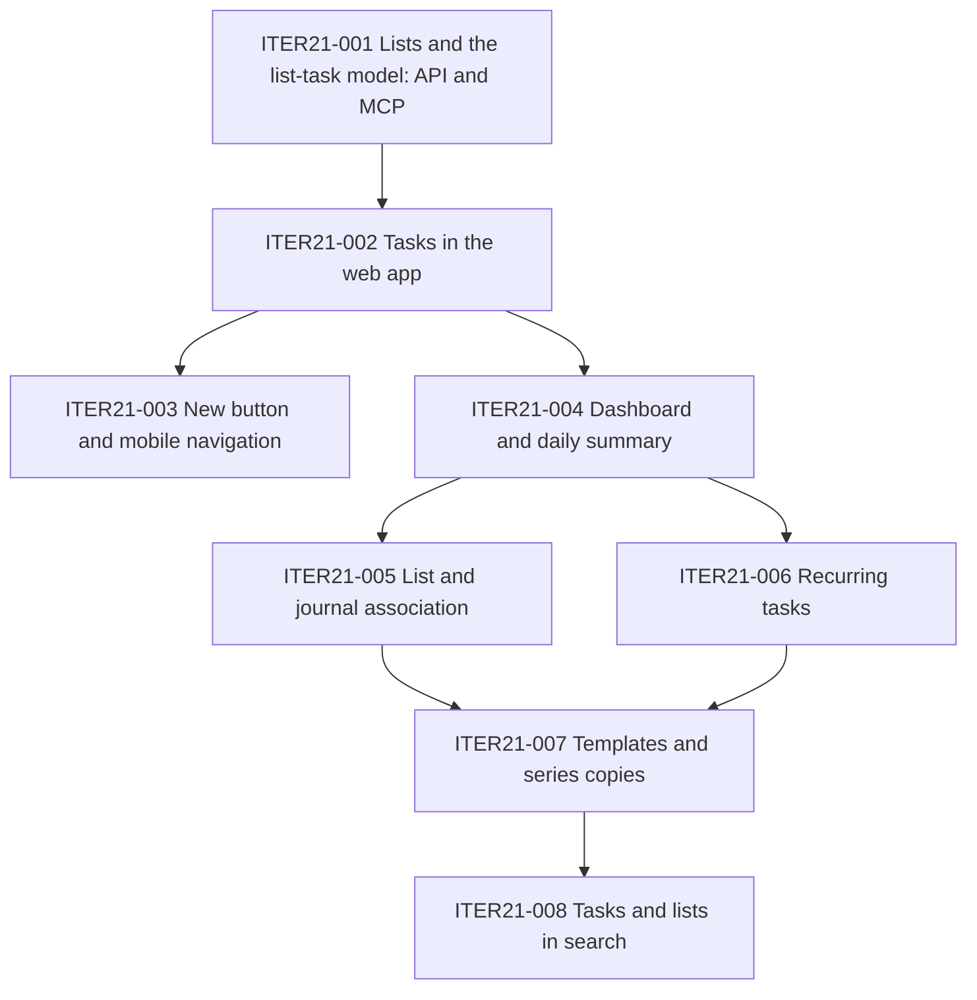

# Iteration 21: Task Lists and Navigation

**Status:** 🚧 IN PROGRESS — 8 sub-iterations, **116 phases**, one PR each, with per-phase acceptance criteria and diff estimates calibrated against Iteration 18's recorded actuals. Each phase records its own status on its heading or **Status:** line below; there is deliberately no roll-up here, because phases land in parallel and a shared line conflicts on every merge.
**Dependencies:** [Iteration 18](./iteration-18-home-dashboard-and-tasks.md) (tasks, journal anchoring, home dashboard, daily-summary task inputs, task history), [Iteration 20](./iteration-20-entity-ownership.md) (entity ownership: every new table carries `user_id`), journal series (migrations 0101 and 0121), MeiliSearch indexing through the transactional outbox, the design-system sync (`frontend/.design-sync/`).
**Goal:** Give tasks a second home — Task Lists — with optional due dates, a flag, an icon, recurrence and reusable templates, and make them reachable: a Tasks sidebar section, a top-bar **New** button and a mobile bottom tab bar. Journal-only tasks keep behaving exactly as today.

## Overview

This iteration delivers the [Task Lists and Navigation Product Specification](../product-specifications/task-lists-and-navigation-product-specification.md). Tasks today exist only between two journals; this iteration gives them a second home on a list, with the dates, recurrence and templates that a list makes useful, and adds the navigation that makes lists reachable on desktop and on a phone.

Every phase merges alone: it breaks nothing that worked, ships its own tests, and never waits for a later phase to restore behaviour. An MCP tool ships in the phase of its REST endpoint, and there is no E2E-only phase.

### Key References

- Spec: [`task-lists-and-navigation-product-specification.md`](../product-specifications/task-lists-and-navigation-product-specification.md)
- Partly superseded: [`home-dashboard-and-tasks-product-specification.md`](../product-specifications/home-dashboard-and-tasks-product-specification.md)
- [`activity-history-product-specification.md`](../product-specifications/activity-history-product-specification.md), [`contact-merge-product-specification.md`](../product-specifications/contact-merge-product-specification.md), [`journals-product-specification.md`](../product-specifications/journals-product-specification.md)
- [`journal-system-specification.md`](../journal-system-specification.md) (*Merging series*)
- [`iteration-18-home-dashboard-and-tasks.md`](./iteration-18-home-dashboard-and-tasks.md) (*Delivery Rules*, *Phase Completion Requirements*, *Phase Sizing Calibration*), [`iteration-20-entity-ownership.md`](./iteration-20-entity-ownership.md)
- [`domain-architecture.md`](../architecture/domain-architecture.md) (*Ownership*; *Daily summary invalidation*)
- [`api-design.md`](../architecture/api-design.md) (*Task Endpoints*, *Home Dashboard Endpoint*, *Conditional Writes*, pagination, MCP guidelines)
- [`database-design.md`](../architecture/database-design.md) (*Ownership*, *Field History Table*, *Event Outbox Table*, *MeiliSearch Integration*, *Migration Strategy*, *Transaction Management & Commit Timing*)
- [`integration-architecture.md`](../architecture/integration-architecture.md) (*Transactional Outbox Pattern*, *Redis Stream Consumer Architecture*)
- [`frontend-design.md`](../architecture/frontend-design.md) (*Responsive Layout Guidelines*, *Design System*, *Home Dashboard Page*, *The task's own change history*)
- [`testing-strategy.md`](../architecture/testing-strategy.md) (backend, RTL, Playwright, *MCP Integration Testing Guidelines*, *The AI Daily Summary in E2E*)
- [`deployment-guide.md`](../architecture/deployment-guide.md) (*Rebuilding the Search Index*)
- [`home-dashboard-wireframe.md`](../design/home-dashboard-wireframe.md) (§*Tasks*, W21–W29)
- [Design canvas](https://claude.ai/artifact/6it49ithFdmoXFXc5rZAgz) — private to the repository owner; acceptance criteria name its artboards by title
- [`mcp-setup.md`](../mcp-setup.md) (tool docs live in code); `frontend/.design-sync/NOTES.md`

## Current Baseline (verified in code, 2026-11-16)

- `tasks` (`backend/app/migrations/versions/0105_create_tasks_tables.py`): `creating_journal_id` and `due_journal_id` are NOT NULL with `ON DELETE RESTRICT`; there is no list, due date, flag, icon, position or recurrence column. The `Task` entity (`core_shared/core_shared/models/tasks/entities.py`) validates both anchors. About 45 reads across 10 backend files assume both anchors are present.
- The frontend assumes it too: `frontend/src/types/tasks.ts` declares both journal references non-null, and `JournalTaskRow`, `AttachTaskDialog`, `RetargetTaskDialog` and `DashboardTaskRow` dereference them unguarded.
- The journal delete guard's query inner-joins both anchors (`task_anchor_repository.py`), so a task with one anchor would be invisible to it and the delete would fail with a raw integrity error.
- Lapse is derived on every read (`core_shared/core_shared/models/tasks/lapse.py`); nothing is stored and no job touches tasks.
- The backend has no scheduler for domain work. The precedents for time-based work are lifespan loops in `backend/app/main.py`: `run_attendance_transition_loop` (hourly) and `run_summary_refresh_sweep_loop`.
- Dashboard tasks: `home_dashboard_service.py` → `tasks_section.py`; the seven-day window is `DEFAULT_UPCOMING_DAYS_AHEAD` in `core_shared/core_shared/models/date_window.py`; selection is in `core_shared/core_shared/models/tasks/upcoming.py`.
- Daily-summary invalidation already listens to task events (`summary_invalidation_consumer.py`).
- Search has `contacts` and `journals` indexes only; `search_indexer_consumer.py` ignores task events; the search service defaults to every available entity type, and `GlobalSearch.tsx` renders any non-journal result as a contact. The frontend's `ENTITY_TYPES` does not match the backend's.
- Series: `journal_series`, `journal_series_members`; journals join by hand or through calendar sync. The series page is reachable only from a journal's series badge.
- MCP task tools: `backend/app/mcp/domains/tasks/tools.py` (13 tools). The server instructions say tasks have "no separate task list and no due date".
- Frontend shell: `Header` (hamburger, Home, search, theme, user menu); `Sidebar.tsx` (844 lines) holds the desktop sidebar and `MobileSidebar`, the only place tag trees exist on phones. Mobile Chrome E2E helpers (`utils/sidebar-tags.ts`, `utils/test-helpers.ts`, `sidebar-tag-management.spec.ts` and others) open that sheet. No New button, bottom bar, drag-and-drop library or icon picker exists.
- The latest migration file is `0143_…`.

## Delivery Rules

The [Delivery Rules](./iteration-18-home-dashboard-and-tasks.md#delivery-rules) and [Phase Completion Requirements](./iteration-18-home-dashboard-and-tasks.md#phase-completion-requirements) of Iteration 18 apply unchanged. The rules that shape this breakdown:

1. **Tests first.** Each phase writes its failing tests before its implementation.
2. **One phase, one PR, one capability.** A phase never spans two domains.
3. **Every phase is safe alone.** It can be merged and deployed without any later phase. Where a backend change would put something new in front of an existing screen, the screen's tolerance lands first; new search result types are opt-in until the dropdown can show them. A setting is never exposed over REST or MCP before the behaviour it controls: that behaviour lands first as a service, with the setting seeded in tests, and a guard lands before the first row it guards can exist.
4. **A hard rule gets its own phase.** A rule matrix (dates, invariants, selection) lands as a pure service with unit tests ahead of the phase that exposes it.
5. **MCP ships with its API.** A REST endpoint and its MCP tool land in the same phase. MCP tools open no transactions; they call a `@transactional` service.
6. **Events ship with the change.** A domain event is emitted in the phase that makes the change possible, so no write is ever missing from history. At most two new event types per phase.
7. **E2E ships with the UI.** Each UI phase adds its own E2E, on Firefox and Mobile Chrome, to the sub-iteration's spec file; the first UI phase of a sub-iteration creates the spec and its `TestDataManager` helpers. Tests create their own data and never branch on what they find.
8. **Every UI phase is checked on a phone.** It asserts no horizontal scroll and touch targets of at least 44px at a 390px-wide viewport for what it adds.
9. **Ownership.** Every new table carries `user_id`; every repository read and write is owner-scoped and proven with a second user.
10. **Record the actual.** When a phase lands, record its actual diff beside the estimate, and re-estimate the phases that follow if the ratio has moved.

## Phase Completion Requirements

A phase is complete when:

- [ ] its acceptance criteria are met and ticked in this document;
- [ ] unit tests for the touched stack pass, and backend integration tests pass when the backend or `core_shared` changed;
- [ ] the E2E tests it added pass on Firefox and Mobile Chrome, when it has UI;
- [ ] linting, formatting and type checks pass (`ruff`, `mypy`, `pnpm quality:check`);
- [ ] architecture documents are updated where the phase changes what they describe;
- [ ] the actual diff is recorded beside the estimate.

## Phase Sizing Calibration

One phase is one PR. Estimates are **production lines → tracked lines**, using the multipliers [Iteration 18 measured](./iteration-18-home-dashboard-and-tasks.md#phase-sizing-calibration):

- ×4 for schema and wiring phases; ×6 for a port + adapter pair or a phase whose criteria are a rule matrix (dates, invariants);
- frontend phases are priced by counting their components (Iteration 18's title-priced frontend phases landed at 3–6 times their estimates), so they sit at 650–1,100;
- a phase that exposes **one capability on REST and MCP together** is budgeted at 900–1,500 and says so on its estimate line.

**On the 500-line standard.** About 70 phases sit between 400 and 1,100 tracked lines. The other 46 expose one capability on both surfaces, and that shape has never landed near 500 here: Iteration 18 estimated it at about 600 and measured 2,036, 2,483 and 3,300. Those phases are kept whole, at one capability each, rather than split into a REST PR and a trailing MCP PR, because MCP must not trail its API. If a capability phase is on course to pass 1,500, split it by capability (for example, set and clear) — never by surface.

## Sequencing Strategy

| # | Sub-iteration | Depends on | Can run alongside | Phases |
|---|---|---|---|---:|
| ITER21-001 | Lists and the list-task model: API and MCP | Iterations 18, 20 | — | 30 |
| ITER21-002 | Tasks in the web app | 001 | — | 19 |
| ITER21-003 | New button and mobile navigation | 002 | 004–008 | 10 |
| ITER21-004 | Dashboard and daily summary for list tasks | 002 | 003 | 6 |
| ITER21-005 | List ↔ journal association | 004 | 003, 006 | 10 |
| ITER21-006 | Recurring tasks | 004 | 003, 005 | 10 |
| ITER21-007 | Templates and series copies | 005, 006 | 003 | 21 |
| ITER21-008 | Tasks and lists in search | 007 | 003 | 10 |

Search is last because its rules name things the earlier steps create (templates, instance lists, association, auto-archive).

## Iteration Breakdown

### ITER21-001: Lists and the list-task model — API and MCP

**Objective:** Introduce Task Lists and let a task live on one, with an optional due date or due journal, a flag and an icon, over REST and MCP. The only web changes are those that keep existing pages correct.

**Independently deliverable because:** it is additive. Existing tasks are journal-only tasks and keep every rule; an agent can run a list end to end over MCP; existing pages stay correct when list tasks exist.

**Relevant documents:** [Spec](../product-specifications/task-lists-and-navigation-product-specification.md) §*Tasks*, §*Task Lists* (product model, archiving and deleting), §*MCP and AI-Agent Parity*, the superseded-behaviour table; activity-history and contact-merge specs; [`api-design.md`](../architecture/api-design.md) *Task Endpoints*, *Conditional Writes*; [`database-design.md`](../architecture/database-design.md) *Ownership*, *Migration Strategy*, *Field History Table*; [`domain-architecture.md`](../architecture/domain-architecture.md) *Ownership*; [`testing-strategy.md`](../architecture/testing-strategy.md) *MCP Integration Testing Guidelines*.

**Acceptance Criteria — lists:**
- [ ] A user can create, rename, set or clear the icon of, reorder, archive, unarchive and delete a list; another user's list is never readable or writable.
- [ ] Archiving leaves task state untouched and works with open tasks. Until unarchived the list and its tasks are read-only: every list and task write is refused.
- [ ] Deleting a list deletes its tasks, except tasks holding both a creating and a due journal, which survive as journal-only tasks (lapsed if that journal has passed).
- [ ] Listing lists supports an archived filter and returns each list's open-task count; reading one list returns its open tasks in manual order and its closed tasks most-recently-closed first, paged.

**Acceptance Criteria — tasks on a list:**
- [x] A task can be created on a list with no journal at all, with a due date, or with a due journal; never with both a due date and a due journal, and never with neither a list nor a due journal (invariants 1–5 hold in the domain and in the database). *(Phases 10, 19, 20)*
- [ ] A due date must be today or later in the user's timezone when set; a due journal must be future-dated when set.
- [ ] A list task never lapses. Past its date it reads as **overdue**; when the date comes from a multi-day journal it is overdue only once the journal's last day has ended.
- [ ] Changing or clearing a list task's date is a plain edit with no acknowledgement and no status change; a replaced or cleared due journal becomes an intermediate journal.
- [ ] A done or cancelled list task can be set straight back to not done.
- [ ] Tasks on a list can be reordered; a new task joins the bottom.
- [ ] A list task can move to another list, joining the bottom; a journal-only task can be added to a list and stops lapsing.
- [x] A task can leave its list only when it has both anchors; the response says when that leaves it lapsed. *(Phase 27)*
- [ ] Flag and icon can be set and cleared on any task, journal-only ones included; the icon must come from the fixed set.

**Acceptance Criteria — journals, contacts, history:**
- [ ] Deleting a journal is not blocked by list tasks: their link to it is removed and a task that was due in it becomes undated. Journal-only tasks still block deletion.
- [x] The journal delete confirmation states how many list tasks will lose their link. *(Phase 17)*
- [ ] While a journal is cancelled, a list task due in it is treated as undated; un-cancelling restores the date. Merging journals re-points list-task links as today.
- [ ] A contact's task record includes list tasks, labelled with their list.
- [ ] List membership, due date, flag and icon changes emit domain events in the phase that makes them possible and appear in task history; reordering does not. Lists have their own history: created, renamed, archived, unarchived.

**Acceptance Criteria — existing surfaces, MCP and regression:**
- [ ] With list tasks present, every existing surface still works: on a journal page a list task shows the overdue marker and direct actions, never the lapsed marker; the dashboard, `list_upcoming_tasks` and the daily summary leave list tasks out until ITER21-004. Nothing errors on a task with no journal.
- [ ] MCP tools cover every list and list-task operation above; existing task tools behave unchanged for journal-only tasks.
- [ ] The server's task guidance no longer says there is no task list and no due date.
- [ ] No test of journal-only behaviour (two anchors required, lapse, retarget-to-revive, reopen acknowledgement, delete guard) changes its assertions.

**Phase ordering:** Phases 1–8 (lists) and 9–18 (task model and its safety work) are independent and can interleave. Phase 19 is the first that lets a list task exist; phases 11, 12, 15, 16 and 18 are what keep existing pages, journal deletion and archived lists correct at that moment.

#### Phase 1: Task list table, entity and icon set ✅ DONE

**Prerequisites:** None beyond the iteration's dependencies.
**Estimated diff:** ~110 production → **~440 tracked** · **Actual:** ~255 production → **~740 tracked**
(739 insertions, 3 deletions excluding this document: 255 production — migration 76, entity 92, icon set
65, exceptions and exports 18, REST error-code entry 4; 437 tests; 47 architecture docs). Ratio ×1.7
on the estimate, driven by a 40-key icon set and the docstrings carrying the decisions below; the
×4 multiplier held for tracked lines over production (×2.9).

**Acceptance Criteria:**

- [x] Migration for `task_lists` (owner, name, icon, position, archived-at); `TaskList` entity; the fixed icon-key set in `core_shared`.

**Delivered:** migration `0145_create_task_lists_table.py`; `TaskList`, `TaskIcon`,
`TaskListValidationError` and `MAX_TASK_LIST_NAME_LENGTH` in `core_shared.models.tasks`;
`TaskListValidationError` mapped to `TASK_VALIDATION_ERROR` in `app/api/error_handlers.py`.

**Tests:** unit `tests/unit/tasks/test_task_list_entity.py`, `test_task_icon.py` (including the
add-only guard: every published key must stay in the enum), and list cases in
`test_task_validation_error_surfaces.py` (REST and MCP); integration
`tests/integration/tasks/test_task_lists_migration.py` (round trip) and
`test_task_list_table_constraints.py` (defaults, blank name, length bound, negative position,
NOT NULLs, no accidental uniqueness across two owners). No E2E: no UI.

**Decisions (recorded during implementation):**
- **No DB CHECK on icon values** (user decision). `TaskIcon` gates every write; the set is
  **add-only** — never rename or remove a key. Keys are our own stable kebab-case keys that today
  match `lucide-react` names (all 40 verified against the installed package).
- **`TaskList.position` is `None` until inserted**, like `id`; the repository places a new list at
  the bottom in the INSERT itself. Positions are not unique; lists order by `(position, id)`.
- **Lists are part of the tasks domain.** `TaskListValidationError` subclasses
  `TaskValidationError`; the REST code map is an exact-type lookup, so it needed its own entry
  (MCP matches by `isinstance`).
- **`TaskList` is keyword-only**, so later columns (association, kind, template) break no call site.
- A varchar overflow reaches SQLAlchemy from asyncpg as a bare `DBAPIError`, not `DataError`; the
  constraint tests assert SQLSTATEs rather than message text or wrapper class.

**Notes for later phases:**
- *Phase 2:* implement the bottom-of-list insert and `(position, id)` ordering above.
- *Phase 3:* the `{journal_id}`/`{contact_id}` route ownership guards do not see `{list_id}` routes;
  add a list-route coverage guard alongside the cross-user tests.
- *ITER21-002 Phase 2:* the icon picker needs the key set in the frontend — take it from the API's
  published enum (OpenAPI/MCP schema) rather than hand-copying the 40 keys.

#### Phase 2: Task list repository ✅ DONE

**Prerequisites:** Phase 1.
**Estimated diff:** ~130 production → **~780 tracked** (×6) · **Actual:** ~340 production → **~855
tracked** (852 insertions, 3 deletions excluding this document: 339 production — adapter 205, port
93, exceptions/filter/exports 30, DI and REST code map 11; 495 tests; 18 architecture docs). Production
ran ×2.6 on the estimate, mostly docstrings carrying the contract; tracked lines landed within 10%
because the ×6 multiplier was generous for a single port (measured ×2.5).

**Acceptance Criteria:**

- [x] Port + SQL adapter: owner-scoped CRUD, positions, archived filter; second-user isolation tests.

**Delivered:** `TaskListRepository` port (`app/core/tasks/models/repositories.py`);
`SqlTaskListRepository` (`app/core/tasks/adapters/sql/task_list_repository.py`) provided at request
scope by `TaskProvider`: `save` (insert at the bottom / update), `find_by_id`,
`find_by_id_for_update` (`FOR NO KEY UPDATE`), `list_for_user(user_id, archived)`, `delete`.
`TaskListArchiveFilter` (`ACTIVE`, `ARCHIVED`, `ALL`) and `TaskListNotFoundError` (404) in
`core_shared.models.tasks`; `TaskListNotFoundError` mapped to `TASK_LIST_NOT_FOUND` in
`app/api/error_handlers.py` (MCP reports it as "Not found" through the existing `TaskDomainError`
branch).

**Tests:** integration `tests/integration/tasks/test_task_list_repository_integration.py` (31: insert
id/timestamps, bottom placement incl. archived lists and per owner, caller position ignored; find
round trip and icon parsing; row lock statement; update of name/icon/archive state, `updated_at`
moved and `created_at`/`position` kept; `(position, id)` order with positions set against id order
and a tie; archived order against both id and position; each archived filter;
second-user isolation on find, find-for-update, update, delete and every filter; DI resolution);
unit cases in `tests/unit/tasks/test_task_validation_error_surfaces.py` (REST code and MCP surface
for a missing list). No E2E: no UI.

**Decisions (recorded during implementation):**
- **Open-task count moved from Phase 3 to Phase 15** (user decision). Tasks gain their list column
  only in Phase 9, so Phase 3 cannot count them; Phase 14 builds the per-list counts and Phase 15,
  which already exposes list fields on REST and MCP, adds the count to the list listing.
- **Reordering is not in the repository yet.** Phase 5 owns whether a reorder index counts archived
  lists, so it adds the move operation with its API.
- **The bottom counts archived lists**, so unarchiving returns a list to its old place; **saving
  never writes `position`**, so a rename cannot undo a concurrent reorder.
- **Archived lists list most-recently-archived first** (`archived_at DESC, id DESC`), the order the
  archived page groups by; `ACTIVE` and `ALL` use `(position, id)`.
- asyncpg deduces one type per bind parameter, so the INSERT's bottom-position subquery casts
  `:user_id` to `VARCHAR`; without it the statement fails with `AmbiguousParameterError`.

**Notes for later phases:**
- *Phase 3:* use `TaskListNotFoundError` for an unowned or missing list (already mapped); add
  `TASK_LIST_NOT_FOUND` to `api-design.md` with the endpoint.
- *Phase 4 / 6:* read with `find_by_id_for_update` inside the unit of work before writing.
- *Phase 5:* add the move operation to the port; `save` deliberately ignores `position`.
- *Phase 9:* the `tasks.task_list_id` foreign key must **not** `ON DELETE CASCADE` — Phase 29 keeps
  tasks holding both journals.
- *ITER21-002 Phase 12:* extend `list_for_user` (paging, name filter) for the archived page; add an
  `archived_at` index there if needed.

#### Phase 3: Create and read lists ✅ DONE

**Prerequisites:** Phase 2.
**Estimated diff:** ~200 production → **~1,500 tracked** · one capability on REST and MCP together · **Actual:** ~670 production → **~1,950 tracked**
(1,952 insertions, 21 deletions excluding this document: 671 production — REST controller and schemas
251, MCP tools and schemas 173, services 116, event 74, DI and wiring 62; 1,239 tests; 42 architecture
docs). Tracked lines ran ×1.3 over the estimate, production ×3.4: docstrings again, and three
read/write surfaces (create, get, list) each needing its own REST and MCP refusal and isolation tests.
Kept whole by user decision rather than split by capability. Re-estimate Phases 4–6 at ×1.3
(~1,550, ~1,150 and ~1,700 tracked); each is a single capability, so they should land nearer their
estimates than this three-operation phase did.

**Acceptance Criteria:**

- [x] Create; get one; list all with archived filter. (The open-task count moved to Phase 15: tasks cannot join a list before Phase 9.)
- [x] Emits list-created.
- [x] The REST endpoint and the MCP tool ship together, each with its own rejection and second-user isolation tests.

**Delivered:** `TaskListCreated` (`app/core/tasks/models/task_list_events.py`, with
`TASK_LIST_EVENT_TYPES`); `TaskListService.create_task_list` (`@transactional`, publishes the event)
and `TaskListReadService.get_task_list` / `list_task_lists`, both provided by `TaskProvider`. REST:
`POST /api/task-lists`, `GET /api/task-lists/{list_id}`, `GET /api/task-lists?archived=` (JSON:API
type `task-lists`; `app/api/tasks/task_list_controllers.py`, `task_list_schemas.py`). MCP:
`create_task_list`, `get_task_list`, `list_task_lists` (`app/mcp/domains/tasks/task_list_tools.py`).
Server instructions gain a *Task lists* line and no longer say "there is no separate task list";
"no due date" stays until the due-date phases. `api-design.md` *Task List Endpoints* documents
`TASK_LIST_NOT_FOUND`.

**Tests:** unit `tests/unit/tasks/test_task_list_events.py` (whole-key payload),
`tests/unit/infrastructure/events/test_task_list_event_subscriptions.py` (no consumer matches a list
event), `tests/unit/mcp/domains/test_task_list_tools_schema.py` (icon and archived enums, output
shapes); integration `tests/integration/tasks/test_task_list_service_integration.py`,
`tests/integration/api/test_task_list_endpoints.py`, `test_task_list_ownership.py` (the `{list_id}`
route-coverage guard, both directions), 401 cases in `test_authentication_requirements.py`, and
`tests/integration/mcp/test_task_list_tools_mcp.py`. No E2E: no UI.

**Decisions (recorded during implementation):**
- **List events live in their own module.** `tests/task_event_inventory.py` requires every event in
  `tasks/models/events.py` to be projected as *task* history (filed under a task id), so a list
  event there would be mis-filed or fail the inventory. A list is its own aggregate.
- **Payload:** `task_list_id`, `user_id`, `name`, `icon`, `source`, `changed_by` — no position
  (reorders publish nothing, so it would go stale), no archive state (a new list never is).
- **Write and read services are split**, as `TaskService` / `TaskReadService` are.
- **`?archived=` is a plain query param**, default `active`; the listing is unpaginated.
- **`icon` is typed `TaskIcon` on every request and response**, so OpenAPI publishes a `TaskIcon`
  schema and the MCP schemas carry the enum (pinned by tests).
- **`task_events()` (test seeding) is matched on the task event inventory**, not the `Task%`
  prefix, which also matches `TaskListCreated` — and a list id can equal a task id.
- **Kept whole despite running over budget** (user decision): see the actual above.

**Notes for later phases:**
- *Phase 4 / 5 / 6:* extend `TaskListService`; read with `find_by_id_for_update` in the unit of
  work; add each new `{list_id}` route to `CROSS_USER_REQUESTS` in `test_task_list_ownership.py`
  (the guard fails until you do) and to the 401 cases; add each event type to
  `TASK_LIST_EVENT_TYPES`.
- *Phase 7:* subscribe the history projection to `TASK_LIST_EVENT_TYPES` under its own
  `entity_type` (never `task`); flip `test_task_list_event_subscriptions.py` for history; widen the
  event inventory (or add a list inventory) — `_SAMPLE_ARGUMENTS` needs a `TaskIcon | None` sample —
  and adjust the `Task*`-prefix guards in `tests/unit/history/test_history_service.py` and
  `tests/unit/infrastructure/events/test_history_projection_consumer.py`, which assume every
  `Task*` handler is a task event. Decide whether lists created before Phase 7 get a backfilled
  "created" row.
- *ITER21-002 Phase 1:* the resource is `{type: "task-lists", id, attributes: {name, icon,
  position, archived, archived_at, created_at, updated_at}, links.self}`; take the icon keys from
  the OpenAPI `TaskIcon` schema.

#### Phase 4: Rename and icon ✅ DONE

**Prerequisites:** Phase 3.
**Estimated diff:** ~120 production → **~1,200 tracked** · one capability on REST and MCP together · **Actual:** ~365 production → **~1,100 tracked**
(~1,085 insertions, ~30 deletions excluding this document: 365 production — REST schemas and controller
124, service and patch 114, MCP tool and registration 77, event 50; 703 tests; 16 architecture docs).
Tracked lines landed ×0.9 of the estimate, production ×3 again (docstrings). A single-operation
capability phase lands near ~1,100; Phase 5's ~900 and Phase 6's ~1,700 stand.

**Acceptance Criteria:**

- [x] One update capability; icon validated against the fixed set.
- [x] Emits list-updated.
- [x] The REST endpoint and the MCP tool ship together, each with its own rejection and second-user isolation tests.

**Delivered:** `TaskListUpdated` (`app/core/tasks/models/task_list_events.py`, in
`TASK_LIST_EVENT_TYPES`); `TaskListPatch` (`app/core/tasks/services/task_list_patch.py`, a
`FieldPatch`: `UNSET` keeps a field, `icon=None` clears it); `TaskListService.update_task_list`
(`@transactional`, locked read, one `applied_to`, no-op when nothing differs). REST:
`PATCH /api/task-lists/{list_id}` (`TaskListUpdateRequest`). MCP: `update_task_list` (`IDEMPOTENT_WRITE`).
Server instructions and `api-design.md` *Task List Endpoints* updated.

**Tests:** unit `tests/unit/tasks/test_task_list_events.py` (whole-key payload, JSON round trip),
`tests/unit/mcp/domains/test_task_list_tools_schema.py` (icon enum, `clear_icon` boolean, id
bounds, output shape); the subscriptions test covers the new type through `TASK_LIST_EVENT_TYPES`;
integration `test_task_list_service_integration.py` (`TestUpdateTaskList`: rename, set/replace/clear
icon, both in one event, no-op cases, refused names, missing and foreign lists),
`test_task_list_endpoints.py` (`TestUpdateTaskListEndpoint`), the PATCH entry in
`test_task_list_ownership.py`'s `CROSS_USER_REQUESTS`, a 401 case, and `TestUpdateTaskListTool` in
`test_task_list_tools_mcp.py`. No E2E: no UI.

**Decisions (recorded during implementation):**
- **One update capability on each surface**: a PATCH carrying `name` and/or `icon`, and one
  `update_task_list` tool — not separate rename and icon operations.
- **`null` clears, absent keeps** on REST (`model_fields_set`); `"name": null` and a body naming
  nothing are refused (400 `VALIDATION_ERROR`). MCP clears with `clear_icon=true` (a tool cannot tell
  a null argument from an omitted one); `icon` with `clear_icon`, or no change named, is a
  `TaskListValidationError`.
- **The service treats an unchanged value or an empty patch as a no-op**: nothing written, no event.
  `changed_fields` names only what moved, as `{field: (old, new)}` with icon keys as plain strings.
- **A body id that disagrees with the path** is refused (`TASK_VALIDATION_ERROR`, `meta.field=id`),
  as on the task PATCH.
- **No archived-list guard yet** — no API can archive a list before Phase 6, which adds it.
- **No `ETag`/`If-Match`**: lists are not a conditional-write route; the locked read serialises
  concurrent patches field-safely.
- Tests cannot assert `updated_at` moving: the fixture shares one transaction, so `now()` is one
  instant. They assert stored fields and the outbox instead.

**Notes for later phases:**
- *Phase 6:* add `archived` to `changed_fields` of `TaskListUpdated` (publish it from the archive
  write), and put the archived refusal right after the locked read in `update_task_list` so a rename
  or icon change of an archived list is refused too. Add its route to `CROSS_USER_REQUESTS` and the
  401 cases.
- *Phase 7:* project `TaskListUpdated`'s `name` and `icon` keys as "renamed" and "icon" lines; a
  cleared icon arrives as `[old, null]`.
- *ITER21-002:* rename and icon actions send `PATCH /api/task-lists/{id}` with `data.id`; send
  `"icon": null` to clear.

#### Phase 5: Reorder lists ✅ DONE

**Status:** ✅ DONE
**Prerequisites:** Phase 3.
**Estimated diff:** ~100 production → **~900 tracked** · one capability on REST and MCP together ·
re-estimated ~1,150 after Phase 3 · **Actual:** ~360 production → **~1,270 tracked** (1,267
insertions, 30 deletions excluding this document: 362 production — service 53, repository adapter 53
and port 31, MCP tool and schemas 46, REST controller and schemas 78, ordering rule 74, archived error
and exports 22, code map and registration 5; 889 tests; 16 architecture docs). Tracked lines ran ×1.4
on the original estimate and ×1.1 on the re-estimate; production ran ×3.6, docstrings again plus a
pure ordering rule the estimate did not price.

**Acceptance Criteria:**

- [x] Position among the user's lists; no event.
- [x] The REST endpoint and the MCP tool ship together, each with its own rejection and second-user isolation tests.

**Delivered:** `reorder_task_lists` (`core_shared/core_shared/models/tasks/task_list_order.py`), the
pure placement rule; `TaskListArchivedError` (409, `TASK_LIST_ARCHIVED` in `app/api/error_handlers.py`;
MCP "Task error"). `TaskListRepository.list_for_user_for_update` (every list, archived included,
`FOR NO KEY UPDATE` locked in `id` order by one statement, then read in `(position, id)` order by a
second whose snapshot postdates the wait; a new list's `save` takes the same locks before its
`INSERT`) and
`reposition` (dense `0..N-1` from an id order, owner-scoped, skipping rows already in place, never
touching `updated_at`). `TaskListService.move_task_list` (`@transactional`, no event, answers the
active lists in their new order). REST `POST /api/task-lists/{list_id}/move`, body type
`task-list-moves` with `index` (all levels `extra="forbid"`, `index` strict int 0..INT32_MAX), 200
with a `task-lists` collection. MCP `move_task_list` (`IDEMPOTENT_WRITE`, answers `TaskListsMCP`);
the `JsonIntOnly` marker (`app/mcp/shared/arguments.py`) on every task-list tool's `task_list_id` and
on `index`, so `true`, `"1"` and `1.0` are refused as REST refuses them.
Server instructions say lists can be reordered; `api-design.md` *Task List Endpoints* documents the
route, the error and the conventions.

**Tests:** unit `tests/unit/tasks/test_task_list_order.py` (19: up/down/top/last/own place,
clamp, only active list, input vs stored order, ties by id, archived lists keeping their place at the
top, middle and bottom and beside an own-place, upward or downward move, programming-error guards), `tests/unit/api/test_task_error_mapping.py` and
`tests/unit/mcp/shared/test_task_error_handling.py` (archived refusal on both surfaces),
`tests/unit/mcp/domains/test_task_list_tools_schema.py` (move input bounds; output shape),
`tests/unit/mcp/shared/test_arguments.py` (`JsonIntOnly`: non-integers refused, bounds and the
published `minimum`/`maximum` kept);
integration `test_task_list_repository_integration.py` (11: stored order incl. archived, lock
then fresh read, an insert locking first, second-user isolation on both methods, dense numbering, tie healing, `updated_at` kept,
unchanged rows not rewritten — proven by `ctid`), `test_task_list_service_integration.py` (9 + a
concurrency test: two overlapping moves via `concurrency_helpers.overlap` serialize and the second
builds on the first; verified to fail without the lock — and two more, from tied positions, where a
create and a move overlap in each order and the result is still the move's index with the new list
at the bottom; both verified to fail without the create's lock), `tests/integration/api/test_task_list_endpoints.py`
(17: order, archived left out, clamp, no event, 409, foreign = missing, 8 malformed bodies, bad ids),
the move row in `test_task_list_ownership.py`, its 401 case in `test_authentication_requirements.py`,
and `tests/integration/mcp/test_task_list_tools_mcp.py` (5: order, clamp, negative index, archived,
foreign = missing and unmoved; plus 8 cases of a boolean, string or float id or index refused with
the guard's own message and nothing changed). No E2E: no UI.

**Decisions (recorded during implementation):**
- **The index counts active lists only** — the view the overview and sidebar show. Archived lists keep
  their place relative to their neighbours, so unarchiving returns a list near where it was; every list
  is then renumbered densely, which also heals ties left by concurrent creates.
- **Placement:** the index is clamped to the last active place (**not refused**, so a stale client
  view still lands sensibly); a move to its own place changes nothing; a move up lands directly above
  its new lower neighbour, a move down directly below its new upper one, so no archived list is hopped
  over. (The first cut always inserted "before the list at the index", which let an own-place move hop
  an archived neighbour — found in review, pinned by unit tests.)
- **Archived lists cannot be moved**: `TaskListArchivedError`, 409 `TASK_LIST_ARCHIVED`, whose message
  names unarchiving as the way out. No API can archive yet; tests seed archived lists.
- **A dedicated action route, `index` not `position`**: a move rewrites other lists' positions and
  publishes nothing, so it is not an attribute edit (and stays clear of Phase 4's `PATCH`); stored
  `position` orders all lists, archived included, so it need not equal the active index.
- **The answer is the whole active order**, because one move changes several positions.
- **No event, no `updated_at` bump**; a row already at its dense position is not written, so a
  no-op move on densely numbered lists writes nothing.
- **Every one of the owner's lists is locked**, in `id` order (which no move changes) so two movers
  cannot deadlock, **and a create takes the same locks** before its `INSERT`. Found in PR review:
  renumbering can lower the highest position (ties `A=0, B=0, C=0` become `B=0, C=1, A=2`), so a
  create that read the old highest, or a move that read the lists before a create committed, left
  the new list in the middle and the moved one off its index. The lock is a statement of its own and
  the positions are read afterwards, because under READ COMMITTED a statement that waited on a lock
  keeps the snapshot it started with. Only two first-ever lists can still tie (there is nothing to
  lock); `(position, id)` keeps the order total and the next move renumbers.
- **MCP integers are guarded like REST's** (found in PR review): fastmcp validates leniently, so
  `index=true` arrived as `1` and moved a list. `JsonIntOnly` refuses non-integers on the task-list
  tools. Other domains' MCP integer arguments (journal, contact and task ids) still coerce; they are
  outside this iteration's list surface and want a sweep of their own.

**Notes for later phases:**
- *Phase 4* merged first; this phase was rebased onto it. The two sit side by side in
  `TaskListService`, the controllers, the tools module and the ownership table without overlapping
  behaviour; Phase 4's field update locks only its one row, so it cannot deadlock with a move.
- *Phase 6:* reuse `TaskListArchivedError` for rename, icon and task writes on an archived list;
  unarchiving needs no position work — the list kept its place.
- *Phase 25 (reorder tasks):* the same shape fits — a pure placement rule, lock-all in `id` order
  (in its own statement, taken by creates on the list too), dense reposition, no event.
- *Every later phase adding a task-list MCP tool:* put `JsonIntOnly` after the bounds of each integer
  argument.
- *ITER21-002 Phase 9:* send the target index in the active view and replace the cached
  `GET /api/task-lists` data with the response, rather than re-fetching.

#### Phase 6: Archive and unarchive ✅ DONE

**Status:** ✅ DONE
**Prerequisites:** Phase 4.
**Estimated diff:** ~140 production → **~1,300 tracked** · one capability on REST and MCP together ·
**Actual:** ~320 production → **~1,010 tracked** (~1,010 insertions, ~40 deletions excluding this
document: ~320 production — service 141, MCP tools and registration 88, REST controller 69, entity
guard 23; ~700 tests; ~30 architecture docs). Tracked lines landed ×0.8 of the estimate, production
×2.3 (docstrings): Phase 5 had already shipped the archived error and its mapping, which the
estimate priced in.

**Acceptance Criteria:**

- [x] Archive with open tasks; list writes refused while archived; unarchive restores.
- [x] Emits list-updated.
- [x] The REST endpoint and the MCP tool ship together, each with its own rejection and second-user isolation tests.

**Delivered:** `TaskList.ensure_writable()` (`core_shared/core_shared/models/tasks/task_list.py`),
the one read-only rule of an archived list, raising Phase 5's `TaskListArchivedError` (409
`TASK_LIST_ARCHIVED`); `TaskListService.archive_task_list` / `unarchive_task_list`
(`@transactional`, locked read, idempotent, one `TaskListUpdated` carrying `archived_at`);
`update_task_list` and `move_task_list` both call `ensure_writable` right after their locked read.
REST: `POST /api/task-lists/{list_id}/archive` and `/unarchive` (no body, 200 with the list). MCP:
`archive_task_list`, `unarchive_task_list` (`IDEMPOTENT_WRITE`, `JsonIntOnly` list id). Server
instructions, the `create_task_list`/`update_task_list` docstrings, `api-design.md` *Task List
Endpoints* and `domain-architecture.md` updated.

**Tests:** unit `tests/unit/tasks/test_task_list_entity.py` (`TestEnsureWritable`),
`test_task_list_events.py` (the `archived_at` pair, JSON round trip),
`tests/unit/mcp/domains/test_task_list_tools_schema.py` (bounded id only, idempotent
non-destructive hints, `TaskListMCP` output); integration `test_task_list_service_integration.py`
(`TestArchiveTaskList` 7: keeps name/icon/place, the event, a list holding an open list task
archived with the task row untouched, re-archive keeps its instant and records nothing,
provenance, missing, foreign; `TestUnarchiveTaskList` 6: back in the active listing at its old
place, the event, unarchiving an active list is a no-op, round trip, missing, foreign left
archived; `TestUpdateTaskList` +5: rename, set/clear icon and a no-op patch refused on an archived
list, rename accepted after unarchive; `TestConcurrentArchives`: two overlapping archives via
`concurrency_helpers.overlap` leave one event and the first instant — verified to fail without the
row lock), `tests/integration/api/test_task_list_endpoints.py`
(PATCH → 409; archive 7 and unarchive 7: shapes, `source=ui`, idempotent 200, 404, bad ids),
both routes in `test_task_list_ownership.py` and `test_authentication_requirements.py`,
`tests/integration/mcp/test_task_list_tools_mcp.py` (archive → unarchive round trip with
`source=mcp`, repeats record nothing, foreign = missing for both, out-of-range and non-integer
ids, `update_task_list` on an archived list). No E2E: no UI.

**Decisions (recorded during implementation):**
- **Reuses Phase 5's `TaskListArchivedError`**, which merged first; the guard moved from an
  inline `is_archived` check in the move to `TaskList.ensure_writable()`, so every list write —
  and Phase 18's task writes — consults one rule.
- **Two action routes and two tools**, not a `PATCH` attribute: Phase 4 kept archive state out of
  the update, and the spec names archive and unarchive as operations.
- **Idempotent**: archiving an archived list, or unarchiving an active one, answers the list
  unchanged, writes nothing and publishes nothing; `archived_at` keeps its first instant.
- **The event key is `archived_at`** (ISO instant or `null`), not the `archived` Phase 4's note
  suggested: it fits `TaskListFieldChange = tuple[str | None, str | None]` and names the entity
  field as `name` and `icon` do. `(null, ts)` is archived, `(ts, null)` unarchived.
- **An archived list refuses even a no-op patch**: read-only means "not writable", so the guard
  runs before the no-op comparison.
- **`archived_at` is set from the Python clock** (`datetime.now(UTC)`), taken *after* the row lock
  so it is when the archive took effect (found in review); `updated_at` comes from the database's
  `now()`. Only `archived_at` orders the archived listing, so the order is consistent.

**Notes for later phases:**
- *Phase 7:* project `TaskListUpdated`'s `archived_at` key as "Archived" (`[null, ts]`) and
  "Unarchived" (`[ts, null]`) lines.
- *Phase 18:* call `TaskList.ensure_writable()` on the task's list inside the task write's unit of
  work (lock the list, or read it under the task's lock) — do not re-derive the rule.
- *List delete (Phase 29):* decide whether deleting an archived list is allowed; if not, call
  `ensure_writable`. Unarchive must never be routed through it.
- *ITER21-002 Phases 13–14:* archive and unarchive send `POST /api/task-lists/{id}/archive` and
  `/unarchive` with no body; replace the cached list with the response.

#### Phase 7: List history projection ✅ DONE

**Status:** ✅ DONE
**Prerequisites:** Phase 4, Phase 6.
**Estimated diff:** ~130 production → **~800 tracked** · **Actual:** ~120 production → **~930 tracked**
(~930 insertions, ~50 deletions excluding this document: ~120 production — history service handlers and
owner rule ~80, backfill ~17, consumer subscription ~14, docstrings and comments across the list events
module and history models; ~795 tests, of which the projection e2e file is 338; ~14 architecture docs).
Production landed on the estimate; tracked lines ×1.2, the integration file pricing above the ×6
multiplier for a phase with no REST/MCP surface. Phase 8's ~900 stands.

**Acceptance Criteria:**

- [x] Created, renamed, icon, archived and unarchived projected into field history with labels.

**Delivered:** `HistoryService._project_task_list_created` / `_project_task_list_updated`
(`app/core/history/services/history_service.py`), filing rows under `entity_type='task_list'`,
`entity_id` = list id; `_owner_for` stamps `field_history.user_id` on list rows as on task rows.
`TASK_LIST_HISTORY_EVENT_TYPES` (`app/infrastructure/events/history_projection_consumer.py`, derived
from `TASK_LIST_EVENT_TYPES`) joins the `history-projection` subscription. `TaskHistoryBackfill`
re-projects the list types too, so lists created since Phase 3 recover their history at startup.

**The vocabulary ("labels")** — the contract Phase 8 returns and ITER21-002 Phase 17 words:

| Event | `field_name` | old → new | Reads as |
|---|---|---|---|
| `TaskListCreated` | `__created__` | `null` → name | Created |
| `TaskListUpdated` | `name` | old → new | Renamed |
| `TaskListUpdated` | `icon` | key/`null` → key/`null` | Icon set / changed / cleared |
| `TaskListUpdated` | `archived_at` | `null` → ISO instant | Archived |
| `TaskListUpdated` | `archived_at` | ISO instant → `null` | Unarchived |

**Tests:** unit `tests/unit/history/test_history_service.py` (`TestTaskListCreated` 4,
`TestTaskListUpdated` 11, `TestTaskListHistoryCarriesItsOwner` 4,
`TestEveryTaskListEventTypeIsProjected` 5: created marker with and without an icon, rename, icon
set/replaced/cleared, archive, unarchive, two fields in one write, empty/missing/non-pair changes,
provenance, actor, event id and event time, owner stamped or NULL, inventory ↔ handlers both ways,
never filed under `task` or `journal`);
`tests/unit/infrastructure/events/test_history_projection_consumer.py` (list types in the exact
subscription set and the handler check); `test_task_list_event_subscriptions.py` flipped for history
only (search, summary invalidation and inbound still match no list event); `tests/task_event_inventory.py`
gains `task_list_event_types()`. Integration
`tests/integration/infrastructure/events/test_task_list_history_projection_e2e.py` (7: real
`TaskListService` writes relayed and projected — create with provenance and owner and no task/journal
row for the id, rename, icon set/replace/clear, archive/unarchive with the stored instant, no-op patch,
repeat archive/unarchive and move write nothing, stream redelivery writes no second row, a second
user's rows carry that user) and `TestTheBackfillRepairsTaskListHistory` in
`test_task_history_backfill_integration.py` (skip-acknowledged list events repaired with provenance
and owner; a second run writes nothing). No E2E: no UI.

**Decisions (recorded during implementation):**
- **Labels are stable field names; wording lives in the web app** (user decision, plan OQ1 = A). The
  rows keep the event's keys; ITER21-002 Phase 17 adds the wording.
- **`archived_at` keeps the event's key and instant** rather than becoming a synthetic flag, so the row
  says what the event said; direction is which side is null.
- **The created marker does not itemise the icon**: a later icon change is a self-describing pair (the
  reason a task's create does not itemise its status).
- **List rows carry their owner**: lists will be hard-deleted (Phase 29), so the read must not depend
  on the live row. The backfill's owner fill stays task-only — list rows were owned from the first.
- **Backfill: yes** (the question Phase 3 left open) — the retained outbox holds every list event, so
  the existing idempotent repair re-projects them rather than synthesising "created" rows.
- **No `"task_list"` aggregation strategy yet** — it belongs with the read (Phase 8); tests read with
  `get_entity_history("task_list", id)`.

**Notes for later phases:**
- *Phase 8:* register a `"task_list"` aggregation strategy (`entity_type = 'task_list' AND entity_id =
  :root_id`, no join to `task_lists`), and authorise on `field_history.user_id` as `TaskHistoryService`
  does for deleted tasks; never reach list rows from the contact strategy.
- *Phase 29 (list delete):* publish a deletion event carrying `user_id` and add a `__deleted__` handler
  under `task_list`; the inventory tests fail until both the handler and the subscription exist.
- *ITER21-005 Phase 2 (journal association):* a new `TaskListUpdated` key projects through the existing handler
  with no code change; only its wording is new.
- *ITER21-002 Phase 17:* add `taskListEntryDescription` in `frontend/src/lib/history-display.ts`,
  gated on `entity_type === 'task_list'` — the generic `ActivityItem` path would read an archive as
  "created" and an unarchive as "deleted".

#### Phase 8: List history read ✅ DONE

**Status:** ✅ DONE
**Prerequisites:** Phase 7.
**Estimated diff:** ~100 production → **~900 tracked** · one capability on REST and MCP together · **Actual:** ~370 production → **~1,270 tracked**
(+1,269 / −125 excluding this document: production +456 / −88, of which roughly two thirds is
docstrings on the endpoint, the tool and the shared owner check; tests +795 / −34; architecture docs
+18). Tracked lines ×1.4 the estimate, inside the 900–1,500 band for a REST + MCP capability.
Production ran well past ~100 because the ownership check was extracted rather than copied (it
moved ~40 lines out of `TaskHistoryService`) and because both surfaces document their vocabulary.

**Acceptance Criteria:**

- [x] Endpoint and tool.
- [x] The REST endpoint and the MCP tool ship together, each with its own rejection and second-user isolation tests.

**Delivered:** `GET /api/task-lists/{list_id}/history` (`app/api/tasks/task_list_controllers.py`) and
the MCP tool `get_task_list_history` (`app/mcp/domains/tasks/task_list_tools.py`), both over
`TaskListHistoryService` (`app/core/history/services/task_list_history_service.py`).
- REST answers the shared `HistoryListResponse` with JSON:API type `task_list_history`, paged with
  `page` (1..INT32_MAX) and `limit` (1–100, default 20); 404 `TASK_LIST_NOT_FOUND`, 400 for an
  out-of-range id, page or limit. MCP answers `TaskListHistoryResponse` (`task_list_id`,
  `total_count`, `page`, `limit`, `entries` of `TaskHistoryEntryMCP`).
- A `"task_list"` aggregation strategy (`entity_type = 'task_list' AND entity_id = :root_id`, no
  join to `task_lists`) in `app/core/history/models.py`.
- **`OwnerScopedHistory`** (`app/core/history/services/owner_scoped_history.py`) is the one rule both
  the task and the task-list history reads now use: the owner on the history rows answers first, the
  owner-scoped live row is the fallback only while nothing is projected, and nothing is read before
  the check. `TaskHistoryService` delegates to it unchanged in behaviour (its unit tests keep
  every assertion; only the shared fake moved to `history_fakes.py`). The two history routes share `history_page_response` and the `page`/`limit` query
  types (`app/api/history/pages.py`); the two tools share `TaskHistoryEntryMCP.from_entry`.

**Tests:** unit `tests/unit/history/test_task_list_history_service.py` (9: rows answer first and the
list row is not consulted, the owner reads a list whose row is gone, another user refused with
nothing read, the unprojected fallback, unknown and foreign-unprojected refused, the `task_list`
root and page pass-through, the count authorised the same way); `test_aggregation_strategy.py`
(`task_list` registered, no join, no task rows); `test_task_list_tools_schema.py` (bounded inputs,
read-only, the vocabulary named, the published output shape); `test_task_endpoint_docs.py` (the
route's docstring names the vocabulary, empty-is-not-missing and foreign-is-unknown); the shared
`tests/unit/history/history_fakes.py`. Integration `tests/integration/api/test_task_list_history_endpoints.py`
(13 tests, 16 cases: the whole life newest first with archive/unarchive pairs, the shared shape with provenance and
actor, unprojected reads empty, an archived list readable, task/journal rows with the same id left out,
the owner reads after the row is gone and another user does not, a foreign list with history and
without both answer as an unknown one, paging with a fixed total and links, past the end empty, 400s);
the `{list_id}` ownership guard now covers the route; `TestGetTaskListHistoryTool` in
`tests/integration/mcp/test_task_list_tools_mcp.py` (7 tests, 13 cases: typed result in order,
unprojected empty, paging, readable after the row is gone, foreign list "Not found" like an unknown
one on both branches with nothing leaked, out-of-range arguments refused by their bounds,
`page`/`limit` that are not JSON integers refused), plus `get_task_list_history` cases in
`TestIntegerArgumentsAreNotCoerced` (`true`, `"1"` and `1.0` as the list id refused); and one
projection → read test in `test_task_list_history_projection_e2e.py` (real create, rename and archive
read back through the service, refused to a second user). No E2E: no UI until ITER21-002 Phase 17.

**Decisions (recorded during implementation):**
- **The ownership rule was extracted, not copied** (plan D2), so the task and list reads cannot
  disagree and Sonar's duplication gate stays clear.
- **An archived list's history is readable** — archiving refuses writes, and this is a read.
- **The MCP entry model is shared** (`TaskHistoryEntryMCP`) — the shape is identical.
- **Not in `READ_ONLY_TOOL_NAMES`**, the AI summary generators' curated subset, which holds no task
  tools.

**Notes for later phases:**
- *ITER21-002 Phase 17:* read `GET /api/task-lists/{list_id}/history`; entries carry
  `entity_type: 'task_list'`. Direction of an `archived_at` row is which side is null.
- *Phase 29 (list delete):* the read already authorises on the rows, so a deleted list's
  `__deleted__` marker is readable by its owner with no change here — add an integration test for it
  beside `TestADeletedListStillHasAHistory`, which simulates the delete with a raw row delete.
- *Local integration runs:* this worktree's path hashes to the same `pms_test_43` containers as
  another worktree's, and concurrent runs reset each other's schema; `test_authentication_integration.py`
  builds `Settings` without a Redis URL, so export `REDIS_URL` to the workspace Redis port.

#### Phase 9: Task schema: list columns and relaxed anchors ✅ DONE

**Prerequisites:** Phase 1.
**Estimated diff:** ~80 production → **~400 tracked** · **Actual:** ~120 production → **~760 tracked**
(the migration 122; tests 594 — 584 new, 10 changed; architecture docs 41; this document excluded).
Ratio ×1.5 on production, from the docstring carrying the invariant mapping and a data-preserving
downgrade; tracked lines landed at ×6.2 production (the ×4 multiplier did not hold), because each
invariant and accepted shape got its own test naming its constraint.

**Acceptance Criteria:**

- [x] Migration only: `task_list_id`, position, due date, flag, icon; both anchors nullable; database CHECKs for invariants 1, 2, 4 and 5 — a task with no list must hold both a creating and a due journal, so relaxing the columns never weakens the two-anchor guarantee for journal-only tasks.
- [x] `task_list_id` references `task_lists` with `ON DELETE RESTRICT`, never a cascade: deleting a list (Phase 29) must first keep its tasks that hold both journals.
- [x] Existing code untouched.

**Delivered:** migration `0146_add_list_columns_to_tasks.py`: `task_list_id` (FK → `task_lists`,
`ON DELETE RESTRICT`), `position`, `due_date` (date), `flagged` (boolean, default false), `icon`;
both anchors nullable; `ck_tasks_journal_only_has_both_anchors` (invariants 1 + 2),
`ck_tasks_due_date_only_on_list_without_due_journal` (4 + 5), `ck_tasks_position_only_on_list`,
`ck_tasks_position_non_negative`; index `ix_tasks_task_list_id_position`. No application code
changed beyond the migration.

**Tests:** integration `tests/integration/tasks/test_task_list_columns_migration.py` (round trip;
a journal-only row survives the upgrade unflagged on no list; downgrade refused while a list task or
a flagged task exists) and `test_task_list_columns_constraints.py` (each accepted list-task shape;
one refused row per invariant and position rule, each naming its constraint; unknown list and
list-delete RESTRICT). `test_task_tables_constraints.py::TestAnchorsAreMandatory` now expects the
two-anchor CHECK instead of the `NOT NULL` message — same refusal, new mechanism (user decision).
Gates run locally: ruff format/check, mypy (clean), backend unit tests (5,365 passed) and the full
backend integration suite (all green). No unit tests added (no domain change) and no E2E (no UI).

**Decisions (recorded during implementation):**
- **Two combined CHECKs, not four.** Invariant 1 follows from 2, and 5 from 2 and 4, so a CHECK of
  their own could never be the one that refuses a row; each refused row in the tests breaks exactly
  one constraint.
- **The list FK is `RESTRICT`**, not CASCADE or SET NULL: list deletion settles each task with
  events in the service. PostgreSQL reports it as SQLSTATE `23001`, not `23503`.
- **`position` is present exactly when the task is on a list** (pairing CHECK) — beyond the AC, to
  keep stray positions off journal-only tasks.
- **The flag column is `flagged`.** No composite owner FK between a task and its list; owner scoping
  stays in the repositories.
- **The downgrade refuses** while any task holds a list, due date, flag or icon, instead of dropping it.

**Notes for later phases:**
- *Phase 10:* the entity mirrors these CHECKs; `Task` gains `task_list_id`, `position`, `due_date`,
  `flagged`, `icon`. `_row_to_task`/`_TASK_COLUMNS` are the one place the repository must learn them.
- *Phase 14 / 19:* a task joining a list must be given a `position` in the same statement, and one
  leaving a list must clear `task_list_id`, `position` and `due_date` together — the CHECKs are row-level.
- *Phase 16:* if journal delete moves the anchor FKs to `SET NULL`, nulling a journal-only task's
  anchor fails on `ck_tasks_journal_only_has_both_anchors` (`23514`), not on the FK (`23503`).
- *List delete (Phase 29):* tasks must be deleted or made journal-only before the `task_lists` row goes (RESTRICT).
- *Phase 14:* the database does not stop a task joining another owner's list (single-column FK, by
  decision), so the repository's membership writes must be owner-scoped on **both** the task and the
  list, and proven with a second user (Delivery Rule 9).

#### Phase 10: Task entity and invariants ✅ DONE

**Prerequisites:** Phase 9.
**Estimated diff:** ~110 production → **~660 tracked** (×6) · **Actual:** ~245 production → **~1,050
tracked** (1,049 insertions, 48 deletions excluding this document: 243 production — entity 154,
repository 61, the anchor sites 44 across five files, the internal error and exports 23; 781 tests;
24 architecture docs). Production ran ×2.2 on the estimate: about half of it is the 16 mypy sites the
optional anchors opened in five files, which the estimate did not price, plus docstrings carrying
each narrowing's reason. Tracked landed at ×4.3 production, under the ×6 multiplier.

**Acceptance Criteria:**

- [x] Optional anchors, list membership, due date xor due journal; journal-only rules unchanged.

**Delivered:** `Task` (`core_shared/core_shared/models/tasks/entities.py`) is keyword-only and
gains `task_list_id`, `position`, `due_date`, `flagged` (default false) and `icon`; both anchors
are `int | None`. The entity enforces spec invariants 1–5 and the position rules, mirroring 0146:
no list → both anchors (same field names as before); a due date only on a list and never beside a
due journal, and a `date`, never a `datetime`; a position only on a list, never negative;
`icon` a `TaskIcon`, `flagged` a `bool`. `Task.require_anchor(anchor)` narrows to a journal id or
raises `TaskAnchorMissingError` (internal, a `RuntimeError`). `SqlTaskRepository` reads every new
column; `save()` writes due date, flag and icon but never `task_list_id`/`position`, and refuses
(`ValueError`) to insert a task on a list. No REST, MCP, event or UI contract changed.

**Tests:** unit `tests/unit/tasks/test_task_entity.py` (each accepted list-task shape; each refused
shape naming its field; journal-only defaults; `replace` re-validates; keyword-only;
`require_anchor`), `test_task_row_mapping.py` (list and default columns),
`tests/unit/journal/test_daily_summary_invalidation_service.py` (a task with no due journal makes
nothing stale); integration `tests/integration/tasks/test_task_repository_list_columns_integration.py`
(15: each seeded list-task shape through `find_by_id` and `find_by_id_for_update`; a status edit
keeps list columns; flag/icon/due date written and cleared; journal-only flag and icon on insert
and update; membership never written by `save`; list-task insert refused with nothing written;
second-user read and update isolation), with `create_list_task` added to `task_seeding.py`
(beside Phase 3's `seed_task_list`) for later phases. No existing test's assertions changed (only imports). No E2E:
no UI. Gates run locally: ruff format/check and mypy (backend, core_shared), backend unit suite
(5,401 passed), core_shared (868), the full backend integration suite (4,331 passed, 7 pre-existing
skips) and pre-commit.

**Decisions (recorded during implementation):**
- **Narrow, don't widen, at the contract sites** (user decision). `TaskCreated`, REST
  `TaskAttributes`, MCP `TaskMCP`, the read model's anchor refs and retargeting still promise both
  anchors and narrow through `require_anchor`; only internal pass-throughs were widened
  (`_refuse_anchor_role`, the read service's journal-id batching, summary invalidation skipping a
  task with no due journal).
- **The narrowing error is internal.** No list task can exist yet, so `TaskAnchorMissingError` is a
  broken invariant (a 500), not a refusal with a REST code: a pinned 409 would encode behaviour
  Phases 11 and 23 must reverse (the spec allows retargeting an undated list task).
- **`position` may be `None` on an unplaced list task**, as `TaskList.position` is, so Phase 19 can
  place it in the INSERT; the CHECK still guarantees every stored list task has one.
- **`save()` never writes list membership**, so a stale position cannot undo a reorder; the scalars
  it can write (due date, flag, icon) it does write, so nothing is silently dropped.

**Notes for later phases:**
- *Phase 11:* replace the `require_anchor` narrowings at `TaskReadService._require_ref`, the REST
  `_to_resource`/`TaskAttributes`, MCP `TaskMCP`, and widen those schemas. Readers that type-check
  but still assume both anchors: `api/tasks/schemas.py` `_read_attributes`,
  `SqlTaskRepository.find_tasks_for_journal` (no join), `link_role.py`, `upcoming.py`,
  `read_model.py`. Seed list tasks with `task_seeding.create_list_task`.
- *Phase 13:* the entity does not check a due date against today; that is the date rules' service.
- *Phase 14:* membership writes (`task_list_id`, `position`) are yours — `save()` ignores them.
  `save()` still writes `due_date` from the entity's own view of its list, so a membership write
  that can race an edit must lock the task row, or the stale edit fails a CHECK (a 500).
- *Phase 16:* the delete guard's inner joins (`task_anchor_repository.py` `_FIND_ANCHORED`) still
  hide one-anchor tasks.
- *Phase 19:* replace `_insert`'s list-task refusal with the bottom-of-list insert, and the
  `require_anchor` calls on the `TaskCreated` payload.
- *Phase 23:* retargeting narrows on both anchors; a list task with no due (or creating) journal
  needs its own path there.

#### Phase 11: Readers cope with a task that has no journal ✅ DONE

**Status:** ✅ DONE
**Prerequisites:** Phase 10.
**Estimated diff:** ~150 production → **~900 tracked** · **Actual:** ~420 production → **~1,890
tracked** (1,702 insertions, 184 deletions excluding this document: 416 production, a good half of
it docstrings carrying each null case's reason; 1,425 tests; 45 architecture docs). Production ran
×2.8 on the estimate: the widened REST and MCP schemas and the lapse gate were priced, but the field
descriptions and docstrings were not. Tests ran ×1.9 on the multiplier, because every reader got a
list-task case at the layer it is observable at, plus the badge pins (decision below).

**Acceptance Criteria:**

- [x] The ~45 anchor reads and the inner joins made null-safe; dashboard, upcoming and summary selections keep to journal-only tasks.
- [x] Integration tests seed a list task directly.

**Delivered:** every task *reader* copes with a task on a list that has no journal, or only one.
- `TaskReadModel.creating_journal`/`due_journal` are `TaskJournalRef | None`; `build_task_read_model`
  takes optional refs; `TaskReadModel.require_journal(anchor)` narrows (raising the internal
  `TaskAnchorMissingError`) for surfaces that only ever see journal-only tasks.
- `task_lapse_reason(task, due_journal, today)` in `lapse.py` is the one gate: a list task never
  lapses (spec invariant 7 — a late list task is *overdue*, Phases 13/15), nor does a task with no
  due journal; otherwise `derive_lapse_reason`, unchanged.
- `link_role` orders by the due journal's date, else the task's `due_date`, undated last, then id;
  `select_upcoming_tasks` is journal-only.
- `TaskReadService._anchor_ref` replaces `_require_ref`: an absent anchor is `None`, a present
  anchor whose journal is missing is still `JournalNotFoundError`. One list task no longer 500s a
  whole journal page, upcoming window or summary.
- `find_upcoming_tasks` and `find_tasks_due_in_journals` keep their inner join as journal-only
  selections (`task_list_id IS NULL`), so the dashboard card, `GET /api/tasks/upcoming`,
  `list_upcoming_tasks` and both daily-summary inputs leave list tasks out. Stale "NOT NULL"
  docstrings fixed in the repository and port.
- The dashboard row and both summary prompt lines narrow through `require_journal("due")`;
  `DashboardTask` is unchanged.
- REST `TaskAttributes`/`TaskReadAttributes` and MCP `TaskMCP`/`TaskReadMCP` anchors and refs are
  nullable, with field descriptions saying when; `_to_resource` and `_task_fields` no longer call
  `require_anchor`, so the answers to `PATCH`/`set_task_status`/`update_task_text` on a list task
  are 200s with null anchors.

**Tests:** unit `test_task_lapse_derivation.py` (gate: list task with passed, cancelled or no due
journal → `None`; journal-only → the rule's own answer), `test_task_read_model.py` (no journal,
only due, only creating; passed/cancelled due journal not lapsed; `require_journal` both ways),
`test_task_link_role_grouping.py` (created-only, mentioned-only and due list tasks; deadline order
with undated last), `test_task_upcoming_window.py` (list task in the window left out),
`test_task_read_service.py` (null refs; a present-but-missing anchor still raises),
`api/test_task_read_serialisation.py` (null anchors and refs on the wire). Integration, every list
task seeded with `create_list_task`: `test_task_read_model_integration.py` (all five shapes, and
past and cancelled due journals → `lapsed=false`), `test_task_journal_listing_integration.py`
(roles and order on one journal), `test_task_upcoming_listing_integration.py` (the statement and
the service both leave a list task out), `test_task_repository_integration.py`
(`find_tasks_due_in_journals` journal-only), `test_journal_due_task_counts_integration.py` (badge:
counted on a future journal, not on a passed or cancelled one), `journal/test_daily_summary_tasks_input.py`
and `test_daily_summary_past_tasks_input.py` (left out of both inputs),
`api/test_task_endpoints.py` (GET, journal tasks, upcoming exclusion, `PATCH` text and status, a
second user's list task 404s), `api/test_home_dashboard_tasks.py` (card ready, journal-only row),
`mcp/test_task_tools_mcp.py` (`get_task` typed and model-valid with nulls, its `outputSchema`
admits null, `list_journal_tasks`, `list_upcoming_tasks` exclusion, `set_task_status`,
`update_task_text`, second user not found). No E2E: no UI changes (Phase 12 owns the frontend).
Gates run locally: ruff format/check and mypy (backend, core_shared), backend unit suite (5,441
passed), core_shared (868), the full backend integration suite in chunks (4,422 passed, 7
pre-existing skips) and pre-commit.

**Decisions (recorded during implementation):**
- **Widen the general read contracts, narrow the journal-only ones.** Task detail, a journal's
  tasks, the REST and MCP task shapes and the answers to writes became nullable; the dashboard row
  and the summary lines narrow through `require_journal`, because their selections are journal-only.
- **The journal list badge counts list tasks, with no time extension** (user decision). A list task
  due in a journal is one of its not-done tasks; the badge's existing rule still hides the count
  once the journal has passed or been cancelled. No production change to the count; its docstrings
  say so and the integration tests pin both halves.
- **The summary narrows with an error rather than skipping a list task**: the SQL filter makes one
  unreachable there, and a leak should fail loudly, as Phase 10's broken-invariant stance has it.
- **Existing tests' ref reads were narrowed, not their assertions.** Optional refs made mypy reject
  `model.due_journal.title` in 13 existing test files; those reads now go through
  `require_journal(...)` (read models) or a local `present(...)` (REST schema refs). Every removed
  line is an import or such an accessor; no assertion changed what it checks.
- The read-service unit doubles gained `task_doubles.make_list_task` rather than widening
  `read_service_doubles.make_task`, which stays journal-only for the suites that use it.

**Review:** an independent review against this entry and the spec found no bugs; its doc gaps were
fixed — retarget is excluded from the "every route renders null anchors" convention (it still
narrows, Phase 23), and the `get_task`/`list_journal_tasks` tool docstrings and the REST
`GET /api/tasks/upcoming`/`GET /api/tasks/{id}` descriptions now state the list-task exceptions.

**Deferred:** the journal delete guard's `_FIND_ANCHORED` inner joins
(`task_anchor_repository.py`) and `TaskAnchor.creating_journal_title: str` are Phase 16's (the guard
must see one-anchor tasks; that is delete behaviour, not a read).

**Notes for later phases:**
- *Phase 12:* REST tasks may carry `creating_journal_id`/`due_journal_id`/`creating_journal`/
  `due_journal` as `null`, and `lapsed` is always `false` on a list task; `GET /api/tasks/upcoming`
  and the dashboard card never include a list task yet.
- *Phase 13:* extend `task_lapse_reason` (the gate) with the overdue rule rather than a second
  definition of lateness; a cancelled due journal on a list task currently just reads as not lapsed.
- *Phase 15:* the read shapes are where list, due date, flag, icon and overdue are added; the
  journal page's sort already uses `due_date`.
- *Phase 16:* `_FIND_ANCHORED` above. Summary invalidation still marks the summary stale for a list
  task with a due journal, though the summary leaves it out — harmless over-invalidation.
- *Phase 19:* `TaskCreated`'s `require_anchor` calls in `TaskService.create_task` are the remaining
  creation narrowing; the create response itself is already nullable.
- *Phase 23:* retargeting still narrows on both anchors (`TaskService` retarget paths).
- *ITER21-004:* the journal-only selections to lift are `find_upcoming_tasks`,
  `find_tasks_due_in_journals` (`task_list_id IS NULL`) and the guard in `select_upcoming_tasks`.

#### Phase 12: Frontend copes with a task that has no journal ✅ DONE

**Status:** ✅ DONE
**Prerequisites:** Phase 9.
**Estimated diff:** ~100 production → **~500 tracked** · **Actual:** ~135 production → **~630
tracked** (about 580 insertions, 60 deletions excluding this document: about 135 production —
`DashboardTaskRow` 46, the task types 17, `task-display` 18, `RetargetTaskDialog` 18, the dashboard
type 12, the other three components 22; about 420 tests, 134 of them the E2E; 18 architecture
docs). Production ran ×1.35 on the estimate, most of it the dashboard row's two narrowed branches
and doc comments carrying each null case's reason.

**Acceptance Criteria:**

- [x] Task types allow missing journals; `JournalTaskRow`, `AttachTaskDialog`, `RetargetTaskDialog` and `DashboardTaskRow` guarded.

**Delivered:** the web app renders a task with no journal, or only one, wherever one can reach it.
- `frontend/src/types/tasks.ts`: `creating_journal_id`/`due_journal_id` are `number | null` and
  `creating_journal`/`due_journal` are `TaskJournalRef | null`, mirroring Phase 11's REST shapes;
  doc comments say when each is null and that `lapsed` is always false on a list task.
- `JournalTaskRow` names a due journal only when there is one and it is not this journal; a list
  task never shows the lapsed marker (the payload says `lapsed: false`).
- `AttachTaskDialog` describes an option with no due journal by its status alone.
- `RetargetTaskDialog` renders with no due journal: none is "already due here" and the "kept as a
  mention" note is withheld, since no journal is being left.
- `canRetarget(task)` in `lib/task-display.ts` — both anchors present — gates the retarget trigger
  in `JournalTaskActions`, because `TaskService` retargeting still narrows on both
  (`require_anchor`, an unmapped 500). Status actions, delete and mention removal stay: their
  service paths are null-safe.
- `HomeDashboardTask.due_journal` is `HomeDashboardTaskJournal | null` (frontend only; the backend
  schema stays required while the selection is journal-only). `DashboardTaskRow` draws such a row
  with its text, contacts and action, no chip, no "Due in" line and a neutral accent bar;
  `dueChipLabel` takes the narrowed `HomeDashboardDueTask`.

**Tests:** RTL `JournalTaskRow.test.tsx` (no journal; created here with no due journal; due
journal but no creating journal), `AttachTaskDialog.test.tsx` (an option with no due journal named
by status alone, chosen and attached; a journal-only option still says "due in"),
`RetargetTaskDialog.test.tsx` (no due journal: nothing already due, no mention note),
`JournalTaskActions.test.tsx` (no retarget on each one-anchor and no-anchor shape; status actions
and delete kept), `task-display.test.ts` (`canRetarget` over all four combinations),
`DashboardTaskRow.test.tsx` (null due journal: text, contacts, action, no chip or due line, neutral
bar), `TasksCard.test.tsx` (a null-due row beside a dated one), with `createMockListTask` in
`components/journals/test-helpers.tsx`. E2E `journal-tasks.spec.ts` › *a task with no due journal*
(390px viewport): a typed list task is injected into a real journal's listing via `route.fetch`
(no endpoint can create one before Phase 19); it renders under *Created*, with no "Due in", no
lapsed marker and no retarget, beside an unchanged journal-only task, with no page error and no
horizontal scroll. Shown red against the pre-phase components (`due_journal is null` TypeError).
No integration tests: no backend change. Existing tests changed only types: two optional-chained
ref reads in `lib/api/__tests__/tasks.test.ts` and the `dueChipLabel` helper's return type.
Gates run locally: `pnpm quality:check`, the full jest suite (3,215 passed), and
`journal-tasks.spec.ts` and `home-dashboard.spec.ts` on Firefox and Mobile Chrome, the new test
also with `--repeat-each 3`.

**Decisions (recorded during implementation):**
- **The dashboard row's due journal is nullable** (user decision). The frontend type is looser than
  today's wire, so the card cannot crash when ITER21-004 sends a list task; that phase widens the
  backend schema to match.
- **Retarget is hidden, not left to fail**, on a task missing either journal: it is the only
  journal-page action whose service path narrows on the anchors.
- **No interim wording for an undated task.** The row and the picker omit the due-journal text
  rather than inventing an "undated" label that Phase 15 / ITER21-002 would reword.
- **`days_away` stays a number**: a dated list task in ITER21-004 has one without a due journal.
- **The E2E mock is typed** (`JournalTaskResource` from `src/types/tasks.ts`, `satisfies
  JournalTasksResponse`), so the route's claim about the wire is compiler-checked.

**Found, not fixed:** the journal page's task action buttons are `size='sm'` (32px) on every row,
below the 44px phone target of Delivery Rule 8. Pre-existing and not changed by this phase; the
E2E asserts only the no-horizontal-scroll half. ITER21-002's journal-row work should take it up.

**Notes for later phases:**
- *Phase 15:* the read shapes gain list, due date, flag, icon and overdue; `JournalTaskRow` is
  where the overdue marker and due chip go, in place of the omitted due-journal line.
- *Phase 19:* list tasks can now exist safely on every web surface; replace the E2E's injected task
  with one created through the new endpoint.
- *Phase 23:* replace `canRetarget` (journal-only) with the list-task retarget rule.
- *ITER21-004:* widen the backend `DashboardTask` schema's `due_journal` to nullable (the frontend
  already is), and give `dueChipLabel` the due-date half for a dated list task.

#### Phase 13: List-task date rules ✅ DONE

**Prerequisites:** Phase 10.
**Estimated diff:** ~110 production → **~660 tracked** (×6) · **Actual:** ~290 production → **~1,000
tracked** (about 1,010 insertions, 2 deletions excluding this document: 291 production — the rule module
227, the error and exports 44, `journal_last_day` 18, the code map 2; about 660 tests; 59
architecture docs). Production ran ×2.6 on the estimate, almost all of it docstrings carrying each rule's reason
in the style of `lapse.py`; executable code is about 90 lines. Tracked landed at ×3.4 production,
under the ×6 multiplier, because the rules are pure and need no fixtures.

**Acceptance Criteria:**

- [x] Pure, in the user's timezone: due date today or later; never lapses; overdue after its date or after a multi-day journal's last day; cancelled due journal → undated.
- [x] Tested across day boundaries.

**Delivered:** `core_shared/core_shared/models/tasks/list_dates.py`, pure and taking dates already
resolved in the user's timezone: `DueJournalDays(first_day, last_day, cancelled)`;
`list_task_due(due_date, due_journal)` → `ListTaskDue(day, overdue_after)`, or `None` when undated
or the due journal is cancelled (refuses both a due date and a due journal);
`is_list_task_overdue(status, due, today)` (not done and `overdue_after` strictly before today);
`is_due_date_allowed` / `ensure_due_date_allowed` (today or later; raises the new
`TaskDueDateInPastError`, 400, mapped to REST `TASK_DUE_DATE_IN_PAST`); and
`derive_task_date_state(task, due_journal, today)` → `TaskDateState(lapse_reason, overdue)`, the one
answer for any task: a list task never lapses, a journal-only task keeps `derive_lapse_reason`
unchanged and is never overdue. `journal_last_day(journal, tz)` joins `journal_date` in
`journal_date_resolver.py`. Nothing calls the rules yet; no REST, MCP, DB or UI behaviour changed.

**Tests:** unit `tests/unit/tasks/test_list_task_dates.py` (every rule at its edges: yesterday,
today and tomorrow; a multi-day journal's first, middle and last day and the day after; cancelled
and un-cancelled; closed statuses; invariant-4 refusal; journal-only lapse unchanged; a journal-only
task added to a list stops lapsing; caller-bug refusals), `test_list_task_dates_day_boundaries.py`
(driven from UTC instants through `today_in`/`journal_date`/`journal_last_day`: Sydney and New York
either side of local midnight, a 14–16 Aug trip stored as local midnights, a trip across Sydney's
4 Oct spring-forward, and a due date allowed at 23:59 and refused one minute later),
`tests/unit/journal/test_journal_date_resolver.py::TestJournalLastDay` and
`tests/unit/api/test_task_error_mapping.py` (the new code). No integration tests added: nothing
touches the database; Phase 15 exercises the rules through real reads. No E2E: no UI. No existing
test's assertions changed. Gates run locally: ruff format/check and mypy (backend, core_shared),
backend unit suite (5,472 passed), core_shared (868), the full backend integration suite (4,391
passed, 7 pre-existing skips) and pre-commit.

**Decisions (recorded during implementation):**
- **A journal's last day is the local date of `event_date_range.end`**, which is stored inclusive
  (the journal form and the Google sync both store an all-day journal's end at local midnight *of*
  its last day) — the same reading as `day_span_of`. A timed event ending exactly at local midnight
  therefore ends on the following day, so a task due in it turns overdue a day later: without an
  all-day flag it cannot be told apart from an all-day journal's end.
- **A task's date for a due journal is the journal's first day**; only overdue waits for the last
  day. `ListTaskDue` carries both so neither can be read for the other.
- **The error code is mapped now**, ahead of any endpoint that can raise it, so Phase 19 cannot
  ship it as a generic `DOMAIN_ERROR`. Its own code rather than `TASK_VALIDATION_ERROR`, beside
  `TASK_DUE_JOURNAL_NOT_FUTURE`.
- **`derive_task_date_state` takes the `Task`**, so readers ask one question rather than branching on
  "on a list?" (the one-answer pattern); a `due_journal` argument that does not match the task's
  `due_journal_id` is a `ValueError` (a caller's bug, not a refusal).

**Notes for later phases:**
- *Phase 15:* build `DueJournalDays` from `journal_date`, `journal_last_day` and the batched
  `find_cancelled_journal_ids`, take `today_in` once per request, and read lapse and overdue from
  `derive_task_date_state` for every task — it replaces direct `derive_lapse_reason` calls on task
  reads. `TaskReadService._lapses_its_tasks` (the journal list's tasks-due indicator) judges a
  journal rather than a task, so it needs its own look once list tasks can be due in a journal.
- *Phase 19 and Phase 22 (change a due date):* call `ensure_due_date_allowed(due_date, today_in(tz))` in the
  service, before the write; the REST code is already mapped, and the MCP tool's refusal test must
  name it. The rule is write-time only.
- *Phase 20:* a due journal on a list reuses `is_future_dated` (strictly future) unchanged.
- *ITER21-004:* the dashboard places a dated list task by `ListTaskDue.day` and keeps an overdue one
  for seven days; the spec says "after its date" — count from `overdue_after` so a multi-day trip's
  list is not dropped early (confirm when planning that phase).
- *Journal create over REST/MCP* stores `end` as given; an agent sending an exclusive all-day end
  (next-day midnight) pushes a journal's last day one day late. The MCP schema's description of
  `end` could say it is inclusive.

#### Phase 14: Task repository: list queries ✅ DONE

**Prerequisites:** Phase 10.
**Estimated diff:** ~140 production → **~840 tracked** (×6) · **Actual:** ~665 production → **~2,170
tracked** (2,174 insertions, 18 deletions excluding this document: 665 production — adapter 319, port
156, migration 65, the reorder rule, `TaskPage`, the conflict error and exports 125; 1,460 tests; 49
architecture docs). Production ran ×4.8 on the estimate: the estimate priced the reads alone, and the phase also took a
migration (`closed_at`, which Completed's order needs and nothing stored) and in-list reordering
(user decision) with its lock order. Tracked landed at ×3.3 production; most of the tests are the
second-user and concurrency cases.

**Acceptance Criteria:**

- [x] Membership, positions, open tasks in order, closed tasks paged, open counts per list.

**Delivered:** six methods on the `TaskRepository` port (`app/core/tasks/models/repositories.py`),
implemented by `SqlTaskRepository`:
- `add_to_list(task_id, task_list_id, user_id)` puts a task at the **bottom** of a list (one past the
  owner's highest position there, closed tasks included): a journal-only task joining, a move from
  another list, or rejoining its own. It keeps journals, due date, status, flag and icon.
- `move_within_list(task_id, user_id, *, after_task_id)` moves an open task to just after another
  open task on its list, or to the top (`None`). It writes no event and leaves `updated_at` alone.
  The order comes from the pure rule `reorder_open_tasks` (`core_shared/core_shared/models/tasks/list_order.py`),
  which hands the open tasks' **existing** positions out again in the new order and returns only
  changed rows.
- `remove_from_list(task_id, user_id)` clears `task_list_id`, `position` and `due_date` in one
  statement.
- `find_open_tasks_on_list` returns not-done tasks in `(position, id)` order.
- `find_closed_tasks_on_list(…, *, limit, offset)` returns a `TaskPage(tasks, total)` (new, in
  `core_shared.models.tasks`), most recently closed first, with the total from a separate count.
- `count_open_tasks_by_list(ids, user_id)` returns per-list open counts; a list with none is absent.

Migration `0147_add_closed_at_to_tasks.py` adds `tasks.closed_at`, backfilled from `updated_at` for
closed rows, with `ck_tasks_closed_at_matches_status` and the partial index
`ix_tasks_task_list_id_closed_at`. `save()` stamps it on entering a closed status (done →
cancelled included), clears it on reopening and keeps it on every other edit. It is not on the
entity. No REST, MCP, event or UI contract changed.

**Tests:**
- Unit:
  - `tests/unit/tasks/test_list_order.py` (15: top, middle, bottom, keyboard ±1, no-ops,
    position reuse with gaps, duplicates made strictly increasing, refusals);
  - `test_task_repository_list_paging_args.py` (4: limit and offset refused before any
    statement; `TaskPage` frozen).
- Integration:
  - `tests/integration/tasks/test_task_repository_list_queries_integration.py` (49):
    - join and move at the bottom, counting closed tasks;
    - reorder persistence, closed positions untouched, siblings' `updated_at` and the outbox
      unchanged;
    - every refusal;
    - leave, and the anchor CHECK refusing a leave with nothing written;
    - open order with a tie;
    - closed order, pages and the total past the end;
    - counts;
    - second-user and cross-owner-row isolation on every method, in both directions for the reads
      (another owner's task on this list, and this owner's task on another owner's list);
    - five overlap tests (join/join, move/join, move/move, edit/move, and a neighbour closed while
      the move waits → 409). The join/join test was mutation-checked: it fails with the list lock
      removed.
  - `TestSaveMaintainsClosedAt` in `test_task_repository_list_columns_integration.py` (9).
  - `test_task_closed_at_migration.py` (3: backfill and round trip, each CHECK mismatch).
  - `tests/unit/tasks/test_task_validation_error_surfaces.py`: the new 409 code.
- Existing setup changed, assertions not:
  - `task_seeding` inserts stamp `closed_at` from status (adds `stored_closed_at` and
    `backdate_closed_at`);
  - the raw cancel in `test_task_service_set_status_integration.py` sets it too.
- `test_task_event_completeness_integration.py` classifies the three reads and pins the
  exclusions below (user decision).
- No E2E: no UI.
- Gates run locally:
  - ruff format/check and mypy (backend, core_shared);
  - backend unit suite (5,512 passed), core_shared (868);
  - the full backend integration suite in ten chunks (4,495 passed, 7 pre-existing skips);
  - pre-commit on the changed files. The frontend hooks need `node_modules`; no frontend file
    changed.

**Decisions (recorded during implementation):**
- **`closed_at`, not `updated_at`** (user decision). Every edit moves `updated_at`, so editing a
  completed task would jump it to the top of Completed.
- **Reordering is in this phase** (user decision). "Positions" covers moving as well as placing.
  The question that made Phase 2 defer list reordering (does the index count archived lists?) has a
  spec answer for tasks: drag acts on open tasks only.
- **Moves name a neighbour (`after_task_id`), not an index.** A client with a stale view still lands
  the task beside the one it chose; an index would put it elsewhere without error.
- **Positions are reused, not renumbered,** so a move never creates a value a closed task could tie
  with when reopened.
- **Lock order: the `task_lists` row first, then `tasks` rows, each in ascending id.** A reorder
  locks every open task on its list, so a "task, then list" caller would deadlock against it.
- **Reordering does not touch `updated_at`.** No task route uses it as a precondition (Conditional
  Writes covers journals and contacts), and moving one task must not look like an edit of its
  neighbours.
- **The joining and leaving writes publish nothing yet** (user decision). The repository never
  publishes; the services that call them do. They are named exclusions in the event-completeness
  guard until Phases 26 and 27. `move_within_list` is excluded permanently, because the spec gives
  reordering no event. The guard pins the set to exactly these three.
- **No new port.** The methods sit on `TaskRepository` so one row mapper serves every read.
- **A list that changed underneath a write is a 409, not a bug** (from the implementation review).
  A plain edit locks only its own task, so the neighbour a reorder names, or the task itself, can
  close or leave the list after the caller checked and before the reorder holds the locks.
  `TaskListChangedConcurrentlyError` (409, REST `TASK_LIST_CHANGED`, mapped ahead of its endpoint)
  refuses it; an overlap test reproduces the race. Following itself, or a task on no list, stays a
  `ValueError` (a caller's bug).
- **The lock order covers list-side writers only.** A journal merge re-points anchors by journal
  without a list lock, so a merge overlapping a reorder of the same tasks can deadlock (PostgreSQL
  aborts one side). No corruption; left as is.

**Notes for later phases:**
- *Every list-wide or membership write (Phases 18, 25, 26, 27, 29):* follow the lock order.
  - Lock the list(s) by ascending id, then the task(s), then call the repository. Re-locking in
    the same transaction is free.
  - Never take a task lock and then ask for its list.
  - *(Superseded by Phase 25: task writes now lock the task, then share the list; see Phase 25's
    lock-order decision and `database-design.md` before writing a list-wide write.)*
- *Phase 15:* read `count_open_tasks_by_list(...).get(id, 0)` for the list listing.
- *Phase 19:* reuse `_BOTTOM_OF_LIST` in the list-task INSERT, and lock the list first.
- *Phase 21:* `find_open_tasks_on_list` / `find_closed_tasks_on_list` return `[]` / an empty page
  for an unowned list. Resolve the list first to return a 404.
- *Phase 24:* reopening clears `closed_at` through `save()`. The task keeps its old position, which
  reordering never hands to another task.
- *Phase 25:* expose `move_within_list` with `after_task_id` (`null` = top).
  - Validate that the task and the anchor are open tasks on the same list and map that to a 4xx.
    A race the check cannot close surfaces as `TaskListChangedConcurrentlyError` (409, already
    mapped on REST); give the MCP tool's refusal test that case too.
  - No event; the exclusion stays.
- *Phase 26:* call `add_to_list` after locking source and target lists. Publish the list-membership
  event, then **delete the `add_to_list` entry from `NAMED_EXCLUSIONS`** and add a `WritePath` in
  `test_task_event_completeness_integration.py`.
- *Phase 27:* check both anchors under lock, then call `remove_from_list`. **Delete its
  `NAMED_EXCLUSIONS` entry** and add a `WritePath`.
- *Phase 29:* lock the list, then its tasks in id order, before settling each task. *(Superseded
  by Phases 18 and 25: lock the list's tasks first, then the list.)*

#### Phase 15: Task reads carry list, due date, flag, icon, overdue ✅ DONE

**Status:** ✅ DONE
**Prerequisites:** Phase 11, Phase 13, Phase 14.
**Estimated diff:** ~130 production → **~1,100 tracked** · one capability on REST and MCP together ·
**Actual:** ~530 production → **~3,050 tracked** (about 2,795 insertions, 255 deletions excluding this
document: about 530 net production across 23 files — the REST and MCP schemas with their field
descriptions about 200, the read model and read service about 150, the contact feed label and its
wiring about 70, the listing count about 90, the two repository lookups about 70; about 1,980 net
tests across 43 files; 30 net architecture docs). Production ran ×4 on the estimate: it priced the
read fields but not the contact feed label (a second consumer of a new repository lookup, with
three hand-built construction sites), the listing's own resource types on both surfaces, or the
field descriptions. Tests ran at ×3.7 production, over the capability band, because each of five
surfaces got its own REST and MCP field, rejection and isolation cases, and two constructor changes
(`TaskJournalRef.last_day`, `TaskReadService`/`ContactHistoryService` collaborators) touched about 25
existing test files mechanically.

**Acceptance Criteria:**

- [x] Get-task, journal tasks, upcoming, the dashboard payload and the contact task record (labelled with the list).
- [x] The list listing (Phase 3) returns each list's open-task count, using Phase 14's per-list counts.
- [x] The REST endpoint and the MCP tool ship together, each with its own rejection and second-user isolation tests (the contact task record is REST-only: no MCP tool lists a contact's history — see the decisions).

**Delivered:** every task read carries the task's list, due date, flag, icon and overdue.
- `core_shared.models.tasks.read_model`: `TaskJournalRef` gains a required `last_day` (internal,
  never on the wire) and `days()` → `DueJournalDays`; new `TaskListRef(id, name, icon, archived)`;
  `TaskReadModel` gains `task_list` and `overdue`; `build_task_read_model(..., task_list=...)`
  reads lapse and overdue from `derive_task_date_state` and refuses (`ValueError`) a list ref that
  is not the task's own. `task_lapse_reason` is removed: `derive_task_date_state` is the one gate.
- `TaskListRepository.find_by_ids(ids, user_id)` (the lists a page of tasks names) and
  `find_for_tasks(task_ids, user_id)` (task → its list, both owners checked).
- `TaskReadService` (now taking `task_list_repo`) sets `last_day` via `journal_last_day` and reads
  the lists in one batched statement, **skipped when no task is on a list**, so journal-only pages
  keep their statement counts; a task naming a list its owner cannot read is
  `TaskListNotFoundError` (404), as a missing anchor is.
- REST: `TaskAttributes` (every task resource, write answers included, through one
  `task_attribute_values` builder) gains `task_list_id`, `due_date`, `flagged`, `icon`;
  `TaskReadAttributes` gains `task_list` (`TaskListRefSchema`) and `overdue`. The dashboard row
  (`DashboardTask` / `DashboardTaskSchema`) gains `flagged`, `icon`, `task_list`, `overdue`.
- MCP: `TaskMCP` and `TaskReadMCP` gain the same fields (`get_task`, `list_journal_tasks`,
  `list_upcoming_tasks` and every write tool's answer); tool docstrings describe overdue.
- Contact task record: `ContactHistoryService` (now taking `task_list_repo`) stamps
  `FieldHistoryEntry.entity_list` on a page's task rows; REST `ContactHistoryAttributes.task_list`.
- List listing: `TaskListReadService.list_task_lists` (now taking `task_repo`) returns
  `TaskListSummary(task_list, open_task_count)` from `count_open_tasks_by_list(...).get(id, 0)`;
  REST `GET /api/task-lists` answers `TaskListSummaryAttributes` with `open_task_count`, MCP
  `list_task_lists` answers `TaskListSummaryMCP`.
- `api-design.md` (*Task Endpoints* conventions, the dashboard tasks table, *Task List Endpoints*)
  and `domain-architecture.md` (the gate, the read model, the read service) updated.

**Tests:** unit `tests/unit/tasks/test_task_read_model.py` (`TestTheList`: carried, refused when
mismatched, missing or on a journal-only task; `TestOverdueOnTheModel`: due date past/today, closed
statuses, passed due journal, multi-day due journal on its last day and after, cancelled due journal,
no date at all, journal-only never overdue and lapsing by its first day),
`test_task_read_service.py::TestTheListAndOverdue` (owner-scoped list lookup, none for a journal-only
task, missing list raises, past due date, a Sydney trip's last local day vs the same rows in UTC,
cancelled due journal), `test_task_list_read_service.py` (counts, zero, one scoped read, none for no
lists), `api/test_task_read_serialisation.py::TestTheListDueDateFlagIconAndOverdue`,
`api/test_home_dashboard_serialisation.py` (the row's pinned key set updated deliberately, new fields),
`dashboard/test_tasks_section.py::TestTheRowsFlagIconListAndOverdue`,
`contacts/test_contact_history_service.py` (rows labelled, no lookup without task rows),
`mcp/domains/test_task_tools_schema.py::TestTheListFieldsArePublished` and
`test_task_list_tools_schema.py` (the listing's `open_task_count`). Integration:
`tasks/test_task_list_batch_lookups_integration.py` (both lookups, owner scoping on real foreign
rows in every direction), `tasks/test_task_read_model_integration.py`
(`TestTheListDueDateFlagIconAndOverdue`, `TestTheListCostsOneStatement`: one list statement for many
tasks on a journal, none for journal-only), REST
`api/test_task_endpoints.py::TestTaskReadsCarryListDueDateFlagIconAndOverdue` (get, journal tasks,
upcoming, PATCH answer, multi-day and cancelled due journals, archived list, unknown task 404,
another user's list task 404 without its name), `api/test_home_dashboard_tasks.py` (flag and icon on a
row), `api/test_history_endpoints.py` (list label with archived, journal-only null, another owner's
list unnamed, another user's contact 404), `api/test_task_list_endpoints.py` and
`mcp/test_task_list_tools_mcp.py` (counts per filter, done/cancelled not counted, another user's tasks
never counted, unknown filter refused), MCP
`mcp/test_task_tools_mcp.py::TestTaskToolsCarryListDueDateFlagIconAndOverdue`. Existing tests changed
only their constructor plumbing (`last_day`, `task_list=None`, the new collaborators, `TaskAttributes`
arguments, `.task_list.id` on listing items) and the dashboard key pin; the `task_lapse_reason` gate
tests went with the function, their cases now covered by `derive_task_date_state` and the read-model
tests. No E2E: no UI change (ITER21-002 renders the fields; Phase 30 the journal page's overdue
marker). Gates run locally: ruff format/check and mypy (backend, core_shared), backend unit suite
(5,741 passed), core_shared (868), the full backend integration suite in chunks (about 4,790 passed,
7 pre-existing skips) and pre-commit.

**Decisions (recorded during implementation):**
- **The contact task record is the contact history feed, REST-only** (user decision: "Keep it,
  labels on feed"). Tasks keep their own history unchanged; the contact page shows a task only as a
  task row on `GET /api/contacts/{id}/history`, which now carries `task_list`. No MCP tool lists a
  contact's history entries (`get_contact` reports a count), so there is no MCP half to extend.
- **`open_task_count` is on the listing only** — not get-one or the write answers — so writes pay
  no count query; a client refetches the listing. The listing has its own resource types
  (`TaskListSummary*`) rather than a nullable count on every list resource.
- **The dashboard row carries `task_list` and `overdue` now**, constant until ITER21-004 widens the
  selection, so that phase changes only the selection.
- **One rule for lapse and overdue**: `task_lapse_reason` is removed rather than kept beside
  `derive_task_date_state`; `TaskJournalRef.last_day` is required so no caller treats a multi-day
  journal as single-day by default.
- **The contact label reads through the tasks domain's port** (`TaskListRepository`, injected into
  `ContactHistoryService`) rather than SQL over `tasks`/`task_lists` in the history adapter. The
  `ContactService` fallback that built its own `ContactHistoryService` was removed (the collaborator
  was already required by type).
- **A list the owner cannot read is a 404 on a task read, but only unlabelled on the contact feed**,
  where the list is a label and the row must still render.
- **Upcoming and the dashboard carry the fields, not yet list tasks.** Their selections stay
  journal-only until ITER21-004, so there `task_list` is null and `overdue` false; flag and icon
  already vary. The write answers carry the plain fields (`task_list_id`, `due_date`, `flagged`,
  `icon`) but not `task_list` or `overdue`, which need the reads' lookups; the read shape is where
  overdue is reported.

**Notes for later phases:**
- *Phase 19 onward:* write answers already carry `task_list_id`, `due_date`, `flagged` and `icon`
  through `task_attribute_values`; nothing to add for a new list-task write's response.
- *Phase 21 (read one list):* reuse `TaskListSummary` if the single read should carry its count;
  `count_open_tasks_by_list([id], user_id).get(id, 0)`.
- *Phase 30 / ITER21-002:* REST tasks carry `task_list: {id, name, icon, archived}` and `overdue`;
  `lapsed` is never true on a list task, `overdue` never on a journal-only one. The contact feed's
  task rows carry `task_list` the same shape.
- *ITER21-004:* lift the journal-only selections; the dashboard row and `list_upcoming_tasks` already
  carry `task_list` and `overdue`. `DashboardTask.due_journal` is still required — an undated or
  due-date list task needs it widened.
- `TaskReadService._lapses_its_tasks` (the journal list's tasks-due badge) is unchanged: it judges a
  journal, under the Phase 11 user decision (list tasks counted, no time extension), so a passed
  journal's overdue list task shows no badge. Revisit with ITER21-005 if the badge should follow the
  overdue rule (found by the phase's independent review).
- *Phase 29 (list delete):* task rows and their lists are read in separate statements, so a list
  deleted between them turns that read into `TaskListNotFoundError` (404) rather than dropping the
  task. Rare under the list lock order; consider reading the list in the task statement there.

#### Phase 16: Journal delete with list tasks — backend ✅ DONE

**Status:** ✅ DONE
**Prerequisites:** Phase 11.
**Estimated diff:** ~150 production → **~1,200 tracked** · one capability on REST and MCP together ·
**Actual:** ~670 production → **~3,180 tracked** (2,931 insertions, 250 deletions excluding this
document: about 670 net production across 19 files — more than half of it docstrings, the rest the
repository SQL, the deletion service, the preview on both surfaces and the tidier keep; about 1,970
net tests across 38 files, of which ~140 lines are the mechanical move of 30 hand-built
`JournalService(...)` sites onto one factory; 38 net architecture docs). Production ran ×4.5 on the
estimate: the estimate priced the detach and the preview but not the tidier (a user decision), the
`JournalService` wiring at three hand-built production sites, or the docstrings. Tests ran at ×2.9
production, over the capability band, because each guard that pins a hand-written inventory
(event completeness, history subscriptions, summary-invalidation exclusions, journal-by-id
ownership coverage, the history e2e "every type" lifecycle) needed the new event or route.

**Acceptance Criteria:**

- [x] Delete not blocked by list tasks: links removed, due → undated; delete preview reports the count (REST + MCP); the guard sees one-anchor tasks (met by the guard and the detach together — see the first decision below).
- [x] Cancel and merge behaviour for list tasks proven here.
- [x] Lands before any list task can exist.
- [x] The REST endpoint and the MCP tool ship together, each with its own rejection and second-user isolation tests.

**Delivered:** deleting a journal is no longer blocked by tasks on a list; journal-only tasks still
block with the unchanged `JOURNAL_HAS_ANCHORED_TASKS` 409.
- `SqlTaskAnchorRepository._FIND_ANCHORED` reads only journal-only tasks (`task_list_id IS NULL`);
  its inner joins stay correct because `ck_tasks_journal_only_has_both_anchors` gives such a task
  both anchors. New `detach_list_tasks_from_journal` (lock the list tasks linked in any role, delete
  their intermediate links to the journal, null their anchors on it; returns
  `TaskJournalDetachment` per task, new in `core_shared/core_shared/models/tasks/journal_detachment.py`)
  and `count_list_tasks_linked_to_journal` (same predicate). No migration: the anchors stay
  `ON DELETE RESTRICT` as the backstop.
- `TaskJournalDeletionService` (tasks domain, provided by `JournalProvider` and a required
  keyword-only `JournalService` collaborator) publishes one **`TaskJournalLinksRemoved`** per task:
  `journal_id` plus `changed_fields` in the merge's vocabulary, every pair `(deleted, None)`. History
  projects it through `_project_task_updated`; the history consumer subscribes to it.
- `JournalService.delete_journal`: guard → savepoint(detach → events → `DELETE`); the
  `IntegrityError` retry re-runs the guard and the detach. Returns the count. New
  `preview_delete` → `JournalDeletePreview(list_tasks_losing_link)`.
- REST `GET /api/journals/{id}/delete-preview` (`journal-delete-previews`, 404 for a missing or
  another user's journal); `DELETE` stays 204. MCP `preview_journal_delete` (read-only) and
  `delete_journal`'s new `list_tasks_unlinked`; both tool docstrings say list tasks never block.
- `CancelledRecurrenceTidier._is_protected` keeps a continuation any list task links to.
- `journal_service_on(connection, publisher, …)` builds the service for the three hand-built
  production sites (the inbound consumer's two, the MCP tools).

**Tests:** unit `tests/unit/tasks/test_task_journal_detachment.py`,
`test_task_journal_deletion_service.py`, `test_task_events.py::TestTaskJournalLinksRemoved` (+ id
uniqueness), `tests/unit/journal/test_journal_delete_guard.py` (`TestListTasksAreDetachedNotBlocking`:
detach before delete, never on refusal, again on retry, count; `TestDeletePreview`),
`test_journal_delete_guard_documentation.py` (OpenAPI preview route and tool description),
`tests/unit/core/integrations/test_cancelled_recurrence_tidier.py` (kept / deleted by count),
history service and consumer inventories. Integration (list tasks seeded with `create_list_task`):
new `tests/integration/tasks/test_journal_delete_list_tasks_integration.py` (due → undated, creating,
both, mention only, closed statuses, untouched, mixed refusal keeps the list task whole, one event
per task, preview = delete count, journal-only not counted, second user, racing list task caught by
the retry); `test_journal_delete_guard_integration.py` (guard leaves out due/creating/both list
tasks, still returns the journal-only one); `test_journal_merge_task_links_integration.py`
(`TestListTaskLinksRepointAsToday`); `test_journal_cancellation_lapse_integration.py`
(`TestCancellingAListTasksDueJournal`: through the person's route, links kept, `lapsed=false`, not in
upcoming, `list_task_due` undated then restored); in the new delete file, a real detach rolled back by a
failing `DELETE` (links and outbox restored, one event after a retry) and two-connection lock tests
(a racing link waits on the tidier's and the detach's journal lock); `test_cancelled_recurrence_keep_next.py` (list
task due / mentioning keeps a continuation); `test_task_history_projection_e2e.py` (the event through
the real relay and consumer; the "every type" lifecycle); `test_task_event_completeness_integration.py`
(write path + read); REST `test_journal_endpoints.py::TestJournalDeleteWithListTasks` and
`test_journal_ownership.py`; MCP `test_journal_tools_integration.py::TestJournalDeleteWithListTasksMcp`.
No E2E: no UI change (Phase 17). Gates run locally: ruff format/check and mypy (backend,
core_shared), backend unit suite (5,595 passed), core_shared (868), the full backend integration
suite in chunks (~4,600 passed, 7 pre-existing skips) and pre-commit.

**Decisions (recorded during implementation):**
- **The guard stays journal-only, reversing the Phase 10/11 note that it "must see one-anchor
  tasks".** One-anchor tasks are list tasks, which the detach handles; together the two cover every
  task referencing the journal, so none reaches the RESTRICT FK as a raw `IntegrityError`. The
  `TaskAnchor.creating_journal_title: str` those notes name does not exist; the `str` title of
  `blocking_task_from_anchors` stays non-optional.
- **No `SET NULL` migration**: it would trip the journal-only CHECK (`23514`) and null anchors
  with no event.
- **The detach reports what its statements did, not what its read inferred** (PR review): the
  mention delete and the anchor update carry `RETURNING`, so a mention someone else detached after
  the read is not announced a second time, and a task left with nothing removed is not reported.
- **The detach locks the journal row first** (as the merge does), so a task link inserted
  concurrently waits on its foreign key and then fails, rather than landing after the read and
  cascading away with no event (found by the phase's independent review).
- **The tidier keeps a continuation a list task links to** (user decision): a sync tidy-up must not
  undate a user's task now that the guard no longer refuses for it. It locks the journal row before
  counting and holds it through the delete (PR review), so a link cannot slip in behind the count.
- **The preview returns only the count**; REST `DELETE` stays 204, MCP reports the count.
- **Daily-summary invalidation does not subscribe** to `TaskJournalLinksRemoved`: summary inputs are
  journal-only, and `JournalDeleted` already invalidates the deleted journal's days.
- **Cancel is proven at the row level plus the pure rule over reloaded rows**; no read puts a list
  task's date on the wire yet.
- Hand-built test sites moved onto `tests/journal_service_factory.py::build_journal_service`.

**Notes for later phases:**
- *Phase 15:* read the cancelled-due-journal undated answer through `derive_task_date_state` /
  `list_task_due` on the wire; a list task whose due anchor was removed by a delete has neither a due
  journal nor a due date (undated).
- *Phase 17:* `GET /api/journals/{id}/delete-preview` → `data.attributes.list_tasks_losing_link`;
  a 404 means missing or not yours. A `delete` can still 409 for journal-only blockers alongside a
  non-zero count; the dialog should show both.
- *Phase 19 onward:* any new list-task write that can set an anchor must expect a journal delete to
  null it under a row lock; `detach_list_tasks_from_journal` locks the affected task rows.
- *ITER21-008 (search):* index on `TaskJournalLinksRemoved` (due-journal delete is a freshness
  trigger in the spec).

#### Phase 17: Journal delete confirmation states the count ✅ DONE

**Status:** ✅ DONE
**Prerequisites:** Phase 16.
**Estimated diff:** ~90 production → **~450 tracked** · **Actual:** ~160 production → **~810
tracked** (776 insertions, 32 deletions excluding this document: production 160 — dialog 83,
hook and fetcher 50, types 23, key and endpoint 4; tests 587 — dialog 360, E2E 143, hook 84;
29 architecture docs). Production ran ×1.8 on the estimate, mostly the dialog's docstring and
the refusal-view, failed-read and live-region states. Tests ran ×3.7 production, because every
existing dialog test moved onto URL-aware fetch mocks once opening the dialog started a request,
and the reviews added the paused, focus and announcement cases.

**Acceptance Criteria:**

- [x] Existing delete dialog; E2E in the journal-tasks spec.
- [x] The confirmation states how many list tasks will lose their link (spec §*Journal changes*);
  a delete refused by journal-only tasks shows the blockers and the count together (Phase 16 note).
- [x] Checked on a phone: no horizontal scroll at 390px. It adds no controls, so there are no new
  touch targets.

**Delivered:** frontend only; the endpoint and MCP `preview_journal_delete` are Phase 16's.
- `useJournalDeletePreview(id, { enabled })` in `frontend/src/lib/api/journals.ts` reads
  `GET /api/journals/{id}/delete-preview` through `fetchJournalDeletePreview`, which throws on a
  404 rather than answering zero. It uses `staleTime: 0`, `retry: false` and
  `refetchOnWindowFocus: false`, under key
  `journalKeys.deletePreview(id)`, with endpoint `API_ENDPOINTS.JOURNALS.DELETE_PREVIEW`. The
  types `JournalDeletePreviewResponse`/`Resource`/`Attributes` live in `types/journals.ts`.
- `DeleteJournalDialog` reads the count each time it opens. For N > 0 it says *"N tasks on a list
  link to this journal and will lose that link. Any due here will have no due date."* (1 → *"…If
  it's due here, it will have no due date."*). Zero says nothing. "Delete journal" waits for the
  count. One `role="status"` live region, mounted while the confirmation is open, holds "Checking
  linked tasks…", then the count, the failure line, or nothing. A failed read says it couldn't
  check and enables the confirm. The refusal view adds *"Once these are cleared, N tasks on a
  list will also lose their link to this journal."*
- The count arrives after the dialog opens, so it is announced through that live region. The
  region sits inside the dialog's accessible description (`AlertDialogDescription asChild`).

**Tests:**
- Unit, `DeleteJournalDialog.test.tsx` (nothing mocked below `fetch`; the preview and each `DELETE`
  are answered by URL): one / several, accessible description, zero says nothing, confirm held
  until the count is read, the count and a failed read both landing in the live region that was
  mounted while loading, the confirm held while the read is paused offline (first open and a
  reopen with a cached count), a failed read lets the delete go ahead, refusal plus count, and a
  reopen reads afresh without showing the old count.
- Unit, `journals.test.ts` (`useJournalDeletePreview`): reads the count with credentials, does
  not refetch on window focus, sends nothing while disabled, and fails on a 404. `JournalDetailView.test.tsx`'s module mock stubs the
  new hook.
- E2E, `journal-tasks.spec.ts` › *Journal delete confirmation and list tasks*:
  - a real zero-count round trip: the preview is 200 with `journal-delete-previews` / 0, no
    sentence is shown, and the delete returns 204;
  - a typed `page.route` stub of N = 2 at 390px: the sentence and accessible description are
    shown, there is no horizontal scroll in the page or the dialog, and declining keeps the
    journal.
- Gates run locally: `pnpm quality:check`, full jest (3,230 passed), and Playwright
  `journal-tasks.spec.ts` + `journal-delete-blocked.spec.ts` on Firefox and Mobile Chrome (37
  passed; the new tests also passed `--repeat-each 3`). Backend, as a regression check (no backend
  change): ruff and mypy, unit (5,719 passed), and the journal-delete integration files (250
  passed).

**Decisions (recorded during implementation):**
- **The non-zero E2E stubs the preview** (user decision). No REST or MCP path can put a task on a
  list until Phase 19, so the real backend can only answer 0. The real zero-count round trip
  proves the route and the wire shape. The stub's body is typed as `JournalDeletePreviewResponse`.
- **Zero says nothing**, and **a failed preview does not block the delete**: the delete is safe
  whatever links exist, so the count informs rather than gates.
- **The count is shown only when settled**: `fetchStatus === 'idle'`, and succeeded or failed.
  The hook lives in the dialog body, which outlives the Radix content, so a reopen would
  otherwise flash the last visit's count. A read paused offline is unsettled even with a cached
  success, and window focus does not refetch. These came from the phase's independent review and
  the PR review.
- **The count is announced through a mounted live region** (PR review): it arrives after the
  dialog opens, so being part of the description alone would not announce it.
- **No client timeout on the preview read** (review finding, not taken): a hung request holds the
  confirm until the browser gives up. Every other read in `lib/api` leaves timeouts to the browser
  too.

**Notes for later phases:**
- *Phase 19:* replace the `page.route` stub in `journal-tasks.spec.ts` (*states how many list tasks
  will lose their link*) with a real list task linked to the journal, and assert the count after a
  real delete (the task becomes undated).

#### Phase 18: Archived lists freeze their tasks ✅ DONE

**Status:** ✅ DONE
**Prerequisites:** Phase 6, Phase 11.
**Estimated diff:** ~90 production → **~800 tracked** · **Actual:** ~180 production → **~1,720
tracked** (1,689 insertions, 32 deletions excluding this document: 177 production — service 97,
repositories 53, MCP tool docstrings and instructions 25, DI 2; 1,485 tests; 27 architecture
docs). Production ran ×2 on the estimate, half of it docstrings; tests ran ×2.6 on the multiplier,
because every write is covered at the service (unit and integration), REST and MCP layers, plus two
real-connection concurrency tests.

**Acceptance Criteria:**

- [x] Status, text, delete, retarget, contact-link and attach endpoints and tools refuse a task on an archived list.
- [x] Tests seed a list task directly.
- [x] Lands before any list task can be created, so an archived list is never editable; each later list-task write refuses an archived list in its own phase.

**Delivered:** every `TaskService` task write refuses a task on an archived list with Phase 5's
`TaskListArchivedError` (409 `TASK_LIST_ARCHIVED`, "…archived and read-only; unarchive it to change
it"), on REST and MCP alike, through one helper, `TaskService._hold_list_writable`, which calls
Phase 6's `TaskList.ensure_writable()` rather than re-deriving the rule.
- `TaskListRepository.find_by_id_for_share` (`FOR SHARE`): the task write holds its list for the
  unit of work. It conflicts with the `FOR NO KEY UPDATE` an archive takes but not with another
  task write's share lock.
- Wired into `update_task` (text and status, after the locked read, before the no-op comparison),
  `retarget_due_journal` (an early refusal on a plain read of the list right after the peek,
  before the same-journal no-op and any lock; then the share-locked guard after the task row lock),
  `delete_task`, `link_contact` (after contact resolution), `unlink_contact`,
  and `attach_`/`detach_intermediate_journal`. `TaskService` takes `task_list_repo`
  (`app/infrastructure/di/tasks.py`).
- `TaskRepository.delete` is `DELETE … RETURNING task_list_id` and returns it (`None` for a
  journal-only task; a missing task still raises), so the delete keeps its "no read precedes it"
  shape: it refuses after the statement, and raising rolls the unit of work back.
- The eight MCP write tools' docstrings and the server instructions say an archived list's tasks
  are read-only; `api-design.md` (*Task Endpoints* rows and the task-list read-only bullet) and
  `domain-architecture.md` (the archived rule, lock order) updated.

**Tests:** unit `tests/unit/tasks/test_task_service_archived_list.py` (each of the eight writes:
refused naming the list, nothing written or published, the list read `for_share`; the delete reads
the list its statement returned; no-ops refused — same status, same due journal, an already-linked
contact; an unknown contact still 404s first; a missing task still 404s without reading a list; an
unreadable list → not found; an active list lets each write through; a journal-only task never
reaches the list repository). Integration, every list task seeded with `create_list_task` on a
`seed_task_list(archived_at=…)` list via the new `seed_archived_list_task`/`task_state` helpers in
`task_seeding.py`: `test_task_list_repository_integration.py` (`find_by_id_for_share` finds,
owner-scoped, missing, takes `FOR SHARE`), `test_task_repository_integration.py` (delete returns
the list id, or `None`), `test_task_service_archived_list_integration.py` (each write refused with
row, links and outbox unchanged; a refused delete is rolled back; unarchiving restores each write;
an active list writes; journal merge and contact merge still re-point an archived list's task
links; `overlap` concurrency both ways — a status change during an archive waits and is refused, an
archive during a status change waits for it), `api/test_task_archived_list_endpoints.py` (all
seven routes, `PATCH` status and text separately → 409 with the task unchanged; `GET` still 200; a
second user's archived-list task → 404), `mcp/test_task_tools_archived_list_mcp.py` (all eight
tools → "Task error" naming unarchiving, task and outbox unchanged; `get_task` still answers). No
E2E: no UI, and no list task can be created through the product yet. Existing suites only gained
the new constructor argument and fixture return values; no assertion changed.
Gates run locally: ruff format/check and mypy (backend), the backend unit suite (5,612 passed), the
full backend integration suite in chunks (about 4,650 passed, 7 pre-existing skips) and pre-commit.

**Decisions (recorded during implementation):**
- **Lock order is the task, then its list** (the share lock is taken after the task is read or
  locked). It keeps every pinned journal-only test as it was — the delete's "no read precedes it",
  status and text's "only the locked read" — and it is the order a move needs, since the task names
  its list. No list writer holds a task lock, so nothing can deadlock today. *(Not so once the
  reorder existed: Phase 25 found and fixed the deadlock by making its list lock `FOR SHARE`.)* The retarget keeps it
  too (journals → task → list): it refuses early on a *plain* read of the list — so the no-op and a
  list task without a due journal are refused before anything is locked — and takes the share lock
  after its task lock (found in review: the first cut took the share lock ahead of the task row).
- **`FOR SHARE`, not `FOR NO KEY UPDATE`**, so writes to different tasks on one list never queue.
- **No-ops are refused**, as Phase 6 refused a no-op patch of an archived list.
- **Error precedence:** a missing task or contact still answers 404 first. After that the archived
  refusal comes before the write's own rules — an unknown or past journal, an anchor-role conflict,
  the reopen acknowledgement — as an archived list's own writes refuse before looking at the change:
  nothing about an archived list's task can be fixed by correcting the request.
- **Merges are not refused** (user decision). Journal and contact merges re-point an archived
  list's task links "as today": they are the journal's and the contact's operations, and refusing them would block a
  merge over a list the user is not touching. Pinned by integration tests.
- **The delete refuses after its statement** and relies on the rollback, which holds while the
  refusal propagates out of the outermost unit of work, as every caller lets it; the docstring says
  so and an integration test proves the row survives.

**Notes for later phases:**
- *Phase 16:* journal delete removing a list task's links is a journal operation; like the merges,
  it should not be refused by an archived list.
- *Phase 19 and every later list-task write* (create on a list, due date, due journal, flag, icon,
  move, reorder, recurrence): call `TaskService._hold_list_writable` with the task's list inside the
  write's unit of work, after the task's own read or lock.
- *Phases 25/26 (move):* lock the task, then the source and target lists in ascending id order
  (`find_by_id_for_share`, or `FOR NO KEY UPDATE` if the list row itself changes). The link,
  unlink, attach and detach writes read the task without a lock, so once a task can change lists
  they must lock it (or re-read its list under the share lock) before trusting `task_list_id`.
- *Phase 29 (list delete):* lock the list's tasks before the list, or a task write holding its task
  lock and waiting for the list share lock will deadlock against it.

#### Phase 19: Create a task on a list ✅ DONE

**Status:** ✅ DONE
**Prerequisites:** Phase 12, Phase 15, Phase 16, Phase 18.
**Estimated diff:** ~170 production → **~1,500 tracked** · one capability on REST and MCP together
· **Actual:** ~600 production → **~3,000 tracked** (2,995 insertions, 241 deletions excluding this
document: 600 production — service 188, MCP tool and placement 187, repository and port 74, REST
schema and route 89, event 16, shared ISO-date type 41, docstrings about half of it; 2,201 backend
tests; 164 E2E; 30 architecture docs). Production ran ×3.5 on the estimate: the MCP placement
decision, a shared date type and the docstrings the domain carries. Tests ran ×1.6 on the
multiplier, covering the service, repository, REST and MCP layers, two concurrency races and the
guard inventories.

**Acceptance Criteria:**

- [x] Undated or with a due date; joins the bottom; refused on an archived list; the created event carries the list; server task guidance rewritten.
- [x] The REST endpoint and the MCP tool ship together, each with its own rejection and second-user isolation tests.

**Delivered:** a task can be created on one of the user's lists with no journal, undated or due on a
date that is today or later in the user's timezone. It joins the bottom of the list, closed tasks
included.
- `TaskService.create_list_task` / `create_list_task_with_trail` (`@transactional`). The list is read
  with `find_by_id_for_update` (`FOR NO KEY UPDATE`) **first**, then contacts are resolved,
  `TaskList.ensure_writable()` is called, and Phase 13's `ensure_due_date_allowed` is applied against
  `today_in` the user's timezone. Refusals: entity rules → `TASK_LIST_NOT_FOUND` → contact 404 →
  `TASK_LIST_ARCHIVED` (409) → `TASK_DUE_DATE_IN_PAST` (400). The contact-linking and publishing
  tail is shared with the journal create (`_link_and_announce_created`).
- `SqlTaskRepository.save()` no longer refuses a list task: `_insert` locks the list (Phase 14's
  `_lock_list`) and inserts `task_list_id`, `due_date` and `position = _BOTTOM_OF_LIST` in one
  statement. An update still never writes membership.
- `TaskCreated` carries `task_list_id` and `due_date` (ISO string), both required with no default;
  its journal ids are nullable. The journal create still narrows its anchors with `require_anchor`.
  The history projection and daily-summary invalidation are unchanged (a list task invalidates
  nothing while the summary leaves list tasks out).
- **REST** `POST /api/task-lists/{list_id}/tasks` (`ListTaskCreateRequest`: `text`, optional
  `due_date`, optional `contact_ids`, closed at every level), answering 201 with the task resource.
- **MCP**: the existing `create_task` takes either placement (user decision): `task_list_id` with an
  optional `due_date`, or both journal ids as before. `app/mcp/domains/tasks/placement.py`'s pure
  `resolve_create_placement` returns `InJournals | OnList` and refuses any other mix as a "Task
  error" naming the field. `text` now comes first and the journal ids are optional.
  `JsonIntOnly`/`JsonIsoDate` are nested inside `| None`, so an explicit `null` reads as absent.
- `app/shared/calendar_date.py`'s `IsoCalendarDate` (`YYYY-MM-DD` strings only) is the due-date type
  on both surfaces (`JsonIsoDate` on MCP), so a number is never read as a timestamp.
- Server instructions, the `tools.py` module docstring and the `create_task` / `create_task_list`
  docstrings say tasks may live on lists and carry due dates. `api-design.md`,
  `domain-architecture.md` and `database-design.md` are updated.

**Tests:** unit `test_task_service_create_on_list.py` (saved shape, event payload and provenance,
the update lock never the share lock, today/yesterday in Sydney, no timezone read when undated,
each refusal with nothing written, precedence: contact before archived, archived before a past
date, contacts linked once, the event naming the contacts actually linked), `test_task_events.py`
(the list payload, the two new keys required, the exact journal-only dict),
`test_task_create_placement.py` (both placements and seven refused mixes, each naming its field),
`test_task_tools_schema.py` (two tests replaced: only `text` is required; the only date offered is a
`format: date` string whose description states the rule), `test_arguments.py` (`JsonIsoDate`, and
the nested optional `JsonIntOnly` accepting `null`), `test_list_task_create_schemas.py`,
`test_server.py` (rewritten guidance), plus one test each in the history projection and
daily-summary invalidation suites. Integration: `test_task_repository_list_columns_integration.py`
(the save-refusal test replaced; stored columns, 0 on an empty list, below open *and* closed,
owner-scoped bottom, another user's list → not found with no row, two overlapping inserts take
consecutive places), `test_task_service_create_on_list_integration.py` (row, position, date and
contacts; one outbox event with the list and the date; reads back on its list and not overdue;
listed as *mentioned* once linked to a journal; archived and another user's list write nothing;
Sydney timezone vs UTC fallback; `overlap` both ways — a create during an archive waits and is
refused, an archive during a create waits for it), the event-completeness inventory (two
`WritePath`s), `api/test_list_task_create_endpoints.py` (201, bottom, contacts, UI provenance;
400 past date, validation errors, blank text with `meta.field`, out-of-range ids; 404 list and
contact; 409 archived; a second user's list → 404 identical to a missing one, nothing written), the
list ownership guard (`CROSS_USER_REQUESTS` entry), `mcp/test_task_tools_mcp.py` (on a list:
undated at the bottom, dated with contacts, nulls as absent, MCP provenance; refusals: past date,
archived, blank text, unknown contact, coerced ids and dates, each placement mix naming its field,
another user's list → "Not found"), `test_mcp_contact_ownership.py` (a `create_task` "on a list"
entry with a seeded list), and `test_task_tools_archived_list_mcp.py` (its own create test). E2E
(`journal-tasks.spec.ts`): Phase 12's injected task and Phase 17's stubbed preview are replaced with
real list tasks (`TestDataManager.createTaskList` / `createListTask`) linked as mentions. The first
now shows under **Mentioned**, and the second deletes for real and reads both tasks back unlinked.
Gates run locally: ruff format/check and mypy; backend unit (5,828 passed); the full backend
integration suite in chunks (4,626 passed, 7 pre-existing skips); `pnpm quality:check`; jest (3,230
passed); `journal-tasks.spec.ts` on Firefox and Mobile Chrome (25 passed, and the two rewritten
tests 3 repeats each); pre-commit.

**Decisions (recorded during implementation):**
- **One MCP tool** (user decision in plan review): `create_task` takes a list, rather than a new
  `create_list_task` tool. REST keeps a list-scoped route, because the existing create's path names
  a journal.
- **The create takes the list's update lock first**, the one exception to Phase 18's "task, then
  its list" with `_hold_list_writable`: it has no task row, and share-then-update would be a lock
  upgrade two concurrent creates deadlock on. `_hold_list_writable`'s docstring names it.
- **`save()` places the list task** (the Phase 10 note) rather than a new port method, so the
  event-completeness inventory keeps `ports={"save"}`.
- **A separate service method**, so the journal create's contract and tests are untouched.
- **The archived create is tested in its own files**, because the archived-list suites compare an
  existing task's state, which a create does not have.
- **Known inconsistency:** the existing journal-id arguments are plain `int`, so fastmcp accepts
  `"1"`; the new `task_list_id` is `JsonIntOnly` and refuses it. Tightening the journal ids would
  change today's contract.
- **Independent review** found nothing blocking. From it: stale "no list task can be created"
  comments corrected, `TaskCreated` made keyword-only, the concurrency and list seeding helpers
  shared as `committed_task_list` / `seed_task_list_id` in `task_seeding.py`, the ISO date pattern
  limited to ASCII digits, and the E2E delete asserting both tasks stay on their list.

**Notes for later phases:**
- *Phase 20:* allow `due_journal_id` beside `task_list_id` in `resolve_create_placement`, adding
  there the refusal of `due_journal_id` with `due_date` so "never together" stays in that pure
  function; give `OnList` an optional `due_journal_id` and `create_list_task` the parameter; add
  `due_journal_id` to `ListTaskCreateAttributes`, whose `extra="forbid"` refuses it today. Consider
  moving the journal ids to `JsonIntOnly`.
- *Phase 21 and the web UI:* `frontend/src/types/tasks.ts`'s `TaskAttributes` still lacks
  `task_list_id`, `due_date`, `flagged` and `icon`, which every response carries; the E2E helpers
  read them through a local type.
- *Phase 29 (list delete):* `TestDataManager` archives the lists it created, since they cannot be
  deleted yet; switch its cleanup to a delete.

#### Phase 20: Create on a list with a due journal ✅ DONE

**Status:** ✅ DONE
**Prerequisites:** Phase 19.
**Estimated diff:** ~90 production → **~800 tracked** · one capability on REST and MCP together ·
**Actual:** ~245 production → **~1,700 tracked** (1,698 insertions, 121 deletions excluding this
document: 245 production — the service's create and its lock 97, the closed-list-task retarget
refusal and its error 60, MCP placement, tool and guidance 50, REST schema and controller 26, about
half of it docstrings; 1,435 tests across backend unit, integration and E2E; 25 architecture docs).
Production ran ×2.7 on the estimate: the lock-order change found in plan review and the retarget
refusal found in the phase's review were not priced. Tracked ran ×2.1, under the capability band's
upper end.

**Acceptance Criteria:**

- [x] Future-dated journal; never together with a due date.
- [x] The REST endpoint and the MCP tool ship together, each with its own rejection and second-user isolation tests.

**Delivered:** a task can be created on one of the user's lists due in one of their journals,
dated in the future (strictly after today in the user's timezone, the journal-only rule
`is_future_dated` unchanged), with no creating journal and never beside a due date.
- `TaskService.create_list_task` / `create_list_task_with_trail` take `due_journal_id`. **Lock
  order: due journal, then list, then the insert.** The due journal is held `FOR KEY SHARE` through
  the new `_lock_due_journal` (`JournalRepository.find_and_lock_by_ids_for_user`, owner-scoped)
  *before* the list's `FOR NO KEY UPDATE`: the order a retarget (journals → task → list) and a
  journal delete's detach (journal → tasks) take, so no create closes a cycle with them. Refusals:
  entity rules (a due date with a due journal is `TaskValidationError` on `due_date`) → list not
  found → due journal not found (`TaskAnchorJournalNotFoundError`, anchor `due`) → contact → list
  archived → due date before today / due journal not in the future. `_save(task)` now reads the
  anchor ids off the task, so the list insert keeps the foreign-key backstop (a vanished journal is
  the 404, not a 500).
- **REST** `POST /api/task-lists/{list_id}/tasks` accepts `due_journal_id` (`DatabaseId`); a
  `creating_journal_id` is still refused by `extra="forbid"`. 404 `TASK_ANCHOR_JOURNAL_NOT_FOUND`
  (`meta.anchor` = `due`) for a missing or another user's journal, byte-identical; 400
  `TASK_DUE_JOURNAL_NOT_FUTURE`; 400 `TASK_VALIDATION_ERROR` `meta.field` = `due_date` for both.
- **MCP** `create_task`: `resolve_create_placement` accepts `task_list_id` + `due_journal_id`
  (`OnList.due_journal_id`) and refuses it beside a `due_date`, naming `due_date` as the entity
  does; a creating journal with a list stays refused. Tool, parameter and server guidance say a
  task on a list may be due in a future journal.
- **Retarget refuses a done or cancelled task on a list** (user decision, from the phase's
  review): `TaskListTaskClosedError` (409, REST `TASK_LIST_TASK_CLOSED`, MCP "Task error"),
  decided from the locked read after the archived check and the no-op answer, whatever
  `acknowledge_reopen` says, writing nothing. This phase is the first to let a list task reach
  retarget in production; retarget's journal-only rules would reopen a closed one, and a list
  task's date change never changes its status. A not-done list task still retargets — the date
  moves, the old journal becomes a mention, the status is untouched — which already matches the
  spec. The web app never offered retarget on such a task (`canRetarget` needs both journals).
  **Lifted in Phase 23** (see its acceptance criteria).
- **Retarget refuses a task on a list with no due journal** (from PR review):
  `TaskListTaskNotDueInJournalError` (409, REST `TASK_LIST_TASK_NOT_DUE_IN_JOURNAL`, MCP "Task
  error") for an undated or due-date list task, checked on the peek before any lock, and again on
  the locked read. The second check closes the race this phase opens: a journal delete that
  commits while a retarget waits on the journal's lock detaches the task, which used to reach
  `require_anchor("due")` and answer 500. **Lifted in Phase 23** with the closed refusal.

**Tests:** unit `test_task_service_create_on_list.py` (`TestCreatingWithADueJournal`: saved shape,
event payload, the journal locked before the list and never the share lock, tomorrow accepted and
today refused in Sydney, UTC fallback, not found as the `due` anchor, the pair refused before any
read, precedence list → journal → contact and archived → not future, the FK violation mapped; a
dated create takes no journal lock), `test_task_service_retarget.py`
(`TestAClosedTaskOnAListIsNotRetargeted`: done and cancelled, with and without the
acknowledgement, nothing written; decided from the locked read; a not-done list task moves and
stays not done; a done journal-only task still asks for the acknowledgement;
`TestAListTaskNotDueInAJournalIsNotRetargeted`: undated and due-date refused before any lock, and a
journal delete between the peek and the lock refused cleanly),
`test_task_error_mapping.py`, `test_task_create_placement.py` (the Phase 19 "not supported yet"
case replaced by the accepted placement, the pair refusal and a list with both journals),
`test_list_task_create_schemas.py`, `test_task_tools_schema.py`, `test_server.py`, and
`test_daily_summary_invalidation_service.py` (a list task created due in a journal makes today
stale — deliberate over-invalidation, see below). Integration
`test_task_service_create_on_list_integration.py` (`TestCreatingDueInAJournal`: stored at the
bottom with the journal and no other date, one event; reads back due there, on its list, neither
lapsed nor overdue, in the journal's *due* group; lights the journal's tasks-due badge; stays out of
the upcoming window; another user's journal → not found, nothing written; today in Sydney refused
naming both days; UTC fallback; and `TestAJournalDeleteRacingTheCreate`, two committed connections
through `overlap`: a create during the delete waits and is told the journal is gone, a delete during
the create waits and leaves the task undated with `TaskJournalLinksRemoved`;
`TestAJournalDeleteRacingARetarget`: a retarget during the delete waits and is refused with
`TaskListTaskNotDueInJournalError`, not a 500), the event-completeness
inventory (a "create on a list due in a journal" write path, ports `{"save"}`),
`api/test_list_task_create_endpoints.py` (201; 400 not future, the pair, a creating journal, out of
range ids; 404 unknown; 409 archived before a past journal; a second user's journal identical to a
missing one, nothing written; retarget of a closed list task → 409 `TASK_LIST_TASK_CLOSED`, left as
it was; retarget of an undated or due-date list task → 409 `TASK_LIST_TASK_NOT_DUE_IN_JOURNAL`), `mcp/test_task_tools_mcp.py` (`TestCreateTaskOnAListDueInAJournal`: created at the bottom
with MCP provenance; not future with both dates; the pair naming `due_date`; another user's journal
reads as an absent one, nothing written; `TestRetargetingAClosedListTask`;
`TestRetargetingAListTaskNotDueInAJournal`), and
`test_task_tools_archived_list_mcp.py` (archived wins over a past journal). E2E
(`journal-tasks.spec.ts`, new describe *a task on a list due here*, 390px): the first real list task
in a journal's *Due* group — no lapsed marker, no retarget, **Mark done** awaited on its PATCH and
read back after a reload, no horizontal scroll, no page errors; `TestDataManager.createListTask`
takes `dueJournalId`. No journal-only test's assertions changed. Gates run locally: ruff
format/check and mypy (backend, core_shared); backend unit (5,911 passed); core_shared (868); the
full backend integration suite in chunks (4,950 passed, 7 pre-existing skips) and the task, REST
and MCP chunks again after the retarget refusal; `pnpm quality:check`; jest (3,237 passed);
`journal-tasks.spec.ts` on Firefox and Mobile Chrome (27 passed; the new test 3 repeats each);
pre-commit.

**Decisions (recorded during implementation):**
- **The due journal is locked before the list** (found in plan review): taking it through the
  insert's foreign key *after* the list lock let a create, a journal delete queued on the journal
  and a retarget holding it while waiting on the list form a cycle (40P01, an unmapped 500).
- **"Never both" has one home per surface and one field name:** the entity on REST, the placement on
  MCP (so the refusal costs no query), both naming `due_date`. No REST `model_validator`.
- **MCP journal ids stay plain `int`** (Phase 19's suggestion not taken): `JsonIntOnly` would
  change the journal-only contract, which this sub-iteration must keep unchanged.
- **Daily-summary invalidation: deliberate over-invalidation.** `TaskCreated` with a due journal
  marks that journal's day stale although the summary leaves list tasks out, so the regeneration
  changes nothing yet — as list-task updates already do through the row's due journal; ITER21-004
  needs it.
- **The tasks-due badge counts a list task due in the journal** (Phase 15's decision), now proven
  through a real create.
- **Retarget refuses a closed list task** (user decision: "refuse … but ensure the task document
  documents exactly when and how the refusal is lifted in a phase"). A 409 of its own rather than
  `TaskReopenNotAcknowledgedError`, so no acknowledgement can buy the reopen; its message tells a
  done task's caller to set it back to not done first, and says plainly that a cancelled one's date
  cannot be changed yet (cancelled → not done is still refused until Phase 24).

**Notes for later phases:**
- *Phase 23 (change a list task's due journal):* **lifts Phase 20's refusal.** Retarget — or the
  list-task due-journal change that replaces it for tasks on a list — must accept a done or
  cancelled list task, keep its status and ask for no acknowledgement; delete
  `TaskListTaskClosedError`, its `TASK_LIST_TASK_CLOSED` mapping and the `retarget_due_journal`
  check that raises it, and rewrite `TestAClosedTaskOnAListIsNotRetargeted`, the REST
  `TestRetargetingAClosedListTaskDueInAJournal` and the MCP `TestRetargetingAClosedListTask` to
  assert the change lands with the status kept. Update the `retarget_task` tool docstring, the
  controller docstring and `api-design.md`'s retarget row. Reuse `_lock_due_journal` for the new
  due journal, before the task and list locks.
- *Phase 23 (set a due journal):* **lifts the not-due-in-a-journal refusal too.** Setting a due
  journal on an undated list task (or replacing a due date with one) is Phase 23's "set"; delete
  `TaskListTaskNotDueInJournalError`, its `TASK_LIST_TASK_NOT_DUE_IN_JOURNAL` mapping and both
  checks in `retarget_due_journal`, and rewrite `TestAListTaskNotDueInAJournalIsNotRetargeted`, the
  REST and MCP `TestRetargetingAListTaskNotDueInAJournal` and
  `TestAJournalDeleteRacingARetarget` (a delete that wins must still leave a clean outcome, never
  a 500).
- *Phase 24 (direct reopen):* the closed-list-task refusal's message names "set it back to not
  done" only for a done task; once a cancelled list task can be reopened directly, reword it (or,
  if Phase 23 lands first, it is already gone).
- *Phase 30 and ITER21-002:* `TestDataManager.createListTask` takes `dueJournalId`; a list task due
  in a journal sits in that journal's *Due* group, the place its overdue marker and direct reopen go.

#### Phase 21: Read a list's tasks ✅ DONE

**Status:** ✅ DONE
**Prerequisites:** Phase 19.
**Estimated diff:** ~110 production → **~1,000 tracked** · one capability on REST and MCP together
· **Actual:** ~630 production → **~2,330 tracked** (2,198 insertions, 134 deletions excluding this
document: about 630 net production — the read service's three list reads and their helpers 260, the
REST schemas, renderers and two routes 165, the MCP tool and its schemas 140, `TaskListTasks` /
`TaskReadModelPage` 40, and the MCP task renderers moved out of `tools.py` into `read_models.py`
(about 105 lines moved, not new); about 1,430 tests; 26 architecture docs). Production ran ×5.7
on the estimate: the estimate priced one read, and the phase shipped two REST reads, an MCP tool
with three paging options (user decision), the list-ref seeding that keeps the read's statement
count flat, and the docstrings both surfaces publish. Tests ran ×2.3 production, inside the
capability band.

**Acceptance Criteria:**

- [x] Open in order; closed paged.
- [x] The REST endpoint and the MCP tool ship together, each with its own rejection and second-user isolation tests.

**Delivered:** a list's tasks can be read on REST and MCP, which together with Phases 3 and 15 completes the
sub-iteration criterion "reading one list returns its open tasks in manual order and its closed
tasks most-recently-closed first, paged".
- `TaskReadService` (`app/core/tasks/services/task_read_service.py`), read-only, no transaction:
  - `read_models_on_list(user_id, list_id, *, limit=None, offset=0)`: the open tasks in
    `(position, id)` order, every one by default, or sliced **before** assembly when given a
    `limit`.
  - `read_closed_models_on_list(…, *, limit, offset)`: one page of done and cancelled tasks, most
    recently closed first.
  - `read_list_with_tasks(…, *, page, limit, page_open_tasks, include_completed)`: both in one
    answer, for the MCP tool.
  - Each **resolves the list first** (`find_by_id`), so an unknown or another user's list is
    `TaskListNotFoundError` rather than the empty list the repository would read, and reads the
    timezone once.
  - The resolved list seeds `_assemble`'s list refs (`known_lists`), so the read makes no
    second list statement. The journal and single-task reads still batch through `find_by_ids`.
- `core_shared.models.tasks`: `TaskReadModelPage(models, total)` and
  `TaskListTasks(task_list, open_tasks, completed)`, both frozen, beside `TaskPage`.
- **REST:**
  - `GET /api/task-lists/{list_id}/tasks`: the open tasks, unpaginated, `meta.total`.
  - `GET /api/task-lists/{list_id}/tasks/completed?page=&limit=`: the shared pagination `meta`
    and `links`; `page`/`limit` reuse `HistoryPageQuery`/`HistoryLimitQuery`.
  - Rows are the `TaskReadResource` every task read answers.
  - Answers: 400 for an out-of-range id, page or limit; 404 `TASK_LIST_NOT_FOUND`. An archived
    list is readable.
- **MCP:** `list_task_list_tasks(task_list_id, include_completed=true, page=1, limit=20,
  page_open_tasks=false)` answers
  `{task_list, page, limit, open_tasks: {total_count, paged, tasks}, completed: {total_count, tasks} | null}`.
  - `page`/`limit` always page the completed tasks, and the open ones too when
    `page_open_tasks` is set.
  - `completed` is null, and nothing is read for it, when `include_completed` is false.
  - Integers are `JsonIntOnly` and booleans `JsonBool`.
  - The server's *Task lists* guidance names the tool.
  - The task renderers (`task_mcp_fields`, `task_read_mcp`) moved to
    `app/mcp/domains/tasks/read_models.py`, because `tools.py` imports `task_list_tools.py`.
- `api-design.md` (*Task List Endpoints*: two rows, the split and the MCP options) and
  `domain-architecture.md` (*A list's tasks*) updated.

**Tests:**
- **Unit:**
  - `tests/unit/tasks/test_task_read_service_task_list.py` (22): the list resolved before any
    task read on all three reads; repository order; batching at 2 and 6 tasks; no `find_by_ids`;
    timezone read once; the open slice reaching only its page's links, with its total, past-the-end
    and argument refusals; closed pass-through and past-the-end; the combined read's single list
    and timezone read, its shared page, `page_open_tasks` and `include_completed=false` with no
    closed read; the page type frozen.
  - `test_task_read_service_list.py`: a journal's list tasks still read their lists in one batch.
  - `tests/unit/api/test_task_list_tasks_serialisation.py`: the open meta has no pagination keys;
    completed meta and links on the first, last and past-the-end pages.
  - `test_task_list_tools_schema.py`: bounds and defaults published, read-only, output shape,
    docstring.
  - `test_server.py`: the guidance names the tool.
  - `test_task_endpoint_docs.py`: order, paging and the indistinguishable 404 on both routes.
- **Integration:**
  - `tests/integration/api/test_task_list_tasks_endpoints.py`:
    - manual order with a position tie, done and cancelled both absent from open;
    - empty list; the full read shape (list ref, due date, flag, icon, contacts, due journal,
      overdue); archived list;
    - completed order with cancelled marked, two pages with meta and links, past the end, an
      empty completed page's meta and links;
    - 400s for id, page and limit; 404;
    - another user's real list, with open and closed tasks, answering the unknown-list 404 with
      nothing leaked.
  - The two routes in `CROSS_USER_REQUESTS` (`test_task_list_ownership.py`) and in the 401 table.
  - `test_task_read_model_integration.py::TestAListsOwnPageCostsTheSameAtAnySize`: the same
    statement count at 2 and 6 tasks, open and closed, with exactly one list-only statement.
    Mutation-checked: it fails with the seeding removed.
  - `tests/integration/mcp/test_task_list_tools_mcp.py::TestListTaskListTasksTool` /
    `TestListTaskListTasksRefusals`:
    - defaults; `include_completed=false`; completed paging with open whole; `page_open_tasks`
      pages; a section running out first; empty and archived lists;
    - "Not found" for unknown and another user's list (identical, nothing leaked);
    - coerced integers and booleans refused;
    - each out-of-range argument refused naming its bound.
- No E2E: no frontend file changed (ITER21-002 Phases 4 and 11 render this).
- **Gates run locally:**
  - ruff format/check and mypy (backend, core_shared);
  - backend unit (5,919 passed under `-m unit`); core_shared (868);
  - the full backend integration suite in ten foreground chunks (all passed);
  - pre-commit on the changed files.

**Decisions (recorded during implementation):**
- **MCP shape** (user decision in plan review): one tool returning the list with its tasks, with
  an option to leave the completed tasks out and one page size that may also page the open tasks.
  `page`/`limit` follow the existing paged MCP reads (`get_task_history`,
  `get_task_list_history`).
- **Two REST routes, not a `?status=` filter**: open is the working set and unpaged, completed
  grows and is paged, and the list page fetches Completed only when it is opened.
- **Open paging slices in the service**: open tasks are working-list sized, so the Phase 14 port
  stays unpaged and its tests unchanged; the slice happens before assembly.
- **The MCP tool reads through one service call** (from the implementation review), so the list
  and the timezone are read once and the paging arithmetic is not in the tool.
- **Not added to `READ_ONLY_TOOL_NAMES`**: that list is the curated toolset the AI summary
  generators hand Gemini, not a registry of read-only tools, and holds no task tools; adding one
  would widen what the summaries see.
- **`meta.total` on the open route**, as the journal and upcoming listings name an unpaged count;
  the paged route uses the shared `total_count`.
- **The two MCP sections are not read in one snapshot**: reads open no transaction, so a task
  closed between them can appear in both. The tool's docstring says so.
- Frontend `TaskAttributes` (the Phase 19 note) deferred to ITER21-002 Phase 1 (user decision).

**Notes for later phases:**
- *Phase 25:* the open order here is `(position, id)`, the order a move answers in. Reordering
  changes nothing about these reads.
- *Phase 15's note on reading one list:* superseded. The single-list REST read stays the list
  alone; the open-task count of one list is `meta.total` on its open route and
  `open_tasks.total_count` on the MCP tool.
- *ITER21-002 Phase 1:* `frontend/src/types/tasks.ts`'s `TaskAttributes` still lacks
  `task_list_id`, `due_date`, `flagged` and `icon` (and `TaskReadAttributes` lacks `task_list` and
  `overdue`); type both routes' responses there. The completed route's `links.next` is absent on
  the last page.
- *ITER21-002 Phases 4 and 11:* the list page reads `GET …/tasks` for its body and
  `GET …/tasks/completed` when the Completed group opens; a cancelled row is `status: cancelled`.

#### Phase 22: Change a list task's due date ✅ DONE

**Status:** ✅ DONE
**Prerequisites:** Phase 19.
**Estimated diff:** ~130 production → **~1,300 tracked** · one capability on REST and MCP together ·
**Actual:** ~150 production → **~1,800 tracked** (about 1,800 insertions and 35 deletions, excluding
this document):
- production, about 150 lines across 7 files: the service 45, the MCP tool and its docstring 55, the
  REST schema and controller 40, the web history wording 15, the server guidance 1;
- about 1,600 test lines across 15 files;
- 13 lines of architecture docs.

Production landed on the estimate. Because the due date joined Phase 28's `update_task` / `PATCH`
rather than adding a route or a tool, there was no new surface to price. Tests ran ×10 production,
the top of the capability band, because each surface carries its own set/change/clear, rejection,
isolation, archived and timezone cases.

**Acceptance Criteria:**

- [x] Set, change, clear as a plain edit; carried on the task-updated event with its history label.
- [x] The REST endpoint and the MCP tool ship together, each with its own rejection and second-user isolation tests.

**Delivered:** a list task's due date can be set, changed or cleared, in any status, as a plain edit:
there is no acknowledgement, and the status is kept.

- **Service.** `TaskService.update_task` / `update_task_with_trail` take `due_date: date | None |
  Unset` (`None` clears, `UNSET` keeps) and a test-only `now`. The checks run in this order:
  1. not found;
  2. archived list (409, a no-op included);
  3. an unchanged date is a no-op, with no clock read, so an overdue task can be resent its own
     date;
  4. the entity's invariants refuse a date on a journal-only task (5) or on a task due in a
     journal (4), as `TaskValidationError` on `due_date`;
  5. a date being set must be today or later in the user's timezone (`_require_due_date_allowed`,
     `TaskDueDateInPastError`).

  Clearing never reads the timezone, and no journal is read or locked. One save publishes one
  `TaskUpdated` carrying `due_date: (iso | None, iso | None)` beside any other field in the same
  call.
- **REST.** `PATCH /api/tasks/{id}` takes `due_date` (`IsoCalendarDate`). `null` clears it and an
  absent date keeps it (`due_date_change()` over `model_fields_set`). `{"due_date": null}` alone
  counts as a change.
- **MCP.** `update_task` takes `due_date` (`JsonIsoDate`) and `clear_due_date` (`JsonBool`). Both
  together are refused, and the "name a change" guard counts them. The tool docstring and the
  server guidance say that it sets or clears a list task's due date as a plain edit that keeps its
  status.
- **History.** No projection change: rows are field `due_date` with ISO days. The web app words
  them in `taskEntryDescription` as *Due date set to 3 Dec 2026*, *Due date changed from … to …*
  and *Due date cleared*, named with the task on a contact's feed, formatted by `formatIsoDate` as a
  calendar day.
- `api-design.md` (the PATCH row, the history vocabulary, `update_task`'s shared fields, the
  archived-list write list) and `domain-architecture.md` (`TaskUpdated`) are updated.

**Tests:**
- **Unit:**
  - `tests/unit/tasks/test_task_service_due_date.py`:
    - set, change and clear as ISO pairs, the status kept in every status, no journal touched;
    - Sydney today accepted, yesterday refused naming both days, UTC fallback;
    - clear and absent read no timezone; resent past date and clear-when-undated are no-ops;
    - journal-only and due-in-journal refused before the clock;
    - one event with text, flag and icon; a refused date refuses the whole call;
    - not found; the trail wrapper forwarding the date and provenance.
  - `test_task_service_archived_list.py` (set, past date answered as archived first, no-op clear).
  - `api/test_task_schemas.py::TestTheUpdateRequestCarriesADueDate`.
  - `test_task_tools_schema.py`: the two parameters, `format: date`, the rule in the description, and
    `clear_due_date`.
  - `test_server.py`.
  - `history/test_history_service.py` (set, changed and cleared rows, owned).
  - Jest `history-display.test.ts` (three wordings, a calendar-day parse, named on a contact's
    feed).
- **Integration:**
  - `tasks/test_task_service_due_date_integration.py`:
    - the row and one outbox event per change;
    - a closed task re-dated and still closed;
    - an overdue task re-dated to today reads not overdue;
    - a resend writes nothing;
    - Sydney vs UTC fallback;
    - a task due in a journal keeps it.
  - `api/test_task_due_date_endpoints.py`:
    - 200 set, change and clear with UI provenance;
    - done and cancelled kept;
    - overdue cleared on read;
    - a quiet 200 resend;
    - date + flag as one event;
    - 400 `TASK_DUE_DATE_IN_PAST`, `TASK_VALIDATION_ERROR` `meta.field=due_date` for journal-only
      and due-in-journal, and `VALIDATION_ERROR` for numeric, local-format, datetime and empty
      dates, each writing nothing;
    - a second user's task 404 byte-identical to an unknown id, left alone.
  - `mcp/test_task_due_date_mcp.py`:
    - set, change and clear with MCP provenance;
    - done kept;
    - a past date naming the rule and today;
    - date with clear, numeric, local-format and string-clear refused;
    - journal-only and due-in-journal refused;
    - another user's task "Not found".
  - Archived 409s on both surfaces (`test_task_archived_list_endpoints.py`,
    `test_task_tools_archived_list_mcp.py`).
  - The event-completeness inventory's "due date" `WritePath`.
  - `test_task_history_projection_e2e.py` (a real set then clear, relayed and projected with
    provenance and owner).
  - `task_state` now includes the due date and reads anchors nullable, so it describes a list task
    too.
- **E2E:** `task-activity-history.spec.ts` "a due date set on a list task reads as a history line"
  (Firefox and Mobile Chrome, 3 repeats each).

**Gates run locally:**
- ruff format/check and mypy (backend, core_shared);
- backend unit (6,079 passed);
- the full backend integration suite in five foreground chunks (5,174 passed, 7 pre-existing skips);
- `pnpm quality:check`; jest (3,424 passed);
- `task-activity-history.spec.ts` on both projects (one unrelated test hit `ERR_NETWORK_CHANGED` once
  and passed on re-run, 2 repeats);
- pre-commit.

**Decisions (recorded during implementation):**
- **The due date joins `update_task` / `PATCH`**, per Phase 28's rule that a task's own fields share
  one tool. It is cleared with `null` on REST and `clear_due_date` on MCP, as the icon is.
- **Due journal → due date is refused here and owned by Phase 23** (user decision in plan review,
  OQ1 = A). The replacement writes an intermediate link and needs Phase 23's journal-first lock
  order. Phase 23's acceptance criteria now say so.
- **The no-op comes before the rules**, so re-sending an overdue task's past date, or clearing a
  date a task does not have, is a quiet 200 rather than a refusal. It is still refused on an
  archived list.
- **No daily-summary change.** Invalidation reads the row's due journal and nothing reads
  `changed_fields["due_date"]`. That is correct while the summary leaves list tasks out.

**Notes for later phases:**
- *Phase 23:* lift this phase's refusal (see Phase 23's new criterion). Rewrite
  `test_a_task_due_in_a_journal_takes_no_due_date` in the unit, service-integration, REST and MCP
  suites to assert the replacement.
- *ITER21-004 (dashboard and past-day summaries):* a due-date change must invalidate the old and
  the new day. `daily_summary_invalidation_service._targets_for_task_event` reads only
  `due_journal_id`, so read the `due_date` pair from `changed_fields` there.
- *ITER21-002 (details panel):* send `due_date` on the same `PATCH`. The history wording is already
  in place, and `frontend/src/types/tasks.ts` still lacks `due_date` (Phase 21's note).

#### Phase 23: Change a list task's due journal ✅ DONE

**Status:** ✅ DONE

**Prerequisites:** Phase 20.
**Estimated diff:** ~120 production → **~1,200 tracked** · one capability on REST and MCP together

**Acceptance Criteria:**

- [x] Set, change, clear; the replaced journal becomes intermediate.
- [x] Lifts Phase 20's closed-list-task retarget refusal: a done or cancelled task on a list can have its due journal changed, keeping its status and asking for no acknowledgement; `TaskListTaskClosedError` and `TASK_LIST_TASK_CLOSED` are removed and Phase 20's refusal tests rewritten to assert the change (see Phase 20's notes).
- [x] Lifts Phase 22's due-journal refusal: setting a due date on a list task due in a journal replaces the journal, which becomes intermediate (the spec's "replaced … by a due date"); Phase 22's `test_a_task_due_in_a_journal_takes_no_due_date` tests (unit, service integration, REST, MCP) are rewritten to assert it (user decision in Phase 22's plan review).
- [x] Lifts Phase 20's not-due-in-a-journal retarget refusal: an undated or due-date list task can be given a due journal; `TaskListTaskNotDueInJournalError` and `TASK_LIST_TASK_NOT_DUE_IN_JOURNAL` are removed, and a journal delete racing the change still ends cleanly (see Phase 20's notes).
- [x] The REST endpoint and the MCP tool ship together, each with its own rejection and second-user isolation tests.

**Actual diff:** ~811 production lines added / ~335 removed (much of it docstrings stating the new rules), ~47 / 26 docs, **~4,230 / 695 tracked in total** with tests, against the ~1,200 estimate. Over the estimate because the user widened the scope in plan review: journal-only tasks take `due_journal_id` on `PATCH`/`update_task` too, and the journal-page Reschedule for list tasks (Phase 12's note) was included.

**Delivered:**

- `TaskService.update_task` / `update_task_with_trail` take `due_journal_id` (`int | None | UNSET`) and `acknowledge_reopen`.
  - A **list task**'s due journal is a plain edit: set, changed or cleared, the status kept, no acknowledgement. Setting a due date or a due journal clears the other in one `replace`, and the journal left is retained as an intermediate journal.
  - A **journal-only task**'s new due journal is a retarget under the existing rules (shared helper `_retarget_journal_only`): it lands not done, a done one needs `acknowledge_reopen` or `status=not_done`, and it cannot be cleared.
- `retarget_due_journal` applies the list rules to a list task from its locked read: the status is kept, an undated or dated task gains the journal, and a task detached by a racing journal delete simply gains the new one. `TaskListTaskClosedError` / `TASK_LIST_TASK_CLOSED` and `TaskListTaskNotDueInJournalError` / `TASK_LIST_TASK_NOT_DUE_IN_JOURNAL` are deleted.
- Lock order stays peek → journals `FOR KEY SHARE` (ascending id, through the generalised `_lock_date_journals`) → task `FOR UPDATE` → list `FOR SHARE`. Edits naming no journal and setting no date keep the single locking read.
- REST `PATCH /api/tasks/{id}`: `due_journal_id` (strict int, or `null`) and `acknowledge_reopen`. MCP `update_task`: `due_journal_id` (`JsonIntOnly`), `clear_due_journal` and `acknowledge_reopen`. Server guidance and all docstrings updated.
- Events:
  - a list task publishes `TaskJournalLinked(origin=RETARGET)`, only when a link row is written, then one `TaskUpdated` with the `due_journal_id` (and replaced `due_date`) pairs;
  - a journal-only task publishes what retarget publishes, plus a `TaskUpdated` only for a text, flag or icon change beside it.
- Web app:
  - `canRetarget` offers the journal-page dialog to a list task that has a due journal;
  - `retargetAction(status, lapsed, onList)` gives it a **Reschedule** that says it keeps its status;
  - `TaskAttributes` gains `task_list_id`;
  - history reads *Due journal set / changed / cleared*.
- Docs: `api-design.md` (the PATCH and retarget rows, the clash rule replacing "not a field on the PATCH", MCP `update_task`), `domain-architecture.md` (events), `frontend-design.md` (the offer).

**Decisions (user, plan review):**

- `due_journal_id` is a `PATCH`/`update_task` field for every task. A body with two answers is a 400 `TASK_VALIDATION_ERROR`:
  - a date and a journal together → `meta.field=due_date`;
  - a journal-only task's new journal beside a status other than `not_done` → `meta.field=status`;
  - a journal-only task's clear → `meta.field=due_journal_id`.
- The journal-page Reschedule for list tasks is included.
- `status: "not_done"` beside a journal-only task's new journal counts as the reopen acknowledgement; MCP has no `status`, so there it is `acknowledge_reopen`.

**Tests:**

- **Unit:**
  - new `test_task_service_due_journal.py`, including peek/lock disagreements: a resend or clear that became a change, detached, moved onto a list;
  - the retarget closed / not-due classes rewritten;
  - `takes_no_due_date` rewritten as a replacement;
  - archived-list due-journal refusals;
  - schema, tool-schema, server-guidance, summary-invalidation and history-projection cases.
- **Integration:**
  - new service suite with `overlap` delete races of the new and the old journal;
  - merge lock-order cases for replace and clear in both orderings;
  - event-completeness paths, with the multi-event rule widened to writes that retain a journal;
  - summary invalidation and history projection;
  - rewritten `TestAJournalDeleteRacingARetarget`;
  - new REST and MCP suites, each with rejection and second-user isolation tests;
  - REST and MCP retarget / due-date / archived rewrites.
- **Jest:** `task-display`, `history-display`, `JournalTaskActions`, `RetargetTaskDialog`.
- **E2E:** `journal-tasks.spec.ts` "reschedules a done list task to another journal, and it stays done" (Firefox + Mobile Chrome, `--repeat-each=5`); the list-task-due-here test now asserts the keeps-status Reschedule.

**Gates run locally:**

- **Backend:** ruff format/check and mypy; 6,240 unit tests; the full integration suite in four chunks, all passing.
- **core_shared:** ruff and mypy; 924 tests.
- **Frontend:** `pnpm quality:check`; jest 3,444.
- **E2E:** the spec on both projects.
- **pre-commit:** over the changed files.

Two unrelated E2E tests and one run of the new one stalled on the auth "Loading" screen and passed on re-run (environmental).

**Forward notes resolved here:**

- Phase 12's `canRetarget` note.
- Phase 20's docstring and api-design retarget-row notes.
- Phase 22's replacement.
- Phase 11/13's "narrows on both anchors": retarget reads only the due journal; no change needed.

**Notes for later phases:**

- *ITER21-002 (task details):* set or clear a list task's due journal through `PATCH due_journal_id`. The journal page only offers the move to a task already due there.
- *Touch targets:* the journal row's action buttons, the Reschedule trigger included, are the shared `size='sm'` (32px), short of 44px. This is pre-existing (Phase 12) and was not widened here.
- *Residual windows:* stated in `update_task`'s docstring. Both need a third concurrent writer between the peek and the task lock:
  - a journal the peek did not show is locked after the task row;
  - a journal-only clash is refused from the peek.

#### Phase 24: Direct reopen of list tasks ✅ DONE

**Status:** ✅ DONE
**Prerequisites:** Phase 19.
**Estimated diff:** ~60 production → **~500 tracked** · **Actual:** ~100 production → **~775 tracked**
(about 730 insertions and 60 deletions, excluding this document). Production is mostly docstrings:
the behaviour change is the predicate's `on_list` keyword with `if on_list: return True`, and one
`on_list=` argument in the service. The rest is about 620 test lines across 5 files and
20 lines of architecture docs.

**Acceptance Criteria:**

- [x] Done or cancelled → not done without retarget, on the existing endpoints and tool.

**Delivered:** a task on a list may move between any two statuses through `PATCH /api/tasks/{id}`
and the `set_task_status` MCP tool. Journal-only tasks keep both refusals out of cancelled and
retarget-to-revive.
- **Rule.** `is_status_transition_allowed(current, target, *, on_list)` in
  `core_shared.models.tasks.task_status`. `on_list` is a required keyword, so no caller gets the
  journal-only answer by default. `on_list=True` allows every pair.
- **Service.** `TaskService.update_task` (and so `set_status`/`set_status_with_trail`) answers
  `on_list` from the `FOR UPDATE` row: `task.task_list_id is not None`. The archived-list refusal
  still comes first, so an archived list's task stays read-only.
- **Row effects.** No new code, all proved on real rows:
  - `save()` clears `closed_at` on the reopen;
  - `position` is kept, so the task returns to its own place among the open tasks;
  - the `TaskUpdated` event carries the `status` pair.
- **Error.** `TaskStatusTransitionError` is unchanged. It can now only arise for a journal-only
  task, so its "retarget" advice stays right.
- **Docs.**
  - Docstrings that called retargeting "the only way" out of cancelled now say journal-only: the
    PATCH and retarget routes, the `status` and `acknowledge_reopen` field descriptions, both MCP
    tools, the service, and the frontend comments in `lib/api/tasks.ts` and `lib/task-display.ts`
    (comments only; no frontend behaviour changed).
  - `api-design.md` and `frontend-design.md` are updated.

**Tests:**
- Unit:
  - `test_task_status_transitions.py`: the list matrix (all nine pairs open). The journal-only
    cases gained only the `on_list=False` keyword; no assertion changed.
  - `test_task_service_set_status.py` `TestListTaskReopen` (5):
    - cancelled → not done, cancelled → done and done → not done saved and published;
    - a both-anchored list task reopens;
    - no journal is read or linked.
- Integration:
  - `tasks/test_task_service_list_reopen_integration.py` (8):
    - `closed_at` cleared and position kept for done and cancelled;
    - the reopened task sits between its open neighbours;
    - the outbox pair;
    - a past due journal reopens `overdue=True`, `lapsed=False`;
    - cancelled → done stays closed;
    - another user's task → not found, unchanged;
    - an archived list → `TaskListArchivedError`, nothing written.
  - `api/test_task_list_reopen_endpoints.py` (5): three 200s, a journal-only 409 naming retarget,
    another user's task answering the same 404 code as a missing one.
  - `mcp/test_task_list_reopen_mcp.py` (5): the same matrix through `set_task_status`.
  - Each new service, REST and MCP case that reopens out of cancelled was seen red with the service
    forced back to `on_list=False`.
- No E2E: no UI (see the note for Phase 30).

Gates run locally:
- ruff format/check and mypy (backend 1,356 files, core_shared 175);
- the backend unit suite (6,016 passed) and core_shared (908);
- the full backend integration suite in foreground chunks (about 5,010 passed, the 7 existing skips);
- pre-commit on the changed files.

**Decisions (recorded during implementation):**
- **Cancelled → done is open on a list** (user decision in plan review, *"allow"*). So nothing is
  refused for a list task, and the error needed no list-specific message.
- **The split lives in the pure rule**, not as a branch in the service. The matrix stays the one
  answer to "may X become Y", for the service and for any UI that greys out an action.
- **`task_list_id` is read from the locked row.** Membership writes lock the task too, so the list
  the rule asks about cannot change underneath it.

**Notes for later phases:**
- *Phase 23 (merged first):* a retarget of a done or cancelled list task is refused with
  `TASK_LIST_TASK_CLOSED`, so this phase's status change is the only way to reopen one, as the spec
  says (*"reopened by changing its status, not its date"*). Its message now names the same way out
  for both statuses — set it back to not done, then change its due journal — where it used to tell
  a cancelled one its date could not be changed yet (review finding; proved end to end in
  `test_task_list_reopen_endpoints.py`).
- *Phase 30:* `statusActions` in `frontend/src/lib/task-display.ts` still offers nothing for a
  cancelled task (pinned by `task-display.test.ts`), so a cancelled list task on a journal page has
  no reopen. Make the offer list-aware: ask the same question as the backend rule, with
  `task_list_id` from the read.
- *Phases 26 and 27:* `add_to_list` / `remove_from_list` lock the list and then the task, while
  `update_task` locks the task and then shares the list. Follow Phase 25's corrected lock order when
  wiring them, or a membership write overlapping a status change can deadlock.
- *ITER21-002 (list page Completed group):* reopen is `PATCH /api/tasks/{id}` with
  `status: not_done`; the task comes back at its old position.

#### Phase 25: Reorder tasks in a list ✅ DONE

**Status:** ✅ DONE
**Prerequisites:** Phase 21 (not needed in the end: the answer is built from Phase 14's
`find_open_tasks_on_list`, so this phase was built in parallel with it).
**Estimated diff:** ~100 production → **~900 tracked** · one capability on REST and MCP together ·
**Actual:** ~580 production → **~2,760 tracked** (about 2,780 insertions and 50 deletions, excluding this
document). Of that, about 580 is production code across 10 files:
- service 183;
- repository adapter 81 and port 70;
- MCP tool 76;
- pure arrangement rule 73;
- REST route and schemas 84;
- MCP answer model and guidance 10.

The rest is about 2,120 test lines across 16 files and 40 lines of architecture docs. Production ran ×5.8
on the estimate, for three reasons:
- the user's bulk MCP tool added a second service method, port method and pure rule;
- the lock fix below;
- the docstrings.

Tests ran ×3.7 on production, mostly in refusal tables on both surfaces and the four concurrency
scenarios.

**Acceptance Criteria:**

- [x] Position change; no event.
- [x] The REST endpoint and the MCP tool ship together, each with its own rejection and second-user isolation tests.

**Delivered:** an open task on a list can be reordered, over REST one move at a time and over MCP a
block at a time. Nothing is recorded: no event, no history, no `updated_at`.
- **Service.**
  - `TaskService.reorder_task(*, user_id, task_id, after_task_id, transaction)` is the list page's
    single move: to the top (`None`) or directly after another open task on the same list.
  - `TaskService.reorder_list_tasks(*, user_id, task_list_id, task_ids, after_task_id=None,
    before_task_id=None, transaction)` is the agent's move. The named open tasks move as one block,
    in the order given, to the top, or directly after or before one anchor. Every other open task
    keeps its relative order.
  - Both are `@transactional`, publish nothing, and answer the list's open tasks in their new
    order, each with its trail (one batched `list_intermediate_journal_ids_for_tasks`).
- **Refusals.** Anything the caller could see in what it read is a 400 `TASK_VALIDATION_ERROR` with
  `meta.field`:
  - `reorder_task`: self as anchor; a task on no list or closed; an anchor that is closed or on
    another list.
  - `reorder_list_tasks`: an empty or repeating block; both anchors; an anchor inside the block;
    any named id or anchor that is not an open task on this list. Another user's task gets the
    same answer, indistinguishably.

  Then:
  - 404 for an unknown or foreign task, anchor or list;
  - 409 `TASK_LIST_ARCHIVED`, even for a no-op;
  - 409 `TASK_LIST_CHANGED` for a race between the check and the locks.
- **Rule.** `core_shared.models.tasks.arrange_open_tasks` is the pure block rule. It shares the
  extracted `_assign_slots` with `reorder_open_tasks`, whose behaviour is unchanged: existing
  positions are handed out again, and only changed rows are returned.
- **Repository.** `TaskRepository.arrange_open_tasks` is a new port method. `move_within_list` and
  it share `SqlTaskRepository._rearrange`:
  1. list `FOR SHARE`;
  2. the open tasks `FOR NO KEY UPDATE` in id order;
  3. a re-check of every named id → `TaskListChangedConcurrentlyError`;
  4. the rule, then the changed rows written.
- **REST.** `POST /api/tasks/{task_id}/reorder`, with body type `task-reorders` and a required,
  nullable `after_task_id` (strict int, 1..INT32_MAX). It answers 200 with a
  `TaskCollectionResponse` of the open tasks in order.
- **MCP.** `reorder_list_tasks(task_list_id, task_ids, after_task_id?, before_task_id?)` in
  `task_list_tools.py`, `IDEMPOTENT_WRITE`:
  - `JsonIntOnly` on every id, including each `task_ids` item;
  - `task_ids` takes 1–500 ids;
  - it answers `TaskListOrderMCP(task_list_id, open_tasks)`;
  - the server's Task lists guidance names it.
- **Docs.** `database-design.md` (*Tasks on a list*: the lock order rewritten, an
  `arrange_open_tasks` row), `api-design.md` (the route row, the MCP tool, the `TASK_LIST_CHANGED`
  callers), `domain-architecture.md` (the lock order).

**Tests:** unit:
- `tests/unit/tasks/test_arrange_open_tasks.py` (22): every placement — whole order, prefix, top,
  after, before, beside the old place — plus no-ops, slot reuse, tie healing and refusals.
- `test_task_service_reorder.py` (27):
  - delegation and the answer with trails;
  - nothing published;
  - share lock only, with no task lock;
  - every refusal and its precedence.
- `test_task_service_archived_list.py`: both reorders refused under the share lock.
- `api/test_task_reorder_schemas.py` (13).
- `mcp/domains/test_task_tools_schema.py`: the input bounds, the nullable anchors, the description,
  the annotations, and the output shape including every task field.
- `mcp/shared/test_task_error_handling.py`: the race error reaches an agent as a "Task error" with
  its retry message.
- `mcp/test_server.py`: the guidance names the tool.

Integration:
- `test_task_repository_list_queries_integration.py`: Phase 14's tests unchanged, plus 11 for
  `arrange_open_tasks`:
  - placements, with closed tasks untouched;
  - `updated_at` and the outbox unchanged;
  - no-op rows not rewritten;
  - a closed task named anywhere → conflict;
  - another user's list → not found; their row → conflict, unmoved.
- `test_task_service_reorder_integration.py` (17):
  - both methods: the stored order, not an edit, no-op, foreign ids, archived;
  - **the deadlock interleave for each method**, verified red against the old exclusive list lock
    (`DeadlockDetectedError`);
  - a create overlapping each reorder, in both orders: the new task lands at the bottom;
  - a reopen during each: the reopened task keeps its position.
- `api/test_task_reorder_endpoints.py` (19):
  - 200 order, `null` = top, nothing recorded;
  - every 400 with its field;
  - foreign task and anchor identical to missing ones;
  - malformed bodies and out-of-range ids.
- The reorder route added to `test_authentication_requirements.py` (401) and to
  `test_task_archived_list_endpoints.py` (409, a no-op).
- `mcp/test_task_list_tools_mcp.py` `TestReorderListTasksTool` (24):
  - six placements, and a task created since the read stays at the bottom;
  - five refusals naming why, and another list's task refused;
  - another user's list "Not found", identical to a missing one; another user's task reads as one on
    another list;
  - nine malformed arguments (empty, 501 ids, coerced items and ids).
- `reorder_list_tasks` added to `test_task_tools_archived_list_mcp.py`.
- `NAMED_EXCLUSIONS` pins `arrange_open_tasks` permanently beside `move_within_list`.
- The race Phase 14 asked MCP to cover is pinned by the error-rendering unit test and the
  service-level overlap tests; no MCP integration test drives it, since the tool adds no logic
  between the service and the shared error handler.
- No E2E: no UI (the list page is ITER21-002).

Gates run locally:
- ruff format/check and mypy (backend 1,344 files, core_shared 174);
- the backend unit suite (5,951 passed) and core_shared (868);
- the full backend integration suite in foreground chunks (about 5,000 passed, the 7 existing skips);
- pre-commit on the changed files.

**Decisions (recorded during implementation):**
- **The MCP tool reorders any number of tasks** (user decision in plan review: *"It feels like for the
  MCP it would be more logical to support reordering any number of tasks in a list?"*).
  - The block semantics (named tasks first, the rest keeping their order) were the plan's option A.
  - The user added *"an optional 'after task X, or before task Y' which places the ordered tasks there
    instead of at the start"*.
  - REST keeps the single neighbour move the UI's drag and keyboard send. Parity holds, because one
    task with `after_task_id` is that move.
- **The reorder's list lock is `FOR SHARE`, which fixes a latent deadlock.**
  - Phase 14 took the list `FOR NO KEY UPDATE` and then its open tasks. Phase 18 made every task write
    lock its task and then share the list. A reorder waiting on task X while an edit holding X waited
    for the list deadlocked; the interleave test reproduced it.
  - Share locks never wait on each other, so the two now meet only on task rows.
  - Joins, creates and archives still take the list exclusively and queue against a reorder. None of
    them holds a task lock first.
  - The Phase 14 note "lock the list first, then the task" and the Phase 18 note "no list writer holds
    a task lock" are superseded by the corrected rule in the port docstring and `database-design.md`.
- **A reopen during a reorder is not excluded any more**, and it needs no exclusion. The reopened task
  was not in the set the reorder reordered, and positions are reused rather than renumbered, so it
  keeps its own place (pinned by a test).
- **400 for what the caller could have seen, 409 only for the race** (Phase 14's note). The archived
  refusal comes before the open/closed checks, as in Phase 19.
- **`after_task_id` is required on REST**: `null` is the top, and a missing key is a 400, never a
  silent move.
- **The route is `/reorder`**, not `/move`, leaving `move` for Phase 26.
- **Deviations from the plan:**
  - the MCP tool first sat in `tools.py`, because `task_list_tools.py` could not reach the task
    answer builder without an import cycle; Phase 21's shared `read_models` module removed the
    cycle, and the tool now lives in `task_list_tools.py` as planned;
  - the route is not in `CROSS_USER_REQUESTS`, which covers only `/task-lists/{list_id}` routes;
    second-user isolation is proved in `test_task_reorder_endpoints.py` instead.

**Notes for later phases:**
- *Phase 21* (merged first; this phase was rebased onto it): agents read a list's full order with
  `list_task_list_tasks`, and `reorder_list_tasks` answers the new order after every call. The
  reorder answers the **write** shape (`TaskResource` / `TaskMCP`), as every task write does, while
  Phase 21's read answers the richer read shape (`TaskReadResource` / `TaskReadMCP`).
  `reorder_list_tasks` moved to `task_list_tools.py` beside `list_task_list_tasks`, now that Phase 21's
  `read_models.task_mcp_fields` removed the import cycle; that reverses the first deviation below.
- *Phase 26 (move between lists):* refuse a same-list move, or make it a no-op. Otherwise it would
  lock the task and then the list `NO KEY UPDATE`, against a reorder holding the list `SHARE` and
  waiting on that task.
- *Phase 29 (list delete):* the list's tasks must be locked before the list, as Phase 18 noted. The
  reorder holds the list `SHARE` while it waits on task rows.
- *ITER21-002 (list page):* a drag sends `after_task_id` = the task above the drop point, or `null`.
  Keyboard down is the next task; keyboard up is the task two above, or `null`. The response's ids
  are the new order: re-sort the cached `GET /api/task-lists/{list_id}/tasks` read models by them
  (the response itself is the write shape, without journal refs or overdue). On a 409
  `TASK_LIST_CHANGED`, re-read and retry.

#### Phase 26: Move a task onto or between lists ✅ DONE

**Status:** ✅ DONE
**Prerequisites:** Phase 21.
**Estimated diff:** ~150 production → **~1,500 tracked** · one capability on REST and MCP together ·
**Actual:** ~440 production → **~2,850 tracked** (about 2,830 insertions, 130 deletions excluding
this document: about 440 production lines across 12 files, of which the service is about 190 and
docstrings most of the rest; about 2,360 test lines across 30 files; 35 architecture docs).
Production ran ×2.9 on the estimate: closing the stale-list race on the link writes (user decision,
below) priced in a new port read, a journal-first lock for attach and detach, and their existing
tests' doubles. Tests sat at ×5.4 production, because each surface got its own rejection, isolation
and archived cases, and the lock order has concurrency tests over real connections.

**Acceptance Criteria:**

- [x] List → list; journal-only → list (stops lapsing).
- [x] New list-membership event with its history projection.
- [x] `add_to_list`'s entry is removed from `NAMED_EXCLUSIONS` in `test_task_event_completeness_integration.py` and replaced by a `WritePath` asserting its event (Phase 14 left it excluded until a service calls it).
- [x] The REST endpoint and the MCP tool ship together, each with its own rejection and second-user isolation tests.

**Delivered:** a task is put on a list, or moved from one list to another, joining the bottom.
- `TaskService.move_to_list` / `move_to_list_with_trail`: a plain read of the task chooses the lists;
  both are locked in ascending id — the task's own list `FOR SHARE`, the target `FOR NO KEY UPDATE`
  (the bottom is computed under it) — then a plain re-read and the task row (`FOR NO KEY UPDATE`), each
  refusing with 409 `TASK_LIST_CHANGED` if the task changed lists meanwhile, then `add_to_list`. A journal-only task keeps
  its journals and stops lapsing (it is overdue on the list instead); status, flag, icon and contacts
  are kept, and a task in any status may move. Moving to the task's own list is a no-op (its list
  only share-locked, then the task row; no write, no event), still refused on an archived list. Refusals, in order: task 404, target
  list 404 (`TASK_LIST_NOT_FOUND`, another user's list included), the task's own archived list 409,
  an archived target 409.
- `TaskListMembershipChanged` (a **task** event, though its name begins `TaskList`) with
  `changed_fields={"task_list_id": (old | None, new | None)}`, built by the event. Projected by
  `_project_task_updated`, subscribed by the history consumer, and in `TASK_SPAN_EVENTS` (a dated task
  joining a list leaves its due day's summary). Position is never carried.
- REST `POST /api/tasks/{task_id}/move`, body type `task-moves`, attribute `task_list_id`
  (`StrictInt`, 1..`INT32_MAX`, `null` refused); 200 with the task and its trail, UI provenance.
- MCP `move_task_to_list(task_id, task_list_id)`: `IDEMPOTENT_WRITE`, `JsonIntOnly` ids, MCP
  provenance; the server's task guidance names it.
- **Link writes hold the task `FOR SHARE`** (`TaskRepository.find_by_id_for_share`, used by
  `_require_writable_task`): `link_contact`, `unlink_contact`, `attach_intermediate_journal` and
  `detach_intermediate_journal` wait for an in-flight move and then check the list the task is on
  now. Attach and detach lock their journal `FOR KEY SHARE` first
  (`find_and_lock_by_ids_for_user`), so they keep a journal merge's journal-then-task order rather
  than introducing a deadlock with it; a task 404 still outranks a journal 404.
- History wording in `taskEntryDescription`: *Added to a list*, *Moved to another list*, *Removed
  from its list* (ready for Phase 27), named with the task on a contact's feed.
- `api-design.md` (endpoint row, history vocabulary, MCP list), `domain-architecture.md` (the event,
  the move's lock order, the link writes' locks, the summary table) and `database-design.md` (the
  superseded lock rule, membership events) updated.

**Tests:** unit `tests/unit/tasks/test_task_service_move_to_list.py` (join and move with their
events, lock order both directions, the no-op's share lock, every refusal and the refusal order, the
trail wrapper), `test_task_service_archived_list.py` (the move in every guard case; the link writes'
task share lock before the list), `test_task_events.py`, `history/test_history_service.py`,
`test_history_projection_consumer.py`, the daily-summary invalidation service and consumer,
`api/test_task_move_schemas.py`, `mcp/domains/test_task_tools_schema.py` and `mcp/test_server.py`;
jest `history-display.test.ts` (three wordings, named on a contact's feed, a `task_list` row left
alone). Integration `tasks/test_task_service_move_to_list_integration.py` (a lapsed journal-only task
joins below a closed task, stops lapsing and keeps everything; list → list keeps its date and leaves
the source; one event; the no-op keeps its position; archived target, another user's list or task;
over real connections a move during an archive, an archive during a move, two moves onto one list,
a status edit during a move, a reorder of the source during a move and a move during one, a second
move of the same task (refused with `TASK_LIST_CHANGED`), two crossing moves with a reorder between
them (three connections, no deadlock), a stale move against an edit of a task that had just reached
its target (refused, the edit lands), and a contact link racing a move onto a list then archived —
refused),
the completeness inventory (two `WritePath`s, `find_by_id_for_share` classified as a read, the
exclusion and its pin removed), the archived-list suites on all three surfaces,
`api/test_task_move_endpoints.py` (200s, the no-op, eight malformed bodies, 404/409 codes, a second
user's task and list), the 401 table, `mcp/test_task_tools_mcp.py::TestMoveTaskToList` /
`TestMoveTaskToListRefusals` (`get_task` reads not lapsed, coerced ids refused), and
`test_task_history_projection_e2e.py` (a join then a move projected with provenance and owner; the
lifecycle drives the new type). `task_state` now includes list and position. E2E
`task-activity-history.spec.ts` "a journal-only task added to a list and moved to another reads as
history lines" (Firefox and Mobile Chrome, repeated 3×). Gates run locally after rebasing onto
Phase 25: ruff and mypy, backend unit suite (6,111), the full backend integration suite in chunks
(5,183 passed, 7 pre-existing skips; the task, move and archived-list suites re-run after the
lock-order fix), `pnpm quality:check`, jest (3,424), the Playwright spec and pre-commit.

**Decisions (recorded during implementation):**
- **Close the stale-list race on the link writes now** (user decision, plan question Q1 → a). The
  trade-off: a link now waits behind an in-flight edit of the same task.
- **Attach and detach lock their journal before the task.** Found while implementing Q1: with the
  task share-locked first, a journal merge (journals `FOR UPDATE`, then the task rows it re-anchors)
  could deadlock against an attach. Contact links need no such change — a contact merge never locks
  task rows.
- **Lists before the task** (raised by the PR's automated review). The move first locked the task,
  then its lists; with lists A < B, a move A → B (holding its task and A `FOR SHARE`, waiting for B),
  a move B → A (holding its task, waiting for A) and a reorder of B (holding B `FOR SHARE`, waiting
  for the second task) closed a cycle. The move now chooses its lists from a plain read, locks them
  in ascending id, then locks the task and re-checks its list, refusing with 409
  `TASK_LIST_CHANGED` if it moved meanwhile — so a second, overlapping move of the same task is
  refused rather than applied. `TestCrossingMovesAndAReorder` reproduces the deadlock against the
  task-first order. The review's second round found the read could be stale by the time the lists
  were held: a task another move had just put on the target could be held by an edit asking for the
  target `FOR SHARE` while the move waited for the task. A plain re-read under the list locks now
  refuses before waiting (`TestAStaleMoveAndAnEdit`): nothing can put the task on the target while
  the move holds it, so a task still on its list is held only by writers waiting for a list the move
  holds shared.
- **One event type for membership**, reused by Phase 27 with `new = None`.
- **An action sub-resource and a dedicated tool**, as the retarget is; a move repositions the task.

**Notes for later phases:**
- *Phase 27:* publish `TaskListMembershipChanged(previous, None)`; the history wording and the
  invalidation entry are already in place. Delete `remove_from_list` from `NAMED_EXCLUSIONS` and its
  pin. If the removal takes its list exclusively, lock it **before** the task, as the move does.
- *Phase 29 (delete a list):* no writer may hold a task lock while waiting for a list exclusively;
  take the list first, as the move does.
- *Phase 25 (reorder), merged first:* its reorders hold the list `FOR SHARE`, which a move's share
  lock on its source never waits on, so the two meet only on the task row. Overlap tests cover both
  orders: a reorder naming the moving task waits and refuses with `TASK_LIST_CHANGED`, and a move
  during a reorder of its list waits and lands. A same-list move is a no-op, as Phase 25 asked.
- *ITER21-002 Phase 16 (move UI):* use `POST /api/tasks/{id}/move`; `TestDataManager.moveTaskToList`
  exists for e2e.
- The Phase 14 lock note ("lists first, then the task") still holds for any write that takes a list
  exclusively (the move); task-field writes lock the task first and their list only `FOR SHARE`.

#### Phase 27: Remove a task from its list ✅ DONE

**Status:** ✅ DONE
**Prerequisites:** Phase 26.
**Estimated diff:** ~110 production → **~1,000 tracked** · one capability on REST and MCP together ·
**Actual:** ~250 production → **~2,390 tracked** (about 2,390 insertions, 40 deletions excluding
this document: about 250 production lines across 9 files, about half of them docstrings; about
2,120 test lines across 16 files; 25 architecture docs). Production ran ×2.3 on the estimate, as
Phase 26 did, and for the same reason: the lock order. Tests ran ×8.5 on production, because the
concurrency suite covers every writer that can meet a removal over real connections.

**Acceptance Criteria:**

- [x] Only with both anchors; response says when it leaves the task lapsed.
- [x] `remove_from_list`'s entry is removed from `NAMED_EXCLUSIONS` in `test_task_event_completeness_integration.py` and replaced by a `WritePath` asserting its event (Phase 14 left it excluded until a service calls it).
- [x] The REST endpoint and the MCP tool ship together, each with its own rejection and second-user isolation tests.

**Delivered:** a task holding both journals can leave its list and become journal-only.
- `TaskService.remove_from_list`: a plain read of the task chooses its list, which is locked
  `FOR SHARE` (an archived list is refused). The task row is then locked `FOR NO KEY UPDATE` and
  re-checked: a task that has left the list meanwhile is refused with 409 `TASK_LIST_CHANGED`. The
  anchors are judged on that locked row, and a task missing either is refused with the new
  `TaskListRemovalNeedsJournalsError`. That error answers 409 `TASK_LIST_REMOVAL_NEEDS_JOURNALS`,
  names the missing journals and the way out (move, cancel or delete). Otherwise
  `TaskRepository.remove_from_list` clears the list, position and due date, and the service
  publishes `TaskListMembershipChanged(list → None)`. The task keeps its journals, status, flag,
  icon and contacts. A task on no list is a no-op: nothing locked, written or published.
  Refusal order: task 404, archived 409, changed 409, missing journals 409.
- **The repository primitive share-locks the list** (it took `FOR NO KEY UPDATE`). Under the
  service's share lock that was an upgrade, so two removals from one list deadlocked.
- REST `POST /api/tasks/{task_id}/remove-from-list` (no body) and MCP
  `remove_task_from_list(task_id)` (`IDEMPOTENT_WRITE`, `JsonIntOnly`). Both answer with the task
  **read model** (`GET /api/tasks/{id}` / `get_task`), read after the commit, so `lapsed` and
  `lapse_reason` say whether the task is lapsed now. UI and MCP provenance. The server's task
  guidance names the tool.
- History wording (*Removed from its list*) and summary invalidation were already in place from
  Phase 26.
- `api-design.md` (endpoint row, error code, MCP list), `domain-architecture.md` (the event, the
  removal's lock order) and `database-design.md` (the lock-order bullet, membership events) updated.

**Tests:** unit `tests/unit/tasks/test_task_service_remove_from_list.py` (the write and its one
event; the lock order: read, list share, task, write; the list never taken exclusively; the
journal-only no-op; every refusal, including a task changed, removed or deleted under the lock,
journals judged on the locked row, archived before journals; the message names the ways out),
`test_task_service_archived_list.py` (the removal across the archived-list write matrix),
`api/test_task_error_mapping.py`, `mcp/domains/test_task_tools_schema.py` and `mcp/test_server.py`.

Integration:
- `tasks/test_task_service_remove_from_list_integration.py`:
  - single-connection cases: what the task keeps; lapsed straight after for a passed due journal,
    not lapsed for a future one or a done task; refusals for undated, date-only and one-journal
    tasks; the no-op; archived; another user's task; one event.
  - over real connections: two removals from one list (fails under the old exclusive lock); two
    removals of the same task (the second a no-op); a removal and a status edit either way round; a removal during a move of its task (refused) and
    a move during a removal (the move refused); a removal and a reorder either way round; a removal
    and an archive either way round; a removal and a delete of its due journal either way round.
  - `TestARemovalAMoveAndAJournalDelete`: three connections that deadlock under a task-first
    order.
- The completeness inventory: a `WritePath`, the exclusion and its pin removed.
- `test_task_history_projection_e2e.py`: join, move and removal projected with provenance.
- `api/test_task_remove_from_list_endpoints.py`, the 401 table and the archived-list endpoints.
- `mcp/test_task_tools_mcp.py::TestRemoveTaskFromList` / `TestRemoveTaskFromListRefusals` and the
  archived-list MCP matrix.

E2E: `task-activity-history.spec.ts` "a task taken off its list reads as a history line" (Firefox
and Mobile Chrome, repeated 3×), with `TestDataManager.removeTaskFromList`.

Gates run locally:
- ruff and mypy;
- the backend unit suite (6,203);
- the full backend integration suite in chunks (5,310 passed, 7 skips that were already there);
- `pnpm quality:check`, jest (3,429) and pre-commit.

**Decisions (recorded during implementation):**
- **List first, share only.** The plan review found that a task-first removal can close a cycle
  with a move onto its list and a journal delete holding the move's task. A removal places
  nothing, so it never needs the list exclusively, and it never holds a task while waiting for a
  list.
- **Answer with the read model.** Lapse is derived from the due journal's date and cancellation,
  which `TaskService` cannot see, so the surfaces read the task after the commit rather than
  deriving the lapse rule a second time. This is the first write route to answer in the read shape.
- **A task on no list is a no-op**, as a move to the task's own list is. Raised by the phase's
  final review: a second removal of the same task that waited on the first answers that same
  no-op, not `TASK_LIST_CHANGED`, so a retry gets one answer however it races.
- **A move during a removal is refused** with `TASK_LIST_CHANGED`: the move chose its lists while
  the task was still on its list, by Phase 26's design.

**Notes for later phases:**
- *ITER21-002 Phase 16 (move and remove UI):* call `POST /api/tasks/{id}/remove-from-list`. The
  spec's "told before confirming" is that UI's job: the task's due journal date is on the read
  model it already has. Read `lapsed` from the answer.
- *ITER21-006 (recurrence):* removing a recurring task must clear its recurrence (spec *Moving
  tasks*), and the user is told so before confirming.
- *Pre-existing, out of scope:* `update_task` locks its task, then its list `FOR SHARE`. A move
  onto that list that is holding a journal delete's task can therefore form the same three-way
  cycle the removal avoids. PostgreSQL aborts one side, and the caller retries.
- *Phase 29 (delete a list, merged first):* a removal and a list delete meet without deadlock
  either way round. A delete that finds a removal holding one of its tasks waits, then skips it;
  a removal that waited for a delete finds its list gone and reads the task again, answering the
  no-op for a task the delete kept journal-only, 404 for one it deleted
  (`test_a_removal_during_a_delete_of_its_list_answers_the_no_op`).

#### Phase 28: Flag and icon on any task ✅ DONE

**Status:** ✅ DONE
**Prerequisites:** Phase 15.
**Estimated diff:** ~120 production → **~1,100 tracked** · one capability on REST and MCP together ·
**Actual:** ~230 production → **~1,550 tracked** (about 1,430 insertions, 120 deletions excluding
this document: about 230 production lines across 8 files — the service, the REST schema and
controller, the MCP tool and its docstring about 60, the history wording 16; about 1,280 test lines
across 12 files; 35 architecture docs). Production ran ×1.9 on the estimate: replacing
`update_task_text` with a general `update_task` (user decision) priced in a whole tool, and the
history wording shipped here rather than in ITER21-002. Tests sat at ×5.6 production, because the
removed tool's tests moved across unchanged and each surface got its own rejection, isolation and
archived cases.

**Acceptance Criteria:**

- [x] Journal-only tasks included; carried on the task-updated event with history labels.
- [x] The REST endpoint and the MCP tool ship together, each with its own rejection and second-user isolation tests.

**Delivered:** a task's flag and icon are set and cleared on any task, journal-only ones included,
in any status.
- `TaskService.update_task` / `update_task_with_trail` take `flagged: bool | None` and
  `icon: TaskIcon | None | Unset = UNSET` (`None` clears). One locked read, the archived-list guard
  first (a no-op on an archived list is refused), one save, one `TaskUpdated` carrying
  `flagged: (old, new)` and `icon: (old_key | None, new_key | None)`; a resent value writes nothing.
  The flag never touches list membership or position.
- REST `PATCH /api/tasks/{id}`: `TaskUpdateAttributes` gains `flagged` (`StrictBool`, null refused)
  and `icon` (`"icon": null` clears, an absent icon keeps — `icon_change()` over
  `model_fields_set`); a body naming no change is still refused, and `{"icon": null}` alone is a
  change.
- MCP: **`update_task(task_id, text?, flagged?, icon?, clear_icon?)` replaces `update_task_text`**
  (user decision). Every argument optional; icon with `clear_icon`, and a call naming nothing, are
  refused; `status` stays on `set_task_status`. Server task guidance names it.
- History: no projection change (`_rows_from_changed_fields`); rows are `flagged` `"False"`/`"True"`
  and `icon` keys. The web app words them in `taskEntryDescription`
  (`frontend/src/lib/history-display.ts`): *Flagged* / *Unflagged*, *Icon set* / *Icon changed* /
  *Icon cleared*, named with the task on a contact's feed.
- `api-design.md` (*Task Endpoints* PATCH row, history vocabulary, the MCP tool list and the
  fields-share-one-tool rule) and `domain-architecture.md` (`TaskUpdated`) updated.

**Tests:** unit `tests/unit/tasks/test_task_service_flag_and_icon.py` (flag/unflag, icon
set/changed/cleared as plain keys, absent icon kept, one save and one event for flag + icon + text,
resent and absent-clear no-ops, every status of a journal-only task with nothing else changed, a list
task not moved, not found, provenance through the trail wrapper),
`test_task_service_archived_list.py` (flag and icon in every guard case, the no-op refused),
`api/test_task_schemas.py::TestTheUpdateRequestCarriesFlagAndIcon`,
`history/test_history_service.py` (six flag/icon projections with owner),
`mcp/domains/test_task_tools_schema.py` (`update_task`'s properties, nullable icon enum and flag,
`clear_icon`, no status/now/journal, its description, `update_task_text` gone, answer shape), jest
`history-display.test.ts` (the five wordings, named on a contact's feed, a `task_list` icon row left
alone). Integration: REST `api/test_task_endpoints.py::TestFlagAndIconOnAnyTask` (flag a journal-only
task, icon set/changed/cleared, absent icon kept, one event for three fields, lapsed task, unknown icon
/ null / string / integer flag 400 with nothing written, another user's task 404 with no event),
`test_task_archived_list_endpoints.py` (flag, icon, a no-op icon clear: 409), MCP
`mcp/test_task_tools_mcp.py::TestUpdateTaskFlagAndIcon` (set, unset and clear, one event, lapsed,
four malformed calls refused unchanged, another user's task not found) with the former
`update_task_text` tests re-pointed at `update_task` with their assertions kept,
`test_task_tools_archived_list_mcp.py` (text, flag, icon, clear-icon), the completeness inventory's
"flag and icon" `WritePath`, and `test_task_history_projection_e2e.py` (a real flag + icon set then
cleared, relayed and projected with provenance and owner). `task_state` now includes the flag and
icon, so every refusal test asserts they stayed put. E2E `task-activity-history.spec.ts` "a flag and
icon set on a journal-only task read as history lines" (Firefox and Mobile Chrome). Gates run
locally: ruff and mypy, backend unit suite (5,809), the full backend integration suite in chunks
(about 4,990 passed, 7 pre-existing skips), `pnpm quality:check`, jest (3,237), the Playwright spec
and pre-commit.

**Decisions (recorded during implementation):**
- **One MCP tool for a task's own fields** (user decision: "Shouldn't the flag and icon be part of a
  update task mcp?"): `update_task` takes text, flag and icon; lifecycle moves (status, retarget)
  and links keep their own tools.
- **`update_task_text` is removed** (user decision: "yes remove if its covered by update_task");
  its behaviour is carried by `update_task(text=…)` and its tests were moved, not rewritten.
- **The history wording ships here**, unlike the list history (Phase 7), because task history
  already renders on the journal page and an agent can flag a task as soon as this lands.
- **The flag is stored in history as `str(bool)`**, the contact `is_primary`/`is_archived`
  precedent, rather than a bespoke vocabulary.

**Notes for later phases:**
- *Phase 22/23 (due date / due journal):* add the field to `TaskUpdateAttributes` (the validator
  counts set fields), to `TaskService.update_task`, and as an argument of MCP `update_task`.
- *Phase 19 or whichever phase gives MCP a due date:* `server.py`'s task guidance still ends "a task
  is due in a journal, never on a bare date" (true for MCP today) — rewrite it then.
- *ITER21-002:* the details panel and journal rows edit flag and icon through the same `PATCH`; the
  history wording is already in place.

#### Phase 29: Delete a list ✅ DONE

**Status:** ✅ DONE
**Prerequisites:** Phase 21.
**Estimated diff:** ~150 production → **~1,300 tracked** · one capability on REST and MCP together ·
**Actual:** ~525 production → **~2,420 tracked** (about 2,365 insertions, 55 deletions excluding
this document, measured on top of Phase 26: about 525 production lines across 16 files, most of them docstrings — the service
method and its lock contract about 110, the two SQL adapters about 90, the MCP tool and its schema
about 65, the event 45, the new error and value object 45; about 1,650 test lines across 22 files;
30 architecture docs). Production ran ×3.5 on the estimate: the lock design (share, tasks, then
`NOWAIT`) and its documentation in the port, adapters and two architecture docs were not priced in.
Tests sat at ×3.4 production, with a concurrency class at both the repository and the service.

**Acceptance Criteria:**

- [x] Deletes its tasks; both-anchor tasks survive as journal-only.
- [x] Emits list-deleted.
- [x] The REST endpoint and the MCP tool ship together, each with its own rejection and second-user isolation tests.

**Delivered:** a list can be hard-deleted, for mistakes.
- `TaskListService.delete_task_list` (`@transactional`; the service now takes `task_repo`):
  serialises with other deletes of the list (`TaskListRepository.serialize_deletes`, an advisory
  lock), reads the list `FOR SHARE` (`find_by_id_for_share`), refuses an archived one (`ensure_writable`, 409
  `TASK_LIST_ARCHIVED`), then `TaskRepository.release_list_tasks` locks every task of the owner's
  on the list `FOR NO KEY UPDATE` in id order, deletes those without both journals (links cascade)
  and clears `task_list_id`, `position` and `due_date` on the rest in one `UPDATE`.
  `TaskListRepository.delete` then locks the list `FOR UPDATE NOWAIT` and deletes the row; a held
  list raises the new `TaskListBusyError` (a `TaskListChangedConcurrentlyError`: 409
  `TASK_LIST_CHANGED`). Answers `TaskListDeletion(task_list_id, deleted_task_ids, kept_task_ids)`
  (`core_shared.models.tasks`).
- Events, in order: `TaskDeleted` per deleted task, `TaskListMembershipChanged
  {task_list_id: [list_id, null]}` per kept task, then the new `TaskListDeleted` (`task_list_id`, `user_id`, `name`,
  `deleted_task_count`, `kept_task_count`, `source`, `changed_by`), in `TASK_LIST_EVENT_TYPES`.
  History projects it as `__deleted__` under `task_list` with the name as the old value; the list
  history stays readable by its owner only.
- REST `DELETE /api/task-lists/{list_id}` → 204 (`source=ui`); MCP `delete_task_list`
  (`DESTRUCTIVE_WRITE`, bounded `JsonIntOnly` id) answers `{deleted, task_list_id,
  deleted_task_ids, kept_task_ids}` (`source=mcp`). Server task-list guidance names it.
- E2E `TestDataManager` cleanup deletes the lists it created (unarchiving one the test archived),
  rather than archiving them.
- `api-design.md` (the DELETE row, `TASK_LIST_CHANGED`'s callers, the event and the MCP tool),
  `domain-architecture.md` and `database-design.md` (the delete's lock order) updated.

**Tests:** unit `tests/unit/tasks/test_task_list_service_delete.py` (call order share → release →
delete → publish, not found and archived refused before any task is touched, the events with counts
and provenance, the answer), `test_task_list_events.py::TestTaskListDeleted`,
`history/test_history_service.py::TestTaskListDeleted` and the owner/entity-type cases,
`test_history_projection_consumer.py`, `test_task_list_event_subscriptions.py` (by the event set),
`api/test_task_error_mapping.py` and `mcp/shared/test_task_error_handling.py` (`TaskListBusyError`),
`mcp/domains/test_task_list_tools_schema.py::TestTheDeleteTool`, `test_tool_annotations.py`.
Integration: `test_task_repository_list_queries_integration.py::TestReleaseListTasks` (undated,
dated, due-journal-only and closed tasks deleted with their links; two-anchor tasks kept open or done
with text, status, flag, icon and contacts intact; foreign lists and foreign rows untouched; nothing
published) and `TestReleaseListTasksHoldsItsTasks`; `test_task_list_repository_integration.py`
(`FOR UPDATE NOWAIT` issued; a list held `FOR SHARE` elsewhere raises `TaskListBusyError`);
`test_task_list_service_integration.py::TestDeleteTaskList` (empty and mixed lists, outbox order, a
kept task with a passed journal reads `date_passed`, archived / missing / foreign refused with
nothing changed, other lists keep their order) and `TestConcurrentDeletes` (an edit, a create and a
reorder during a delete wait then find nothing; a delete during an edit or reorder waits then
deletes; a second delete finds nothing; a list held by a task write in flight is busy, not
deadlocked; a second delete waits for the first's advisory lock; a link write on a kept task
after the delete goes on; a move off or onto the list racing the delete); the
completeness inventory's two list-delete `WritePath`s (`deleted`,
`list-membership-changed`); `test_task_list_history_projection_e2e.py::TestADeletedListsHistoryIsProjected`;
REST `api/test_task_list_endpoints.py::TestDeleteTaskListEndpoint` (204 then 404, tasks deleted and
kept, provenance, repeat 404, archived 409, another user's list 404 and intact, bad ids 400),
`test_task_list_ownership.py`, `test_authentication_requirements.py`,
`test_task_list_history_endpoints.py::TestARealDeleteEndsTheListsHistory`; MCP
`mcp/test_task_list_tools_mcp.py::TestDeleteTaskListTool` and three `TestIntegerArgumentsAreNotCoerced`
cases. E2E: no new UI, so no new spec; `journal-tasks.spec.ts` (which creates lists) run on Firefox
and Mobile Chrome against the new cleanup. Gates run locally: ruff and mypy (backend, core_shared),
backend unit suite (6,029), the full backend integration suite in chunks (5,145 passed, 7
pre-existing skips), core_shared (908), `pnpm quality:check`, the Playwright spec (25 passed) and
pre-commit.

**Decisions (recorded during implementation):**
- **An archived list cannot be deleted** (the Phase 6 note): 409 `TASK_LIST_ARCHIVED`, unarchive
  first — "every list and task write is refused" until unarchive, and Phase 18 already refuses
  deleting one of its tasks.
- **The lock order supersedes the "lock the list's tasks first" notes** of Phases 18 and 25: those
  guard against an *exclusive* list lock before task locks. The delete's first list lock is
  `FOR SHARE`, compatible with every task write and reorder; it escalates only at the end, with
  `NOWAIT`, because a holder then may be waiting on one of the delete's tasks. The cost is a
  retryable 409 when a delete overlaps a reorder or task write on the same list. Two deletes of
  one list are serialised first by a transaction-scoped advisory lock, so a double-submitted
  delete answers 204 then 404 rather than two 409s (independent review finding).
- **A link write on a kept task goes on after the delete** (independent review finding): link
  writes hold their task `FOR SHARE` (Phase 26), so they wait for the delete and read the task as it
  left it — journal-only — instead of a list that is gone. A reorder or same-list move that read its
  task without a lock and then finds the list gone answers not found.
- **A kept task announces `TaskListMembershipChanged {task_list_id: [list_id, null]}`** (user
  decision, open question 1): this phase is stacked on Phase 26, which adds the event, so a kept
  task leaving its deleted list is announced as the membership change it is.
- **Lock order beside Phase 26's moves:** a move holds its lists (own `FOR SHARE`, target
  `FOR NO KEY UPDATE`) before its task. A move off a list being deleted holds that list `FOR SHARE`,
  so the delete's `NOWAIT` refuses with `TASK_LIST_CHANGED`; a move onto it queues on the list like
  a create, then finds it gone. Neither can close a cycle with the delete.
- **A read racing a deletion answers not found** (the Phase 15 note), accepted unchanged.

**Notes for later phases:**
- *ITER21-002:* the list page header's delete confirms first, expects 204, re-reads on 409
  `TASK_LIST_CHANGED` and offers unarchive on `TASK_LIST_ARCHIVED`. History wording for a list's
  `__deleted__` row and a task's `task_list_id` row (Phase 17).
- *ITER21-006 (recurrence):* a task kept by a list delete must stop recurring ("no longer
  recurring" in the spec); nothing exists to stop yet.

#### Phase 30: Journal page: list tasks ✅ DONE

**Status:** ✅ DONE
**Prerequisites:** Phase 22, Phase 24.
**Estimated diff:** ~130 production → **~700 tracked** · **Actual:** ~180 production → **~960 tracked**
(about 890 insertions and 70 deletions, including this document). Production is about half
docstrings. The rest is about 580 test lines across 8 files (unit, RTL, E2E) and 40 lines of
architecture docs. Frontend only: the backend already sent `task_list_id`, `due_date` and `overdue`.

**Acceptance Criteria:**

- [x] Overdue marker and direct reopen for a list task on a journal page, never lapsed.
- [x] E2E in the journal-tasks spec.

**Delivered:**
- **Types.** `TaskAttributes` gains `task_list_id` and `due_date`; `TaskReadAttributes` gains
  `overdue`. All required, mirroring the backend.
- **Overdue marker.** `JournalTaskRow` shows a `destructive` badge `Overdue · 13 Nov`
  (`overdueWording`, new `formatIsoDayMonth`), naming `due_date` or else the due journal's date,
  with the description "Overdue: its date has passed and it is still not done." It is shown only
  while the task is not done, and the accent bar turns `bg-destructive` as for a lapsed row. Whether
  a task is overdue is the read's `overdue`, never re-derived in the browser.
- **Direct reopen.** `statusActions(status, { onList })` (required option) gains a list table:
  cancelled → *Not done*, *Done*; done → *Not done*, *Cancel*. Journal-only offers are unchanged.
- **No refused offers.** `canRetarget` now also withholds the retarget from a done or cancelled
  list task, which the server refuses with `TASK_LIST_TASK_CLOSED`. The delete confirmation's
  advice is list-aware (`deleteTaskDescription`).
- **Optimistic patch.** Leaving not done also clears `overdue`; `PATCHABLE_FIELDS` gains it so a
  failed write restores it. Returning to not done leaves it to the refetch.
- **Touch targets.** Every journal task action button is at least 44px square below `sm`
  (`max-sm:*:min-h-11 max-sm:*:min-w-11` on the action group). Desktop is unchanged.

**Tests:**
- Unit: `task-display.test.ts` (list status matrix, every allowed transition and no other;
  `canRetarget` closed-list cases; `overdueWording`; `deleteTaskDescription`), `date-utils.test.ts`,
  `tasks.test.ts` (`overdue` cleared on done/cancel, kept on reopen, restored on failure).
- RTL: `JournalTaskRow` (marker text, due-date fallback, description, never lapsed, hidden when
  not overdue or settled), `JournalTaskActions` (cancelled/done list offers and their PATCHes, no
  retarget on a closed list task, *Reschedule* kept on an open one, delete wording both ways),
  `JournalTasksSection` (marker under *Due*).
- E2E (`journal-tasks.spec.ts`, 390px, Firefox + Mobile Chrome, `--repeat-each 3`): a list task
  due in a journal moved into the past reads *Overdue*, never lapsed; cancelling hides the marker;
  *Return to not done* is offered (≥44px) with no retarget; the reopen persists and the marker
  returns after a reload; no horizontal scroll, no page errors.
- Journal-only unit and RTL tests keep every assertion; only their inputs gained the new required
  arguments.
- Re-run locally: the full journal-tasks, task-activity-history and home-dashboard specs on both
  projects, the full Jest suite, `pnpm quality:check`, and the backend read-model and list-reopen
  integration and REST tests (279 passed).

**Decisions:**
- Touch targets: raise every journal task action button to 44px on phones rather than only the
  ones this phase adds (user decision), closing Phase 12's "found, not fixed".
- Only the three fields this phase reads are typed. `flagged`, `icon` and `task_list` are left to
  ITER21-002's types phase.

**Notes — found, not fixed:**
- The journal page header overflows a 390px viewport by about 2px when the title has a long
  unbroken word: the delete-journal button is pushed past the edge. It predates this phase, so the
  E2E uses a short title. A later phone-layout phase should let the title break.
- The history disclosure trigger on each task row is still 28px tall on a phone.
- `canRetarget` still requires a creating journal, so an open list task due in a journal but
  created in none is offered no retarget, though the server would accept it. Left to Phase 23,
  which replaces this rule with the list-task retarget rule.

---

### ITER21-002: Tasks in the web app — sidebar, `/tasks`, list page, task details

**Objective:** Make lists usable in the browser at desktop and phone widths.

**Independently deliverable because:** it is a new section over ITER21-001's API and changes no existing page except to show the flag and icon on tasks already rendered.

**Relevant documents:** [Spec](../product-specifications/task-lists-and-navigation-product-specification.md) §*The list page*, §*The Tasks overview*, §*Sidebar*, §*Archiving and deleting*, §*Flag and icon*; [canvas](https://claude.ai/artifact/6it49ithFdmoXFXc5rZAgz) *List page*, *Tasks overview*, *Archived lists*, *Task details*, *Task row*, *Sidebar with Tasks section*, *Mobile: list page*, *Mobile: Tasks tab*; [`frontend-design.md`](../architecture/frontend-design.md) *Responsive Layout Guidelines*, *Design System*; [`testing-strategy.md`](../architecture/testing-strategy.md) Playwright.

**Acceptance Criteria — sidebar and overview:**
- [ ] The sidebar has a Tasks section: *All lists*, one entry per unarchived ordinary list in the user's order with icon and open-task count, and *New list*.
- [ ] `/tasks` shows every open list as a card with name, icon, open-task count and a preview of its first open tasks, completable in place; lists can be created and reordered there.
- [ ] Archived lists have their own page reached from `/tasks`: grouped by month archived, filterable by name, paged, each with Unarchive. An archived list opens read-only.
- [ ] Tasks on an archived list still appear, marked archived and not actionable, on their due or creating journal's page and in linked contacts' records.

**Acceptance Criteria — list page:**
- [ ] Open tasks show in manual order with drag reordering and a keyboard equivalent; an always-present inline row adds a task at the bottom.
- [ ] A row shows checkbox, icon, text, flag, due date or due-journal link, overdue marker and contact avatar circles; text is editable inline.
- [ ] Done and cancelled tasks sit in a collapsed *Completed* group, most recently closed first, loaded in pages, cancelled ones marked.
- [ ] The header offers rename, change icon, archive, delete and the list's history; an empty list says so and invites the first task.

**Acceptance Criteria — task details and existing surfaces:**
- [ ] A details panel edits a task's list, due date or due journal, flag, icon and contacts.
- [ ] The panel links to the task's history.
- [ ] Removing a task from its list warns first when that will leave it lapsed.
- [ ] The icon picker offers the fixed set, is searchable by name and scrolls.
- [ ] Flag and icon show on journal task rows and dashboard task rows, and can be edited from the journal page.
- [ ] A contact's page labels list tasks with their list and links to it.
- [ ] At a 390px-wide viewport every page here has no horizontal scroll and touch targets of at least 44px.
- [ ] E2E covers create list → add → complete → find under Completed, reorder, archive and unarchive, on Firefox and Mobile Chrome.

#### Phase 1: Frontend API client for lists and list tasks ✅ DONE

**Status:** ✅ DONE — delivered as a stack of two PRs: (1) types and list hooks, (2) list-task hooks.
**Prerequisites:** ITER21-001.
**Estimated diff:** ~200 production → **~900 tracked** · **Actual:** ~1,720 production →
**~3,880 tracked** across both layers, excluding this document. Layer 1 (types, list hooks,
`tasks.ts` changes, E2E fixture types): 2,412 (≈1,180 production, ≈1,170 tests, 63 docs). Layer 2
(list-task hooks, the paged patch): 1,471 (≈540 production, ≈895 tests, 39 docs). That is ×8.6 on
the production estimate and ×4.3 on tracked lines. Two things drove it. The hook surface grew to
every route ITER21-001 exposes: 15 hooks, where the estimate assumed "types and hooks" for the
first UI phases only. And the cache rules between the two key roots, including the overlapping-move
settling the independent review asked for, needed docstrings and tests of their own. Tests sat at
about ×1.2 production. Re-estimate the frontend phases that follow from their components, as the
calibration says, not from this phase.

**Acceptance Criteria:**

- [x] Types and query/mutation hooks.

**What landed:**
- **Types.**
  - `types/task-icons.ts`: `TASK_ICONS`, the 40 keys in published order, and `TaskIcon`.
  - `types/task-lists.ts`: list resources (`TaskListSummaryResource` carries `open_task_count`, only on the listing), responses, `TaskListRef`, and inputs.
  - `types/tasks.ts`:
    - `flagged` and `icon` on the write shape, and `task_list` on the read shape;
    - `ListTasksResponse`, `CompletedListTasksResponse`, `TaskCollectionResponse`;
    - a widened `TaskUpdateInput`;
    - `ListTaskCreateInput`, `ListTaskReorderInput`, `TaskMoveInput`.
  - Request inputs are unions, so a body naming no change, both dates (on a create or a `PATCH`), a `null` flag or an unknown icon does not compile; `@ts-expect-error` cases in `types/__tests__/task-list-types.test.ts` pin this.
- **List hooks** (`lib/api/task-lists.ts`): `useTaskLists({archived})`, `useTaskList`, `useTaskListHistory`, `useCreateTaskList`, `useUpdateTaskList`, `useMoveTaskList` (optimistic), `useArchiveTaskList`, `useUnarchiveTaskList`, `useDeleteTaskList`, and the codes `TASK_LIST_NOT_FOUND`, `TASK_LIST_ARCHIVED` and `TASK_LIST_CHANGED`.
- **List-task hooks** (`lib/api/list-tasks.ts`): `useTaskListOpenTasks`, `useTaskListCompletedTasks` (infinite), `useCreateListTask`, `useReorderListTask` (optimistic), `useMoveTaskToList`, `useRemoveTaskFromList`, and the codes `TASK_DUE_DATE_IN_PAST` and `TASK_LIST_REMOVAL_NEEDS_JOURNALS`.
- **Overlapping moves.** `lib/api/move-sequence.ts` tracks overlapping optimistic moves per scope.
- **Keys.** `lib/api/task-list-keys.ts` holds `taskListKeys` (`['task-lists']`) and `taskListHistoryKeys` (`['task-list-history']`). `taskKeys.onLists()`, `onList`, `openOnList` and `completedOnList` are a fourth sibling under `['tasks']`.
- **`lib/api/tasks.ts`.**
  - `useUpdateTask` sends `flagged`, `icon`, `due_date`, `due_journal_id` and `acknowledge_reopen`, and patches the flag and icon optimistically.
  - It raises no toast for `TASK_REOPEN_NOT_ACKNOWLEDGED`.
  - The patch and rollback walk an infinite query's `pages`.
  - `taskFilters` names `onLists()`, and the count-moving refreshes name `taskListKeys.listings()`.
- **Order helpers.** `lib/api/cached-order.ts` holds pure order helpers that move rows without rebuilding them.
- **E2E fixtures.** `tests/e2e/data-management.ts` reads its list and list-task answers through the shared types.

**Tests:**
- **Unit, the order helpers** (`cached-order.test.ts`): move to an index, clamped, after an anchor, and to the top; re-order by ids keeping each row object; a set mismatch.
- **Unit, every hook** (`task-lists.test.ts`, `list-tasks.test.ts`):
  - URLs, `credentials` and query parameters; exact JSON:API bodies, with `null` meaning clear and absent meaning keep, and ids sent as JSON integers;
  - paging by `meta`, never `links.next`;
  - what each write stores, removes and invalidates;
  - `TaskApiError` codes, toasts, and no retry.
- **Unit, the optimistic reorders:**
  - the move shows at once;
  - the answer re-sorts and keeps the counts or the read models;
  - an order-only rollback keeps a status ticked meanwhile;
  - the newest of two quick moves wins;
  - two failing moves, or an older failure after a newer success, re-read rather than restore;
  - a pending reorder on one list never holds back another list's;
  - a move that cut short a refresh in flight re-reads;
  - an answer naming other rows re-reads;
  - `TASK_LIST_CHANGED` re-reads without a toast;
  - a pending reorder does not hold back a status write's refresh.
- **Unit, `tasks.test.ts`:**
  - the new `PATCH` attributes;
  - optimistic flag and icon, with rollback; a date-only update patches nothing;
  - the reopen question raises no toast;
  - the patch and rollback inside a cached Completed page and an open-list payload;
  - the count-moving refreshes name the listings.
- **Integration, cross-root cache behaviour** (`task-cache-freshness.test.ts`, one real `QueryClient`):
  - the sibling contract both ways, with neither list root under `taskKeys.all`;
  - a status tick neither patches nor cancels a cached listing, yet re-reads it for the count;
  - a task write refreshes a list's tasks;
  - a list rename refreshes a task detail embedding it, and the list's history;
  - a journal write reaches a list's tasks;
  - a move refreshes the list it left and the list it joined.
- **E2E:** none added; there is no UI, and Phase 4 creates `task-lists.spec.ts`. `task-activity-history.spec.ts` and `journal-tasks.spec.ts`, whose list helpers changed, were re-run on Firefox and Mobile Chrome: 47 passed.
- **No backend test.** Neither the backend nor `core_shared` changed. The contract is pinned by `test_task_list_endpoints.py` (OpenAPI `TaskIcon` included), `test_task_list_tasks_endpoints.py` and `test_task_endpoints.py`.
- **Gates run locally, on each layer:**
  - `pnpm quality:check` (0 errors);
  - the full Jest suite (260 suites, 3,540 tests on layer 2);
  - pre-commit.
  - Backend ruff, mypy and pytest are not applicable, because no Python file changed.

**Decisions:**
- **User decisions in plan review:**
  - *Hook surface:* every hook ITER21-001 exposes lands here, rather than each landing with the UI phase that first uses it.
  - *Stacking:* the phase is delivered as a stack of two PRs.
  - *Icon keys:* copied from the backend enum, as every other mirrored enum is (`TaskStatus`, `LapseReason`, `JournalType`, …). This replaces the Phase 3 note's "take the keys from the OpenAPI `TaskIcon` schema", because there is no codegen, and there are no cross-stack contract tests. The set is add-only, and Phase 2's `Record<TaskIcon, …>` will force an icon for every key.
- **A key root is a resource type, so lists get their own** (a rationale the user asked for in plan review).
  - `taskKeys.all` is what every task write cancels and patches as task resources, and what every journal, contact and timezone write invalidates.
  - A list is a different aggregate. Under `taskKeys.all`, a status tick would cancel the sidebar listing, a journal rename would refetch every list, and the patcher would run over list payloads.
  - A list's **tasks** are task resources, so they sit under `taskKeys`.
  - The cross-root dependencies are named by the mutations: task counts → `taskListKeys.listings()`; list name, icon and archive → `taskKeys.all`, the dashboard, the contact history and the list's history.
- **The listing is refreshed by the writes that can move a count** (status, create, delete, retarget, move, remove), named beside the journals' due counts. A contact or mention link does not refresh it. A text, flag or icon edit does, one refetch more than needed, because `useUpdateTask` cannot tell from its variables what changed (the trade `refreshTaskAndDueCounts` already documents).
- **Overlapping optimistic moves settle together** (independent review). The rule applies to list moves and to task reorders on one list:
  - nothing is decided until the last pending move settles;
  - that move's answer is taken only if it is also the newest;
  - anything else re-reads, because each move's snapshot may hold another's unconfirmed order;
  - a lone failure first restores its order.
  - The pending count lives in `lib/api/move-sequence.ts`, per scope, rather than in `isMutating`: two answers landing in the same tick each see the other as still pending. It also re-reads when a move's cancel cut short a refresh already in flight.
- **Moving a task onto a list, and taking it off one, refresh on settle** (independent review), so a failure refreshes too. The shared collections are refreshed by the last task write standing, as `useUpdateTask` does. That also covers a status change that skipped its refresh behind one of them. The task's own detail and history, and the contact history, are refreshed in every case, because the last writer refreshes those only for its own task.
- **Automated review (Greptile) on the two PRs:**
  - **A list write's answer is stored only after cancelling a detail read already in flight,** which would otherwise land afterwards and restore the old name or archived state.
  - **A move's answer brings the order and positions, and nothing else,** so a rename landing while it was out survives.
  - **Automated review (auggie) on #2067:**
    - **Overlapping writes to one list** (a rename answering after an archive it committed before) are sequenced like moves: only the newest answer is stored, and the list is re-read.
    - **A delete takes part in the same write sequence** (Greptile): a list's delete makes a rename still out on it no longer the newest, and a task's delete does the same for `useRemoveTaskFromList` (`taskStoreScope`). A late answer can then recreate neither deleted detail.
    - **A task update settling behind another task write** still refreshes its own detail and history, because the last writer refreshes only its own task.
  - **Overlapping moves or reorders are confirmed by a re-read even when the newest answer arrives last:** the order the answers arrived in says nothing about the order the server applied them in.
  - **A read started during a move or reorder, still running as it settles, is cancelled before the answer is applied and then re-read,** so a read that captured the old order cannot land afterwards and snap it back.
  - **A skipped shared refresh is owed and repaid by the last task write to settle, success or failure** (`deferSharedRefresh`, `settleTaskWrite`). Most task writes, journal ones included, refreshed only on success, so a write that skipped behind one of them was never covered when that one failed.
  - **Every task write that adds a row to a contact's feed now refreshes it.** That is creating a task with contacts (on a journal or on a list), and linking or unlinking a contact; before, none did. `historyKeys` moved to `lib/api/contact-history-keys.ts` to avoid the `contacts.ts` ↔ `tasks.ts` import cycle.
- *Found, not fixed:* `isLastTaskWrite` reads `isMutating`. Two task writes answered in the same tick can each see the other as pending and both skip the shared refresh. This predates the phase (`useUpdateTask`, `useRetargetTask`). The list moves avoid it with their own count in `move-sequence.ts`.
- **Archive and unarchive answers are stored as the list's detail, never in a listing,** which is the only shape with a count.
- **Delete removes, rather than invalidates, the list's detail and its tasks' queries** (a refetch would only answer 404). It invalidates the list's history, which ends in the deletion.
- **The reorder is not a task write.** `TASK_REORDER_KEY` is not `TASK_WRITE_KEY`: a reorder records nothing and moves no count, and counting it would hold back `isLastTaskWrite` refreshes and the dashboard's on-load summary hold for the length of a drag.
- **Completed tasks are paged by number from `meta`.** The backend's `links` are absolute and built from its own base URL, and `next` is `null` (not absent) on the last page; the Phase 21 note was loose.
- **`useCreateListTask` takes the list in its variables** (`listId`), as `useCreateTask` takes its journal, rather than as a hook argument, so one hook can create on any list (the New dialog's *On a list*).
- **Dates are not patched optimistically;** `overdue` needs the user's day boundary.

**Notes for later phases:**
- *Phase 2:* iterate `TASK_ICONS` (published order) and map it through `Record<TaskIcon, LucideIcon>`.
- *Phases 4 and 5:* use `useTaskListOpenTasks(listId)` and `useCreateListTask()` with `{listId, text}`. A status tick is already optimistic on the list page.
- *Phase 9:* `useMoveTaskList()` with `{listId, index}` (the index among active lists) is optimistic and needs no refetch. The `all` listing is re-read and the archived one left alone.
- *Phase 10:*
  - `useReorderListTask()` takes `{taskId, listId, afterTaskId}`. Keyboard down sends the next task; up sends the task two above, or `null`.
  - On `TASK_LIST_CHANGED` the hook has already re-read the list and raised no toast. Retrying against the fresh order is the caller's.
- *Phase 11:*
  - `useTaskListCompletedTasks(listId)` is infinite (`fetchNextPage`, `hasNextPage`).
  - Reopening is `useUpdateTask` with `status: not_done`, patched optimistically inside the pages.
  - A status tick cancels an in-flight `fetchNextPage`, which is not re-requested, so re-offer *Show more* rather than assuming it loaded.
- *Phase 12:* extend `TaskListListingParams` (paging, the name filter). `taskListKeys.listing` already takes an object.
- *Phases 13 and 14:* use the archive, unarchive and delete hooks. The delete's 409 codes are on `error.code`; the hook still toasts the detail, which Phase 14 may suppress for the codes it answers.
- *Phase 16:* `useMoveTaskToList()` with `{taskId, taskListId}`, and `useRemoveTaskFromList()` with the task id, whose answer's `lapsed` follows the removal. `TASK_LIST_REMOVAL_NEEDS_JOURNALS` is exported.
- *Phase 17:* `useTaskListHistory(listId, {page, limit})`; the wording is still to add.

#### Phase 2: Icon picker ✅ DONE

**Status:** ✅ DONE
**Prerequisites:** Phase 1.
**Estimated diff:** ~120 production → **~600 tracked** · **Actual:** ~326 production → **~880
tracked**, excluding this document. That is 326 production (display map 116, picker 139, glyph 16,
harness page and client 52, Playwright env 3), 495 tests (the E2E spec 138, the picker 222, the
rest 135) and 58 architecture docs. This is ×2.7 on the production estimate and ×1.5 on tracked
lines. Two things drove it: the 40-entry display map, which the estimate did not count, and the
test-only harness route and its spec, which the user chose in plan review. Re-estimate the phases
that embed the picker (6, 15, 18) from their components; this phase's E2E already covers the
picker's own behaviour, so they need only test it in context.

**Acceptance Criteria:**

- [x] Fixed set mapped to `lucide-react`; search by name; scrolling grid; "No icon"; keyboard operable.

**What landed:**
- `lib/task-icon-display.ts`:
  - `TASK_ICON_DISPLAY`, a `Record<TaskIcon, { Icon, label }>` holding the lucide component and the searchable name for each of the 40 keys;
  - `filterTaskIcons`, a trimmed, case-insensitive substring match on the name, in published order.
- `components/tasks/TaskIconGlyph.tsx`: draws one icon, `aria-hidden`.
- `components/tasks/TaskIconPicker.tsx`, a controlled `value: TaskIcon | null` / `onChange` picker:
  - a search field and one `role="status"` line;
  - a scrolling radio grid of 44px tiles, with **No icon** first and never filtered out;
  - a "Chosen: …" caption, and a `title` on each tile.
- `/e2e-harness/task-icon-picker`: the picker on its own, beside an `<output>` of its value. The route is served only when `E2E_TEST_ROUTES=true`, which `playwright.config.ts` sets.
- Docs:
  - `frontend-design.md` *The task icon picker*;
  - `testing-strategy.md` *E2E Harness Routes*.

**Tests:**
- **Unit:**
  - `lib/__tests__/task-icon-display.test.ts`: every key has a component and a unique name; the search's blank, case, trim, mid-word, several-match and no-match cases.
  - `TaskIconGlyph.test.tsx`.
  - The harness page's gate (`app/e2e-harness/task-icon-picker/__tests__/page.test.tsx`): 404 unset or `'false'`; renders when `'true'`.
- **Component** (`TaskIconPicker.test.tsx`, real Radix):
  - the 41 radios in order;
  - the checked state and caption;
  - `onChange` with the key or `null`;
  - the search narrowing and the status line;
  - `aria-controls`;
  - Tab to the chosen tile; the arrows; looping from first to last;
  - the chosen tile hidden by a search (Tab still reaches the grid, and Space chooses);
  - disabled.
- **E2E** (`task-icon-picker.spec.ts`, Firefox and Mobile Chrome):
  - search and choose; "No icon" clears;
  - keyboard only (Tab, arrows, End, Space);
  - the grid really scrolls;
  - at 390px, no horizontal scroll and 44px for the search field and all 41 tiles.
- **No backend test:** nothing in Python or `core_shared` changed.

**Decisions:**
- **User decision in plan review: a test-only route.** The picker gets browser coverage in this phase through a harness route (`/e2e-harness/task-icon-picker`), rather than waiting for Phase 6 to embed it.
  - It is gated at request time by `E2E_TEST_ROUTES`, a server env variable, so it works under CI's production build. Deployments answer 404.
- **A radio group, not a cmdk listbox.** The canvas draws radio tiles. `Command` moves linearly through a grid, matches fuzzily ("car" finds "calendar"), and has no checked state.
- **No fieldset, though the canvas draws one.** The group is named by `aria-labelledby` on a ``, per the *Attaching a mention* rule (a fieldset would add a second group with the same name).
- **Tiles are `RadioGroupPrimitive.Item`.** `ui/RadioGroupItem` is a fixed 16px dot. This is the first feature-level `radix-ui` import.
- **Names are written by hand.** For example `users` → "People" and `book-open` → "Open book", so the search finds the word a person would use.
- **The chosen tile is marked by a ring, a check glyph and the caption, not colour alone.**
- **Radix checks a radio when an arrow key's focus lands on it, but only while the key is still down,** and it moves focus on a timeout. A person's keypress outlasts that timeout.
  - The tests hold the key the same way: a 50ms press in Playwright, and a key held across one tick in Jest.
  - Without that, Mobile Chrome's instant press left focus moved but nothing chosen.
  - Home and End move focus only, so Space chooses.
- **Touch targets in Playwright are compared to 0.1px.** Firefox measured a 44px tile on a fractional grid track as 43.999998px.
- **A spec of its own (`task-icon-picker.spec.ts`), not the sub-iteration's spec.** Rule 7's single spec, `task-lists.spec.ts`, is still Phase 4's to create. This spec tests the harness, which is retired once a product page covers the picker (independent review).
- **Focus is an outline, separate from the chosen tile's ring** (independent review). The checked ring came after `focus-visible:ring-*` in the compiled CSS, so a focused, chosen tile looked unfocused (WCAG 2.4.7). In Tailwind 4 an `outline-none` base also needs `focus-visible:outline-solid`. The E2E asserts the focused, chosen tile's outline.
- **The harness reports hydration** (`data-hydrated`), and the spec waits on it, so no click lands on server-rendered markup (independent review).
- **Layout departs from the canvas:** 44px tiles rather than 40px, a "Chosen: …" caption in place of the help line, and no magnifier glyph.

**Notes for later phases:**
- *Phases 3 and 18:*
  - `TaskIconGlyph({ icon, className })` and `TASK_ICON_DISPLAY[icon].label` are here; Phase 3 depends on this phase for them, beyond the Phase 1 prerequisite its heading lists.
  - The glyph is always `aria-hidden`, but on a row the icon says something the text does not, so give it the label as visually hidden text.
- *Phases 6, 15 and 18:*
  - every arrow key calls `onChange`, so commit the icon on the form's submit, never on change (no auto-save per keypress);
  - the picker takes `value`, `onChange` and `disabled` only; add form wiring (`aria-describedby`, `aria-invalid`) on its `RadioGroup` when the first form needs it.
- *Phase 6:* test the picker in the list dialog as part of that flow. Its search, keyboard, scroll and 390px behaviour are already covered by `task-icon-picker.spec.ts`, so Phase 6's estimate is unchanged. Once a product page covers what the harness does, retire the harness (`testing-strategy.md`).

#### Phase 3: Task row ✅ DONE

**Status:** ✅ DONE — a native stack of two PRs on top of Phase 2's: (1) the row's parts (flag marker, status checkbox, `ContactAvatarStack`), (2) `TaskRow`.
**Prerequisites:** Phase 1; Phase 2 for the icon glyph (`TaskIconGlyph`), decided in plan review.
**Estimated diff:** ~130 production → **~650 tracked** · re-estimated in planning at ~1,045 tracked (layers ~530 and ~515) · **Actual:** layer 1 753 tracked (607 added, 146 removed, about 130 of them moved code), layer 2 ~450 tracked including this document. Layer 1 ran over its estimate on the moved `MockImage` helper (unplanned) and fuller checkbox tests.

**Acceptance Criteria:**

- [x] Checkbox, icon, text, flag, due date or due-journal link, overdue marker, contact avatar circles.

**What landed:**
- **`components/tasks/TaskRow.tsx`** — one task on a list: checkbox, icon, text, a meta line (overdue marker, due-date chip, due-journal link, *Cancelled*), flag and contacts, in the canvas's order. `TaskRow` itself has no `'use client'`.
- **`components/tasks/TaskStatusCheckbox.tsx`** — ticks and unticks through `useUpdateTask`, taking the move from the list offer table (`statusActions(…, {onList: true})`), so a done or cancelled list task reopens directly. Held per task by `useTaskWriteInFlight` (`aria-busy`, `aria-disabled`).
- **`components/tasks/TaskFlagMarker.tsx`** — the filled flag in `text-warning`, an `img` named "Flagged".
- **`components/contacts/ContactAvatarStack.tsx`** — extracted from `AgendaParticipantStack`, which now maps onto it with the same markup and test id.
- **`types/tasks.ts`** — `ListTaskReadAttributes`, `ListTaskReadResource` and the `isListTask` guard.
- **Test support** — `test-utils/tasks.ts` (`createMockTaskRead`, `createMockListTaskRead`), which `createMockJournalTask` now builds on; `test-utils/mock-image.ts`, the Radix avatar image mock moved out of `ContactAvatar.test.tsx`.

**Tests:**
- **Unit:** `TaskRow.test.tsx` (text, done and cancelled strike-through, *Cancelled* as the checkbox's description, icon present and absent, flag, due date `<time>`, due-journal link and date, cancelled due journal, overdue in place of the due date, overdue beside a due-journal link, no overdue marker on a done task, undated, contacts); `ContactAvatarStack.test.tsx`; `TaskFlagMarker.test.tsx`; `list-task-guard.test.ts`. `AgendaParticipantStack.test.tsx` passes unchanged.
- **Frontend integration** (`TaskStatusCheckbox.test.tsx`, one real `QueryClient` over a seeded open-tasks cache): the exact `PATCH` body for tick and for untick of a done and a cancelled task (no `acknowledge_reopen`), the optimistic tick, the per-task lock, the rollback on a 404.
- **E2E:** no spec added — no route mounts the row until Phase 4, which creates `task-lists.spec.ts`. `home-dashboard.spec.ts` *Tags and participants (W15, W16)*, which covers the refactored stack, passed on Firefox and Mobile Chrome.
- **Gates run locally, on each layer:** `pnpm quality:check` (0 errors), the full Jest suite (268 suites, 3,626 tests on layer 2), pre-commit. No Python changed, so backend ruff, mypy and pytest do not apply.

**Decisions:**
- **User decision in plan review:** stack on Phase 2 and draw the icon with its `TaskIconGlyph`, rather than this phase writing the map.
- **The row takes `ListTaskReadResource`,** so a journal-only task, whose reopen needs an acknowledgement, cannot reach it.
- **The meta line sits under the text at every width** — the *Mobile: list page* artboard's layout, not the desktop *Task row* artboard's inline chips — so one layout fits a 390px phone.
- **Overdue replaces the due-date chip; a due-journal link stays.** The marker also needs `status === not_done`, as on the journal row, because an optimistic tick shows a done row before the refetch clears `overdue`.
- **The icon is named for screen readers** (Phase 2's review): the glyph stays `aria-hidden`, and its `TASK_ICON_DISPLAY` label is visually hidden text beside it (*"Paw print icon"*), since the icon a user picked says something the text does not.
- **A cancelled due journal reads *journal cancelled*** in place of its date (new wording; the canvas does not draw this state).
- **Contacts are named avatars, not links** — the canvas's `<a role="img">` is an invalid pattern, and 24px links would miss the 44px target. Contacts are acted on from the details panel (Phase 17).
- **The checkbox's hit area is its own `after:` inset widened to ~44px,** and the due-journal link is `max-sm:min-h-11`.
- **Free text wraps anywhere** (review): the task text and the due-journal link use `wrap-anywhere`, and the link is `min-w-0 max-w-full`. A flex item's minimum width is its min-content width, which `break-words` does not lower, so a long unbroken journal title pushed the row to 767px at 390px. The fix was measured in Firefox at 390px: the row stays at 390px.

**Notes for later phases:**
- *Phase 4:* narrow `useTaskListOpenTasks` answers with `isListTask` and render `<TaskRow>` inside a `<ul>`. Its E2E owns the row's phone checks: no horizontal scroll at 390px, and 44px targets for the checkbox and the due-journal link, with one task whose text and due-journal title are long unbroken strings (about 60 lines more on its estimate).
- *Phases 5, 10, 15:* inline edit, the drag handle and the details affordance join the row; the row's test ids are `task-row-{id}`, `task-row-text`, `task-row-icon`, `task-row-due-date`, `task-row-due-journal`, `task-row-overdue`, `task-row-contacts`, `task-flag`.
- *Phase 11:* the row already strikes through closed tasks, marks cancelled ones, and reopens on untick.
- *Phases 13, 19:* a read-only row (archived list) is still to add.
- *Phase 18:* reuse `TaskFlagMarker` and Phase 2's `TaskIconGlyph` on the journal and dashboard rows.

#### Phase 4: List page: header and open tasks

**Status:** 🚧 IN PROGRESS — planned as a native stack of three PRs: (1) the page's parts, (2) the view and its reads, (3) the route, E2E and docs.
**Prerequisites:** Phase 3.
**Estimated diff:** ~200 production → **~1,000 tracked**

**Acceptance Criteria:**

- [ ] `/tasks/[id]`, breadcrumb, open tasks in order, complete in place, empty state.
- [ ] Creates `task-lists.spec.ts` and helpers.

#### Phase 5: Inline add row and inline text edit

**Prerequisites:** Phase 4.
**Estimated diff:** ~120 production → **~600 tracked**

**Acceptance Criteria:**

- [ ] E2E: add and complete.

#### Phase 6: List form: create, rename, icon

**Prerequisites:** Phase 2, Phase 4.
**Estimated diff:** ~130 production → **~650 tracked**

**Acceptance Criteria:**

- [ ] One dialog; rename and icon wired into the list header.

**Notes from Phase 18's planning:**
- `TaskIconPicker`'s search is an `<Input type='search'>` with no key handling, so Enter in it submits the form around it — inside a dialog with Save, a user who searches and presses Enter submits before choosing. Stop Enter there in the picker itself (`preventDefault`), with an RTL case, so every form embedding it gets the fix.

#### Phase 7: `/tasks` overview

**Prerequisites:** Phase 6.
**Estimated diff:** ~220 production → **~1,100 tracked**

**Acceptance Criteria:**

- [ ] Cards with previews completable in place; New list; empty state.
- [ ] E2E: create a list.

#### Phase 8: Sidebar Tasks section

**Prerequisites:** Phase 7.
**Estimated diff:** ~180 production → **~900 tracked**

**Acceptance Criteria:**

- [ ] *All lists*, list entries with icon and count, *New list*; `Sidebar` design-sync preview updated.
- [ ] Every link already has a destination.

#### Phase 9: Reorder lists

**Prerequisites:** Phase 7, Phase 8.
**Estimated diff:** ~150 production → **~750 tracked**

**Acceptance Criteria:**

- [ ] Drag with a keyboard equivalent on `/tasks`; sidebar follows.
- [ ] Introduces the drag-and-drop dependency.

#### Phase 10: Reorder tasks

**Prerequisites:** Phase 4, Phase 9.
**Estimated diff:** ~120 production → **~600 tracked**

**Acceptance Criteria:**

- [ ] Drag and keyboard on the list page.

#### Phase 11: Completed group

**Prerequisites:** Phase 4.
**Estimated diff:** ~130 production → **~650 tracked**

**Acceptance Criteria:**

- [ ] Collapsed, paged, cancelled marked; reopen.
- [ ] E2E: find under Completed.

#### Phase 12: Archived listing: paging and name filter ✅ DONE

**Status:** ✅ DONE — delivered as a native stack of two PRs (user decision), each mergeable alone: (1) the listing value, repository filter and paging, and the read service; (2) the REST and MCP parameters with the frontend client hook.
**Prerequisites:** ITER21-001.
**Estimated diff:** ~80 production → **~700 tracked** · one capability on REST and MCP together · **Actual:** ~530 production → **~1,300 tracked**
(excluding this document). Layer 1: 630 (516 insertions, 114 deletions: 264 production, 366 tests).
Layer 2: 664 (638 insertions, 26 deletions: 265 production — REST 90, MCP 67, frontend client 108 —
397 tests, 2 architecture docs). Tracked lines ran ×1.9 over the estimate, production ×6.5: the
estimate priced the SQL alone, and the phase also carried a new listing value, both surfaces' answer
shapes and the frontend client hook (ITER21-002 Phase 1's note), each with its own tests.

**Acceptance Criteria:**

- [x] Extends the list-all endpoint and tool.
- [x] The REST endpoint and the MCP tool ship together, each with its own rejection and second-user isolation tests.

**Delivered:**
- `core_shared.models.tasks`: `TaskListListing` (archived filter, `name_contains` — trimmed; blank or
  over `MAX_TASK_LIST_NAME_LENGTH` raises `TaskListValidationError(field="name")` — and an optional
  `TaskListPageWindow(limit, offset)`), `TaskListPage` and `TaskListSummaryPage` (each with `total`).
- `TaskListRepository.list_for_user(user_id, listing) -> TaskListPage`: one statement composed from the
  archive clause, an optional `ILIKE … ESCAPE '\'` name clause (`%`, `_`, `\` literal) and the
  filter's order, with `LIMIT/OFFSET` and a separate `COUNT(*)` only when paged; unpaged is one
  statement and `total == len`. `TaskListReadService.list_task_lists(user_id, listing)` counts open
  tasks for the page's ids only. The move answer reads an unpaged `ACTIVE` listing.
- REST `GET /api/task-lists`: `?name=`, and `?page=` / `?limit=` (1–100, default 20) — either one pages
  the answer as `TaskListSummaryPageResponse` (`data`, pagination `meta`, `links` that keep `archived`
  and `name`); without them the answer is `{data}` exactly as before.
- MCP `list_task_lists`: `name`, `paged` (default false), `page` (1), `limit` (20) — the
  `list_task_list_tasks` shape; the answer gains `total_count` and `paged`.
- Frontend: `TaskListsPageResponse`; `TaskListListingParams.name` (honoured by `useTaskLists`);
  `taskListKeys.archivedPages({name, limit})` under `listings()`; `useArchivedTaskLists({name, limit})`
  (infinite, `ARCHIVED_LISTS_PAGE_SIZE` 20, a blank name left out).
- `api-design.md` *Task List Endpoints*: the listing row.

**Tests:** unit `tests/unit/tasks/test_task_list_listing.py` (trim, blank, bound), `test_task_list_read_service.py`
(page total, counts for the page only, empty page), `tests/unit/mcp/domains/test_task_list_tools_schema.py`
(the new arguments and answer fields); integration `test_task_list_repository_integration.py`
(`TestListingByName`: substring ignoring case, literal wildcards, each archived filter in its order;
`TestListingInPages`: archived order across an `archived_at` tie, active order, filtered total, a page past
the end, unpaged in one statement, a second user neither listed nor counted),
`tests/integration/api/test_task_list_endpoints.py` (`TestListTaskListsByNameInPages`: filtered page with
`meta`/`links`, unpaged has no `meta`, out-of-range `page`/`limit`, blank and over-long name naming the
field, second-user isolation) and `tests/integration/mcp/test_task_list_tools_mcp.py`
(`TestListTaskListsByNameInPagesTool`: the same); Jest `src/lib/api/__tests__/task-lists.test.ts`
(`useArchivedTaskLists` URL, trimmed/encoded/blank name, paging, keys and refresh; `useTaskLists` name).
No E2E: no UI.

**Decisions (recorded during implementation):**
- **Paging is opt-in** so the sidebar, overview and move answer keep every list. REST pages when `page` or
  `limit` is given; MCP takes a `paged` flag, as `list_task_list_tasks` does.
- **No `archived_at` index** (ITER21-001 Phase 2's note): every query is bounded to one owner by
  `ix_task_lists_user_id_position`, and a substring `ILIKE` cannot use a b-tree.
- **The name rule lives in `TaskListListing`**, so both surfaces refuse with `TASK_VALIDATION_ERROR`
  (field `name`); the MCP schema publishes no `maxLength`, leaving the domain the one rule.
- **The LIKE escape stays private to the task-list adapter**; reusing it in
  `journal_event_link_repository.py` would cross into the integrations domain.
- **A move patches only the exact active listing and re-reads the name-filtered ones**: `useTaskLists`
  can now hold a name-filtered active listing, which a partial-key cancel would have stranded
  mid-flight and which the move's patch never reorders. The move cancels with `exact: true` and its
  settle invalidates every named active listing (found in review and on PR review; pinned by Jest
  tests with two matching lists, cached and in flight).
- **Two PRs rather than one** (user decision): layer 1 adapts REST and MCP to the new service answer with
  no behaviour change, so it merges alone.

**Notes for later phases:**
- *Phase 13:* use `useArchivedTaskLists({ name })` — `fetchNextPage`/`hasNextPage` for *Show more*,
  `pages.flatMap(page => page.data)` for the rows, already most recently archived first, so month groups
  follow from `attributes.archived_at` in the user's timezone. Debounce the filter input; the hook trims
  and omits a blank name. Archive, unarchive and delete invalidate `listings()`, which refreshes it. The
  client work Phase 13's estimate assumed is done here; its UI-priced ~950 estimate is otherwise unchanged.

#### Phase 13: Archived lists page

**Prerequisites:** Phase 7, Phase 12.
**Estimated diff:** ~190 production → **~950 tracked**

**Acceptance Criteria:**

- [ ] Grouped by month, filter, paging, Unarchive; an archived list opens read-only.

#### Phase 14: Archive and delete from the list header

**Prerequisites:** Phase 13.
**Estimated diff:** ~110 production → **~550 tracked**

**Acceptance Criteria:**

- [ ] With confirmation.
- [ ] E2E: archive then unarchive.
- [ ] Lands after the page that can undo it.

#### Phase 15: Task details: due, flag, icon

**Prerequisites:** Phase 4, Phase 2.
**Estimated diff:** ~190 production → **~950 tracked** · re-estimated in Phase 18's planning at **~1,150 tracked**, once opening the panel from journal task rows moved here (about 200 lines: the journal-row trigger, the picker's Enter fix, the switch's 44px hit area and a journal-page E2E).

**Acceptance Criteria:**

- [ ] Side panel.
- [ ] The details panel also opens from journal task rows, so flag and icon are editable from the journal page (moved from Phase 18 by user decision).

**Notes from Phase 18's planning:**
- **Trigger on a journal row:** an icon-only ghost "Task details" button in the `JournalTaskActions` group, before delete, taking `disabled={writing}` — the prop pattern `RetargetTaskDialog` and `DetachMentionButton` use, so the per-task lock is tested once, at the group.
- **The panel's `task` prop** can be `{ id: string; attributes: TaskReadAttributes }`, which both `JournalTaskResource` and `ListTaskReadResource` satisfy.
- **One Save, one PATCH of only the changed fields.** `OneChange` (`types/tasks.ts`) accepts several fields; type the diff as a non-empty change or `null` (no request), since a `Partial` cannot be spread into `TaskUpdateInput` without a cast. A form commits the icon on Save, never per arrow key (Phase 2).
- **Sheet width:** `SheetContent side='right'` defaults to `w-3/4 sm:max-w-sm`; the *Task details* artboard is 480px, so pass `w-full sm:max-w-[480px]`.
- **The Flag switch is 18.4px tall.** `ui/switch`'s `after:` hit area is about 56×34px; reach 44px with a widened `after:` inset on a `min-h-11` label row, as `TaskStatusCheckbox` does, and assert the real target.
- **Enter in `TaskIconPicker`'s search** submits an enclosing form (see Phase 6); fix it in the picker if Phase 6 has not.
- **E2E:** wait for the Sheet to open on the trigger's `aria-expanded`, not `isVisible()` (the slide-in race). The journal-page E2E belongs in `journal-tasks.spec.ts`, beside the journal rows it opens from.
- The row's icon and flag markers stay: the row shows state, the panel changes it.

#### Phase 16: Task details: move and remove

**Prerequisites:** Phase 15.
**Estimated diff:** ~130 production → **~650 tracked**

**Acceptance Criteria:**

- [ ] Move to another list; remove with the lapse warning.

#### Phase 17: Task details: contacts and history; list history

**Prerequisites:** Phase 15.
**Estimated diff:** ~150 production → **~750 tracked**

**Acceptance Criteria:**

- [ ] Contacts; link to task history; the list's history from its header.

#### Phase 18: Flag and icon on journal and dashboard rows ✅ DONE

**Status:** ✅ DONE
**Prerequisites:** Phase 2.
**Estimated diff:** ~130 production → **~650 tracked** · re-planned display-only at ~375 tracked once editing moved to Phase 15 · **Actual:** ~110 production → **~430 tracked** (about 380 insertions, 50 deletions, including this document): about 110 production, 200 test lines (85 RTL, 120 E2E and its helper), 120 docs. It ran over the ~375 re-plan on the iteration-doc notes carried to Phase 15.

**Acceptance Criteria:**

- [x] Shown on both. *(Editable from the journal page moved to Phase 15 by user decision.)*

**What landed:**
- **`components/tasks/TaskIconMarker.tsx`** — the glyph (`TaskIconGlyph`, hidden) with its name as visually hidden text (*"Tent icon"*), extracted from `TaskRow`, which now uses it.
- **Journal row** (`JournalTaskRow`) — the icon before the text and `TaskFlagMarker` first in the right-hand badge cluster. The text keeps the id the action group is described by, alone, and is now `min-w-0 wrap-anywhere`. `accentClass`'s second parameter, passed "lapsed or overdue", is renamed from `flagged` to `datePassed`.
- **Dashboard row** (`DashboardTaskRow`) — the same placement; `HomeDashboardTask` gains the required `flagged` and `icon` the backend already sent; the text is `wrap-anywhere`.
- **Test support:** `TestDataManager.setTaskFlagAndIcon`, which `task-activity-history.spec.ts` now uses.
- No backend, MCP or history change.

**Tests:**
- **Unit / RTL:** `TaskIconMarker.test.tsx`; `JournalTaskRow.test.tsx` and `DashboardTaskRow.test.tsx` (icon with its name, or none; *Flagged* or not; the described-by text is the task text alone); `TaskRow.test.tsx` unchanged. Every `HomeDashboardTask` fixture states the new fields.
- **E2E** (Firefox and Mobile Chrome): `journal-tasks.spec.ts` › *flag and icon* — a seeded flagged task with the tent icon shows both on its journal row and an unflagged one neither, at 390px with a long unbroken text, no horizontal scroll and no page errors; `home-dashboard.spec.ts` › *tasks card* — the same on its dashboard row at mobile width.
- **Backend:** none added; `TestFlagAndIconOnAnyTask` and `TestARowCarriesItsFlagIconListAndOverdue` already cover the wire.

**Decisions:**
- **User decision in plan review: display only.** Editing belongs on the task details panel (the canvas *Task details*), so Phase 15 opens it from journal rows too; that criterion moved there and Phase 15 was re-estimated.
- **User decision in plan review: the rows stay separate components, sharing parts** ("go with A but we might need to revisit"). The canvas draws two idioms — a journal's own tasks and the dashboard's are the bordered card row, a list's are the divider-list *Task row* — and the journal row carries actions and journal-only tasks `TaskRow` refuses. ITER21-005 Phase 6 moves associated lists' tasks onto `TaskRow`. **Considered and deferred:** one row component with card and list variants for all three surfaces — touching `TaskRow`, `JournalTaskRow`, `JournalTaskActions`, `DashboardTaskRow`, `TasksCard`'s actions slot and their seven RTL files, roughly 800–1,000 lines as a ticket of its own. Revisit from here if the surfaces drift.
- **Placement matches the list row:** the icon before the text; the flag right of it, ahead of the row's other markers. The accent bar is unchanged; the marker is the distinction.
- **E2E in the surfaces' own specs**, not `task-lists.spec.ts` (Phase 4's to create), following Phase 2's precedent.

**Notes for later phases:**
- *Phase 15:* see its notes — the trigger, one non-empty PATCH, the Sheet width, the switch's hit area, the picker's Enter, the E2E's home.
- *Phase 19:* withhold the details trigger (Phase 15) with the status actions on archived-list rows; the markers stay.
- *ITER21-004 Phase 2:* list-task dashboard rows already draw the icon and flag.

#### Phase 19: Archived and list labels on journal and contact pages

**Prerequisites:** Phase 13.
**Estimated diff:** ~110 production → **~550 tracked**

**Acceptance Criteria:**

- [ ] Archived-list tasks marked and not actionable; contact page links a list task to its list.

---

### ITER21-003: New button and mobile navigation

**Objective:** Add the top-bar **New** control and replace the mobile hamburger sheet with a bottom tab bar.

**Independently deliverable because:** it changes only the app chrome and reuses the existing journal and contact forms; it needs ITER21-002 for the Tasks destination and nothing later.

**Relevant documents:** [Spec](../product-specifications/task-lists-and-navigation-product-specification.md) §*Navigation*, §*Designing for Notes*; [canvas](https://claude.ai/artifact/6it49ithFdmoXFXc5rZAgz) *New* dialog (four states), *Mobile: New sheet* (three states), *Mobile: Journals tab, tags sheet*, *Mobile: More*, *Top bar with New*, *Mobile tab bar*; [`frontend-design.md`](../architecture/frontend-design.md) *Responsive Layout Guidelines*; `frontend/.design-sync/NOTES.md` and the project CLAUDE.md *Design System Sync* section.

**Acceptance Criteria — New:**
- [ ] A **New** control is in the top bar on every authenticated page at every viewport and opens one dialog (a top sheet on phones) with a Task / Journal / Contact switch that keeps what was typed in each.
- [ ] Task requires a destination. *On a list*: an existing list or a new one named inline, with optional due date or due journal, flag, icon and contacts. *In a journal*: the existing create-task fields plus the creating journal, with no date field.
- [ ] The destination is pre-filled from context: the list being viewed, or the journal being viewed as creating journal.
- [x] Journal and Contact hold the full existing create forms and behave as `/journals/new` and `/contacts/new` do today; the existing page-level create buttons keep working.
- [ ] The entity types offered come from one list, so a further type can be added without restructuring the dialog.

**Acceptance Criteria — mobile navigation:**
- [ ] Below the desktop breakpoint a fixed bottom tab bar shows Home, Journals, Tasks, Contacts and More; each is one tap from any page and the current section is marked.
- [ ] More holds the secondary destinations (journal tags, outdoor logbook, favourites, contact tags, integrations, settings, theme); each is at most two taps from its section.
- [ ] Journal and contact tags are reachable from their own tab through a Tags control that opens the tag tree, including create, rename, move and delete.
- [ ] Search stays reachable from every page.
- [ ] The tab bar never covers a page's primary action or an open on-screen keyboard, and respects device safe areas.
- [ ] The hamburger sheet is gone on phones; the desktop sidebar is unchanged apart from the Tasks section.
- [ ] The design-system sync includes the new and changed chrome components.
- [ ] E2E on Mobile Chrome covers one-tap movement between the four sections and creating a task, a journal and a contact from New; Firefox covers New on desktop.

#### Phase 1: New dialog shell and Contact

**Status:** ✅ Complete.
**Prerequisites:** None.
**Estimated diff:** ~170 production → **~900 tracked**
**Actual diff:** ~350 production → **~1,000 tracked**. Production ran over mostly on docblocks: `NewDialog` (148 lines) carries the responsive-sheet and retention rationale, and `CreateContactForm` was extracted so `/contacts/new` and the dialog share one create path. The tracked total also includes a one-off fix to `frontend/pnpm-lock.yaml`, whose duplicated `baseline-browser-mapping` entry had broken `pnpm install` on main.

**Acceptance Criteria:**

- [x] **New** in the top bar; dialog on desktop, top sheet on phones; type switch from one registry, keeping each type's input; Contact tab holding `ContactForm`.
- [x] `Header` design-sync preview updated. `NewDialog` is registered as a new primary component (48), with one desktop-width card: the card viewport is per component, so the phone top sheet is described in the preview's doc comment.
- [x] Creates `new-dialog.spec.ts`.

#### Phase 2: New → Journal

**Status:** ✅ Complete.
**Prerequisites:** Phase 1.
**Estimated diff:** ~150 production → **~900 tracked** (×5)
**Actual diff:** ~55 production → **~500 tracked**. Production came in well under the estimate because `JournalCreateForm` already took `onSuccess`/`onCancel` and already worked inside a dialog (`CalendarQuickCreateDialog`), so the panel is a 40-line wrapper. The one surprise was layout: `DialogContent` is a grid, so the journal form's min-content width stretched the column past the 390px sheet. `min-w-0` on each panel section fixes it, and the phone E2E now asserts the sheet's own `scrollWidth`. Phases 3 and 5 reuse the same shell and may land similarly under estimate.

**Acceptance Criteria:**

- [x] `JournalCreateForm` inside the dialog, behaving as `/journals/new`; the page keeps working. `NewJournalPanel` wraps the unchanged form. Journal is ordered before Contact, following the spec's Task · Journal · Contact order, so the dialog opens on Journal. `new-dialog.spec.ts` creates a journal on Firefox and on Mobile Chrome, and `journal-creation-ui.spec.ts` still passes.

#### Phase 3: New → Task on a list

**Prerequisites:** Phase 1, ITER21-002 Phase 6.
**Estimated diff:** ~200 production → **~1,000 tracked**

**Acceptance Criteria:**

- [ ] Existing list or a new one named inline; due date or due journal; flag; icon; contacts; list pre-filled when viewing one.

#### Phase 4: Lift the create-task fields out of their dialog

**Status:** ✅ Complete.
**Prerequisites:** None.
**Estimated diff:** ~120 production → **~800 tracked** (×5)
**Actual diff:** ~80 net production → **~1,180 tracked** (~780 added, ~400 removed). Most of it is a move: 425 lines of `CreateTaskForm` came out of a 458-line dialog, docstrings included, and the dialog is now about 115 lines. The tracked total counts both sides of that move, plus 250 lines of new form tests.

**Acceptance Criteria:**

- [x] Refactor only: `CreateTaskDialog` keeps working on the journal page with the same tests. The schema, form, mutation, refusal-to-field mapping, fields and buttons moved to `CreateTaskForm` (`components/tasks/`). It takes `journalId`, `onCreated`, `onCancel`, `onBusyChange` and an opt-in `autoFocusText`. `CreateTaskDialog` keeps the trigger, the open state and the rule against closing over a write. The 37 existing dialog tests pass unmodified. One test is appended: the next opening can still close after a held write settles. `CreateTaskForm.test.tsx` covers what a host relies on.

#### Phase 5: New → Task in a journal

**Status:** ✅ Complete. The design-sync card text is updated, but the card is not republished: run `/design-sync`.
**Prerequisites:** Phase 1, Phase 4.
**Estimated diff:** ~130 production → **~650 tracked**
**Actual diff:** ~390 production → **~1,630 tracked** (~1,570 added, ~65 removed; about 1,000 of it tests). Over for three reasons the estimate did not price. The refusal of a chosen creating journal had to name its field, so `TaskAnchorJournalNotFoundError` gained `error_meta() → {"anchor": …}` on REST and MCP, with its tests. `JournalSearchCombobox` needed `aria-invalid`/`aria-describedby` and a per-instance listbox id, because the New dialog mounts two at once. The dialog also needed a focus rule. Production lines are mostly docblocks, as in Phases 1 and 4.

**Acceptance Criteria:**

- [x] The lifted fields plus a creating-journal search; journal pre-filled when viewing one.
  - **Task is the first type in the registry,** so New opens on Task (Task · Journal · Contact).
  - **`NewTaskPanel` reuses `CreateTaskForm`.** The form now takes `creatingJournal: { kind: 'fixed', id } | { kind: 'choose', initial? }`. The journal page's `CreateTaskDialog` passes `fixed` and is unchanged: its 37 tests pass unmodified.
  - **`choose` makes the creating journal a field** (`CreatingJournalField`, over the all-journals `JournalSearchCombobox`). It has schema validation and a `FormMessage`. A 404 `TASK_ANCHOR_JOURNAL_NOT_FOUND` is mapped to whichever field its `meta.anchor` names.
  - **The pre-fill comes from the route.** `journalIdFromPath` matches only `/journals/{id}`, and `useJournal` supplies the title. A read that lands late is applied only to a field the user has not touched.
  - **There is no date field.**
  - **E2E in `new-dialog.spec.ts`:** a task from the journal being viewed (desktop), a task in a journal chosen from `/contacts` (desktop), and a task from the phone sheet (Mobile Chrome, no sideways scroll, a 44px Create button).

**Decisions (from the Phase 4 note):**
- **Focus on open:** only the panel shown on open gets `shownOnOpen`, which the Task panel turns into `autoFocusText`. A registry entry with `focusesOnOpen` keeps Radix from moving focus to Close. The Journal and Contact panels keep their focus behaviour.
- **Closing over a running save:** the panel keeps `NewDialog`'s existing rule rather than the journal page's. The switch locks and Cancel is disabled, but Escape and X still close, as for Journal and Contact. The write completes, the toast is truthful, and the form ignores a create that settles after it has gone. A dialog-wide close guard would change the other two types and was left out.
- **After a create:** the dialog closes and the user stays on the page.

**Note for Phase 3:** add the *On a list | In a journal* destination switch inside `NewTaskPanel`; the registry entry does not change. The journal half stays `CreateTaskForm` with `{ kind: 'choose' }`. The design-sync `NewDialog` preview and `NOTES.md` now say the card opens on Task. `prepare.mjs` needs the `.ds-sync/` toolchain from a `/design-sync` run, so re-run the sync before relying on the card.

**Note from Phase 4:** `CreateTaskForm` still takes the creating journal as a fixed `journalId` prop. This phase moves it into the form's state, so the search gets schema validation, a `FormMessage` and refusals mapped to it. Pass `autoFocusText` only to the panel shown on open, because New-dialog panels stay mounted while hidden. Also decide whether the panel keeps the journal page's rule against closing over a running save; `NewDialog` does not enforce it today.

#### Phase 6: Bottom tab bar

**Prerequisites:** ITER21-002 Phase 7.
**Estimated diff:** ~200 production → **~1,000 tracked**

**Acceptance Criteria:**

- [ ] Five tabs below the desktop breakpoint; current section marked; safe areas; hidden while the on-screen keyboard is open; never over the inline add row or the journal editor; search still one tap away.
- [ ] More opens the existing sheet, so nothing is lost yet.
- [ ] Added to the design sync.
- [ ] Creates `mobile-navigation.spec.ts`.

#### Phase 7: Tags on the Journals tab

**Prerequisites:** Phase 6.
**Estimated diff:** ~200 production → **~1,000 tracked**

**Acceptance Criteria:**

- [ ] Tags control opening the journal tag tree as a sheet, with create, rename, move and delete by touch.

#### Phase 8: Tags on the Contacts tab

**Prerequisites:** Phase 7.
**Estimated diff:** ~110 production → **~550 tracked**

**Acceptance Criteria:**

- [ ] The same control over contact tags.

#### Phase 9: More page

**Prerequisites:** Phase 7, Phase 8.
**Estimated diff:** ~170 production → **~850 tracked**

**Acceptance Criteria:**

- [ ] Secondary destinations and theme; More stops opening the sheet.

#### Phase 10: Remove the hamburger sheet on phones

**Prerequisites:** Phase 9.
**Estimated diff:** ~80 production → **~900 tracked**

**Acceptance Criteria:**

- [ ] Sheet and trigger removed; Mobile Chrome helpers and specs that opened it (`sidebar-tags.ts`, `test-helpers.ts`, `sidebar-tag-management.spec.ts`, `sidebar.spec.ts` and others) moved to the tab bar and Tags control.

---

### ITER21-004: Dashboard and daily summary for list tasks

**Objective:** Bring dated and overdue list tasks into the dashboard's Tasks card, `list_upcoming_tasks` and the daily summary, without letting undated backlog in.

**Independently deliverable because:** it only widens what an existing read model selects; with no list tasks present the dashboard is what it is today.

**Relevant documents:** [Spec](../product-specifications/task-lists-and-navigation-product-specification.md) §*Dashboard and Daily Summary*, §*Dates, overdue and lapse*; [canvas](https://claude.ai/artifact/6it49ithFdmoXFXc5rZAgz) *Dashboard*; [`home-dashboard-wireframe.md`](../design/home-dashboard-wireframe.md) §*Tasks* — W21, W22 and W29 change and the wireframe doc is updated; [`api-design.md`](../architecture/api-design.md) *Home Dashboard Endpoint*; [`frontend-design.md`](../architecture/frontend-design.md) *Home Dashboard Page*; [`domain-architecture.md`](../architecture/domain-architecture.md) *Daily summary invalidation*; [`testing-strategy.md`](../architecture/testing-strategy.md) *The AI Daily Summary in E2E*.

**Acceptance Criteria:**
- [ ] The Tasks card shows journal-only tasks as today, plus list tasks whose due date or due journal falls in the upcoming window, plus overdue list tasks.
- [ ] An overdue task stays on the card for seven days after its date, then leaves it while staying open and overdue on its list.
- [ ] Overdue tasks come first, oldest first; everything else soonest first. The card keeps its size and show-more behaviour.
- [ ] Undated list tasks, tasks on archived lists, tasks whose due journal is cancelled, and done or cancelled tasks never appear.
- [ ] Each list task names and links its list, shows an overdue marker when overdue, and can be completed from the card.
- [ ] The home-dashboard endpoint and the `list_upcoming_tasks` MCP tool return the same tasks, each marked with its list and whether it is overdue.
- [ ] Today's briefing (`get_daily_summary` included) follows the card's rules; a past day's summary also includes list tasks whose due date was that day, with their outcome.
- [ ] A summary is refreshed by a due-date change, a task moving on or off a list, and a list being archived or unarchived, as well as by the existing triggers.
- [ ] E2E covers a dated list task appearing in its week and an overdue one being marked, on Firefox and Mobile Chrome.

#### Phase 1: Selection rules for list tasks, and one "date has passed" rule ✅ DONE

**Status:** ✅ DONE
**Prerequisites:** ITER21-001.
**Estimated diff:** ~120 production → **~720 tracked** (×6) · re-estimated at plan review to ~1,000–1,200 tracked once the journal-only lapse rule joined the phase (user decision below) · **Actual:** ~250 production → **~1,250 tracked** (1,249 insertions, 186 deletions excluding this document: about 250 production — `upcoming.py` 123, the lapse rule and its readers 45, the summary refresh targets 26, the listing query 12, `tasks_section` 7, schema/controller/MCP wording 37; about 940 tests, 87 of them E2E; about 60 spec and architecture docs). Production ran ×2.1 on the original estimate — the lapse rule joining the phase, and docstrings carrying each rule's reason; tracked landed at ×5 production, inside the ×6 band.

**Acceptance Criteria:**

- [x] Pure: dated list tasks in the window; overdue for seven days; overdue first, oldest first; exclusions.
- [x] A journal-only task lapses only once its due journal's **last** day has ended; creating or retargeting still needs a due journal that starts in the future.
- [x] While a due journal is in progress its open tasks are on the dashboard, `/tasks/upcoming` and `list_upcoming_tasks` as due today; the journal list's tasks-due badge stays lit; a change to such a task refreshes today's summary.
- [x] E2E: a journal-only task due in an in-progress multi-day journal shows as Today on the dashboard and is not marked lapsed on its journal page, on Firefox and Mobile Chrome.

**Delivered:** one rule for when a task's date has passed, and the dashboard selection built on it.
- **Lapse waits for the last day.** `derive_task_date_state` (`list_dates.py`) passes the due journal's **last** day to `derive_lapse_reason`, whose parameter is now `due_journal_last_day`; the journal list's badge (`TaskReadService._lapses_its_tasks`) reads `journal_last_day`. Every reader takes lapse from those two, so task reads (REST, MCP), journal pages, the badge, the remove-from-list and list-delete answers and the daily summary all follow. `is_future_dated` (create, retarget) still asks about the **first** day.
- **One selection rule** (`core_shared/models/tasks/upcoming.py`). `select_upcoming_tasks` admits a not-done, not-lapsed task that is dated and not on an archived list. Then:
  - an **overdue** task stays for `OVERDUE_DASHBOARD_DAYS` (7), counted from `overdue_after`, and is placed on its date;
  - any other task is placed by `upcoming_task_day(model, today)` on `max(date, today)`, so a task under way is due today, and is kept if that day is in the window;
  - order: overdue first, oldest first, then by placed day, ties by task id across both kinds.

  The function's signature and `UpcomingTasks` are unchanged; the new pieces are exported from `core_shared.models.tasks`.
- **The listing matches by overlap.** `find_upcoming_tasks` uses `event_date_range_start <= :window_end AND event_date_range_end >= :window_start`, the daily summary's day predicate, and is still journal-only (`task_list_id IS NULL`).
- **`days_away` counts to the placed day** (`tasks_section._row`), so a task under way reads `0` → the existing Today chip; no frontend code changed.
- **Today's briefing refreshes for a journal under way, and says "today" with today's date.** `targets_for_task_due_span` returns `[first_day, today]` for a span that crosses today, and today alone for one starting inside the window. The prompt's task line dates a task by `upcoming_task_day` rather than its due journal's first day, so it never reads "Due 24 Nov (today)" on the 26th (found by the phase's independent review).
- Specs corrected: task-lists §*Which day counts*, the *Dates* table, the *Tasks card* table and *Superseded behaviour*; home-dashboard §*Lapsed tasks*. `domain-architecture.md` and `api-design.md` updated; REST field descriptions and MCP tool docs say "ended".

**Tests:**
- **Unit:**
  - `test_task_upcoming_window.py`: `TestDatedListTasksInTheWindow` (replaces `TestListTasksAreLeftOut`), `TestInProgressDueJournal`, `TestOverdueListTasks`, `TestListTaskExclusions`, `TestMixedOrdering`, `TestUpcomingTaskDay`; the journal-only classes unchanged.
  - `test_list_task_dates.py`: the first-day lapse test rewritten; last-day, ended and cancelled-in-progress cases added.
  - `test_task_read_model.py`: one test rewritten to the new rule.
  - `test_task_due_counts.py`: an in-progress journal counts; one that ended yesterday doesn't.
  - `test_tasks_section.py`: a task under way gives `days_away == 0`.
  - `test_daily_summary_invalidation_targets.py`: the crossing-today test rewritten; ending-today and ended-yesterday cases added.
  - `test_task_lapse_derivation.py`: keyword renamed.
  - `test_daily_summary_prompt_builder.py`: a task in a journal under way is dated today on the briefing.
- **Integration:**
  - upcoming listing: repository overlap, both ways; the service lists a task under way, not lapsed and ahead of tomorrow's; a journal that ended yesterday is absent; due-date and overdue due-date list tasks are still absent (the safe-alone guard);
  - the journal-list badge;
  - `GET /api/tasks/upcoming` and `GET /api/tasks/{id}`;
  - the home-dashboard `days_away: 0`;
  - MCP `list_upcoming_tasks`;
  - the past-day summary reports a task under way as open.
  - Four timezone tests (Sydney/Kiritimati) relied on `create_journal`'s default one-hour end running past local midnight. They now seed a point-in-time journal, keeping the case they were written for.
- **E2E:** `home-dashboard.spec.ts` › *keeps a task due in a journal under way on the card as due today, not lapsed*, at 390px, using the new `TestDataManager.moveJournalToInProgress`. It was shown red against the pre-phase backend.
- **Gates run locally:**
  - ruff format/check and mypy (backend, core_shared);
  - backend unit (6,344) and core_shared (924);
  - every backend integration directory;
  - `pnpm quality:check`; jest (3,474);
  - `home-dashboard.spec.ts` and `journal-tasks.spec.ts` on Firefox and Mobile Chrome (115 passed), the new test also with `--repeat-each 3`.

**Decisions (recorded during planning and implementation):**
- **One rule for when a date has passed** (user decision: "the spec is clearly wrong", then "shouldn't it be the same rule?"). A task due in a journal is late only once the journal's last day has ended — a journal-only task lapses, a list task is overdue — and while the journal is under way it is due today. The spec's earlier first-day lapse is superseded; it is fixed in this phase rather than a later one, since it is one rule.
- **The seven overdue days count from `overdue_after`** (user decision), so a multi-day trip's leftover gets its full week.
- **Overdue "oldest first" orders by the task's date**; the overdue lookback does not depend on `days_ahead`.
- **The archived check is the selection's own**: `derive_task_date_state` ignores archiving, so an archived list's past task still reads overdue.
- **`upcoming_task_day` takes `today`** (the plan named it with one argument): placing a task under way needs the day, and the window's first day is passed so the row and the order share it.
- **The visible "Lapsed: the date of this task's due journal has passed." copy is kept** (plan default, unchallenged at approval).

**Notes for later phases:**
- *Phase 3:*
  - lift `task_list_id IS NULL` in `find_upcoming_tasks`;
  - LEFT JOIN the due journal and add a `due_date` predicate;
  - add a lower bound of `OVERDUE_DASHBOARD_DAYS` before the window, on the due date or the due journal's end;
  - widen `DashboardTask.due_journal` to nullable; `_row` narrows it with `require_journal("due")` today.

  The selection and `days_away` are ready. Rewrite `TestListTasksAreLeftOut` (unit service guard and integration).
- *Phase 4:* `daily_summary_prompt_builder.py` narrows with `require_journal("due")` on "journal-only by selection" (two places); a due-date list task has none.
- *Phase 6:* a due-date list task has no `due_journal_id`, so `_targets_for_task_event` finds no target for it.
- *Phase 2 (card rows):* `DashboardTaskRow`'s chip is a `<time dateTime={due_journal.date}>`. For a task under way, that date is the journal's start, while the label reads Today. If the row should carry the placed day, it needs the anchor (`meta.anchor.date` plus `days_away`).
- *Phase 5 (past-day summaries):* a past day's summary generated while its journal is still under way says "still not done". Nothing invalidates it when the journal ends, because lapse is derived and has no event. This is within the spec's "status at generation time"; revisit if past days should say "lapsed" once over.
- *ITER21-002 Phase 16 (task details: move and remove):* the remove-from-list warning ("if its due journal is already past it is immediately lapsed") must use the journal's **last** day. Take it from the read model or a backend answer, not the journal's date.
- `TaskReadService._lapses_its_tasks` (the journal list's badge) now keeps a multi-day journal lit until it ends. Phase 15's open note stands: after that, a journal holding an overdue list task shows no badge.

#### Phase 2: Tasks card renders list-task rows

**Prerequisites:** ITER21-002 Phase 4.
**Estimated diff:** ~170 production → **~850 tracked**

**Acceptance Criteria:**

- [ ] Row with list link, overdue marker and Done; description and empty-state copy; wireframe doc updated.
- [ ] Lands before the data, so the card is ready when it arrives.

#### Phase 3: Dashboard payload and upcoming tasks

**Prerequisites:** Phase 1, Phase 2.
**Estimated diff:** ~150 production → **~1,300 tracked** · one capability on REST and MCP together

**Acceptance Criteria:**

- [ ] Home-dashboard tasks section, `/tasks/upcoming` and `list_upcoming_tasks` return list tasks marked with list and overdue.
- [ ] E2E: dated task in its week; overdue marked.
- [ ] The REST endpoint and the MCP tool ship together, each with its own rejection and second-user isolation tests.

#### Phase 4: Today's briefing uses the new selection

**Prerequisites:** Phase 1.
**Estimated diff:** ~110 production → **~800 tracked**

**Acceptance Criteria:**

- [ ] Summary inputs and `get_daily_summary`.

#### Phase 5: Past-day summaries include list tasks

**Prerequisites:** Phase 4.
**Estimated diff:** ~100 production → **~750 tracked**

**Acceptance Criteria:**

- [ ] Tasks whose due date was that day, with outcome.

#### Phase 6: Summary refresh triggers

**Prerequisites:** Phase 4.
**Estimated diff:** ~110 production → **~750 tracked**

**Acceptance Criteria:**

- [ ] Due-date change, list move, archive, unarchive.

---

### ITER21-005: List ↔ journal association

**Objective:** Let a list belong to one journal so it shows on that journal and its undated tasks reach the dashboard while the journal is upcoming.

**Independently deliverable because:** an unassociated list behaves exactly as before.

**Relevant documents:** [Spec](../product-specifications/task-lists-and-navigation-product-specification.md) §*Association with a journal*, §*Tasks card* (undated tasks do not take a row each), §*Journal changes*, §*The list page*; [canvas](https://claude.ai/artifact/6it49ithFdmoXFXc5rZAgz) *Journal page: associated lists*, *Dashboard* (list rows), *Tasks overview*.

**Acceptance Criteria:**
- [ ] A list can be associated with at most one journal, and the association changed or removed at any time; a journal can hold several lists. Association never changes a task's own date.
- [ ] The list page header offers *associate with journal* and links to the journal; the `/tasks` card links to it too.
- [ ] The journal page shows each associated list with its tasks completable in place, and can link an existing list or create one.
- [ ] A task shown in an associated list is not repeated in the journal's Due, Created or Mentioned groups; a past-date list task shows overdue, never lapsed; an archived list shows marked and read-only.
- [ ] While the journal is within the dashboard's upcoming window, the list appears on the Tasks card as **one** row at the journal's date — list name, journal, "*n* open" — expandable in place. It counts only the list's undated open tasks; a dated or overdue task on the same list keeps its own row.
- [ ] `list_upcoming_tasks` returns the same tasks individually, each marked with its list and the journal that surfaced it.
- [ ] Deleting the journal leaves the list unassociated; cancelling it stops the list surfacing until un-cancelled; merging moves the association to the surviving journal.
- [ ] Today's briefing can mention an associated list for an upcoming journal; changing an association refreshes the summary.
- [ ] Association changes appear in the list's history and can be made over MCP.
- [ ] E2E covers associating a list with next week's journal and seeing the single row on the dashboard, on Firefox and Mobile Chrome.

#### Phase 1: Schema and entity ✅ DONE

**Prerequisites:** ITER21-001.
**Estimated diff:** ~70 production → **~400 tracked** · **Actual:** ~110 production → **~505 tracked**
(507 insertions, 16 deletions excluding this document: 112 production — migration 76, entity 18,
repository and its port docstring 18; 376 tests; 19 architecture docs). Production ran ×1.6 on the
estimate, mostly the migration docstring carrying the decisions below; the ×4 multiplier held
(measured ×4.5 tracked over production, landing ×1.3 on the tracked estimate).

**Acceptance Criteria:**

- [x] `associated_journal_id` on lists; at most one journal.

**Delivered:** migration `0149_add_associated_journal_to_task_lists.py`: nullable
`task_lists.associated_journal_id`, FK `fk_task_lists_associated_journal_id` → `journals.id`
`ON DELETE RESTRICT`, partial index `ix_task_lists_associated_journal_id`
(`WHERE associated_journal_id IS NOT NULL`); the downgrade refuses while any list is associated.
`TaskList.associated_journal_id: int | None` (keyword-only; a non-positive id is refused with
`TaskListValidationError` on `associated_journal_id`). `SqlTaskListRepository` reads it on every
query (`_TASK_LIST_COLUMNS` / `_row_to_task_list`, so `find_for_tasks` too) and `save` writes it on
insert and update. No REST, MCP or read-schema change: nothing can set an association yet.

**Tests:** unit `tests/unit/tasks/test_task_list_entity.py` (unassociated by default, carries its
journal, 0 and -1 refused, an archived list keeps it and stays read-only); integration
`tests/integration/tasks/test_task_list_association_migration.py` (round trip incl. the `RESTRICT`
delete rule from `information_schema` and the index's partial predicate, downgrade refused while
associated), `test_task_list_association_constraints.py` (two lists on one journal, list delete leaves
the journal, unknown journal `23503`, deleting an associated journal `23001`) and
`test_task_list_repository_integration.py::TestAssociatedJournal` (default, insert round trip, set /
change / clear, an update from the stored row keeps it, every read — including the locking ones —
carries it). Gates run locally: ruff
format/check and mypy (backend, core_shared), backend unit suite (6,308 passed), core_shared (924),
the full backend integration suite in chunks (5,473 passed, 7 pre-existing skips) and pre-commit. No
E2E and no frontend tests: no UI. No worker suite: no worker reads `TaskList`.

**Decisions (recorded during implementation):**
- **Re-split of ITER21-005** (user decision). Journal delete, cancel and merge is now **Phase 2** and
  *Associate, change, remove* **Phase 3**, so the journal paths learn about associations before any
  can be written. The old order left a window in which a journal delete failed on an associated
  list (`RESTRICT`) or a merge silently dropped the association (`SET NULL`). Phases 4, 5, 7 and 10
  and ITER21-007 Phase 8 now need Phase 3; ITER21-007 Phase 9 needs Phase 2 (since re-split into 2a–2c).
- **`ON DELETE RESTRICT`, not `SET NULL`**, as for the task anchors: the journal services unassociate
  or re-point lists with history events, and a path that forgot fails rather than dropping the
  association silently. Only two paths delete journal rows — `JournalService.delete_journal` (REST,
  MCP, `CancelledRecurrenceTidier`) and `JournalMergeService` (`journal_repo.delete(source_id)`).
- **No uniqueness and no composite owner key**: a journal holds several lists, and the owner check on
  the journal is a service rule (as for `tasks.task_list_id`).
- **`save` writes the association now**, on insert and update, so Phase 2's tests can seed it and
  Phase 3 needs no repository change. Every update caller passes the locked stored row through
  (`patch.applied_to(stored)`, `replace(stored, …)`); the port docstring says so.
- **An archived list keeps its association** (spec *Archiving and deleting*).

**Notes for later phases:**
- *Phase 2:* unassociate each list inside `JournalService._detach_list_tasks_and_delete`, after
  `remove_list_task_links` and before `journal_repo.delete`, so the `IntegrityError` retry is covered
  too and never reaches `RESTRICT` as a raw 500. Running after the detach keeps the delete's lock
  order journal → lists: `SqlTaskAnchorRepository.detach_list_tasks_from_journal` takes the journal
  `FOR UPDATE` first, unconditionally (`_LOCK_JOURNAL`); unassociating before it would lock lists
  first and deadlock against Phase 3. Archived lists are included — a system write that bypasses
  `ensure_writable`, since an archived list keeps its association; re-point in the merge's step 0 beside the task re-point (before
  `journal_merge_service.py`'s `journal_repo.delete(source_id)`). One `TaskListUpdated` per list,
  with the caller's source (the tidier's is the system). Owner-scope the new statements and prove
  them with a second user. Committed-data cleanups that delete journals (`task_seeding.py`
  `_DELETE_JOURNAL` and the committed-journal helpers, `committed_journal.py`) must remove or
  unassociate lists first once a test associates one, or they fail with `23001`.
- *Phase 3:* owner-check the journal; lock it `FOR KEY SHARE` before the list `FOR NO KEY UPDATE`,
  the order a journal delete takes. Start from the stored list (`replace(stored,
  associated_journal_id=…)`); `TaskListMCP` and the REST resource gain the field here — their
  exact-property schema tests (`test_task_list_tools_schema.py`) will need it.
- *Phase 5:* read a journal's lists by `associated_journal_id` (served by the partial index), still
  filtering on `user_id`.
- *ITER21-007 Phase 1:* new `task_lists` columns go into `_INSERT`, `_UPDATE` and `_write_params` as
  this one did, with the same "update from the stored row" rule.

#### Phase 2: Journal delete, cancel and merge — re-split into 2a, 2b and 2c

Planned as one phase of ~850 tracked lines. Planning measured ~1,375: a cancelled-continuation
tidier that would otherwise delete an associated journal, a lock-order overlap test, and a shared
merge-service factory replacing 13 hand-built test sites. So it is re-split (user decision) into
three phases, one PR each, every one safe alone because nothing can write an association before
Phase 3. The delete, the tidier and the merge each learn about associations in their own phase.

#### Phase 2a: Journal delete unassociates lists ✅ DONE

**Prerequisites:** Phase 1.
**Estimated diff:** ~200 production → **~750 tracked** · **Actual:** ~220 production → **~940 tracked**
(220 production — repository and port 60, deletion service 75, journal service 45, wiring and
docstrings 40; 578 tests; 33 architecture docs; ~110 this document). Tests ran ×1.3 on the
estimate, mostly the staged overlap test, the retry pair and the delete's call-order test.

**Acceptance Criteria:**

- [x] Delete → the list survives, unassociated, archived lists included (a system write that bypasses
  the archived read-only rule).
- [x] Each unassociation is a `TaskListUpdated` carrying `associated_journal_id` `(deleted, null)`
  into list history (the key this phase introduces), published inside
  `JournalService._detach_list_tasks_and_delete`, so the `IntegrityError` retry is covered too.
- [x] Lists are taken after the delete's journal and task locks (journal → tasks → lists), so a task
  write on a list task — task, then its list — queues against the delete instead of deadlocking.
- [x] Lands before any association can exist: tests seed associations through the repository; the new
  statements are owner-scoped and proven with a second user.

**Delivered:** `TaskListRepository.unassociate_journal(journal_id, user_id)` (one owner-scoped
`UPDATE … RETURNING id`, ids ascending, `updated_at` moved, no archived check) and
`count_associated_with_journal`. `TaskJournalDeletionService` takes a required `task_list_repo` and
gains `unassociate_lists` (one `TaskListUpdated` per list with the deleter's provenance, one info log)
and `count_associated_lists`; `JournalService._detach_list_tasks_and_delete` calls it after
`remove_list_task_links` and before the row delete, with the journal's owner. `JournalDeletePreview`
gains `lists_losing_association` (not serialised by REST or MCP yet). `TaskListFieldChange` admits
integer ids. Wiring: `JournalProvider` builds `SqlTaskListRepository` on the request connection (it
stays self-sufficient), as do `journal_service_on` and `tests/journal_service_factory.py`. History,
MCP `get_task_list_history` and REST list-history docstrings name `associated_journal_id`.

**Tests:** unit `test_task_journal_deletion_service.py::TestListsAreUnassociated`,
`test_task_list_events.py` (integer pair), `test_journal_delete_guard.py` (preview); integration
`test_task_list_repository_integration.py::TestUnassociateJournal` (owner lists, ids ascending,
backdated `updated_at`, other journal, archived, second user, count),
`test_journal_delete_list_tasks_integration.py::TestAssociatedListsAreUnassociated` (survives incl.
archived, event and provenance, preview), the retry pair in `TestAFailedDeleteTakesTheDetachBack`
(fails twice → kept and silent; once → announced once), the slow
`TestATaskWriteQueuesBehindTheDelete` (a status write holding the task while the delete waits for it;
checked to deadlock under a lists-first order), and
`test_task_list_history_projection_e2e.py::TestAJournalDeleteIsInTheListsHistory` (read back through
`TaskListHistoryService`). Gates run locally: ruff format/check, mypy (backend, core_shared), backend
unit suite (6,313 passed), the full backend integration suite in chunks (5,484 passed, 7 MeiliSearch
skips). No E2E and no frontend tests: no UI. No worker suite: no worker reads these.

**Decisions (recorded during implementation):**
- **Lists last.** No single order suits both kinds of list-task writer: task writes take task → list;
  moves, removals, task reorders and list deletes take list → tasks. Lists-first would deadlock against
  the frequent ones (ticking off a task due in the journal); lists-last leaves one of the others, on a
  list associated with the journal over a task linked to it, able to meet the delete in a deadlock
  PostgreSQL aborts (`40P01`, not retried). Accepted, and recorded in `domain-architecture.md` beside
  the removal's lock order; a retry on deadlock would be a change to the delete's retry, not made here.
- **Owner scope is the journal's owner**; production cannot associate another user's list (Phase 3
  owner-checks the journal), so the second user is proven at the repository.

**Notes for later phases:**
- *Phase 2b:* the tidier reads `JournalDeletePreview.lists_losing_association` under the journal lock
  it already takes.
- *Phase 3 / 4:* the preview's list count is ready for the delete confirmation to state.
- *Phase 10 and ITER21-008 Phase 3:* a journal delete publishes `TaskListUpdated`
  `{associated_journal_id: (deleted, null)}` (and Phase 2c's merge `(absorbed, survivor)`); the
  summary and search freshness must react to those as well as to Phase 3's writes.
- Committed-data tests that associate a list must remove lists before journals (as `racing_owner`
  does) or they fail on `23001`.

#### Phase 2b: Cancelled continuations with an associated list are kept ✅ DONE

**Prerequisites:** Phase 2a.
**Estimated diff:** ~20 production → **~105 tracked** · **Actual:** ~20 production → **~90 tracked**
(20 production, 43 tests, 9 docs, ~16 this document).

**Acceptance Criteria:**

- [x] Cancel → association kept (not surfacing is proven in Phase 7). The cancellation itself
  touches no list; the `CancelledRecurrenceTidier`, the one path that deletes a cancelled journal on
  its own, keeps a continuation with an associated list as "added to", as it keeps one a list task
  links to.

**Delivered:** `CancelledRecurrenceTidier._is_protected` also keeps a continuation whose
`JournalDeletePreview.lists_losing_association` is above zero, counted under the journal lock it
already takes. A cancellation writes `journal_calendar_info.event_state` only, so no other cancel
path touches a list.

**Tests:** unit `test_cancelled_recurrence_tidier.py::TestAnAssociatedListKeepsAContinuation`;
integration `test_cancelled_recurrence_keep_next.py` — `associated_list` joins the parametrised
"a user addition keeps a continuation cancelled" cases. Gates as for Phase 2a.

#### Phase 2c: Journal merge moves associations to the survivor ✅ DONE

**Prerequisites:** Phase 2a.
**Estimated diff:** ~120 production → **~520 tracked** · **Actual:** ~235 production → **~775 tracked**
(234 production — repository and port 45, merge service 75, step 0 15, the shared
`journal_merge_service_on` factory and its three callers 88, history docstrings 11; 495 tests, of
which ~190 are the 13 hand-built test sites moved onto `build_task_journal_merge_service` and ~60
the merge's list-history read-back; 14 architecture docs; ~33 this document).
Production ran ×1.8: the factory refactor, which removed more lines than it added, counts both ways.

**Acceptance Criteria:**

- [x] Merge → each list associated with the absorbed journal moves to the survivor, archived lists
  included.
- [x] Each move is a `TaskListUpdated` carrying `associated_journal_id` `(absorbed, survivor)` into
  list history, made in step 0 beside the task re-point, after the journals and tasks are locked.
- [x] The new statement is owner-scoped and proven with a second user.

**Delivered:** `TaskListRepository.reassociate_journal(*, source_journal_id, target_journal_id,
user_id)`. `TaskJournalMergeService` takes a required `task_list_repo` and gains
`repoint_list_associations` (one `TaskListUpdated` per list with the merger's provenance, one info
log); `JournalMergeService.merge_journals` calls it in step 0 right after `repoint_journal_links`,
with the owner. New `journal_merge_service_on(connection, publisher)` beside `journal_service_on`,
used by the MCP merge tool and the inbound duplicate merge; `JournalProvider` builds the list
repository on the request connection.

**Tests:** unit `test_task_journal_merge_service.py::TestListAssociationsMove`,
`test_journal_merge_service.py` (the call, its owner and actor, and the order re-point → lists →
save → delete); integration `test_task_list_repository_integration.py::TestReassociateJournal`
(moved incl. archived; other journal, already on the survivor and a second user untouched) and
`test_journal_merge_task_links_integration.py::TestListAssociationsMoveToTheSurvivor` (moved incl.
archived; the event, its provenance and its place before the journal events) and
`test_task_list_history_projection_e2e.py::TestAJournalMergeIsInTheListsHistory` (read back through
`TaskListHistoryService` with the merger's provenance). Gates run locally on
this phase: ruff, mypy, backend unit suite, the full backend integration suite in chunks (5,489
passed, 7 MeiliSearch skips).

#### Phase 3: Associate, change, remove

**Prerequisites:** Phases 2a, 2b and 2c.
**Estimated diff:** ~130 production → **~1,300 tracked** · one capability on REST and MCP together

**Acceptance Criteria:**

- [ ] Owner-checked journal; carried on the list-updated event (Phase 2a's key) into list history. The journal is locked `FOR KEY SHARE` before the list `FOR NO KEY UPDATE` — the order a journal delete takes, which holds the journal `FOR UPDATE` before it touches any list (see Phase 1's notes).
- [ ] The REST endpoint and the MCP tool ship together, each with its own rejection and second-user isolation tests.

#### Phase 4: List page and `/tasks` card: associate and link

**Prerequisites:** Phase 3, ITER21-002 Phase 7.
**Estimated diff:** ~150 production → **~750 tracked**

**Acceptance Criteria:**

- [ ] Header action with the journal picker; links to the journal.

#### Phase 5: A journal's lists

**Prerequisites:** Phase 3.
**Estimated diff:** ~110 production → **~1,000 tracked** · one capability on REST and MCP together

**Acceptance Criteria:**

- [ ] Additive read: lists associated with a journal, with their tasks.
- [ ] The journal's existing groups are unchanged here.
- [ ] The REST endpoint and the MCP tool ship together, each with its own rejection and second-user isolation tests.

#### Phase 6: Journal page Lists card

**Prerequisites:** Phase 5, ITER21-002 Phase 3.
**Estimated diff:** ~220 production → **~1,100 tracked**

**Acceptance Criteria:**

- [ ] Tasks completable in place; overdue not lapsed; archived marked read-only; link a list or create one; in the same phase those tasks leave the Due, Created and Mentioned groups.
- [ ] E2E.

#### Phase 7: Surfaced-list rule

**Prerequisites:** Phase 3, ITER21-004 Phase 1.
**Estimated diff:** ~110 production → **~660 tracked** (×6)

**Acceptance Criteria:**

- [ ] Pure: undated open tasks of lists whose journal is in the window; cancelled journals excluded.

#### Phase 8: Tasks card: one expandable row per list

**Prerequisites:** ITER21-004 Phase 2.
**Estimated diff:** ~180 production → **~900 tracked**

**Acceptance Criteria:**

- [ ] Groups tasks that carry a surfacing journal into one row — name, journal, "*n* open".
- [ ] Lands before the data.

#### Phase 9: Dashboard payload and upcoming tasks

**Prerequisites:** Phase 7, Phase 8.
**Estimated diff:** ~120 production → **~1,100 tracked** · one capability on REST and MCP together

**Acceptance Criteria:**

- [ ] Individual tasks marked with list and surfacing journal.
- [ ] E2E: next week's journal shows its list as one row.
- [ ] The REST endpoint and the MCP tool ship together, each with its own rejection and second-user isolation tests.

#### Phase 10: Daily summary and association

**Prerequisites:** Phase 3, Phase 7, ITER21-004 Phase 4.
**Estimated diff:** ~110 production → **~750 tracked**

**Acceptance Criteria:**

- [ ] Briefing can mention an associated list; association change refreshes the summary.

---

### ITER21-006: Recurring tasks

**Objective:** Let a task on a list repeat: completing it creates the next copy.

**Independently deliverable because:** a task with no recurrence is untouched.

**Relevant documents:** [Spec](../product-specifications/task-lists-and-navigation-product-specification.md) §*Recurring Tasks*, §*Moving tasks*, §*Archiving and deleting*, invariant 6; [canvas](https://claude.ai/artifact/6it49ithFdmoXFXc5rZAgz) *Task details* (Repeat); [`journal-system-specification.md`](../journal-system-specification.md) *Merging series*.

**Acceptance Criteria:**
- [ ] Recurrence can be set on a list task in one of three modes: no date, interval after completion (days, weeks, months, years), or next journal in a chosen series. It cannot be set on a journal-only task.
- [ ] Marking a recurring task done creates one new not-done copy in the same list at the same position, inheriting text, flag, icon, contacts and the recurrence setting — not the creating or intermediate journals — and recording which task it came from. Cancelling creates no copy and ends the recurrence.
- [ ] Interval mode dates the copy completion day + interval. When recurrence is switched on for a task with a due date the interval is pre-filled with the gap between creation and due date.
- [ ] Series mode makes the next non-cancelled series journal dated after today the copy's due journal, and is offered by default when the task's due journal belongs to a series. If no such journal exists at completion, no copy is made, the chain stops for good, and the completed task says it did not recur.
- [ ] Reopening a recurring task whose copy is untouched removes the copy; if the copy has been changed both remain and the reopened original stops recurring.
- [ ] Editing recurrence affects the current task and future copies only.
- [ ] Series merge moves the mode to the surviving series; series delete falls back to no date.
- [ ] Removing a recurring task from its list clears the recurrence after a warning; a task that survives its list's deletion no longer recurs.
- [ ] Completing from the list, the dashboard, the journal page and MCP all trigger recurrence; a new copy refreshes the daily summary.
- [ ] Rows show a recurrence marker; setting, changing and clearing recurrence emit events and appear in task history, which also shows the chain; MCP can set, change and clear it.
- [ ] E2E covers complete → next copy dated by interval, and un-tick leaving no stray copy, on Firefox and Mobile Chrome.

#### Phase 1: Schema and entity ✅ DONE

**Status:** ✅ Done — delivered as a three-PR native stack (user decision): migration, entity, repository.
**Prerequisites:** ITER21-001.
**Estimated diff:** ~110 production → **~600 tracked** · **Actual:** ~410 production → **~1,560
tracked** (1,560 insertions, 20 deletions excluding this document: 411 production — migration 146,
value objects and entity 179, repository 86; 1,113 tests; 36 architecture docs). Layers: migration
~690, entity ~365, repository ~505. Production ran ×3.7 on the estimate: the estimate priced the
columns, not a value-object module, the repository mapping both ways, or a migration docstring
carrying the FK decisions. Tracked landed at ×3.8 production, under the ×4 multiplier. Phases 2–8
are priced on a schema that now exists, so their estimates stand.

**Acceptance Criteria:**

- [x] Recurrence setting (mode, interval, series) and "recurrence of" link; list tasks only.

**Delivered:**
- Migration `0150_add_recurrence_to_tasks.py`: `recurrence_mode` (`no_date` / `interval` /
  `series`, NULL = not recurring), `recurrence_interval_count` + `recurrence_interval_unit`
  (`day`/`week`/`month`/`year`), `recurrence_series_id` (UUID, FK → `journal_series`, `ON DELETE
  RESTRICT`), `recurrence_of_task_id` (FK → `tasks`, `ON DELETE SET NULL`). CHECKs
  `ck_tasks_recurrence_only_on_list` (invariant 6, its list half), `_mode`,
  `_interval_matches_mode`, `_interval_unit`, `_interval_count_positive`, `_series_matches_mode`,
  `_of_not_self`; partial indexes `ix_tasks_recurrence_series_id` and
  `ix_tasks_recurrence_of_task_id`; the downgrade refuses while any task recurs or records its
  original.
- `core_shared/models/tasks/task_recurrence.py`: `NoDateRecurrence`, `IntervalRecurrence(interval)`
  and `SeriesRecurrence(series_id: UUID)`, frozen, each naming its `RecurrenceMode`;
  `RecurrenceInterval(count ≥ 1, unit: RecurrenceIntervalUnit)`; the `TaskRecurrence` alias and
  `TASK_RECURRENCE_TYPES` for runtime checks. `Task` gains `recurrence` (list tasks only) and
  `recurrence_of_task_id` (positive, never the task itself).
- `SqlTaskRepository` reads the five columns (`_row_to_recurrence`) and writes the setting through
  `recurrence_columns()` — every column on every write, so a mode change clears the old mode's
  columns. Both inserts write `recurrence_of_task_id`; the list insert and `_update` write the
  setting; `_update` never writes `recurrence_of_task_id`. No REST, MCP, event or UI contract
  changed, and nothing sets recurrence yet.

**Tests:** unit `tests/unit/tasks/test_task_recurrence.py` (interval units and refusals, value
object type checks, pinned stored keys), `test_task_entity.py::TestRecurrence` /
`TestRecurrenceOf`, `test_task_row_mapping.py::TestRecurrenceMapping` (each mode both ways);
integration `tests/integration/tasks/test_task_recurrence_constraints.py` (each accepted shape; one
refusal per CHECK naming it; unknown series and original `23503`; series delete `23001`; original
delete nulls the link), `test_task_recurrence_migration.py` (round trip; downgrade refused for a
recurring task and for a linked copy), `test_task_repository_recurrence_integration.py` (every
mode and unit through insert, `find_by_id` and `find_by_id_for_update`; change, clear and keep on a
status edit; the link written by both inserts and never by an update; second-user update writes
nothing). `create_list_task` gains `recurrence` and `recurrence_of_task_id`; `seed_series` is new.
No E2E: no UI. Gates run locally: ruff format/check and mypy (backend, core_shared), backend unit
suite (6,408 passed), core_shared (924), the full backend integration suite (5,552 passed, 7
pre-existing MeiliSearch skips) and pre-commit.

**Decisions (recorded during implementation):**
- **Three value objects in a union**, not one dataclass with optional fields: a mode cannot carry
  another mode's data. Every `match` over it ends in `assert_never`.
- **Count + unit**, not a PostgreSQL `interval`, which would normalise "2 weeks" and has no
  month-end rule.
- **Series FK `RESTRICT`**: `SET NULL` would fail the series CHECK; the fallback to *no date* is a
  change with history, made by the series services (Phase 6). Series are hard-deleted by
  `SqlJournalSeriesRepository.delete`, from both the delete and merge services.
- **"Recurrence of" `SET NULL`, not unique, not list-only.** A copy outlives its original; an
  original that kept a changed copy can recur again; a copy has no creating journal, so it can
  never become journal-only, and the entity allows the link on any task.
- **`save()` writes the setting on insert and update** (ITER21-001 Phase 10's rule for due date,
  flag and icon); **the link on insert only** — nothing rewrites a copy's past.
- **Delivered as three stacked PRs** rather than one (user decision), to keep each PR near 700 lines.

**Notes for later phases:**
- *Phase 2 / Phase 8:* the interval count has no upper bound; the API surface must bound it so
  month and year arithmetic cannot pass `date.max`.
- *Phase 3:* `save()` places an inserted list task at the **bottom**; "same position" needs a
  position-keeping insert. Owner-check the original. The entity and `recurrence_columns` are ready
  for the copy. The copy's created event must carry `recurrence_of_task_id`: the column is
  `SET NULL` once the original is deleted, so the event is the chain's lasting record.
- *Phase 4:* "did not recur — no next *series* journal" needs a stored marker (and probably the
  series name, which can later be deleted); Phase 4 adds its own migration.
- *Phase 5:* one original can have several copies; "its copy" is the not-done one with
  `recurrence_of_task_id` = the original (indexed). A reorder does not bump `updated_at`, so
  "untouched" cannot rest on it alone.
- *Phase 6:* a closed task keeps its setting, so series merge and delete must re-point or fall back
  **closed** tasks too, before the series row goes, or `RESTRICT` refuses (`23001`).
- *Phase 7:* `_REMOVE_FROM_LIST` and `_KEEP_RELEASED` must clear the recurrence columns in the same
  statement, or `ck_tasks_recurrence_only_on_list` refuses (`23514`).
- *Phase 8:* the series FK is single-column; check the series is the user's.
- *Phase 10:* read the chain in history from the copies' created events, not only from
  `recurrence_of_task_id`, which forgets a deleted original.
- *ITER21-007 Phase 15:* invariant 6's ordinary-list half is still to add.

#### Phase 2: Interval arithmetic and the suggested interval

**Prerequisites:** Phase 1.
**Estimated diff:** ~90 production → **~540 tracked** (×6)

**Acceptance Criteria:**

- [ ] Days, weeks, months, years including month ends; suggestion from the creation → due gap.

#### Phase 3: Completion creates the next copy

**Prerequisites:** Phase 2.
**Estimated diff:** ~160 production → **~1,200 tracked**

**Acceptance Criteria:**

- [ ] No-date and interval modes; same list and position; inheritance; cancel ends it.
- [ ] Proven through every completion entry point.
- [ ] The copy's created event refreshes the summary.
- [ ] Tests seed the recurrence setting directly: nothing can set it yet, so the behaviour is inert until Phase 8.

#### Phase 4: Next journal in a series

**Prerequisites:** Phase 3.
**Estimated diff:** ~130 production → **~800 tracked** (×6)

**Acceptance Criteria:**

- [ ] Next non-cancelled journal after today; none → no copy, chain stops, task says it did not recur.

#### Phase 5: Undoing a completion

**Prerequisites:** Phase 3.
**Estimated diff:** ~120 production → **~800 tracked**

**Acceptance Criteria:**

- [ ] Untouched copy removed on reopen; changed copy stays and the original stops recurring.

#### Phase 6: Series merge and delete

**Prerequisites:** Phase 4.
**Estimated diff:** ~70 production → **~500 tracked**

**Acceptance Criteria:**

- [ ] Follows the surviving series; falls back to no date.

#### Phase 7: Leaving a list

**Prerequisites:** Phase 1.
**Estimated diff:** ~60 production → **~450 tracked**

**Acceptance Criteria:**

- [ ] Removal from the list, or surviving the list's deletion, clears recurrence; flagged in the response.

#### Phase 8: Set, change, clear recurrence

**Prerequisites:** Phase 3, Phase 4, Phase 5, Phase 6, Phase 7.
**Estimated diff:** ~170 production → **~1,500 tracked** · one capability on REST and MCP together

**Acceptance Criteria:**

- [ ] All three modes, exposed only now that completion, the series mode, undo and leaving a list already behave correctly — a saved setting is never inert.
- [ ] Carried on the task-updated event into history.
- [ ] The REST endpoint and the MCP tool ship together, each with its own rejection and second-user isolation tests.

#### Phase 9: Repeat editor in task details

**Prerequisites:** Phase 8, ITER21-002 Phase 15.
**Estimated diff:** ~200 production → **~1,000 tracked**

**Acceptance Criteria:**

- [ ] Modes, interval, series picker, suggestion, series offered by default.

#### Phase 10: Recurrence on rows and in history

**Prerequisites:** Phase 9, ITER21-002 Phase 11, ITER21-002 Phase 16.
**Estimated diff:** ~150 production → **~750 tracked**

**Acceptance Criteria:**

- [ ] Marker on rows; "did not recur" note; chain in history; removal warning.
- [ ] E2E: complete → next copy; un-tick leaves no stray copy.

---

### ITER21-007: Templates and series copies

**Objective:** Reusable checklists: a template can be used by hand to start a list, or attached to a series so each of its journals gets a fresh copy that tidies itself away.

**Independently deliverable because:** templates are a separate kind of list that never appears among working lists; without one, nothing changes.

**Relevant documents:** [Spec](../product-specifications/task-lists-and-navigation-product-specification.md) §*Series Template Lists* as amended, §*Task Lists* product model (three kinds), §*Sidebar*, invariant 6; [canvas](https://claude.ai/artifact/6it49ithFdmoXFXc5rZAgz) *Templates*, *Series page: template lists*, *New template from a list*; [`journal-system-specification.md`](../journal-system-specification.md) *Merging series*; the lifespan-loop precedents in `backend/app/main.py`.

**Acceptance Criteria — templates:**
- [ ] A template is created empty or from an existing list; copying takes the open tasks' text, order, flag, icon and contacts, drops statuses, dates and recurrence, and leaves the source list as it was.
- [ ] Template tasks have no status, dates or recurrence and cannot be ticked off; templates never appear in the sidebar's lists, on `/tasks`, on the dashboard or in summaries.
- [ ] `/tasks/templates` lists every template and is reachable from the sidebar and `/tasks`; a template can be renamed, edited, archived, restored, deleted, and attached to or detached from one series.
- [ ] *Use template* creates an ordinary list from any template, optionally associated with a journal.
- [ ] The series page shows its attached templates, can attach an existing one or create one, and is reachable from the Templates page.
- [ ] Recurrence cannot be set on a template or instance list; moving a recurring task onto an instance list clears its recurrence after a warning.

**Acceptance Criteria — series copies:**
- [ ] *For each journal, when it is created*: copies are made at once for every existing series journal dated today or later, then for each journal as it joins.
- [ ] *After the previous one has passed*: a copy for the next upcoming journal; once that journal is over, for whichever is then next, finished or not; when one appears, if none exists then. A journal later inserted ahead is not back-filled, and changing a journal's date neither moves nor duplicates its copy.
- [ ] Each copy is an instance list associated with its journal, named after the template, with every task not done. A journal gets at most one copy of a template; past and cancelled journals never get one. Editing a template changes future copies only.
- [ ] An instance list is a working list in every other respect, always shows on its journal's page, and shows in the sidebar and on `/tasks` only while timely: from when its journal enters the upcoming window until it is archived.
- [ ] An instance list archives itself once, when its journal is over and either every task is closed or seven days have passed; unarchived by hand it stays until archived by hand. Ordinary lists never auto-archive.
- [ ] Detaching a template stops future copies and keeps existing ones; removing a journal from the series keeps its instance list as an ordinary associated list.
- [ ] Deleting a series detaches its templates and keeps instance lists as ordinary associated lists. A detached template is archived unless it is used elsewhere — a list made from it by *Use template* still exists.
- [ ] Merging series moves templates to the survivor without duplicating copies; merging two journals that each hold a copy keeps both.
- [ ] Regeneration after a journal has passed, and auto-archive, happen within a day without the user opening the app.
- [ ] MCP covers creating (empty or from a list), editing, using, attaching and detaching templates and setting the mode; instance creation and auto-archive refresh the daily summary.
- [ ] E2E covers a weekly series presenting a fresh checklist for its next journal, on Firefox and Mobile Chrome.

#### Phase 1: Schema and entity

**Prerequisites:** ITER21-005 Phase 1.
**Estimated diff:** ~120 production → **~650 tracked**

**Acceptance Criteria:**

- [ ] List kind (ordinary, template, instance), "copied from template", series attachment, regeneration mode, auto-archived-once marker.

#### Phase 2: Template rules and exclusion

**Prerequisites:** Phase 1.
**Estimated diff:** ~130 production → **~800 tracked** (×6)

**Acceptance Criteria:**

- [ ] Template tasks carry no status, dates or recurrence and cannot be completed; templates excluded from every working-list read.
- [ ] Until Phase 7 opens the allowed ones, every list-task write that targets a template (create, move onto) is refused, so a template can never hold a working task.

#### Phase 3: Timely visibility of instance lists

**Prerequisites:** Phase 2.
**Estimated diff:** ~90 production → **~560 tracked** (×6)

**Acceptance Criteria:**

- [ ] Listed for the sidebar and `/tasks` only from their journal entering the window until archived.
- [ ] Lands before any copy can be made, so copies never flood the sidebar.

#### Phase 4: Create and read templates

**Prerequisites:** Phase 2.
**Estimated diff:** ~160 production → **~1,500 tracked** · one capability on REST and MCP together

**Acceptance Criteria:**

- [ ] Create a template with no tasks, with a name and an optional icon.
- [ ] List the user's templates with an archived filter, each with its task count and attached series; read one template with its tasks.
- [ ] This is the read the Templates page and an agent use to find templates, since working-list reads never return them.
- [ ] The REST endpoint and the MCP tool ship together, each with its own rejection and second-user isolation tests.

#### Phase 5: Create a template from a list

**Prerequisites:** Phase 4.
**Estimated diff:** ~100 production → **~900 tracked** · one capability on REST and MCP together

**Acceptance Criteria:**

- [ ] Copies open tasks' text, order, flag, icon, contacts; source untouched.
- [ ] The REST endpoint and the MCP tool ship together, each with its own rejection and second-user isolation tests.

#### Phase 6: Rename, archive, restore and delete a template

**Prerequisites:** Phase 4.
**Estimated diff:** ~120 production → **~1,000 tracked** · one capability on REST and MCP together

**Acceptance Criteria:**

- [ ] Name and icon, archive, restore and delete through the list operations with kind guards.
- [ ] An archived template makes no copies.
- [ ] The REST endpoint and the MCP tool ship together, each with its own rejection and second-user isolation tests.

#### Phase 7: Template tasks: add, edit, reorder, delete

**Prerequisites:** Phase 4.
**Estimated diff:** ~130 production → **~1,200 tracked** · one capability on REST and MCP together

**Acceptance Criteria:**

- [ ] The existing list-task operations work on a template: create, text, flag, icon, contact links, reorder and delete.
- [ ] Status changes, due dates, due journals and recurrence are refused on a template task.
- [ ] This is how an empty template gains its tasks.
- [ ] The REST endpoint and the MCP tool ship together, each with its own rejection and second-user isolation tests.

#### Phase 8: Use a template

**Prerequisites:** Phase 4, ITER21-005 Phase 3.
**Estimated diff:** ~130 production → **~1,200 tracked** · one capability on REST and MCP together

**Acceptance Criteria:**

- [ ] Creates an ordinary list, optionally associated with a journal.
- [ ] The REST endpoint and the MCP tool ship together, each with its own rejection and second-user isolation tests.

#### Phase 9: Copies for each journal, when it is created

**Prerequisites:** Phase 3, ITER21-005 Phases 2a–2c.
**Estimated diff:** ~170 production → **~1,300 tracked**

**Acceptance Criteria:**

- [ ] At attach for journals today or later; then as a journal joins the series, by hand or through calendar sync; one copy per journal; never past or cancelled.
- [ ] Instance creation refreshes the summary.
- [ ] The attachment is made in the service and seeded in tests: nothing exposes it until Phase 16.

#### Phase 10: Copies after the previous one has passed

**Prerequisites:** Phase 9.
**Estimated diff:** ~170 production → **~1,300 tracked**

**Acceptance Criteria:**

- [ ] Next upcoming at attach; a periodic backend loop moves on once a journal is over; no back-fill; a date change neither moves nor duplicates.

#### Phase 11: Auto-archive

**Prerequisites:** Phase 9.
**Estimated diff:** ~130 production → **~900 tracked**

**Acceptance Criteria:**

- [ ] Periodic loop: journal over and all closed, or seven days; once only; emits list-updated and refreshes the summary.

#### Phase 12: Journal leaves a series; series merged

**Prerequisites:** Phase 9.
**Estimated diff:** ~90 production → **~650 tracked**

**Acceptance Criteria:**

- [ ] Instance list stays; templates move to the survivor with no duplicate copies.

#### Phase 13: Journals merged

**Prerequisites:** Phase 9.
**Estimated diff:** ~60 production → **~450 tracked**

**Acceptance Criteria:**

- [ ] Both copies kept on the surviving journal.

#### Phase 14: Series deleted

**Prerequisites:** Phase 8, Phase 9.
**Estimated diff:** ~80 production → **~550 tracked**

**Acceptance Criteria:**

- [ ] The series' templates are detached in the service; each is archived unless used elsewhere; instance lists stay.

#### Phase 15: Recurrence and special lists

**Prerequisites:** Phase 2, ITER21-006 Phase 8.
**Estimated diff:** ~70 production → **~450 tracked**

**Acceptance Criteria:**

- [ ] Refused on template and instance lists; moving a recurring task onto an instance list clears it, flagged in the response.

#### Phase 16: Attach, detach and mode

**Prerequisites:** Phase 4, Phase 10, Phase 11, Phase 12, Phase 13, Phase 14, Phase 15.
**Estimated diff:** ~150 production → **~1,400 tracked** · one capability on REST and MCP together

**Acceptance Criteria:**

- [ ] One series per template; detaching stops future copies and keeps existing ones.
- [ ] Exposed only now that both copy modes, auto-archive, the series changes and the recurrence guards are in place, so an attached template always produces its copies and an instance list can never hold a recurring task.
- [ ] The REST endpoint and the MCP tool ship together, each with its own rejection and second-user isolation tests.

#### Phase 17: Templates page

**Prerequisites:** Phase 6, ITER21-002 Phase 8.
**Estimated diff:** ~180 production → **~900 tracked**

**Acceptance Criteria:**

- [ ] `/tasks/templates`, linked from the sidebar and `/tasks`; active and archived templates.
- [ ] Creates `task-templates.spec.ts`.

#### Phase 18: Template editor and New template from a list

**Prerequisites:** Phase 17, Phase 5, Phase 7.
**Estimated diff:** ~200 production → **~1,000 tracked**

**Acceptance Criteria:**

- [ ] Non-tickable task rows; the copy-from-a-list dialog.

#### Phase 19: Use template and attach dialogs

**Prerequisites:** Phase 17, Phase 8, Phase 16.
**Estimated diff:** ~150 production → **~750 tracked**

**Acceptance Criteria:**

- [ ] *Use template* with optional journal; attach to a series with mode.

#### Phase 20: Series page Template lists card

**Prerequisites:** Phase 18, Phase 19.
**Estimated diff:** ~180 production → **~900 tracked**

**Acceptance Criteria:**

- [ ] Attached templates, attach existing or create, mode, detach; breadcrumb and link to Templates.

#### Phase 21: Instance lists in the app

**Prerequisites:** Phase 3, Phase 15, ITER21-005 Phase 6, ITER21-002 Phase 16.
**Estimated diff:** ~130 production → **~700 tracked**

**Acceptance Criteria:**

- [ ] Sidebar and `/tasks` while timely; "copied from a template on *series*"; move-onto-instance warning.
- [ ] E2E: a weekly series presents a fresh checklist.

---

### ITER21-008: Tasks and lists in search

**Objective:** Make open tasks and lists findable through global search and its MCP tool.

**Independently deliverable because:** it adds two result types to an open set and changes no existing result.

**Relevant documents:** [Spec](../product-specifications/task-lists-and-navigation-product-specification.md) §*Tasks and Search*; [canvas](https://claude.ai/artifact/6it49ithFdmoXFXc5rZAgz) *Search: tasks and lists*; [`database-design.md`](../architecture/database-design.md) *MeiliSearch Integration*; [`integration-architecture.md`](../architecture/integration-architecture.md) *Transactional Outbox Pattern*, *Redis Stream Consumer Architecture*; [`deployment-guide.md`](../architecture/deployment-guide.md) *Rebuilding the Search Index*; the lifespan-loop precedents.

**Acceptance Criteria:**
- [ ] Global search returns the owner's open tasks: not-done tasks on unarchived lists (overdue included) and not-done, not-lapsed journal-only tasks, matched on task text and on linked contacts' names.
- [ ] Done, cancelled and lapsed tasks, tasks on archived lists and template tasks are never returned.
- [ ] A task result shows its text, its list or journal, and its date, and opens the list scrolled to the task, or the journal.
- [ ] Global search returns unarchived ordinary and instance lists matched on name, showing name, icon, open-task count and associated journal; archived lists and templates are never returned.
- [ ] Task changes are reflected promptly: create, text edit, status change, delete, date or due-journal change (including a retarget that revives a lapsed task), list membership changes and contact links.
- [ ] List changes are reflected promptly: create, rename, archive (auto-archive included), unarchive, delete and association change.
- [ ] Changes elsewhere are reflected promptly: a due journal's date change, cancel, un-cancel, delete and merge; a linked contact's rename and merge.
- [ ] A journal-only task that lapses through time alone drops out of search within a day.
- [ ] The search dropdown and results page show Tasks and Lists groups; the frontend's entity types agree with the backend's.
- [ ] The global-search MCP tool accepts tasks and lists as entity types.
- [ ] Existing tasks and lists are indexed by the documented reindex path.
- [ ] E2E covers finding a task by a word in its text, a list by name, and the same word on an archived list not matching, on Firefox and Mobile Chrome.

#### Phase 1: Task and list search documents and indexes

**Prerequisites:** ITER21-007.
**Estimated diff:** ~170 production → **~900 tracked**

**Acceptance Criteria:**

- [ ] Index settings, document builders, owner filter, registered as indexed entities.
- [ ] Nothing queries them yet.

#### Phase 2: Indexing on task changes

**Prerequisites:** Phase 1.
**Estimated diff:** ~150 production → **~1,100 tracked**

**Acceptance Criteria:**

- [ ] Task create, edit, status, delete, date, membership and contact-link events; closed and lapsed tasks removed.

#### Phase 3: Indexing on list changes

**Prerequisites:** Phase 2.
**Estimated diff:** ~130 production → **~1,000 tracked**

**Acceptance Criteria:**

- [ ] Create, rename, archive (auto included), unarchive, delete, association; archiving removes the list's tasks, unarchiving restores them; templates never indexed.

#### Phase 4: Freshness from journal changes

**Prerequisites:** Phase 2.
**Estimated diff:** ~90 production → **~700 tracked**

**Acceptance Criteria:**

- [ ] Due journal date change, cancel, un-cancel, delete, merge.

#### Phase 5: Freshness from contact changes

**Prerequisites:** Phase 2.
**Estimated diff:** ~70 production → **~500 tracked**

**Acceptance Criteria:**

- [ ] Contact rename and merge.

#### Phase 6: Lapsed tasks drop out daily

**Prerequisites:** Phase 2.
**Estimated diff:** ~80 production → **~500 tracked**

**Acceptance Criteria:**

- [ ] Periodic loop for journal-only tasks that lapsed through time alone.

#### Phase 7: Reindex covers tasks and lists

**Prerequisites:** Phase 1.
**Estimated diff:** ~70 production → **~450 tracked**

**Acceptance Criteria:**

- [ ] The documented reindex path; [`deployment-guide.md`](../architecture/deployment-guide.md) updated.

#### Phase 8: Global search accepts tasks and lists

**Prerequisites:** Phase 3.
**Estimated diff:** ~150 production → **~1,200 tracked** · one capability on REST and MCP together

**Acceptance Criteria:**

- [ ] Two more entity types on the endpoint and the tool, returned only when asked for, so the existing dropdown is unchanged.
- [ ] The REST endpoint and the MCP tool ship together, each with its own rejection and second-user isolation tests.

#### Phase 9: Search dropdown: Tasks and Lists

**Prerequisites:** Phase 8.
**Estimated diff:** ~190 production → **~1,000 tracked**

**Acceptance Criteria:**

- [ ] Frontend entity types aligned with the backend and requested explicitly; two groups; a task opens its list scrolled to it, or its journal.
- [ ] E2E in `global-search.spec.ts`.

#### Phase 10: Search results page

**Prerequisites:** Phase 9.
**Estimated diff:** ~150 production → **~750 tracked**

**Acceptance Criteria:**

- [ ] Tasks and Lists groups.
- [ ] E2E: task by word, list by name, archived list's task not matching.

---

## Specification Coverage Map

| Spec section | Sub-iteration |
|---|---|
| Tasks (model, invariants, dates, status, flag/icon, moving, journal changes, history) | 001 |
| Task Lists: model, archive, delete | 001 |
| List page, `/tasks`, sidebar | 002 |
| Navigation: New, mobile | 003 |
| Dashboard Tasks card, daily summary | 004 (dated, overdue), 005 (associated lists) |
| Association with a journal | 005 |
| Recurring Tasks | 006 |
| Series Template Lists (amended) | 007 |
| Tasks and Search | 008 |
| MCP parity, events and history | every sub-iteration |
| Success criteria | 1: 002 · 2: 004 · 3: 005 · 4: 006 · 5: 007 · 6: 003 · 7: 008 · 8: all · 9: 001 |

## Out of Scope

As the specification's [Out of Scope](../product-specifications/task-lists-and-navigation-product-specification.md#out-of-scope), unchanged. In addition, this iteration adds no series index page: the series page is reached from a journal's series badge and from the Templates page.

## Decisions

- **ITER21-001 has almost no UI.** It is the model, the API and MCP, plus what keeps existing pages correct once a task can exist without a journal.
- **Dashboard before association; search last.** Association builds on the dashboard's selection rules, and search's rules name things the earlier sub-iterations create.
- **Time-based work uses backend lifespan loops** — copies after a journal has passed, auto-archive, and lapsed tasks leaving search — following `run_attendance_transition_loop` and `run_summary_refresh_sweep_loop` in `backend/app/main.py`. No new scheduler is introduced.
- **Events.** Due date, flag, icon and recurrence travel as changed fields on the existing task-updated event. List membership is the one new task event. Lists get created, updated and deleted events.
- **Drag and drop needs a new frontend dependency**, chosen in ITER21-002 Phase 9.
- **"Series" is not in the mobile More page**, because there is no series index page.
- **"Used elsewhere".** When a series is deleted its templates are detached; each is archived unless a list made from it by *Use template* still exists. Archived templates sit in an archived area of the Templates page and can be restored.
- **The design lives on the canvas only.** No design reference document is added to the repository; acceptance criteria name artboards by title.
