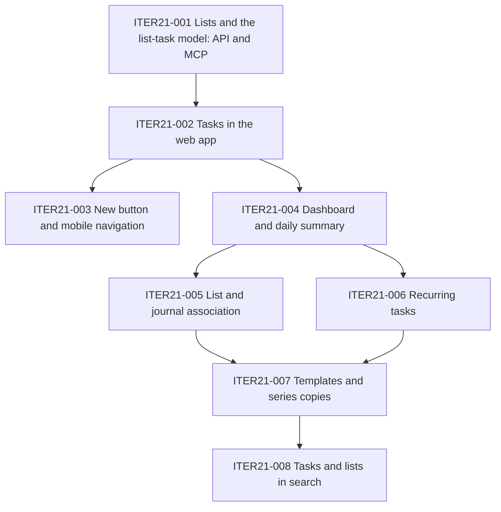

# Iteration 21: Task Lists and Navigation

**Status:** 📋 PLANNED — 8 sub-iterations, **115 phases**, one PR each, with per-phase acceptance criteria and diff estimates calibrated against Iteration 18's recorded actuals. No phase has started.
**Dependencies:** [Iteration 18](./iteration-18-home-dashboard-and-tasks.md) (tasks, journal anchoring, home dashboard, daily-summary task inputs, task history), [Iteration 20](./iteration-20-entity-ownership.md) (entity ownership: every new table carries `user_id`), journal series (migrations 0101 and 0121), MeiliSearch indexing through the transactional outbox, the design-system sync (`frontend/.design-sync/`).
**Goal:** Give tasks a second home — Task Lists — with optional due dates, a flag, an icon, recurrence and reusable templates, and make them reachable: a Tasks sidebar section, a top-bar **New** button and a mobile bottom tab bar. Journal-only tasks keep behaving exactly as today.

## Overview

This iteration delivers the [Task Lists and Navigation Product Specification](../product-specifications/task-lists-and-navigation-product-specification.md). Tasks today exist only between two journals; this iteration gives them a second home on a list, with the dates, recurrence and templates that a list makes useful, and adds the navigation that makes lists reachable on desktop and on a phone.

Every phase merges alone: it breaks nothing that worked, ships its own tests, and never waits for a later phase to restore behaviour. An MCP tool ships in the phase of its REST endpoint, and there is no E2E-only phase.

### Key References

- Spec: [`task-lists-and-navigation-product-specification.md`](../product-specifications/task-lists-and-navigation-product-specification.md)
- Partly superseded: [`home-dashboard-and-tasks-product-specification.md`](../product-specifications/home-dashboard-and-tasks-product-specification.md)
- [`activity-history-product-specification.md`](../product-specifications/activity-history-product-specification.md), [`contact-merge-product-specification.md`](../product-specifications/contact-merge-product-specification.md), [`journals-product-specification.md`](../product-specifications/journals-product-specification.md)
- [`journal-system-specification.md`](../journal-system-specification.md) (*Merging series*)
- [`iteration-18-home-dashboard-and-tasks.md`](./iteration-18-home-dashboard-and-tasks.md) (*Delivery Rules*, *Phase Completion Requirements*, *Phase Sizing Calibration*), [`iteration-20-entity-ownership.md`](./iteration-20-entity-ownership.md)
- [`domain-architecture.md`](../architecture/domain-architecture.md) (*Ownership*; *Daily summary invalidation*)
- [`api-design.md`](../architecture/api-design.md) (*Task Endpoints*, *Home Dashboard Endpoint*, *Conditional Writes*, pagination, MCP guidelines)
- [`database-design.md`](../architecture/database-design.md) (*Ownership*, *Field History Table*, *Event Outbox Table*, *MeiliSearch Integration*, *Migration Strategy*, *Transaction Management & Commit Timing*)
- [`integration-architecture.md`](../architecture/integration-architecture.md) (*Transactional Outbox Pattern*, *Redis Stream Consumer Architecture*)
- [`frontend-design.md`](../architecture/frontend-design.md) (*Responsive Layout Guidelines*, *Design System*, *Home Dashboard Page*, *The task's own change history*)
- [`testing-strategy.md`](../architecture/testing-strategy.md) (backend, RTL, Playwright, *MCP Integration Testing Guidelines*, *The AI Daily Summary in E2E*)
- [`deployment-guide.md`](../architecture/deployment-guide.md) (*Rebuilding the Search Index*)
- [`home-dashboard-wireframe.md`](../design/home-dashboard-wireframe.md) (§*Tasks*, W21–W29)
- [Design canvas](https://claude.ai/artifact/6it49ithFdmoXFXc5rZAgz) — private to the repository owner; acceptance criteria name its artboards by title
- [`mcp-setup.md`](../mcp-setup.md) (tool docs live in code); `frontend/.design-sync/NOTES.md`

## Current Baseline (verified in code, 2026-11-16)

- `tasks` (`backend/app/migrations/versions/0105_create_tasks_tables.py`): `creating_journal_id` and `due_journal_id` are NOT NULL with `ON DELETE RESTRICT`; there is no list, due date, flag, icon, position or recurrence column. The `Task` entity (`core_shared/core_shared/models/tasks/entities.py`) validates both anchors. About 45 reads across 10 backend files assume both anchors are present.
- The frontend assumes it too: `frontend/src/types/tasks.ts` declares both journal references non-null, and `JournalTaskRow`, `AttachTaskDialog`, `RetargetTaskDialog` and `DashboardTaskRow` dereference them unguarded.
- The journal delete guard's query inner-joins both anchors (`task_anchor_repository.py`), so a task with one anchor would be invisible to it and the delete would fail with a raw integrity error.
- Lapse is derived on every read (`core_shared/core_shared/models/tasks/lapse.py`); nothing is stored and no job touches tasks.
- The backend has no scheduler for domain work. The precedents for time-based work are lifespan loops in `backend/app/main.py`: `run_attendance_transition_loop` (hourly) and `run_summary_refresh_sweep_loop`.
- Dashboard tasks: `home_dashboard_service.py` → `tasks_section.py`; the seven-day window is `DEFAULT_UPCOMING_DAYS_AHEAD` in `core_shared/core_shared/models/date_window.py`; selection is in `core_shared/core_shared/models/tasks/upcoming.py`.
- Daily-summary invalidation already listens to task events (`summary_invalidation_consumer.py`).
- Search has `contacts` and `journals` indexes only; `search_indexer_consumer.py` ignores task events; the search service defaults to every available entity type, and `GlobalSearch.tsx` renders any non-journal result as a contact. The frontend's `ENTITY_TYPES` does not match the backend's.
- Series: `journal_series`, `journal_series_members`; journals join by hand or through calendar sync. The series page is reachable only from a journal's series badge.
- MCP task tools: `backend/app/mcp/domains/tasks/tools.py` (13 tools). The server instructions say tasks have "no separate task list and no due date".
- Frontend shell: `Header` (hamburger, Home, search, theme, user menu); `Sidebar.tsx` (844 lines) holds the desktop sidebar and `MobileSidebar`, the only place tag trees exist on phones. Mobile Chrome E2E helpers (`utils/sidebar-tags.ts`, `utils/test-helpers.ts`, `sidebar-tag-management.spec.ts` and others) open that sheet. No New button, bottom bar, drag-and-drop library or icon picker exists.
- The latest migration file is `0143_…`.

## Delivery Rules

The [Delivery Rules](./iteration-18-home-dashboard-and-tasks.md#delivery-rules) and [Phase Completion Requirements](./iteration-18-home-dashboard-and-tasks.md#phase-completion-requirements) of Iteration 18 apply unchanged. The rules that shape this breakdown:

1. **Tests first.** Each phase writes its failing tests before its implementation.
2. **One phase, one PR, one capability.** A phase never spans two domains.
3. **Every phase is safe alone.** It can be merged and deployed without any later phase. Where a backend change would put something new in front of an existing screen, the screen's tolerance lands first; new search result types are opt-in until the dropdown can show them.
4. **A hard rule gets its own phase.** A rule matrix (dates, invariants, selection) lands as a pure service with unit tests ahead of the phase that exposes it.
5. **MCP ships with its API.** A REST endpoint and its MCP tool land in the same phase. MCP tools open no transactions; they call a `@transactional` service.
6. **Events ship with the change.** A domain event is emitted in the phase that makes the change possible, so no write is ever missing from history. At most two new event types per phase.
7. **E2E ships with the UI.** Each UI phase adds its own E2E, on Firefox and Mobile Chrome, to the sub-iteration's spec file; the first UI phase of a sub-iteration creates the spec and its `TestDataManager` helpers. Tests create their own data and never branch on what they find.
8. **Every UI phase is checked on a phone.** It asserts no horizontal scroll and touch targets of at least 44px at a 390px-wide viewport for what it adds.
9. **Ownership.** Every new table carries `user_id`; every repository read and write is owner-scoped and proven with a second user.
10. **Record the actual.** When a phase lands, record its actual diff beside the estimate, and re-estimate the phases that follow if the ratio has moved.

## Phase Completion Requirements

A phase is complete when:

- [ ] its acceptance criteria are met and ticked in this document;
- [ ] unit tests for the touched stack pass, and backend integration tests pass when the backend or `core_shared` changed;
- [ ] the E2E tests it added pass on Firefox and Mobile Chrome, when it has UI;
- [ ] linting, formatting and type checks pass (`ruff`, `mypy`, `pnpm quality:check`);
- [ ] architecture documents are updated where the phase changes what they describe;
- [ ] the actual diff is recorded beside the estimate.

## Phase Sizing Calibration

One phase is one PR. Estimates are **production lines → tracked lines**, using the multipliers [Iteration 18 measured](./iteration-18-home-dashboard-and-tasks.md#phase-sizing-calibration):

- ×4 for schema and wiring phases; ×6 for a port + adapter pair or a phase whose criteria are a rule matrix (dates, invariants);
- frontend phases are priced by counting their components (Iteration 18's title-priced frontend phases landed at 3–6 times their estimates), so they sit at 650–1,100;
- a phase that exposes **one capability on REST and MCP together** is budgeted at 900–1,500 and says so on its estimate line.

**On the 500-line standard.** About 70 phases sit between 400 and 1,100 tracked lines. The other 45 expose one capability on both surfaces, and that shape has never landed near 500 here: Iteration 18 estimated it at about 600 and measured 2,036, 2,483 and 3,300. Those phases are kept whole, at one capability each, rather than split into a REST PR and a trailing MCP PR, because MCP must not trail its API. If a capability phase is on course to pass 1,500, split it by capability (for example, set and clear) — never by surface.

## Sequencing Strategy

| # | Sub-iteration | Depends on | Can run alongside | Phases |
|---|---|---|---|---:|
| ITER21-001 | Lists and the list-task model: API and MCP | Iterations 18, 20 | — | 30 |
| ITER21-002 | Tasks in the web app | 001 | — | 19 |
| ITER21-003 | New button and mobile navigation | 002 | 004–008 | 10 |
| ITER21-004 | Dashboard and daily summary for list tasks | 002 | 003 | 6 |
| ITER21-005 | List ↔ journal association | 004 | 003, 006 | 10 |
| ITER21-006 | Recurring tasks | 004 | 003, 005 | 10 |
| ITER21-007 | Templates and series copies | 005, 006 | 003 | 20 |
| ITER21-008 | Tasks and lists in search | 007 | 003 | 10 |

Search is last because its rules name things the earlier steps create (templates, instance lists, association, auto-archive).

## Iteration Breakdown

### ITER21-001: Lists and the list-task model — API and MCP

**Objective:** Introduce Task Lists and let a task live on one, with an optional due date or due journal, a flag and an icon, over REST and MCP. The only web changes are those that keep existing pages correct.

**Independently deliverable because:** it is additive. Existing tasks are journal-only tasks and keep every rule; an agent can run a list end to end over MCP; existing pages stay correct when list tasks exist.

**Relevant documents:** [Spec](../product-specifications/task-lists-and-navigation-product-specification.md) §*Tasks*, §*Task Lists* (product model, archiving and deleting), §*MCP and AI-Agent Parity*, the superseded-behaviour table; activity-history and contact-merge specs; [`api-design.md`](../architecture/api-design.md) *Task Endpoints*, *Conditional Writes*; [`database-design.md`](../architecture/database-design.md) *Ownership*, *Migration Strategy*, *Field History Table*; [`domain-architecture.md`](../architecture/domain-architecture.md) *Ownership*; [`testing-strategy.md`](../architecture/testing-strategy.md) *MCP Integration Testing Guidelines*.

**Acceptance Criteria — lists:**
- [ ] A user can create, rename, set or clear the icon of, reorder, archive, unarchive and delete a list; another user's list is never readable or writable.
- [ ] Archiving leaves task state untouched and works with open tasks. Until unarchived the list and its tasks are read-only: every list and task write is refused.
- [ ] Deleting a list deletes its tasks, except tasks holding both a creating and a due journal, which survive as journal-only tasks (lapsed if that journal has passed).
- [ ] Listing lists supports an archived filter and returns each list's open-task count; reading one list returns its open tasks in manual order and its closed tasks most-recently-closed first, paged.

**Acceptance Criteria — tasks on a list:**
- [ ] A task can be created on a list with no journal at all, with a due date, or with a due journal; never with both a due date and a due journal, and never with neither a list nor a due journal (invariants 1–5 hold in the domain and in the database).
- [ ] A due date must be today or later in the user's timezone when set; a due journal must be future-dated when set.
- [ ] A list task never lapses. Past its date it reads as **overdue**; when the date comes from a multi-day journal it is overdue only once the journal's last day has ended.
- [ ] Changing or clearing a list task's date is a plain edit with no acknowledgement and no status change; a replaced or cleared due journal becomes an intermediate journal.
- [ ] A done or cancelled list task can be set straight back to not done.
- [ ] Tasks on a list can be reordered; a new task joins the bottom.
- [ ] A list task can move to another list, joining the bottom; a journal-only task can be added to a list and stops lapsing.
- [ ] A task can leave its list only when it has both anchors; the response says when that leaves it lapsed.
- [ ] Flag and icon can be set and cleared on any task, journal-only ones included; the icon must come from the fixed set.

**Acceptance Criteria — journals, contacts, history:**
- [ ] Deleting a journal is not blocked by list tasks: their link to it is removed and a task that was due in it becomes undated. Journal-only tasks still block deletion.
- [ ] The journal delete confirmation states how many list tasks will lose their link.
- [ ] While a journal is cancelled, a list task due in it is treated as undated; un-cancelling restores the date. Merging journals re-points list-task links as today.
- [ ] A contact's task record includes list tasks, labelled with their list.
- [ ] List membership, due date, flag and icon changes emit domain events in the phase that makes them possible and appear in task history; reordering does not. Lists have their own history: created, renamed, archived, unarchived.

**Acceptance Criteria — existing surfaces, MCP and regression:**
- [ ] With list tasks present, every existing surface still works: on a journal page a list task shows the overdue marker and direct actions, never the lapsed marker; the dashboard, `list_upcoming_tasks` and the daily summary leave list tasks out until ITER21-004. Nothing errors on a task with no journal.
- [ ] MCP tools cover every list and list-task operation above; existing task tools behave unchanged for journal-only tasks.
- [ ] The server's task guidance no longer says there is no task list and no due date.
- [ ] No test of journal-only behaviour (two anchors required, lapse, retarget-to-revive, reopen acknowledgement, delete guard) changes its assertions.

**Phase ordering:** Phases 1–8 (lists) and 9–17 (task model and its safety work) are independent and can interleave. Phase 18 is the first that lets a list task exist; phases 11, 12, 15 and 16 are what keep existing pages and journal deletion correct at that moment.

#### Phase 1: Task list table, entity and icon set

**Prerequisites:** None beyond the iteration's dependencies.
**Estimated diff:** ~110 production → **~440 tracked**

**Acceptance Criteria:**

- [ ] Migration for `task_lists` (owner, name, icon, position, archived-at); `TaskList` entity; the fixed icon-key set in `core_shared`.

#### Phase 2: Task list repository

**Prerequisites:** Phase 1.
**Estimated diff:** ~130 production → **~780 tracked** (×6)

**Acceptance Criteria:**

- [ ] Port + SQL adapter: owner-scoped CRUD, positions, archived filter; second-user isolation tests.

#### Phase 3: Create and read lists

**Prerequisites:** Phase 2.
**Estimated diff:** ~200 production → **~1,500 tracked** · one capability on REST and MCP together

**Acceptance Criteria:**

- [ ] Create; get one; list all with archived filter and open-task count.
- [ ] Emits list-created.
- [ ] The REST endpoint and the MCP tool ship together, each with its own rejection and second-user isolation tests.

#### Phase 4: Rename and icon

**Prerequisites:** Phase 3.
**Estimated diff:** ~120 production → **~1,200 tracked** · one capability on REST and MCP together

**Acceptance Criteria:**

- [ ] One update capability; icon validated against the fixed set.
- [ ] Emits list-updated.
- [ ] The REST endpoint and the MCP tool ship together, each with its own rejection and second-user isolation tests.

#### Phase 5: Reorder lists

**Prerequisites:** Phase 3.
**Estimated diff:** ~100 production → **~900 tracked** · one capability on REST and MCP together

**Acceptance Criteria:**

- [ ] Position among the user's lists; no event.
- [ ] The REST endpoint and the MCP tool ship together, each with its own rejection and second-user isolation tests.

#### Phase 6: Archive and unarchive

**Prerequisites:** Phase 4.
**Estimated diff:** ~140 production → **~1,300 tracked** · one capability on REST and MCP together

**Acceptance Criteria:**

- [ ] Archive with open tasks; list writes refused while archived; unarchive restores.
- [ ] Emits list-updated.
- [ ] The REST endpoint and the MCP tool ship together, each with its own rejection and second-user isolation tests.

#### Phase 7: List history projection

**Prerequisites:** Phase 4, Phase 6.
**Estimated diff:** ~130 production → **~800 tracked**

**Acceptance Criteria:**

- [ ] Created, renamed, icon, archived and unarchived projected into field history with labels.

#### Phase 8: List history read

**Prerequisites:** Phase 7.
**Estimated diff:** ~100 production → **~900 tracked** · one capability on REST and MCP together

**Acceptance Criteria:**

- [ ] Endpoint and tool.
- [ ] The REST endpoint and the MCP tool ship together, each with its own rejection and second-user isolation tests.

#### Phase 9: Task schema: list columns and relaxed anchors

**Prerequisites:** Phase 1.
**Estimated diff:** ~80 production → **~400 tracked**

**Acceptance Criteria:**

- [ ] Migration only: `task_list_id`, position, due date, flag, icon; both anchors nullable; database CHECKs for invariants 1, 4, 5.
- [ ] Existing code untouched.

#### Phase 10: Task entity and invariants

**Prerequisites:** Phase 9.
**Estimated diff:** ~110 production → **~660 tracked** (×6)

**Acceptance Criteria:**

- [ ] Optional anchors, list membership, due date xor due journal; journal-only rules unchanged.

#### Phase 11: Readers cope with a task that has no journal

**Prerequisites:** Phase 10.
**Estimated diff:** ~150 production → **~900 tracked**

**Acceptance Criteria:**

- [ ] The ~45 anchor reads and the inner joins made null-safe; dashboard, upcoming and summary selections keep to journal-only tasks.
- [ ] Integration tests seed a list task directly.

#### Phase 12: Frontend copes with a task that has no journal

**Prerequisites:** Phase 9.
**Estimated diff:** ~100 production → **~500 tracked**

**Acceptance Criteria:**

- [ ] Task types allow missing journals; `JournalTaskRow`, `AttachTaskDialog`, `RetargetTaskDialog` and `DashboardTaskRow` guarded.

#### Phase 13: List-task date rules

**Prerequisites:** Phase 10.
**Estimated diff:** ~110 production → **~660 tracked** (×6)

**Acceptance Criteria:**

- [ ] Pure, in the user's timezone: due date today or later; never lapses; overdue after its date or after a multi-day journal's last day; cancelled due journal → undated.
- [ ] Tested across day boundaries.

#### Phase 14: Task repository: list queries

**Prerequisites:** Phase 10.
**Estimated diff:** ~140 production → **~840 tracked** (×6)

**Acceptance Criteria:**

- [ ] Membership, positions, open tasks in order, closed tasks paged, open counts per list.

#### Phase 15: Task reads carry list, due date, flag, icon, overdue

**Prerequisites:** Phase 11, Phase 13, Phase 14.
**Estimated diff:** ~130 production → **~1,100 tracked** · one capability on REST and MCP together

**Acceptance Criteria:**

- [ ] Get-task, journal tasks, upcoming, the dashboard payload and the contact task record (labelled with the list).
- [ ] The REST endpoint and the MCP tool ship together, each with its own rejection and second-user isolation tests.

#### Phase 16: Journal delete with list tasks — backend

**Prerequisites:** Phase 11.
**Estimated diff:** ~150 production → **~1,200 tracked** · one capability on REST and MCP together

**Acceptance Criteria:**

- [ ] Delete not blocked by list tasks: links removed, due → undated; delete preview reports the count (REST + MCP); the guard sees one-anchor tasks.
- [ ] Cancel and merge behaviour for list tasks proven here.
- [ ] Lands before any list task can exist.
- [ ] The REST endpoint and the MCP tool ship together, each with its own rejection and second-user isolation tests.

#### Phase 17: Journal delete confirmation states the count

**Prerequisites:** Phase 16.
**Estimated diff:** ~90 production → **~450 tracked**

**Acceptance Criteria:**

- [ ] Existing delete dialog; E2E in the journal-tasks spec.

#### Phase 18: Create a task on a list

**Prerequisites:** Phase 12, Phase 15, Phase 16.
**Estimated diff:** ~170 production → **~1,500 tracked** · one capability on REST and MCP together

**Acceptance Criteria:**

- [ ] Undated or with a due date; joins the bottom; the created event carries the list; server task guidance rewritten.
- [ ] The REST endpoint and the MCP tool ship together, each with its own rejection and second-user isolation tests.

#### Phase 19: Create on a list with a due journal

**Prerequisites:** Phase 18.
**Estimated diff:** ~90 production → **~800 tracked** · one capability on REST and MCP together

**Acceptance Criteria:**

- [ ] Future-dated journal; never together with a due date.
- [ ] The REST endpoint and the MCP tool ship together, each with its own rejection and second-user isolation tests.

#### Phase 20: Read a list's tasks

**Prerequisites:** Phase 18.
**Estimated diff:** ~110 production → **~1,000 tracked** · one capability on REST and MCP together

**Acceptance Criteria:**

- [ ] Open in order; closed paged.
- [ ] The REST endpoint and the MCP tool ship together, each with its own rejection and second-user isolation tests.

#### Phase 21: Archived lists freeze their tasks

**Prerequisites:** Phase 6, Phase 18.
**Estimated diff:** ~90 production → **~800 tracked**

**Acceptance Criteria:**

- [ ] Status, text, delete, retarget, contact-link and attach endpoints and tools refuse a task on an archived list.

#### Phase 22: Change a list task's due date

**Prerequisites:** Phase 18.
**Estimated diff:** ~130 production → **~1,300 tracked** · one capability on REST and MCP together

**Acceptance Criteria:**

- [ ] Set, change, clear as a plain edit; carried on the task-updated event with its history label.
- [ ] The REST endpoint and the MCP tool ship together, each with its own rejection and second-user isolation tests.

#### Phase 23: Change a list task's due journal

**Prerequisites:** Phase 19.
**Estimated diff:** ~120 production → **~1,200 tracked** · one capability on REST and MCP together

**Acceptance Criteria:**

- [ ] Set, change, clear; the replaced journal becomes intermediate.
- [ ] The REST endpoint and the MCP tool ship together, each with its own rejection and second-user isolation tests.

#### Phase 24: Direct reopen of list tasks

**Prerequisites:** Phase 18.
**Estimated diff:** ~60 production → **~500 tracked**

**Acceptance Criteria:**

- [ ] Done or cancelled → not done without retarget, on the existing endpoints and tool.

#### Phase 25: Reorder tasks in a list

**Prerequisites:** Phase 20.
**Estimated diff:** ~100 production → **~900 tracked** · one capability on REST and MCP together

**Acceptance Criteria:**

- [ ] Position change; no event.
- [ ] The REST endpoint and the MCP tool ship together, each with its own rejection and second-user isolation tests.

#### Phase 26: Move a task onto or between lists

**Prerequisites:** Phase 20.
**Estimated diff:** ~150 production → **~1,500 tracked** · one capability on REST and MCP together

**Acceptance Criteria:**

- [ ] List → list; journal-only → list (stops lapsing).
- [ ] New list-membership event with its history projection.
- [ ] The REST endpoint and the MCP tool ship together, each with its own rejection and second-user isolation tests.

#### Phase 27: Remove a task from its list

**Prerequisites:** Phase 26.
**Estimated diff:** ~110 production → **~1,000 tracked** · one capability on REST and MCP together

**Acceptance Criteria:**

- [ ] Only with both anchors; response says when it leaves the task lapsed.
- [ ] The REST endpoint and the MCP tool ship together, each with its own rejection and second-user isolation tests.

#### Phase 28: Flag and icon on any task

**Prerequisites:** Phase 15.
**Estimated diff:** ~120 production → **~1,100 tracked** · one capability on REST and MCP together

**Acceptance Criteria:**

- [ ] Journal-only tasks included; carried on the task-updated event with history labels.
- [ ] The REST endpoint and the MCP tool ship together, each with its own rejection and second-user isolation tests.

#### Phase 29: Delete a list

**Prerequisites:** Phase 20.
**Estimated diff:** ~150 production → **~1,300 tracked** · one capability on REST and MCP together

**Acceptance Criteria:**

- [ ] Deletes its tasks; both-anchor tasks survive as journal-only.
- [ ] Emits list-deleted.
- [ ] The REST endpoint and the MCP tool ship together, each with its own rejection and second-user isolation tests.

#### Phase 30: Journal page: list tasks

**Prerequisites:** Phase 22, Phase 24.
**Estimated diff:** ~130 production → **~700 tracked**

**Acceptance Criteria:**

- [ ] Overdue marker and direct reopen for a list task on a journal page, never lapsed.
- [ ] E2E in the journal-tasks spec.

---

### ITER21-002: Tasks in the web app — sidebar, `/tasks`, list page, task details

**Objective:** Make lists usable in the browser at desktop and phone widths.

**Independently deliverable because:** it is a new section over ITER21-001's API and changes no existing page except to show the flag and icon on tasks already rendered.

**Relevant documents:** [Spec](../product-specifications/task-lists-and-navigation-product-specification.md) §*The list page*, §*The Tasks overview*, §*Sidebar*, §*Archiving and deleting*, §*Flag and icon*; [canvas](https://claude.ai/artifact/6it49ithFdmoXFXc5rZAgz) *List page*, *Tasks overview*, *Archived lists*, *Task details*, *Task row*, *Sidebar with Tasks section*, *Mobile: list page*, *Mobile: Tasks tab*; [`frontend-design.md`](../architecture/frontend-design.md) *Responsive Layout Guidelines*, *Design System*; [`testing-strategy.md`](../architecture/testing-strategy.md) Playwright.

**Acceptance Criteria — sidebar and overview:**
- [ ] The sidebar has a Tasks section: *All lists*, one entry per unarchived ordinary list in the user's order with icon and open-task count, and *New list*.
- [ ] `/tasks` shows every open list as a card with name, icon, open-task count and a preview of its first open tasks, completable in place; lists can be created and reordered there.
- [ ] Archived lists have their own page reached from `/tasks`: grouped by month archived, filterable by name, paged, each with Unarchive. An archived list opens read-only.
- [ ] Tasks on an archived list still appear, marked archived and not actionable, on their due or creating journal's page and in linked contacts' records.

**Acceptance Criteria — list page:**
- [ ] Open tasks show in manual order with drag reordering and a keyboard equivalent; an always-present inline row adds a task at the bottom.
- [ ] A row shows checkbox, icon, text, flag, due date or due-journal link, overdue marker and contact avatar circles; text is editable inline.
- [ ] Done and cancelled tasks sit in a collapsed *Completed* group, most recently closed first, loaded in pages, cancelled ones marked.
- [ ] The header offers rename, change icon, archive, delete and the list's history; an empty list says so and invites the first task.

**Acceptance Criteria — task details and existing surfaces:**
- [ ] A details panel edits a task's list, due date or due journal, flag, icon and contacts.
- [ ] The panel links to the task's history.
- [ ] Removing a task from its list warns first when that will leave it lapsed.
- [ ] The icon picker offers the fixed set, is searchable by name and scrolls.
- [ ] Flag and icon show on journal task rows and dashboard task rows, and can be edited from the journal page.
- [ ] A contact's page labels list tasks with their list and links to it.
- [ ] At a 390px-wide viewport every page here has no horizontal scroll and touch targets of at least 44px.
- [ ] E2E covers create list → add → complete → find under Completed, reorder, archive and unarchive, on Firefox and Mobile Chrome.

#### Phase 1: Frontend API client for lists and list tasks

**Prerequisites:** ITER21-001.
**Estimated diff:** ~200 production → **~900 tracked**

**Acceptance Criteria:**

- [ ] Types and query/mutation hooks.

#### Phase 2: Icon picker

**Prerequisites:** Phase 1.
**Estimated diff:** ~120 production → **~600 tracked**

**Acceptance Criteria:**

- [ ] Fixed set mapped to `lucide-react`; search by name; scrolling grid; "No icon"; keyboard operable.

#### Phase 3: Task row

**Prerequisites:** Phase 1.
**Estimated diff:** ~130 production → **~650 tracked**

**Acceptance Criteria:**

- [ ] Checkbox, icon, text, flag, due date or due-journal link, overdue marker, contact avatar circles.

#### Phase 4: List page: header and open tasks

**Prerequisites:** Phase 3.
**Estimated diff:** ~200 production → **~1,000 tracked**

**Acceptance Criteria:**

- [ ] `/tasks/[id]`, breadcrumb, open tasks in order, complete in place, empty state.
- [ ] Creates `task-lists.spec.ts` and helpers.

#### Phase 5: Inline add row and inline text edit

**Prerequisites:** Phase 4.
**Estimated diff:** ~120 production → **~600 tracked**

**Acceptance Criteria:**

- [ ] E2E: add and complete.

#### Phase 6: List form: create, rename, icon

**Prerequisites:** Phase 2, Phase 4.
**Estimated diff:** ~130 production → **~650 tracked**

**Acceptance Criteria:**

- [ ] One dialog; rename and icon wired into the list header.

#### Phase 7: `/tasks` overview

**Prerequisites:** Phase 6.
**Estimated diff:** ~220 production → **~1,100 tracked**

**Acceptance Criteria:**

- [ ] Cards with previews completable in place; New list; empty state.
- [ ] E2E: create a list.

#### Phase 8: Sidebar Tasks section

**Prerequisites:** Phase 7.
**Estimated diff:** ~180 production → **~900 tracked**

**Acceptance Criteria:**

- [ ] *All lists*, list entries with icon and count, *New list*; `Sidebar` design-sync preview updated.
- [ ] Every link already has a destination.

#### Phase 9: Reorder lists

**Prerequisites:** Phase 7, Phase 8.
**Estimated diff:** ~150 production → **~750 tracked**

**Acceptance Criteria:**

- [ ] Drag with a keyboard equivalent on `/tasks`; sidebar follows.
- [ ] Introduces the drag-and-drop dependency.

#### Phase 10: Reorder tasks

**Prerequisites:** Phase 4, Phase 9.
**Estimated diff:** ~120 production → **~600 tracked**

**Acceptance Criteria:**

- [ ] Drag and keyboard on the list page.

#### Phase 11: Completed group

**Prerequisites:** Phase 4.
**Estimated diff:** ~130 production → **~650 tracked**

**Acceptance Criteria:**

- [ ] Collapsed, paged, cancelled marked; reopen.
- [ ] E2E: find under Completed.

#### Phase 12: Archived listing: paging and name filter

**Prerequisites:** ITER21-001.
**Estimated diff:** ~80 production → **~700 tracked** · one capability on REST and MCP together

**Acceptance Criteria:**

- [ ] Extends the list-all endpoint and tool.
- [ ] The REST endpoint and the MCP tool ship together, each with its own rejection and second-user isolation tests.

#### Phase 13: Archived lists page

**Prerequisites:** Phase 7, Phase 12.
**Estimated diff:** ~190 production → **~950 tracked**

**Acceptance Criteria:**

- [ ] Grouped by month, filter, paging, Unarchive; an archived list opens read-only.

#### Phase 14: Archive and delete from the list header

**Prerequisites:** Phase 13.
**Estimated diff:** ~110 production → **~550 tracked**

**Acceptance Criteria:**

- [ ] With confirmation.
- [ ] E2E: archive then unarchive.
- [ ] Lands after the page that can undo it.

#### Phase 15: Task details: due, flag, icon

**Prerequisites:** Phase 4, Phase 2.
**Estimated diff:** ~190 production → **~950 tracked**

**Acceptance Criteria:**

- [ ] Side panel.

#### Phase 16: Task details: move and remove

**Prerequisites:** Phase 15.
**Estimated diff:** ~130 production → **~650 tracked**

**Acceptance Criteria:**

- [ ] Move to another list; remove with the lapse warning.

#### Phase 17: Task details: contacts and history; list history

**Prerequisites:** Phase 15.
**Estimated diff:** ~150 production → **~750 tracked**

**Acceptance Criteria:**

- [ ] Contacts; link to task history; the list's history from its header.

#### Phase 18: Flag and icon on journal and dashboard rows

**Prerequisites:** Phase 2.
**Estimated diff:** ~130 production → **~650 tracked**

**Acceptance Criteria:**

- [ ] Shown on both; editable from the journal page.

#### Phase 19: Archived and list labels on journal and contact pages

**Prerequisites:** Phase 13.
**Estimated diff:** ~110 production → **~550 tracked**

**Acceptance Criteria:**

- [ ] Archived-list tasks marked and not actionable; contact page links a list task to its list.

---

### ITER21-003: New button and mobile navigation

**Objective:** Add the top-bar **New** control and replace the mobile hamburger sheet with a bottom tab bar.

**Independently deliverable because:** it changes only the app chrome and reuses the existing journal and contact forms; it needs ITER21-002 for the Tasks destination and nothing later.

**Relevant documents:** [Spec](../product-specifications/task-lists-and-navigation-product-specification.md) §*Navigation*, §*Designing for Notes*; [canvas](https://claude.ai/artifact/6it49ithFdmoXFXc5rZAgz) *New* dialog (four states), *Mobile: New sheet* (three states), *Mobile: Journals tab, tags sheet*, *Mobile: More*, *Top bar with New*, *Mobile tab bar*; [`frontend-design.md`](../architecture/frontend-design.md) *Responsive Layout Guidelines*; `frontend/.design-sync/NOTES.md` and the project CLAUDE.md *Design System Sync* section.

**Acceptance Criteria — New:**
- [ ] A **New** control is in the top bar on every authenticated page at every viewport and opens one dialog (a top sheet on phones) with a Task / Journal / Contact switch that keeps what was typed in each.
- [ ] Task requires a destination. *On a list*: an existing list or a new one named inline, with optional due date or due journal, flag, icon and contacts. *In a journal*: the existing create-task fields plus the creating journal, with no date field.
- [ ] The destination is pre-filled from context: the list being viewed, or the journal being viewed as creating journal.
- [ ] Journal and Contact hold the full existing create forms and behave as `/journals/new` and `/contacts/new` do today; the existing page-level create buttons keep working.
- [ ] The entity types offered come from one list, so a further type can be added without restructuring the dialog.

**Acceptance Criteria — mobile navigation:**
- [ ] Below the desktop breakpoint a fixed bottom tab bar shows Home, Journals, Tasks, Contacts and More; each is one tap from any page and the current section is marked.
- [ ] More holds the secondary destinations (journal tags, outdoor logbook, favourites, contact tags, integrations, settings, theme); each is at most two taps from its section.
- [ ] Journal and contact tags are reachable from their own tab through a Tags control that opens the tag tree, including create, rename, move and delete.
- [ ] Search stays reachable from every page.
- [ ] The tab bar never covers a page's primary action or an open on-screen keyboard, and respects device safe areas.
- [ ] The hamburger sheet is gone on phones; the desktop sidebar is unchanged apart from the Tasks section.
- [ ] The design-system sync includes the new and changed chrome components.
- [ ] E2E on Mobile Chrome covers one-tap movement between the four sections and creating a task, a journal and a contact from New; Firefox covers New on desktop.

#### Phase 1: New dialog shell and Contact

**Prerequisites:** None.
**Estimated diff:** ~170 production → **~900 tracked**

**Acceptance Criteria:**

- [ ] **New** in the top bar; dialog on desktop, top sheet on phones; type switch from one registry, keeping each type's input; Contact tab holding `ContactForm`.
- [ ] `Header` design-sync preview updated.
- [ ] Creates `new-dialog.spec.ts`.

#### Phase 2: New → Journal

**Prerequisites:** Phase 1.
**Estimated diff:** ~150 production → **~900 tracked** (×5)

**Acceptance Criteria:**

- [ ] `JournalCreateForm` inside the dialog, behaving as `/journals/new`; the page keeps working.

#### Phase 3: New → Task on a list

**Prerequisites:** Phase 1, ITER21-002 Phase 6.
**Estimated diff:** ~200 production → **~1,000 tracked**

**Acceptance Criteria:**

- [ ] Existing list or a new one named inline; due date or due journal; flag; icon; contacts; list pre-filled when viewing one.

#### Phase 4: Lift the create-task fields out of their dialog

**Prerequisites:** None.
**Estimated diff:** ~120 production → **~800 tracked** (×5)

**Acceptance Criteria:**

- [ ] Refactor only: `CreateTaskDialog` keeps working on the journal page with the same tests.

#### Phase 5: New → Task in a journal

**Prerequisites:** Phase 1, Phase 4.
**Estimated diff:** ~130 production → **~650 tracked**

**Acceptance Criteria:**

- [ ] The lifted fields plus a creating-journal search; journal pre-filled when viewing one.

#### Phase 6: Bottom tab bar

**Prerequisites:** ITER21-002 Phase 7.
**Estimated diff:** ~200 production → **~1,000 tracked**

**Acceptance Criteria:**

- [ ] Five tabs below the desktop breakpoint; current section marked; safe areas; hidden while the on-screen keyboard is open; never over the inline add row or the journal editor; search still one tap away.
- [ ] More opens the existing sheet, so nothing is lost yet.
- [ ] Added to the design sync.
- [ ] Creates `mobile-navigation.spec.ts`.

#### Phase 7: Tags on the Journals tab

**Prerequisites:** Phase 6.
**Estimated diff:** ~200 production → **~1,000 tracked**

**Acceptance Criteria:**

- [ ] Tags control opening the journal tag tree as a sheet, with create, rename, move and delete by touch.

#### Phase 8: Tags on the Contacts tab

**Prerequisites:** Phase 7.
**Estimated diff:** ~110 production → **~550 tracked**

**Acceptance Criteria:**

- [ ] The same control over contact tags.

#### Phase 9: More page

**Prerequisites:** Phase 7, Phase 8.
**Estimated diff:** ~170 production → **~850 tracked**

**Acceptance Criteria:**

- [ ] Secondary destinations and theme; More stops opening the sheet.

#### Phase 10: Remove the hamburger sheet on phones

**Prerequisites:** Phase 9.
**Estimated diff:** ~80 production → **~900 tracked**

**Acceptance Criteria:**

- [ ] Sheet and trigger removed; Mobile Chrome helpers and specs that opened it (`sidebar-tags.ts`, `test-helpers.ts`, `sidebar-tag-management.spec.ts`, `sidebar.spec.ts` and others) moved to the tab bar and Tags control.

---

### ITER21-004: Dashboard and daily summary for list tasks

**Objective:** Bring dated and overdue list tasks into the dashboard's Tasks card, `list_upcoming_tasks` and the daily summary, without letting undated backlog in.

**Independently deliverable because:** it only widens what an existing read model selects; with no list tasks present the dashboard is what it is today.

**Relevant documents:** [Spec](../product-specifications/task-lists-and-navigation-product-specification.md) §*Dashboard and Daily Summary*, §*Dates, overdue and lapse*; [canvas](https://claude.ai/artifact/6it49ithFdmoXFXc5rZAgz) *Dashboard*; [`home-dashboard-wireframe.md`](../design/home-dashboard-wireframe.md) §*Tasks* — W21, W22 and W29 change and the wireframe doc is updated; [`api-design.md`](../architecture/api-design.md) *Home Dashboard Endpoint*; [`frontend-design.md`](../architecture/frontend-design.md) *Home Dashboard Page*; [`domain-architecture.md`](../architecture/domain-architecture.md) *Daily summary invalidation*; [`testing-strategy.md`](../architecture/testing-strategy.md) *The AI Daily Summary in E2E*.

**Acceptance Criteria:**
- [ ] The Tasks card shows journal-only tasks as today, plus list tasks whose due date or due journal falls in the upcoming window, plus overdue list tasks.
- [ ] An overdue task stays on the card for seven days after its date, then leaves it while staying open and overdue on its list.
- [ ] Overdue tasks come first, oldest first; everything else soonest first. The card keeps its size and show-more behaviour.
- [ ] Undated list tasks, tasks on archived lists, tasks whose due journal is cancelled, and done or cancelled tasks never appear.
- [ ] Each list task names and links its list, shows an overdue marker when overdue, and can be completed from the card.
- [ ] The home-dashboard endpoint and the `list_upcoming_tasks` MCP tool return the same tasks, each marked with its list and whether it is overdue.
- [ ] Today's briefing (`get_daily_summary` included) follows the card's rules; a past day's summary also includes list tasks whose due date was that day, with their outcome.
- [ ] A summary is refreshed by a due-date change, a task moving on or off a list, and a list being archived or unarchived, as well as by the existing triggers.
- [ ] E2E covers a dated list task appearing in its week and an overdue one being marked, on Firefox and Mobile Chrome.

#### Phase 1: Selection rules for list tasks

**Prerequisites:** ITER21-001.
**Estimated diff:** ~120 production → **~720 tracked** (×6)

**Acceptance Criteria:**

- [ ] Pure: dated list tasks in the window; overdue for seven days; overdue first, oldest first; exclusions.

#### Phase 2: Tasks card renders list-task rows

**Prerequisites:** ITER21-002 Phase 4.
**Estimated diff:** ~170 production → **~850 tracked**

**Acceptance Criteria:**

- [ ] Row with list link, overdue marker and Done; description and empty-state copy; wireframe doc updated.
- [ ] Lands before the data, so the card is ready when it arrives.

#### Phase 3: Dashboard payload and upcoming tasks

**Prerequisites:** Phase 1, Phase 2.
**Estimated diff:** ~150 production → **~1,300 tracked** · one capability on REST and MCP together

**Acceptance Criteria:**

- [ ] Home-dashboard tasks section, `/tasks/upcoming` and `list_upcoming_tasks` return list tasks marked with list and overdue.
- [ ] E2E: dated task in its week; overdue marked.
- [ ] The REST endpoint and the MCP tool ship together, each with its own rejection and second-user isolation tests.

#### Phase 4: Today's briefing uses the new selection

**Prerequisites:** Phase 1.
**Estimated diff:** ~110 production → **~800 tracked**

**Acceptance Criteria:**

- [ ] Summary inputs and `get_daily_summary`.

#### Phase 5: Past-day summaries include list tasks

**Prerequisites:** Phase 4.
**Estimated diff:** ~100 production → **~750 tracked**

**Acceptance Criteria:**

- [ ] Tasks whose due date was that day, with outcome.

#### Phase 6: Summary refresh triggers

**Prerequisites:** Phase 4.
**Estimated diff:** ~110 production → **~750 tracked**

**Acceptance Criteria:**

- [ ] Due-date change, list move, archive, unarchive.

---

### ITER21-005: List ↔ journal association

**Objective:** Let a list belong to one journal so it shows on that journal and its undated tasks reach the dashboard while the journal is upcoming.

**Independently deliverable because:** an unassociated list behaves exactly as before.

**Relevant documents:** [Spec](../product-specifications/task-lists-and-navigation-product-specification.md) §*Association with a journal*, §*Tasks card* (undated tasks do not take a row each), §*Journal changes*, §*The list page*; [canvas](https://claude.ai/artifact/6it49ithFdmoXFXc5rZAgz) *Journal page: associated lists*, *Dashboard* (list rows), *Tasks overview*.

**Acceptance Criteria:**
- [ ] A list can be associated with at most one journal, and the association changed or removed at any time; a journal can hold several lists. Association never changes a task's own date.
- [ ] The list page header offers *associate with journal* and links to the journal; the `/tasks` card links to it too.
- [ ] The journal page shows each associated list with its tasks completable in place, and can link an existing list or create one.
- [ ] A task shown in an associated list is not repeated in the journal's Due, Created or Mentioned groups; a past-date list task shows overdue, never lapsed; an archived list shows marked and read-only.
- [ ] While the journal is within the dashboard's upcoming window, the list appears on the Tasks card as **one** row at the journal's date — list name, journal, "*n* open" — expandable in place. It counts only the list's undated open tasks; a dated or overdue task on the same list keeps its own row.
- [ ] `list_upcoming_tasks` returns the same tasks individually, each marked with its list and the journal that surfaced it.
- [ ] Deleting the journal leaves the list unassociated; cancelling it stops the list surfacing until un-cancelled; merging moves the association to the surviving journal.
- [ ] Today's briefing can mention an associated list for an upcoming journal; changing an association refreshes the summary.
- [ ] Association changes appear in the list's history and can be made over MCP.
- [ ] E2E covers associating a list with next week's journal and seeing the single row on the dashboard, on Firefox and Mobile Chrome.

#### Phase 1: Schema and entity

**Prerequisites:** ITER21-001.
**Estimated diff:** ~70 production → **~400 tracked**

**Acceptance Criteria:**

- [ ] `associated_journal_id` on lists; at most one journal.

#### Phase 2: Associate, change, remove

**Prerequisites:** Phase 1.
**Estimated diff:** ~150 production → **~1,400 tracked** · one capability on REST and MCP together

**Acceptance Criteria:**

- [ ] Owner-checked journal; carried on the list-updated event into list history.
- [ ] The REST endpoint and the MCP tool ship together, each with its own rejection and second-user isolation tests.

#### Phase 3: Journal delete, cancel and merge

**Prerequisites:** Phase 2.
**Estimated diff:** ~90 production → **~700 tracked**

**Acceptance Criteria:**

- [ ] Delete → unassociated; cancel → not surfacing; merge → moves to the survivor.

#### Phase 4: List page and `/tasks` card: associate and link

**Prerequisites:** Phase 2, ITER21-002 Phase 7.
**Estimated diff:** ~150 production → **~750 tracked**

**Acceptance Criteria:**

- [ ] Header action with the journal picker; links to the journal.

#### Phase 5: A journal's lists

**Prerequisites:** Phase 2.
**Estimated diff:** ~110 production → **~1,000 tracked** · one capability on REST and MCP together

**Acceptance Criteria:**

- [ ] Additive read: lists associated with a journal, with their tasks.
- [ ] The journal's existing groups are unchanged here.
- [ ] The REST endpoint and the MCP tool ship together, each with its own rejection and second-user isolation tests.

#### Phase 6: Journal page Lists card

**Prerequisites:** Phase 5, ITER21-002 Phase 3.
**Estimated diff:** ~220 production → **~1,100 tracked**

**Acceptance Criteria:**

- [ ] Tasks completable in place; overdue not lapsed; archived marked read-only; link a list or create one; in the same phase those tasks leave the Due, Created and Mentioned groups.
- [ ] E2E.

#### Phase 7: Surfaced-list rule

**Prerequisites:** Phase 2, ITER21-004 Phase hase 1.
**Estimated diff:** ~110 production → **~660 tracked** (×6)

**Acceptance Criteria:**

- [ ] Pure: undated open tasks of lists whose journal is in the window; cancelled journals excluded.

#### Phase 8: Tasks card: one expandable row per list

**Prerequisites:** ITER21-004 Phase hase 2.
**Estimated diff:** ~180 production → **~900 tracked**

**Acceptance Criteria:**

- [ ] Groups tasks that carry a surfacing journal into one row — name, journal, "*n* open".
- [ ] Lands before the data.

#### Phase 9: Dashboard payload and upcoming tasks

**Prerequisites:** Phase 7, Phase 8.
**Estimated diff:** ~120 production → **~1,100 tracked** · one capability on REST and MCP together

**Acceptance Criteria:**

- [ ] Individual tasks marked with list and surfacing journal.
- [ ] E2E: next week's journal shows its list as one row.
- [ ] The REST endpoint and the MCP tool ship together, each with its own rejection and second-user isolation tests.

#### Phase 10: Daily summary and association

**Prerequisites:** Phase 7, ITER21-004 Phase hase 4.
**Estimated diff:** ~110 production → **~750 tracked**

**Acceptance Criteria:**

- [ ] Briefing can mention an associated list; association change refreshes the summary.

---

### ITER21-006: Recurring tasks

**Objective:** Let a task on a list repeat: completing it creates the next copy.

**Independently deliverable because:** a task with no recurrence is untouched.

**Relevant documents:** [Spec](../product-specifications/task-lists-and-navigation-product-specification.md) §*Recurring Tasks*, §*Moving tasks*, §*Archiving and deleting*, invariant 6; [canvas](https://claude.ai/artifact/6it49ithFdmoXFXc5rZAgz) *Task details* (Repeat); [`journal-system-specification.md`](../journal-system-specification.md) *Merging series*.

**Acceptance Criteria:**
- [ ] Recurrence can be set on a list task in one of three modes: no date, interval after completion (days, weeks, months, years), or next journal in a chosen series. It cannot be set on a journal-only task.
- [ ] Marking a recurring task done creates one new not-done copy in the same list at the same position, inheriting text, flag, icon, contacts and the recurrence setting — not the creating or intermediate journals — and recording which task it came from. Cancelling creates no copy and ends the recurrence.
- [ ] Interval mode dates the copy completion day + interval. When recurrence is switched on for a task with a due date the interval is pre-filled with the gap between creation and due date.
- [ ] Series mode makes the next non-cancelled series journal dated after today the copy's due journal, and is offered by default when the task's due journal belongs to a series. If no such journal exists at completion, no copy is made, the chain stops for good, and the completed task says it did not recur.
- [ ] Reopening a recurring task whose copy is untouched removes the copy; if the copy has been changed both remain and the reopened original stops recurring.
- [ ] Editing recurrence affects the current task and future copies only.
- [ ] Series merge moves the mode to the surviving series; series delete falls back to no date.
- [ ] Removing a recurring task from its list clears the recurrence after a warning; a task that survives its list's deletion no longer recurs.
- [ ] Completing from the list, the dashboard, the journal page and MCP all trigger recurrence; a new copy refreshes the daily summary.
- [ ] Rows show a recurrence marker; setting, changing and clearing recurrence emit events and appear in task history, which also shows the chain; MCP can set, change and clear it.
- [ ] E2E covers complete → next copy dated by interval, and un-tick leaving no stray copy, on Firefox and Mobile Chrome.

#### Phase 1: Schema and entity

**Prerequisites:** ITER21-001.
**Estimated diff:** ~110 production → **~600 tracked**

**Acceptance Criteria:**

- [ ] Recurrence setting (mode, interval, series) and "recurrence of" link; list tasks only.

#### Phase 2: Interval arithmetic and the suggested interval

**Prerequisites:** Phase 1.
**Estimated diff:** ~90 production → **~540 tracked** (×6)

**Acceptance Criteria:**

- [ ] Days, weeks, months, years including month ends; suggestion from the creation → due gap.

#### Phase 3: Set, change, clear recurrence

**Prerequisites:** Phase 2.
**Estimated diff:** ~170 production → **~1,500 tracked** · one capability on REST and MCP together

**Acceptance Criteria:**

- [ ] Carried on the task-updated event into history.
- [ ] The REST endpoint and the MCP tool ship together, each with its own rejection and second-user isolation tests.

#### Phase 4: Completion creates the next copy

**Prerequisites:** Phase 3.
**Estimated diff:** ~160 production → **~1,200 tracked**

**Acceptance Criteria:**

- [ ] No-date and interval modes; same list and position; inheritance; cancel ends it.
- [ ] Proven through every completion entry point.
- [ ] The copy's created event refreshes the summary.

#### Phase 5: Next journal in a series

**Prerequisites:** Phase 4.
**Estimated diff:** ~130 production → **~800 tracked** (×6)

**Acceptance Criteria:**

- [ ] Next non-cancelled journal after today; none → no copy, chain stops, task says it did not recur.

#### Phase 6: Undoing a completion

**Prerequisites:** Phase 4.
**Estimated diff:** ~120 production → **~800 tracked**

**Acceptance Criteria:**

- [ ] Untouched copy removed on reopen; changed copy stays and the original stops recurring.

#### Phase 7: Series merge and delete

**Prerequisites:** Phase 5.
**Estimated diff:** ~70 production → **~500 tracked**

**Acceptance Criteria:**

- [ ] Follows the surviving series; falls back to no date.

#### Phase 8: Leaving a list

**Prerequisites:** Phase 3.
**Estimated diff:** ~60 production → **~450 tracked**

**Acceptance Criteria:**

- [ ] Removal from the list, or surviving the list's deletion, clears recurrence; flagged in the response.

#### Phase 9: Repeat editor in task details

**Prerequisites:** Phase 3, ITER21-002 Phase 15.
**Estimated diff:** ~200 production → **~1,000 tracked**

**Acceptance Criteria:**

- [ ] Modes, interval, series picker, suggestion, series offered by default.

#### Phase 10: Recurrence on rows and in history

**Prerequisites:** Phase 9, ITER21-002 Phase 11, ITER21-002 Phase 16.
**Estimated diff:** ~150 production → **~750 tracked**

**Acceptance Criteria:**

- [ ] Marker on rows; "did not recur" note; chain in history; removal warning.
- [ ] E2E: complete → next copy; un-tick leaves no stray copy.

---

### ITER21-007: Templates and series copies

**Objective:** Reusable checklists: a template can be used by hand to start a list, or attached to a series so each of its journals gets a fresh copy that tidies itself away.

**Independently deliverable because:** templates are a separate kind of list that never appears among working lists; without one, nothing changes.

**Relevant documents:** [Spec](../product-specifications/task-lists-and-navigation-product-specification.md) §*Series Template Lists* as amended, §*Task Lists* product model (three kinds), §*Sidebar*, invariant 6; [canvas](https://claude.ai/artifact/6it49ithFdmoXFXc5rZAgz) *Templates*, *Series page: template lists*, *New template from a list*; [`journal-system-specification.md`](../journal-system-specification.md) *Merging series*; the lifespan-loop precedents in `backend/app/main.py`.

**Acceptance Criteria — templates:**
- [ ] A template is created empty or from an existing list; copying takes the open tasks' text, order, flag, icon and contacts, drops statuses, dates and recurrence, and leaves the source list as it was.
- [ ] Template tasks have no status, dates or recurrence and cannot be ticked off; templates never appear in the sidebar's lists, on `/tasks`, on the dashboard or in summaries.
- [ ] `/tasks/templates` lists every template and is reachable from the sidebar and `/tasks`; a template can be renamed, edited, archived, restored, deleted, and attached to or detached from one series.
- [ ] *Use template* creates an ordinary list from any template, optionally associated with a journal.
- [ ] The series page shows its attached templates, can attach an existing one or create one, and is reachable from the Templates page.
- [ ] Recurrence cannot be set on a template or instance list; moving a recurring task onto an instance list clears its recurrence after a warning.

**Acceptance Criteria — series copies:**
- [ ] *For each journal, when it is created*: copies are made at once for every existing series journal dated today or later, then for each journal as it joins.
- [ ] *After the previous one has passed*: a copy for the next upcoming journal; once that journal is over, for whichever is then next, finished or not; when one appears, if none exists then. A journal later inserted ahead is not back-filled, and changing a journal's date neither moves nor duplicates its copy.
- [ ] Each copy is an instance list associated with its journal, named after the template, with every task not done. A journal gets at most one copy of a template; past and cancelled journals never get one. Editing a template changes future copies only.
- [ ] An instance list is a working list in every other respect, always shows on its journal's page, and shows in the sidebar and on `/tasks` only while timely: from when its journal enters the upcoming window until it is archived.
- [ ] An instance list archives itself once, when its journal is over and either every task is closed or seven days have passed; unarchived by hand it stays until archived by hand. Ordinary lists never auto-archive.
- [ ] Detaching a template stops future copies and keeps existing ones; removing a journal from the series keeps its instance list as an ordinary associated list.
- [ ] Deleting a series detaches its templates and keeps instance lists as ordinary associated lists. A detached template is archived unless it is used elsewhere — a list made from it by *Use template* still exists.
- [ ] Merging series moves templates to the survivor without duplicating copies; merging two journals that each hold a copy keeps both.
- [ ] Regeneration after a journal has passed, and auto-archive, happen within a day without the user opening the app.
- [ ] MCP covers creating (empty or from a list), editing, using, attaching and detaching templates and setting the mode; instance creation and auto-archive refresh the daily summary.
- [ ] E2E covers a weekly series presenting a fresh checklist for its next journal, on Firefox and Mobile Chrome.

#### Phase 1: Schema and entity

**Prerequisites:** ITER21-005 Phase 1.
**Estimated diff:** ~120 production → **~650 tracked**

**Acceptance Criteria:**

- [ ] List kind (ordinary, template, instance), "copied from template", series attachment, regeneration mode, auto-archived-once marker.

#### Phase 2: Template rules and exclusion

**Prerequisites:** Phase 1.
**Estimated diff:** ~130 production → **~800 tracked** (×6)

**Acceptance Criteria:**

- [ ] Template tasks carry no status, dates or recurrence and cannot be completed; templates excluded from every working-list read.

#### Phase 3: Timely visibility of instance lists

**Prerequisites:** Phase 2.
**Estimated diff:** ~90 production → **~560 tracked** (×6)

**Acceptance Criteria:**

- [ ] Listed for the sidebar and `/tasks` only from their journal entering the window until archived.
- [ ] Lands before any copy can be made, so copies never flood the sidebar.

#### Phase 4: Create an empty template

**Prerequisites:** Phase 2.
**Estimated diff:** ~130 production → **~1,200 tracked** · one capability on REST and MCP together

**Acceptance Criteria:**

- [ ] A template with no tasks can be created over REST and MCP, with a name and an optional icon.
- [ ] It is a template-kind list and is never returned among working lists.
- [ ] The REST endpoint and the MCP tool ship together, each with its own rejection and second-user isolation tests.

#### Phase 5: Create a template from a list

**Prerequisites:** Phase 4.
**Estimated diff:** ~100 production → **~900 tracked** · one capability on REST and MCP together

**Acceptance Criteria:**

- [ ] Copies open tasks' text, order, flag, icon, contacts; source untouched.
- [ ] The REST endpoint and the MCP tool ship together, each with its own rejection and second-user isolation tests.

#### Phase 6: Edit, archive and delete a template

**Prerequisites:** Phase 4.
**Estimated diff:** ~120 production → **~1,000 tracked** · one capability on REST and MCP together

**Acceptance Criteria:**

- [ ] Through the list operations with kind guards.
- [ ] The REST endpoint and the MCP tool ship together, each with its own rejection and second-user isolation tests.

#### Phase 7: Use a template

**Prerequisites:** Phase 4, ITER21-005 Phase 2.
**Estimated diff:** ~130 production → **~1,200 tracked** · one capability on REST and MCP together

**Acceptance Criteria:**

- [ ] Creates an ordinary list, optionally associated with a journal.
- [ ] The REST endpoint and the MCP tool ship together, each with its own rejection and second-user isolation tests.

#### Phase 8: Attach, detach and mode

**Prerequisites:** Phase 4.
**Estimated diff:** ~150 production → **~1,400 tracked** · one capability on REST and MCP together

**Acceptance Criteria:**

- [ ] One series per template; detaching stops future copies.
- [ ] The REST endpoint and the MCP tool ship together, each with its own rejection and second-user isolation tests.

#### Phase 9: Copies for each journal, when it is created

**Prerequisites:** Phase 3, Phase 8.
**Estimated diff:** ~170 production → **~1,300 tracked**

**Acceptance Criteria:**

- [ ] At attach for journals today or later; then as a journal joins the series, by hand or through calendar sync; one copy per journal; never past or cancelled.
- [ ] Instance creation refreshes the summary.

#### Phase 10: Copies after the previous one has passed

**Prerequisites:** Phase 9.
**Estimated diff:** ~170 production → **~1,300 tracked**

**Acceptance Criteria:**

- [ ] Next upcoming at attach; a periodic backend loop moves on once a journal is over; no back-fill; a date change neither moves nor duplicates.

#### Phase 11: Auto-archive

**Prerequisites:** Phase 9.
**Estimated diff:** ~130 production → **~900 tracked**

**Acceptance Criteria:**

- [ ] Periodic loop: journal over and all closed, or seven days; once only; emits list-updated and refreshes the summary.

#### Phase 12: Journal leaves a series; series merged

**Prerequisites:** Phase 9.
**Estimated diff:** ~90 production → **~650 tracked**

**Acceptance Criteria:**

- [ ] Instance list stays; templates move to the survivor with no duplicate copies.

#### Phase 13: Journals merged

**Prerequisites:** Phase 9.
**Estimated diff:** ~60 production → **~450 tracked**

**Acceptance Criteria:**

- [ ] Both copies kept on the surviving journal.

#### Phase 14: Series deleted

**Prerequisites:** Phase 8, Phase 7.
**Estimated diff:** ~80 production → **~550 tracked**

**Acceptance Criteria:**

- [ ] Templates detached; archived unless used elsewhere; instance lists stay.

#### Phase 15: Recurrence and special lists

**Prerequisites:** Phase 2, ITER21-006 Phase 3.
**Estimated diff:** ~70 production → **~450 tracked**

**Acceptance Criteria:**

- [ ] Refused on template and instance lists; moving a recurring task onto an instance list clears it, flagged in the response.

#### Phase 16: Templates page

**Prerequisites:** Phase 6, ITER21-002 Phase 8.
**Estimated diff:** ~180 production → **~900 tracked**

**Acceptance Criteria:**

- [ ] `/tasks/templates`, linked from the sidebar and `/tasks`; active and archived templates.
- [ ] Creates `task-templates.spec.ts`.

#### Phase 17: Template editor and New template from a list

**Prerequisites:** Phase 16, Phase 5.
**Estimated diff:** ~200 production → **~1,000 tracked**

**Acceptance Criteria:**

- [ ] Non-tickable task rows; the copy-from-a-list dialog.

#### Phase 18: Use template and attach dialogs

**Prerequisites:** Phase 16, Phase 7, Phase 8.
**Estimated diff:** ~150 production → **~750 tracked**

**Acceptance Criteria:**

- [ ] *Use template* with optional journal; attach to a series with mode.

#### Phase 19: Series page Template lists card

**Prerequisites:** Phase 17, Phase 18.
**Estimated diff:** ~180 production → **~900 tracked**

**Acceptance Criteria:**

- [ ] Attached templates, attach existing or create, mode, detach; breadcrumb and link to Templates.

#### Phase 20: Instance lists in the app

**Prerequisites:** Phase 3, Phase 15, ITER21-005 Phase 6, ITER21-002 Phase 16.
**Estimated diff:** ~130 production → **~700 tracked**

**Acceptance Criteria:**

- [ ] Sidebar and `/tasks` while timely; "copied from a template on *series*"; move-onto-instance warning.
- [ ] E2E: a weekly series presents a fresh checklist.

---

### ITER21-008: Tasks and lists in search

**Objective:** Make open tasks and lists findable through global search and its MCP tool.

**Independently deliverable because:** it adds two result types to an open set and changes no existing result.

**Relevant documents:** [Spec](../product-specifications/task-lists-and-navigation-product-specification.md) §*Tasks and Search*; [canvas](https://claude.ai/artifact/6it49ithFdmoXFXc5rZAgz) *Search: tasks and lists*; [`database-design.md`](../architecture/database-design.md) *MeiliSearch Integration*; [`integration-architecture.md`](../architecture/integration-architecture.md) *Transactional Outbox Pattern*, *Redis Stream Consumer Architecture*; [`deployment-guide.md`](../architecture/deployment-guide.md) *Rebuilding the Search Index*; the lifespan-loop precedents.

**Acceptance Criteria:**
- [ ] Global search returns the owner's open tasks: not-done tasks on unarchived lists (overdue included) and not-done, not-lapsed journal-only tasks, matched on task text and on linked contacts' names.
- [ ] Done, cancelled and lapsed tasks, tasks on archived lists and template tasks are never returned.
- [ ] A task result shows its text, its list or journal, and its date, and opens the list scrolled to the task, or the journal.
- [ ] Global search returns unarchived ordinary and instance lists matched on name, showing name, icon, open-task count and associated journal; archived lists and templates are never returned.
- [ ] Task changes are reflected promptly: create, text edit, status change, delete, date or due-journal change (including a retarget that revives a lapsed task), list membership changes and contact links.
- [ ] List changes are reflected promptly: create, rename, archive (auto-archive included), unarchive, delete and association change.
- [ ] Changes elsewhere are reflected promptly: a due journal's date change, cancel, un-cancel, delete and merge; a linked contact's rename and merge.
- [ ] A journal-only task that lapses through time alone drops out of search within a day.
- [ ] The search dropdown and results page show Tasks and Lists groups; the frontend's entity types agree with the backend's.
- [ ] The global-search MCP tool accepts tasks and lists as entity types.
- [ ] Existing tasks and lists are indexed by the documented reindex path.
- [ ] E2E covers finding a task by a word in its text, a list by name, and the same word on an archived list not matching, on Firefox and Mobile Chrome.

#### Phase 1: Task and list search documents and indexes

**Prerequisites:** ITER21-007.
**Estimated diff:** ~170 production → **~900 tracked**

**Acceptance Criteria:**

- [ ] Index settings, document builders, owner filter, registered as indexed entities.
- [ ] Nothing queries them yet.

#### Phase 2: Indexing on task changes

**Prerequisites:** Phase 1.
**Estimated diff:** ~150 production → **~1,100 tracked**

**Acceptance Criteria:**

- [ ] Task create, edit, status, delete, date, membership and contact-link events; closed and lapsed tasks removed.

#### Phase 3: Indexing on list changes

**Prerequisites:** Phase 2.
**Estimated diff:** ~130 production → **~1,000 tracked**

**Acceptance Criteria:**

- [ ] Create, rename, archive (auto included), unarchive, delete, association; archiving removes the list's tasks, unarchiving restores them; templates never indexed.

#### Phase 4: Freshness from journal changes

**Prerequisites:** Phase 2.
**Estimated diff:** ~90 production → **~700 tracked**

**Acceptance Criteria:**

- [ ] Due journal date change, cancel, un-cancel, delete, merge.

#### Phase 5: Freshness from contact changes

**Prerequisites:** Phase 2.
**Estimated diff:** ~70 production → **~500 tracked**

**Acceptance Criteria:**

- [ ] Contact rename and merge.

#### Phase 6: Lapsed tasks drop out daily

**Prerequisites:** Phase 2.
**Estimated diff:** ~80 production → **~500 tracked**

**Acceptance Criteria:**

- [ ] Periodic loop for journal-only tasks that lapsed through time alone.

#### Phase 7: Reindex covers tasks and lists

**Prerequisites:** Phase 1.
**Estimated diff:** ~70 production → **~450 tracked**

**Acceptance Criteria:**

- [ ] The documented reindex path; [`deployment-guide.md`](../architecture/deployment-guide.md) updated.

#### Phase 8: Global search accepts tasks and lists

**Prerequisites:** Phase 3.
**Estimated diff:** ~150 production → **~1,200 tracked** · one capability on REST and MCP together

**Acceptance Criteria:**

- [ ] Two more entity types on the endpoint and the tool, returned only when asked for, so the existing dropdown is unchanged.
- [ ] The REST endpoint and the MCP tool ship together, each with its own rejection and second-user isolation tests.

#### Phase 9: Search dropdown: Tasks and Lists

**Prerequisites:** Phase 8.
**Estimated diff:** ~190 production → **~1,000 tracked**

**Acceptance Criteria:**

- [ ] Frontend entity types aligned with the backend and requested explicitly; two groups; a task opens its list scrolled to it, or its journal.
- [ ] E2E in `global-search.spec.ts`.

#### Phase 10: Search results page

**Prerequisites:** Phase 9.
**Estimated diff:** ~150 production → **~750 tracked**

**Acceptance Criteria:**

- [ ] Tasks and Lists groups.
- [ ] E2E: task by word, list by name, archived list's task not matching.

---

## Specification Coverage Map

| Spec section | Sub-iteration |
|---|---|
| Tasks (model, invariants, dates, status, flag/icon, moving, journal changes, history) | 001 |
| Task Lists: model, archive, delete | 001 |
| List page, `/tasks`, sidebar | 002 |
| Navigation: New, mobile | 003 |
| Dashboard Tasks card, daily summary | 004 (dated, overdue), 005 (associated lists) |
| Association with a journal | 005 |
| Recurring Tasks | 006 |
| Series Template Lists (amended) | 007 |
| Tasks and Search | 008 |
| MCP parity, events and history | every sub-iteration |
| Success criteria | 1: 002 · 2: 004 · 3: 005 · 4: 006 · 5: 007 · 6: 003 · 7: 008 · 8: all · 9: 001 |

## Out of Scope

As the specification's [Out of Scope](../product-specifications/task-lists-and-navigation-product-specification.md#out-of-scope), unchanged. In addition, this iteration adds no series index page: the series page is reached from a journal's series badge and from the Templates page.

## Decisions

- **ITER21-001 has almost no UI.** It is the model, the API and MCP, plus what keeps existing pages correct once a task can exist without a journal.
- **Dashboard before association; search last.** Association builds on the dashboard's selection rules, and search's rules name things the earlier sub-iterations create.
- **Time-based work uses backend lifespan loops** — copies after a journal has passed, auto-archive, and lapsed tasks leaving search — following `run_attendance_transition_loop` and `run_summary_refresh_sweep_loop` in `backend/app/main.py`. No new scheduler is introduced.
- **Events.** Due date, flag, icon and recurrence travel as changed fields on the existing task-updated event. List membership is the one new task event. Lists get created, updated and deleted events.
- **Drag and drop needs a new frontend dependency**, chosen in ITER21-002 Phase 9.
- **"Series" is not in the mobile More page**, because there is no series index page.
- **"Used elsewhere".** When a series is deleted its templates are detached; each is archived unless a list made from it by *Use template* still exists. Archived templates sit in an archived area of the Templates page and can be restored.
- **The design lives on the canvas only.** No design reference document is added to the repository; acceptance criteria name artboards by title.
